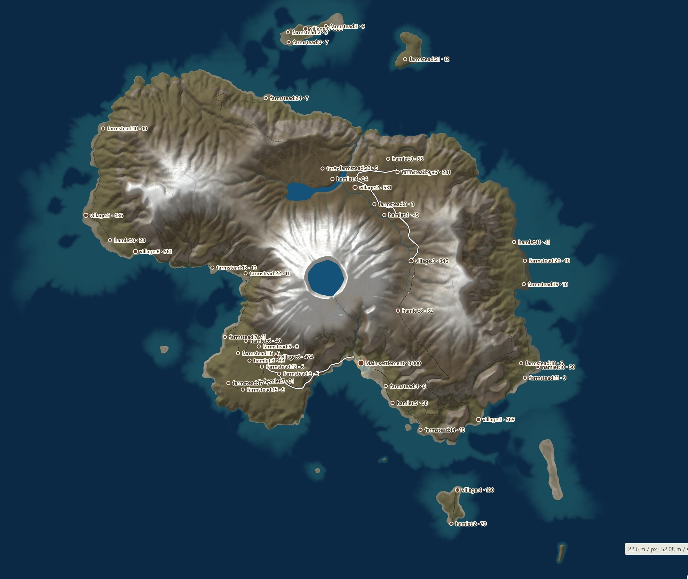
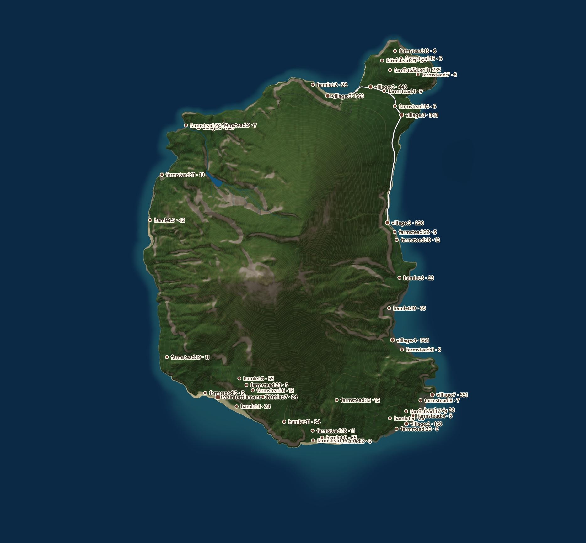
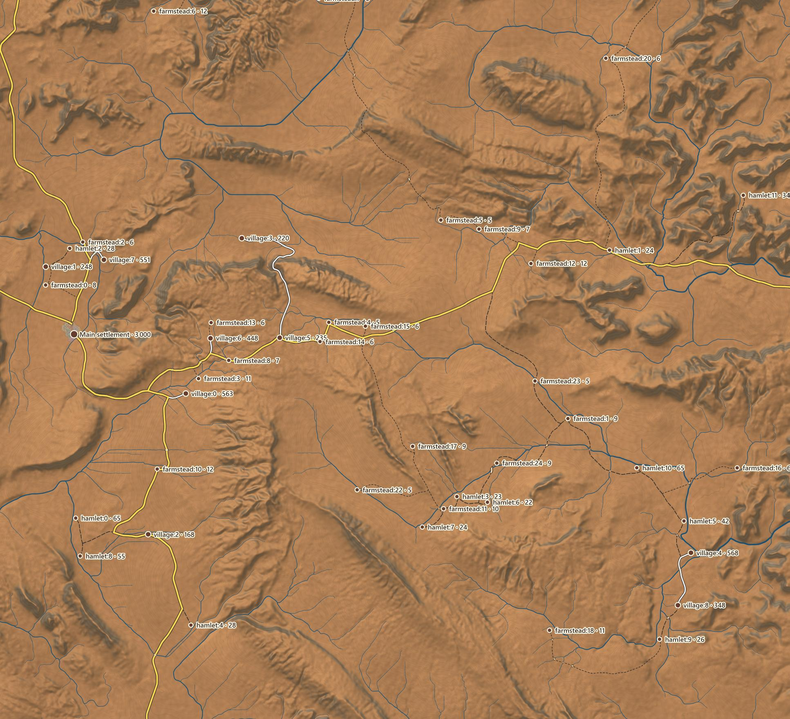
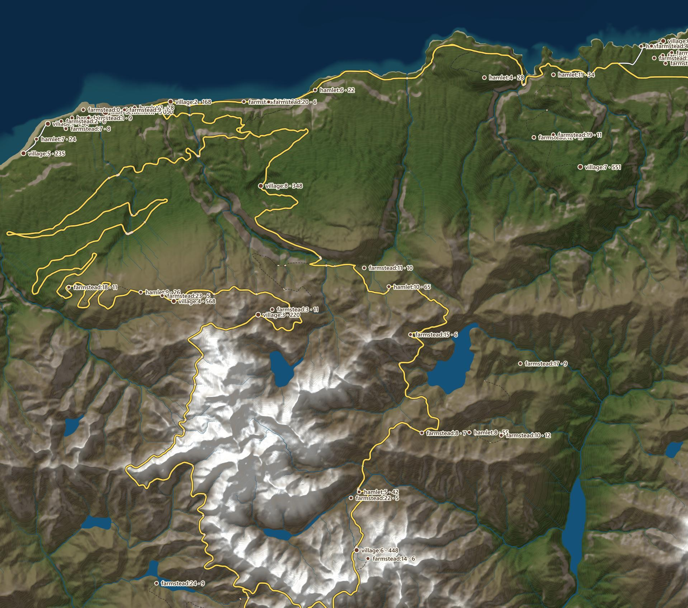
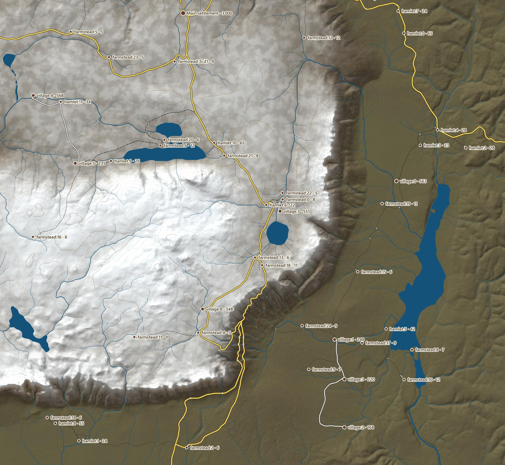

# Magna Urbis

<p align="center">
  
</p>

DEMO: https://dunkean.github.io/magna-urbis/

PREVIEW Magna Urbis V2 (gallery of every culture, village and town, 2D and 3D): https://dunkean.github.io/magna-urbis/gallery/v2/

**Magna Urbis is inspired by [TownGeneratorOS by Watabou (Oleg Dolya)](https://github.com/watabou/TownGeneratorOS) and his [Medieval Fantasy City Generator](https://watabou.itch.io/medieval-fantasy-city-generator).** The project began as a Python port of TownGeneratorOS; that prototype has since been retired, and the TypeScript and Rust implementations continue the exploration.

**Work in progress. Alpha. Prototype.** Magna Urbis generates pre-modern settlements and their surrounding landscapes for maps and tabletop role-playing games. Its output, performance and interfaces are still evolving. This is an experimental project, not a finished application.

There are two implementations: **TypeScript**, currently the most complete, and **Rust / WebAssembly**, which is still behind in features but is gradually catching up.

**The Rust version is actively being implemented.** Its dedicated benches already expose terrain, erosion, hydrology, settlement placement, regional roads, streets, blocks and parcels. A separate Rust house generator is also under development; assembling these stages into the complete application is ongoing.

Read the [technical and scientific overview (in French)](docs/TECHNICAL_AND_SCIENTIFIC_OVERVIEW.md) for the generation pipeline, InfiniteDiffusion / Terrain Diffusion, erosion, rivers and lakes, urban plans, and the Rust / WASM / neural-network stack. It includes research citations, source-code links and the current implementation boundaries.

The long-term goal is to **integrate Magna Urbis into [Neural Earth](https://github.com/dunkean/neural-earth)**, the procedural world project developed in Infinite Map, placing cities and villages within a regional and planetary landscape. This integration is planned for the future and has not been delivered yet.

## TypeScript prototype screenshots

Actual captures from the TypeScript application: three cities of 30,000 inhabitants and a village of 600. They show different urban layouts and the **Parchment** and **Atlas** map styles, including the prototype's current imperfections.

### Medieval city - Parchment


### Desert medina - Atlas


### Planned Chinese city - Atlas


### Village and countryside - Parchment


The [capture seeds, settings and views](docs/images/screenshots.json) let you reproduce these examples with the corresponding version. Rust does not generate these cities yet.

## A first look at the Rust landscapes

**The next chapter of Magna Urbis is taking shape.** From tropical islands to snow-covered volcanic craters, the Rust prototype is already exploring landscapes for future settlements and adventures. These five captures show its current terrain renders, with coastlines, rivers, lakes, settlement locations and regional routes.

### Snow-covered volcanic island



| Tropical island | Arid hills |
| --- | --- |
|  |  |
| **Mountains by the ocean** | **Cold plateau** |
|  |  |

These are snapshots of the Rust prototype in development. Detailed towns and buildings are the next part of the picture as the terrain and urban stages come together. See the [Rust engine documentation](rust/README.md) for its current status.

## TypeScript and Rust

| | TypeScript - `web/` | Rust / WASM - `rust/` |
| --- | --- | --- |
| Status | Most complete prototype and reference application | New engine under development |
| Landscape | Relief, biomes, coasts, rivers, lakes and rural land use | Relief, erosion, coasts, lakes and river networks |
| Settlements | Hamlets, villages and cities; quarters, streets, plots, buildings and landmarks | Settlement placement, regional roads, urban footprints, street fabrics, blocks and parcels in Terrain / Urban Bench |
| Interface | Interactive map, settings, seeds, sharing and SVG / PNG / JSON exports | Browser integration in progress |
| Computation | TypeScript in the browser, without a generation server | Rust compiled to WebAssembly, with WebGPU paths for selected stages |

TypeScript explores organic street patterns, bastides, medinas, Chinese and Japanese plans, and fantasy cultures. Cultures can be combined through successive growth phases. Large populations and progressive detail remain experimental.

Rust is gradually taking over generation responsibilities. Performance and precision still depend on calculation grids, terrain and the browser's CPU/GPU capabilities. It is not yet a complete replacement for TypeScript.

The current interface is intended to be retained. The existing renderer is a temporary integration aid; the future rendering engine remains to be developed.

## Run the TypeScript application

Requirements: a recent Node.js LTS release and npm.

```sh
cd web
npm ci
npm run dev
```

Open the address printed by Vite, usually **http://localhost:5173/**. Choose the environment, then the settlements, their populations and cultures. Generate the map and explore it by zooming. The same seed and settings reproduce a generation within the same engine version.

```sh
npm run build
```

The build produces `web/dist/index.html`, a self-contained page that can run offline. TypeScript development and builds do not require Rust.

In **Share & export**, choose the SVG / PNG layers independently: relief, water, vegetation and fields, buildings and town grounds, town streets, regional roads, names, and decoration. Presets export the complete map, town only, relief only, or roads and streets only. Disable **Paper background** for transparent overlays; the relief image itself remains opaque. These choices affect downloads without regenerating the map. JSON exports retain all world data.

SVG and PNG exports open a crop preview: draw a rectangle, drag it to move it, or enter its position and dimensions in meters. Choose **Carte entière** to reset the selection, then **Exporter** to download it. Rectangular exports keep their proportions, with a longest edge of 3000 px (4096 px for Fantasy exports in Terrain Bench and Urban Bench).

## Illustrate the current view

The **✦ Illustrer** button captures the current view in the TypeScript application,
Terrain / Settlements Bench, City Bench and the urban workshop. Choose **Local · FLUX · édition** (the default), **Local · SDXL · ControlNet**,
or **API externe**, then a style (including automatic inheritance from the map),
fidelity and optional instructions. Results include a comparison slider, a local
history, PNG downloads and a JSON recipe containing the actual model, seed,
controls and provenance. Illustrations do not change the generated world.

**Description et prompt** previews the prose sent to the selected model before
generation: camera angle, settlement scale and culture, relief, climate/biome,
and known visible roof forms, storeys and construction materials. The cloud edit
instruction explicitly treats the screenshot as the primary reference and asks
to restyle the same scene while retaining its layout and details. Context JSON
stays in the connector and recipe; it is compiled into prose for the model.
SDXL encodes the complete caption in CLIP-sized chunks instead of silently
discarding the end. Local captions put the style and concrete subject first,
including the camera view, settlement population, cultural tradition and broad
historical period, followed by relief and climate/biome.
3D captures measure the actual downward angle and height above the target;
orthographic maps describe a vertical view and map extent without inventing an
altitude from zoom. An explicit house era takes precedence over the cultural
preset's broad period.
Snow and weather are not inferred from the cultural preset alone.
The default style follows the visible layer; cadastre, parchment, geographic map,
satellite, fine art and other presets can restyle the same frozen reference image.
**Modifier le prompt** opens the complete editable text. Edited drafts are kept
for each combination of engine/style/fidelity/instructions during the session;
**Revenir au template** restores the automatic template. The recipe records the
exact edited prompt. Long overrides are validated, never silently truncated.
**Illustration PNG** opens **Save As** with a `.png` filename where supported.
Otherwise it downloads the complete original PNG and points to the browser's
download list (Ctrl+J) to locate the file. Cancelling Save As creates no file.

Install the optional connector once, from `web/` (Python 3.12 and a CUDA-compatible
NVIDIA GPU are required for the built-in local models):

```sh
npm run illustration:setup
npm run illustration:serve
```

`npm run dev:local` and `npm run app:dev` start the connector automatically when
its environment exists, as do `start-terrainbench.bat`, `npm run start:benches`
and `start-terrainbench.sh`. The bench stop command also stops its illustration
connector. The connector listens only on `127.0.0.1:8794`; keep it
running when using the ordinary web build or a deployed static page. The advanced
settings let you change its loopback address. The first local generation downloads
model weights into the standard Hugging Face cache and takes longer than later
generations. Weights are external assets, not bundled into the web application.

- **SDXL:** complete SDXL Base 1.0 with Xinsir Union ControlNet, 20/30/40/50 steps,
  editable CFG and negative prompt. By default only the structural guides constrain
  synthesis. Optionally start from the color capture with editable image-to-image
  transformation strength to retain more source forms and colors. This can also
  preserve placeholder cubes; use guides alone for more architectural freedom.
  Changing this starting point reuses the loaded weights. Lightning
  remains available with its matching 4- or 8-step checkpoint for quick previews.
- **FLUX:** [FLUX.2 Klein Base 4B](https://huggingface.co/black-forest-labs/FLUX.2-klein-base-4B),
  a complete local image editor with 20/30/40/50 steps, real CFG and an editable
  negative prompt. The distilled [four-step version](https://huggingface.co/black-forest-labs/FLUX.2-klein-4B)
  remains available with fixed CFG. Choose a color capture, capture + contours,
  capture + depth, or contours alone as visual references. Capture + contours
  reinforces the road/block layout; capture + depth reinforces volumes. These
  are image references, not FLUX ControlNets. No API call is made. New sessions
  use the complete model, 30 steps, 1 MP and capture + contours. Saved preferences
  are retained. The panel checks the connector before submitting a capture.
- **API:** [OpenAI GPT Image edits](https://developers.openai.com/api/docs/guides/image-generation)
  or [Gemini Image](https://ai.google.dev/gemini-api/docs/image-generation), using the captured image and its
  factual scene description. Enter a private API key for the current session, or
  set `OPENAI_API_KEY` / `GEMINI_API_KEY` in the connector environment. Keys are never
  saved in browser preferences, recipes or local image history. The provider bills
  requests made with that key. Cancelling an already transmitted request cannot
  guarantee that the provider stops or refunds it.

3D captures include a camera-aligned depth guide with visible building geometry,
normalized over the visible scene (near geometry is light, sky is black).
2D views use structural contours where available, with Canny extraction as the
fallback. Automatic control combines depth and edges with SDXL when depth is
available. **Contrôles du modèle** exposes separate weights and start/end fractions
for each SDXL guide, plus guide resolution and four presets. The balanced preset
uses contours at 0.3 until 45% of denoising and depth at 0.6 until 70%, leaving late
steps free to resolve facades and materials. Increasing control duration/weight
improves structural adherence but can preserve the source's placeholder cubes;
reducing it can alter the plan. FLUX exposes reference and guide resolution instead.
**Aperçu des guides / références** shows the actual preprocessed images before
generation without creating an image job. Recipes record all effective settings.
Local prompts
prioritize visible content, cultural architecture and the requested art style,
without repeating technical altitude ranges or unrelated native recipe pack names.
Strong fidelity remains a generative constraint, not a
guarantee of geometrically exact output. Seed reproducibility also depends on
runtime, hardware and model versions. Cloud output may use the provider's nearest
supported aspect ratio.

Generated images and metadata are stored outside Git under
`%LOCALAPPDATA%/MagnaUrbis/illustrations` on Windows, or
`~/.local/share/MagnaUrbis/illustrations` elsewhere. Override with
`MAGNA_ILLUSTRATION_OUTPUT`. `MAGNA_ILLUSTRATION_PYTHON` selects a separate Python
interpreter; it should not upgrade the terrain inference environment. The current
local model stays in memory between generations, including after long pauses.
Weights are released when switching model/checkpoint, recovering from GPU memory
exhaustion, or stopping the connector. FLUX still stages modules between CPU
and GPU to fit VRAM; this does not reload the model files from disk.
Model licenses remain separate: Lightning
is OpenRAIL++, while FLUX.2 Klein 4B and the selected ControlNets are Apache 2.0.

The build-free client in `illustration/web/` and the versioned Python job service
are shared with Neural Earth. Verification: `npm run illustration:test`,
`npx vitest run tests/illustration.test.ts`, and `node scripts/illustration_smoke.mjs`
with the local benches running and the City Bench decor catalogue present.
`MAGNA_ILLUSTRATION_BENCH` selects the bench origin. The browser smoke simulates
provider responses; it does not make paid API calls. The focused WebGL test is
`node scripts/illustration_depth_smoke.mjs`. With Neural Earth running,
`NEURAL_EARTH_URL=http://127.0.0.1:8765` selects the server for
`node scripts/illustration_neural_smoke.mjs` and `node scripts/illustration_panel_smoke.mjs`.
`node scripts/illustration_main_smoke.mjs` checks the TypeScript application and
its HUD/minimap exclusion.
`node scripts/illustration_city_layers_smoke.mjs` checks the stacked GPU/2D city
canvases and Canvas fallback. `node scripts/illustration_city_smoke.mjs` verifies
native roofs in the real City Bench, using the existing native-house fixture and
the decor catalogue. Native raster views derive Canny from the complete capture.
`node scripts/illustration_prompt_smoke.mjs` checks the live prose preview and
explicit cloud editing instruction without starting an image job.
The opt-in `python -m illustration.tests.smoke_real --mode fast` runs a real GPU
job through the connector; `--depth path.png --control both` exercises dual
conditioning, `--variant base --steps 30` selects complete SDXL, and
`--mode quality --reference source+edges` tests complete FLUX.2 Klein editing.

## Develop the Rust engine

Install the toolchain pinned in `rust/rust-toolchain.toml`, the `wasm32-unknown-unknown` target and `wasm-pack`. On Windows, install the Visual Studio C++ build tools and Windows SDK.

After installing npm dependencies, run these commands from `web/`:

```sh
npm run wasm:terrain   # Compile the WebAssembly module
npm run check:terrain  # Check Rust code and WASM compilation
```

Generated modules stay in `rust/pkg/wasm/`, which Git ignores. See the [Rust README](rust/README.md) for the engine's organization.

The terrain bench also supports **neural relief** through a local native Rust service using Burn and Terrain Diffusion's coarse → base → decoder models. Start it from `web/` with `npm run neural:serve`. This optional source requires model weights and a compatible GPU; it is separate from the serverless TypeScript application. Magna Urbis's browser neural-inference crate remains experimental and is not connected to the bench. See the [execution paths and limitations](docs/TECHNICAL_AND_SCIENTIFIC_OVERVIEW.md#7-rust-webassembly-webgpu-et-inférence-neuronale).

## Repository layout

```text
web/src/gen/      TypeScript generation
web/src/render/   Current SVG and Canvas rendering
web/src/ui/       Interface and workers
web/tests/        TypeScript tests
web/scripts/      Captures and verification tools
rust/crates/core/ Rust engine without browser dependencies
rust/crates/wasm/ WebAssembly bindings
rust/bridge/      Temporary interface and rendering adapters
rust/scripts/     Rust development commands
docs/images/     README screenshots and reproduction settings
docs/rust_images/ Rust prototype landscape screenshots
```

## Contributing

From `web/`, use `npm run typecheck`, `npm run test:fast` and `npm run build` to check changes. `npm test` also includes the exhaustive city and culture matrix and can take several dozen minutes.

When reporting a problem, include the version, seed, settings and shared link, with a screenshot if possible. The application supports pins and copying a bug report. Formats, results and generation links may change during this alpha.

## Credits and license

Thank you to **Watabou** for TownGeneratorOS and Medieval Fantasy City Generator, the starting point for this project and an ongoing reference.

Magna Urbis is distributed under the **GNU GPL v3**; see [LICENSE](LICENSE). The earlier Python port of TownGeneratorOS has been removed from the repository; it remains available in the Git history. Third-party resources and dependencies retain their own license and provenance notices.
