# Catalogue architectural — 79 cultures

Le catalogue suit les cultures proposées par le moteur. Chaque culture combine un plan, des recettes de quartiers et des paramètres architecturaux. Les planches sont des schémas de lecture : à gauche le principe de trame, à droite une maison du pack natif avec ses proportions, niveaux et toiture. Plusieurs cultures peuvent partager un pack de maisons tout en ayant des trames, lots et densités différents. Les réglages chiffrés proviennent du catalogue du projet.

[Atlas des méthodes](scientific/fr.html) · [Catalogue illustré](scientific/catalogue-architecture.html)

Source : `rust/crates/core/src/urban/catalogue.json`.

## Medieval organic (Europe) (`european-organic`)

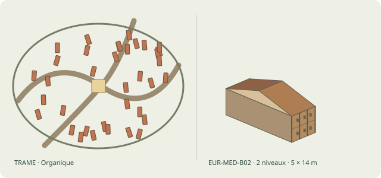

Plan : Organique · Maison illustrée : Maison mitoyenne étroite · Recette native : EUR-MED-B02 · Agencement : strip · Toiture native : RF-GABLE · Structure : post_beam · Étages : 1–3 · Dimensions : 4–6 m × 10–18 m · Famille architecturale : EUR-MED · Parcellaire : burgage · Bâti urbain : streetFrontRow · Matériau porteur : MAT-TIMBER-POST · Remplissage : MAT-WATTLE-DAUB · Couverture : MAT-TILE-CLAY

Le plan organique s’organise autour du noyau « market », de forme hull. Enceinte : organic ; fortification : auto ; orientation : road.

Détails : Façade courte sur rue, profondeur forte, 1–3 niveaux ; Bois et terre, pierre ou brique ; Deux pans, souvent faîtage perpendiculaire à rue

Recettes : european-organic/core, european-organic/ring, european-organic/faubourg, european-organic/village, european-organic/hamlet

## Bastide (planned grid) (`bastide`)

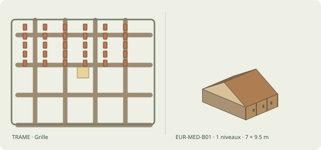

Plan : Grille · Maison illustrée : Chaumière rectangulaire · Recette native : EUR-MED-B01 · Agencement : single · Toiture native : RF-GABLE · Structure : post_beam · Étages : 1–1 · Dimensions : 5–9 m × 7–12 m · Famille architecturale : EUR-MED · Parcellaire : burgage · Bâti urbain : streetFrontRow · Matériau porteur : MAT-TIMBER-POST · Remplissage : MAT-WATTLE-DAUB · Couverture : MAT-THATCH

Le plan grille s’organise autour du noyau « market », de forme rect. Enceinte : rect ; fortification : auto ; orientation : road.

Détails : Rectangle 1 niveau, parfois pignon en rue ; Torchis/clayonnage ou moellons ; Deux pans en chaume

Recettes : bastide/core, bastide/faubourg, bastide/village, bastide/hamlet

## Medina (North Africa) (`medina`)

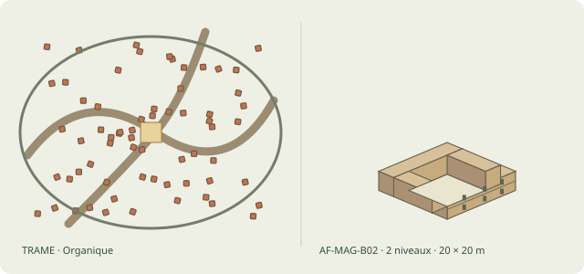

Plan : Organique · Maison illustrée : Dar à patio · Recette native : AF-MAG-B02 · Agencement : courtyard · Toiture native : RF-FLAT · Structure : earth_wall · Étages : 1–2 · Dimensions : 16–24 m × 16–24 m · Famille architecturale : AF-MAG · Parcellaire : burgage · Bâti urbain : shopRow · Matériau porteur : MAT-ADOBE · Remplissage : MAT-ADOBE · Couverture : MAT-MUD-PLASTER

Le plan organique s’organise autour du noyau « mosque », de forme rect. Enceinte : organic ; fortification : wall ; orientation : road.

Détails : Anneau ou U de pièces, patio ouvert ; Maçonnerie/terre et bois ; Terrasse, galeries intérieures

Recettes : medina/core, medina/ring, medina/faubourg, medina/village, medina/hamlet

## Chinese walled city (`chinese`)

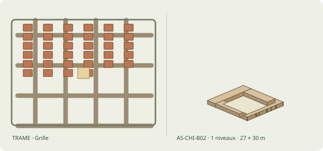

Plan : Grille · Maison illustrée : Siheyuan de cour · Recette native : AS-CHI-B02 · Agencement : siheyuan · Toiture native : RF-GABLE · Structure : post_beam · Étages : 1–1 · Dimensions : 22–32 m × 24–36 m · Famille architecturale : AS-CHI · Parcellaire : siheyuan · Bâti urbain : pavilionCompound · Matériau porteur : MAT-WOOD-MORTISE · Remplissage : MAT-BURNT-BRICK · Couverture : MAT-TILE-CLAY

Le plan grille s’organise autour du noyau « drum-tower », de forme square. Enceinte : square ; fortification : wall ; orientation : cardinal.

Détails : Quatre pavillons en carré autour de cour axiale ; Charpente bois, brique et murs de clôture ; Toits de tuiles à deux pans

Recettes : chinese/core, chinese/ring, chinese/faubourg, chinese/village, chinese/hamlet

## Japanese castle town (jōkamachi) (`japanese-jokamachi`)

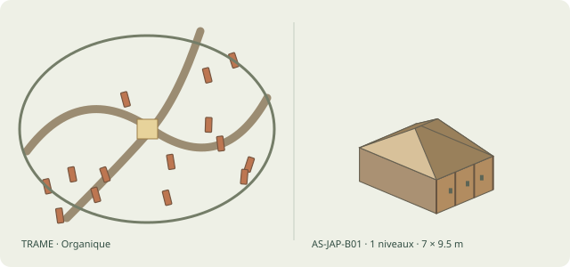

Plan : Organique · Maison illustrée : Maison paysanne bois et chaume · Recette native : AS-JAP-B01 · Agencement : single · Toiture native : RF-REED-HIP · Structure : post_beam · Étages : 1–1 · Dimensions : 5–9 m × 7–12 m · Famille architecturale : AS-JAP · Parcellaire : compound · Bâti urbain : yashiki · Matériau porteur : MAT-WOOD-MORTISE · Remplissage : MAT-WATTLE-DAUB · Couverture : MAT-THATCH

Le plan organique s’organise autour du noyau « castle », de forme square. Enceinte : organic ; fortification : none ; orientation : road.

Détails : Rectangle 1 niveau, annexes ; Poteaux bois, torchis/tressage ; Grand toit deux pans ou croupe végétale

Recettes : japanese-jokamachi/core, japanese-jokamachi/ring, japanese-jokamachi/faubourg, japanese-jokamachi/village, japanese-jokamachi/hamlet

## Indian temple town (`indian-temple`)

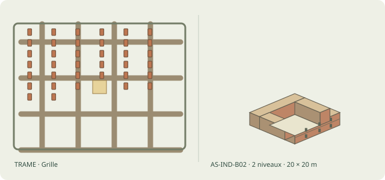

Plan : Grille · Maison illustrée : Maison harappéenne en brique · Recette native : AS-IND-B02 · Agencement : courtyard · Toiture native : RF-FLAT · Structure : masonry · Étages : 1–2 · Dimensions : 16–24 m × 16–24 m · Famille architecturale : AS-IND · Parcellaire : burgage · Bâti urbain : streetFrontRow · Matériau porteur : MAT-BURNT-BRICK · Remplissage : MAT-BURNT-BRICK · Couverture : MAT-MUD-PLASTER

Le plan grille s’organise autour du noyau « temple », de forme square. Enceinte : square ; fortification : none ; orientation : cardinal.

Détails : Pièces fermées autour de petite cour ; Brique cuite et crue ; Terrasse/structure bois, évacuation des eaux

Recettes : indian-temple/core, indian-temple/ring, indian-temple/faubourg, indian-temple/village, indian-temple/hamlet

## Roman castrum core (`roman-core`)

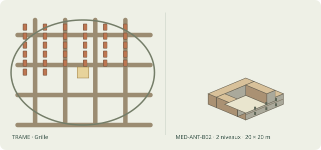

Plan : Grille · Maison illustrée : Domus à atrium · Recette native : MED-ANT-B02 · Agencement : atrium · Toiture native : RF-GABLE · Structure : masonry · Étages : 1–2 · Dimensions : 16–24 m × 16–24 m · Famille architecturale : MED-ANT · Parcellaire : courtyard · Bâti urbain : courtyardHouse · Matériau porteur : MAT-STONE-MORTAR · Remplissage : MAT-STONE-MORTAR · Couverture : MAT-TILE-CLAY

Le plan grille s’organise autour du noyau « forum », de forme rect. Enceinte : rounded-rect ; fortification : wall ; orientation : road. Le front d’eau participe à la composition.

Détails : Enveloppe presque carrée, cour intérieure éclairante ; Murs de maçonnerie, poteaux et colonnades ; Pans de tuiles inclinés vers impluvium

Recettes : roman-core/core, roman-core/ring, roman-core/faubourg, roman-core/village, roman-core/hamlet

## Elven forest town (`elven`)

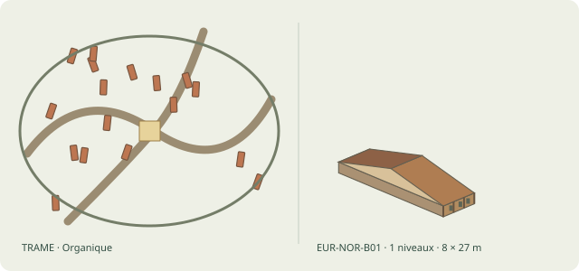

Plan : Organique · Maison illustrée : Maison longue nordique · Recette native : EUR-NOR-B01 · Agencement : single · Toiture native : RF-GABLE · Structure : post_beam · Étages : 1–1 · Dimensions : 6–10 m × 18–36 m · Famille architecturale : EUR-NOR · Parcellaire : compound · Bâti urbain : treeHouse · Matériau porteur : MAT-TIMBER-POST · Remplissage : MAT-WATTLE-DAUB · Couverture : MAT-TURF

Le plan organique s’organise autour du noyau « grove », de forme circle. Enceinte : organic ; fortification : hedge ; orientation : road.

Détails : Très long rectangle à allée ou foyer longitudinal ; Poteaux et bois, solins pierre possibles ; Grand toit deux pans de chaume/tourbe

Recettes : elven/core, elven/ring, elven/village, elven/hamlet

## Dwarven hold (`dwarven`)

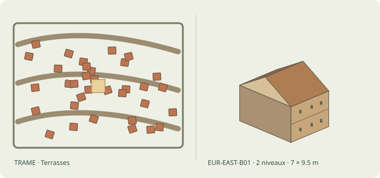

Plan : Terrasses · Maison illustrée : Isba/maison forestière en rondins · Recette native : EUR-EAST-B01 · Agencement : single · Toiture native : RF-GABLE · Structure : log · Étages : 1–2 · Dimensions : 5–9 m × 7–12 m · Famille architecturale : EUR-EAST · Parcellaire : burgage · Bâti urbain : hall · Matériau porteur : MAT-LOG · Remplissage : MAT-LOG · Couverture : MAT-WOOD-SHINGLES

Le plan terrasses s’organise autour du noyau « none », de forme rect. Enceinte : rect ; fortification : wall ; orientation : terrain. Les escaliers accompagnent les différences de niveau.

Détails : Rectangle, 1–2 niveaux avec porche ; Troncs croisés et solin de pierre ; Double pente en bardeaux

Recettes : dwarven/core, dwarven/faubourg, dwarven/village, dwarven/hamlet

## Necropolis (city of the dead) (`necropolis`)

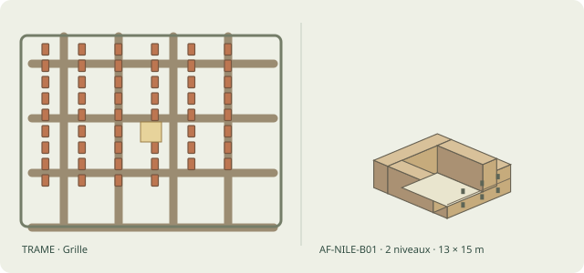

Plan : Grille · Maison illustrée : Maison égyptienne en adobe · Recette native : AF-NILE-B01 · Agencement : courtyard · Toiture native : RF-FLAT · Structure : earth_wall · Étages : 1–2 · Dimensions : 10–16 m × 12–18 m · Famille architecturale : AF-NILE · Parcellaire : courtyard · Bâti urbain : tomb · Matériau porteur : MAT-ADOBE · Remplissage : MAT-ADOBE · Couverture : MAT-MUD-PLASTER

Le plan grille s’organise autour du noyau « mortuary », de forme rect. Enceinte : rect ; fortification : wall ; orientation : cardinal.

Détails : Rectangle mitoyen, 1–2 niveaux, cour ; Briques crues enduites, bois rare ; Toit plat de poutres et terre

Recettes : necropolis/core, necropolis/ring, necropolis/village, necropolis/hamlet

## Russian kremlin and posad (`russian-kremlin`)

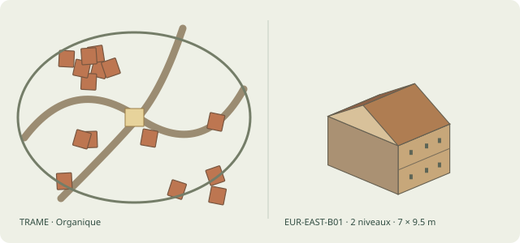

Plan : Organique · Maison illustrée : Isba/maison forestière en rondins · Recette native : EUR-EAST-B01 · Agencement : single · Toiture native : RF-GABLE · Structure : log · Étages : 1–2 · Dimensions : 5–9 m × 7–12 m · Famille architecturale : EUR-EAST · Parcellaire : burgage · Bâti urbain : yardHouse · Matériau porteur : MAT-LOG · Remplissage : MAT-LOG · Couverture : MAT-WOOD-SHINGLES

Le plan organique s’organise autour du noyau « market », de forme hull. Enceinte : organic ; fortification : palisade ; orientation : road.

Détails : Rectangle, 1–2 niveaux avec porche ; Troncs croisés et solin de pierre ; Double pente en bardeaux

Recettes : russian-kremlin/core, russian-kremlin/ring, russian-kremlin/faubourg, russian-kremlin/village, russian-kremlin/hamlet

## Aztec city (Tenochtitlan) (`aztec`)

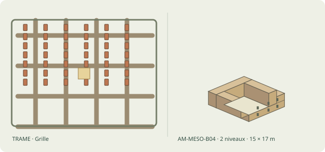

Plan : Grille · Maison illustrée : Maison urbaine en adobe · Recette native : AM-MESO-B04 · Agencement : courtyard · Toiture native : RF-FLAT · Structure : earth_wall · Étages : 1–2 · Dimensions : 12–18 m × 14–20 m · Famille architecturale : AM-MESO · Parcellaire : courtyard · Bâti urbain : courtyardHouse · Matériau porteur : MAT-ADOBE · Remplissage : MAT-ADOBE · Couverture : MAT-MUD-PLASTER

Le plan grille s’organise autour du noyau « precinct », de forme square. Enceinte : square ; fortification : none ; orientation : cardinal. Le front d’eau participe à la composition.

Détails : Petits rectangles jointifs et patios ; Brique crue et pierre ; Toits plats ou faible pente

Recettes : aztec/core, aztec/ring, aztec/faubourg, aztec/village, aztec/hamlet

## Inca city (Cusco) (`inca`)

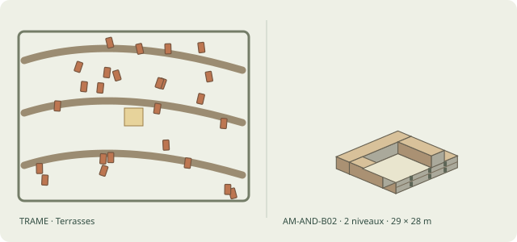

Plan : Terrasses · Maison illustrée : Kancha inca · Recette native : AM-AND-B02 · Agencement : kancha · Toiture native : RF-GABLE · Structure : masonry · Étages : 1–2 · Dimensions : 22–36 m × 22–34 m · Famille architecturale : AM-AND · Parcellaire : courtyard · Bâti urbain : kancha · Matériau porteur : MAT-STONE-DRY · Remplissage : MAT-STONE-DRY · Couverture : MAT-THATCH

Le plan terrasses s’organise autour du noyau « ushnu », de forme rect. Enceinte : rect ; fortification : none ; orientation : terrain. Les escaliers accompagnent les différences de niveau.

Détails : Enclos rectangulaire avec 3–8 bâtiments orientés vers cour ; Pierre ou adobe, portes à encadrement trapézoïdal ; Toits à deux pans de chaume sur corps séparés

Recettes : inca/core, inca/ring, inca/faubourg, inca/village, inca/hamlet

## Byzantine hill town (Mystras) (`byzantine-greek`)

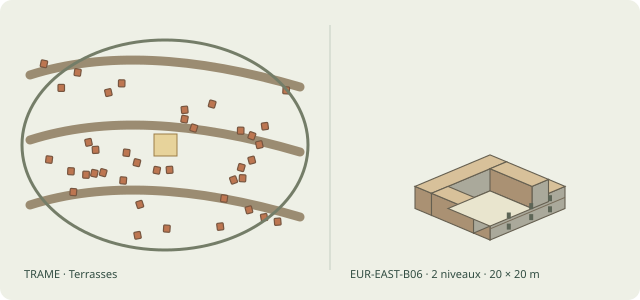

Plan : Terrasses · Maison illustrée : Maison urbaine byzantine · Recette native : EUR-EAST-B06 · Agencement : courtyard · Toiture native : RF-GABLE · Structure : masonry · Étages : 1–2 · Dimensions : 16–24 m × 16–24 m · Famille architecturale : EUR-EAST · Parcellaire : burgage · Bâti urbain : streetFrontRow · Matériau porteur : MAT-STONE-MORTAR · Remplissage : MAT-STONE-MORTAR · Couverture : MAT-TILE-CLAY

Le plan terrasses s’organise autour du noyau « market », de forme hull. Enceinte : organic ; fortification : auto ; orientation : road. Les escaliers accompagnent les différences de niveau.

Détails : Rectangle avec cour et loggia ; Maçonnerie mixte, bois de planchers ; Tuiles canal, volumes dissociés

Recettes : byzantine-greek/core, byzantine-greek/ring, byzantine-greek/faubourg, byzantine-greek/village, byzantine-greek/hamlet

## Venetian lagoon town (`venetian-lagoon`)

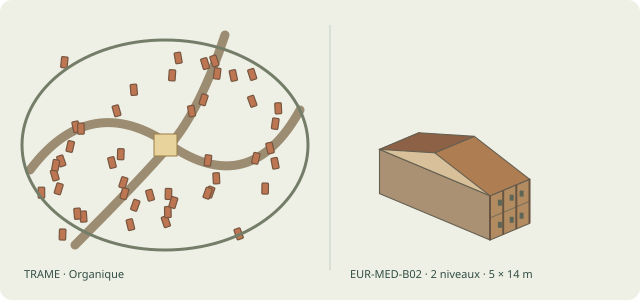

Plan : Organique · Maison illustrée : Maison mitoyenne étroite · Recette native : EUR-MED-B02 · Agencement : strip · Toiture native : RF-GABLE · Structure : post_beam · Étages : 1–3 · Dimensions : 4–6 m × 10–18 m · Famille architecturale : EUR-MED · Parcellaire : burgage · Bâti urbain : venetian · Matériau porteur : MAT-TIMBER-POST · Remplissage : MAT-WATTLE-DAUB · Couverture : MAT-TILE-CLAY

Le plan organique s’organise autour du noyau « market », de forme rect. Enceinte : organic ; fortification : none ; orientation : road. Le front d’eau participe à la composition.

Détails : Façade courte sur rue, profondeur forte, 1–3 niveaux ; Bois et terre, pierre ou brique ; Deux pans, souvent faîtage perpendiculaire à rue

Recettes : venetian-lagoon/core, venetian-lagoon/ring, venetian-lagoon/faubourg, venetian-lagoon/village, venetian-lagoon/hamlet

## Persian city (Isfahan) (`persian`)

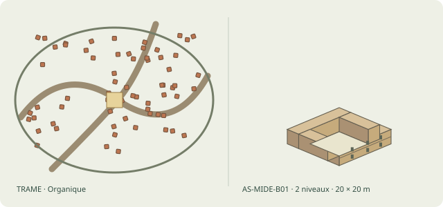

Plan : Organique · Maison illustrée : Maison levantine à cour · Recette native : AS-MIDE-B01 · Agencement : courtyard · Toiture native : RF-FLAT · Structure : earth_wall · Étages : 1–2 · Dimensions : 16–24 m × 16–24 m · Famille architecturale : AS-MIDE · Parcellaire : burgage · Bâti urbain : shopRow · Matériau porteur : MAT-ADOBE · Remplissage : MAT-ADOBE · Couverture : MAT-MUD-PLASTER

Le plan organique s’organise autour du noyau « maidan », de forme rect. Enceinte : organic ; fortification : wall ; orientation : road.

Détails : Bloc rectangulaire 1–2 niveaux, patio ; Pierre/terre/enduit ; Toit plat, galerie ombragée

Recettes : persian/core, persian/ring, persian/faubourg, persian/village, persian/hamlet

## Ottoman town (Bursa) (`ottoman`)

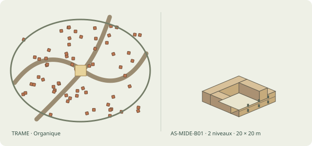

Plan : Organique · Maison illustrée : Maison levantine à cour · Recette native : AS-MIDE-B01 · Agencement : courtyard · Toiture native : RF-FLAT · Structure : earth_wall · Étages : 1–2 · Dimensions : 16–24 m × 16–24 m · Famille architecturale : AS-MIDE · Parcellaire : burgage · Bâti urbain : shopRow · Matériau porteur : MAT-ADOBE · Remplissage : MAT-ADOBE · Couverture : MAT-MUD-PLASTER

Le plan organique s’organise autour du noyau « market », de forme hull. Enceinte : organic ; fortification : none ; orientation : road.

Détails : Bloc rectangulaire 1–2 niveaux, patio ; Pierre/terre/enduit ; Toit plat, galerie ombragée

Recettes : ottoman/core, ottoman/ring, ottoman/faubourg, ottoman/village, ottoman/hamlet

## Sahelian mud town (Djenne) (`sahel`)

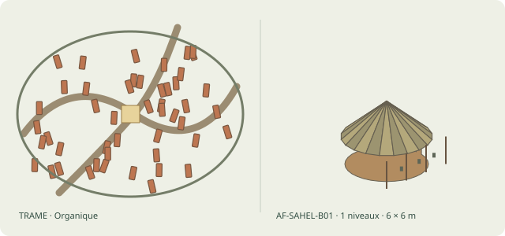

Plan : Organique · Maison illustrée : Hutte sahélienne ronde · Recette native : AF-SAHEL-B01 · Agencement : single · Toiture native : RF-CONE · Structure : post_beam · Étages : 1–1 · Dimensions : 4–8 m × 4–8 m · Famille architecturale : AF-SAHEL · Parcellaire : courtyard · Bâti urbain : courtyardHouse · Matériau porteur : MAT-TIMBER-POST · Remplissage : MAT-WATTLE-DAUB · Couverture : MAT-THATCH

Le plan organique s’organise autour du noyau « mud-mosque », de forme rect. Enceinte : organic ; fortification : none ; orientation : road.

Détails : Disque à cour adjacente, 1 niveau ; Terre, poteaux et enduits ; Toit conique de chaume

Recettes : sahel/core, sahel/ring, sahel/faubourg, sahel/village, sahel/hamlet

## Hanseatic port (Lubeck) (`hanseatic`)

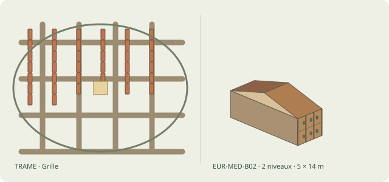

Plan : Grille · Maison illustrée : Maison mitoyenne étroite · Recette native : EUR-MED-B02 · Agencement : strip · Toiture native : RF-GABLE · Structure : post_beam · Étages : 1–3 · Dimensions : 4–6 m × 10–18 m · Famille architecturale : EUR-MED · Parcellaire : burgage · Bâti urbain : giebelhaus · Matériau porteur : MAT-TIMBER-POST · Remplissage : MAT-WATTLE-DAUB · Couverture : MAT-TILE-CLAY

Le plan grille s’organise autour du noyau « market », de forme rect. Enceinte : organic ; fortification : auto ; orientation : water. Le front d’eau participe à la composition.

Détails : Façade courte sur rue, profondeur forte, 1–3 niveaux ; Bois et terre, pierre ou brique ; Deux pans, souvent faîtage perpendiculaire à rue

Recettes : hanseatic/core, hanseatic/ring, hanseatic/faubourg, hanseatic/village, hanseatic/hamlet

## Korean walled town (Hanyang) (`korean`)

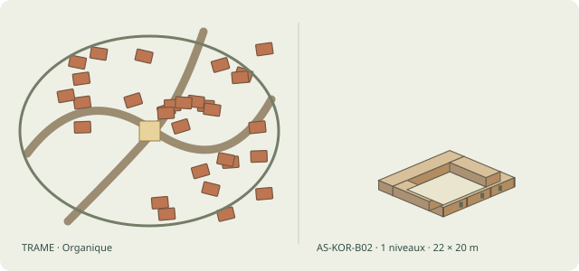

Plan : Organique · Maison illustrée : Hanok à cour · Recette native : AS-KOR-B02 · Agencement : courtyard · Toiture native : RF-EAVES · Structure : post_beam · Étages : 1–1 · Dimensions : 18–26 m × 16–24 m · Famille architecturale : AS-KOR · Parcellaire : burgage · Bâti urbain : hanok · Matériau porteur : MAT-WOOD-MORTISE · Remplissage : MAT-BURNT-BRICK · Couverture : MAT-TILE-CLAY

Le plan organique s’organise autour du noyau « market », de forme rect. Enceinte : organic ; fortification : auto ; orientation : cardinal.

Détails : Ailes en L ou U autour d'un madang ; Ossature bois sur soubassement pierre, terre ; Tuiles ou chaume selon statut

Recettes : korean/core, korean/ring, korean/faubourg, korean/village, korean/hamlet

## Wizard city (`wizard-city`)

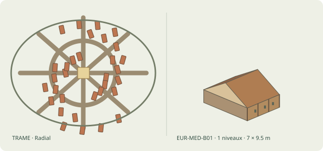

Plan : Radial · Maison illustrée : Chaumière rectangulaire · Recette native : EUR-MED-B01 · Agencement : single · Toiture native : RF-GABLE · Structure : post_beam · Étages : 1–1 · Dimensions : 5–9 m × 7–12 m · Famille architecturale : EUR-MED · Parcellaire : burgage · Bâti urbain : streetFrontRow · Matériau porteur : MAT-TIMBER-POST · Remplissage : MAT-WATTLE-DAUB · Couverture : MAT-THATCH

Le plan radial s’organise autour du noyau « wizard-tower », de forme circle. Enceinte : circle ; fortification : wall ; orientation : cardinal.

Détails : Rectangle 1 niveau, parfois pignon en rue ; Torchis/clayonnage ou moellons ; Deux pans en chaume

Recettes : wizard-city/core, wizard-city/ring, wizard-city/faubourg, wizard-city/village, wizard-city/hamlet

## Gnomish canal town (`gnomish`)

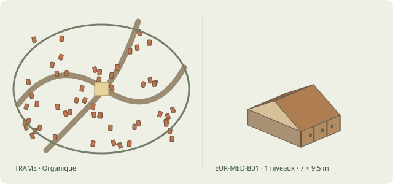

Plan : Organique · Maison illustrée : Chaumière rectangulaire · Recette native : EUR-MED-B01 · Agencement : single · Toiture native : RF-GABLE · Structure : post_beam · Étages : 1–1 · Dimensions : 5–9 m × 7–12 m · Famille architecturale : EUR-MED · Parcellaire : burgage · Bâti urbain : gnome · Matériau porteur : MAT-TIMBER-POST · Remplissage : MAT-WATTLE-DAUB · Couverture : MAT-THATCH

Le plan organique s’organise autour du noyau « clocktower », de forme square. Enceinte : organic ; fortification : auto ; orientation : road. Le front d’eau participe à la composition.

Détails : Rectangle 1 niveau, parfois pignon en rue ; Torchis/clayonnage ou moellons ; Deux pans en chaume

Recettes : gnomish/core, gnomish/ring, gnomish/faubourg, gnomish/village, gnomish/hamlet

## Stilt town (marsh folk) (`stilt-town`)

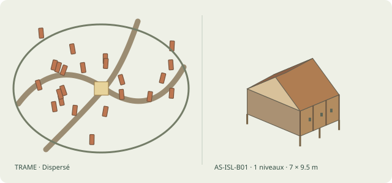

Plan : Dispersé · Maison illustrée : Maison austronésienne sur pilotis · Recette native : AS-ISL-B01 · Agencement : platform · Toiture native : RF-GABLE · Structure : post_beam · Étages : 1–1 · Dimensions : 5–9 m × 7–12 m · Famille architecturale : AS-ISL · Parcellaire : burgage · Bâti urbain : streetFrontRow · Matériau porteur : MAT-TIMBER-POST · Remplissage : MAT-BAMBOO · Couverture : MAT-PALM

Le plan dispersé s’organise autour du noyau « none », de forme circle. Enceinte : circle ; fortification : none ; orientation : road. Le front d’eau participe à la composition.

Détails : Rectangle sur plateforme, 1 étage habitable ; Poteaux bois, bambou, cloisons végétales ; Deux pans très raides en palmes

Recettes : stilt-town/core, stilt-town/village, stilt-town/hamlet

## Barbarian: Germanic village (`barbarian`)

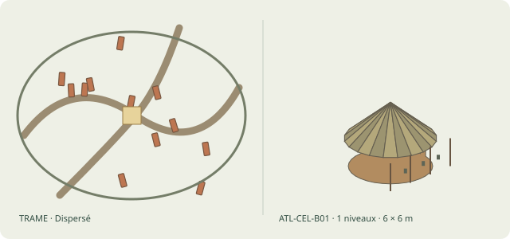

Plan : Dispersé · Maison illustrée : Roundhouse en torchis · Recette native : ATL-CEL-B01 · Agencement : single · Toiture native : RF-CONE · Structure : post_beam · Étages : 1–1 · Dimensions : 4–8 m × 4–8 m · Famille architecturale : ATL-CEL · Parcellaire : burgage · Bâti urbain : streetFrontRow · Matériau porteur : MAT-TIMBER-POST · Remplissage : MAT-WATTLE-DAUB · Couverture : MAT-THATCH

Le plan dispersé s’organise autour du noyau « none », de forme circle. Enceinte : circle ; fortification : none ; orientation : road.

Détails : Disque/ovale simple, 1 niveau ; Poteaux, clayonnage, torchis ; Cône de chaume épais

Recettes : barbarian/core, barbarian/village, barbarian/hamlet, barbarian/grown-core, barbarian/grown-ring, barbarian/grown-faubourg

## Barbarian: Celtic ringfort (`barbarian-celtic`)

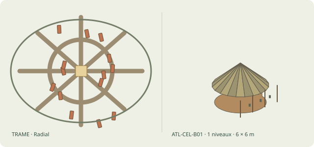

Plan : Radial · Maison illustrée : Roundhouse en torchis · Recette native : ATL-CEL-B01 · Agencement : single · Toiture native : RF-CONE · Structure : post_beam · Étages : 1–1 · Dimensions : 4–8 m × 4–8 m · Famille architecturale : ATL-CEL · Parcellaire : burgage · Bâti urbain : streetFrontRow · Matériau porteur : MAT-TIMBER-POST · Remplissage : MAT-WATTLE-DAUB · Couverture : MAT-THATCH

Le plan radial s’organise autour du noyau « none », de forme circle. Enceinte : circle ; fortification : palisade ; orientation : road.

Détails : Disque/ovale simple, 1 niveau ; Poteaux, clayonnage, torchis ; Cône de chaume épais

Recettes : barbarian-celtic/core, barbarian-celtic/village, barbarian-celtic/hamlet, barbarian-celtic/grown-core, barbarian-celtic/grown-ring, barbarian-celtic/grown-faubourg

## Barbarian: Norse farmstead cluster (`barbarian-norse`)

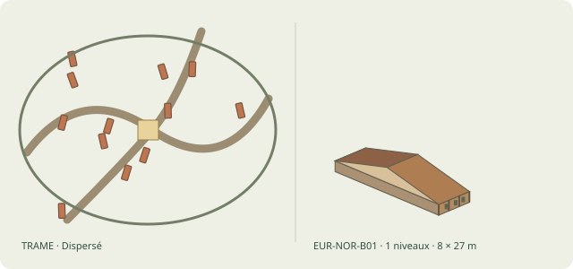

Plan : Dispersé · Maison illustrée : Maison longue nordique · Recette native : EUR-NOR-B01 · Agencement : single · Toiture native : RF-GABLE · Structure : post_beam · Étages : 1–1 · Dimensions : 6–10 m × 18–36 m · Famille architecturale : EUR-NOR · Parcellaire : burgage · Bâti urbain : streetFrontRow · Matériau porteur : MAT-TIMBER-POST · Remplissage : MAT-WATTLE-DAUB · Couverture : MAT-TURF

Le plan dispersé s’organise autour du noyau « none », de forme circle. Enceinte : circle ; fortification : none ; orientation : road.

Détails : Très long rectangle à allée ou foyer longitudinal ; Poteaux et bois, solins pierre possibles ; Grand toit deux pans de chaume/tourbe

Recettes : barbarian-norse/core, barbarian-norse/village, barbarian-norse/hamlet, barbarian-norse/grown-core, barbarian-norse/grown-ring, barbarian-norse/grown-faubourg

## Norse ring fortress (Trelleborg) (`norse-ringfort`)

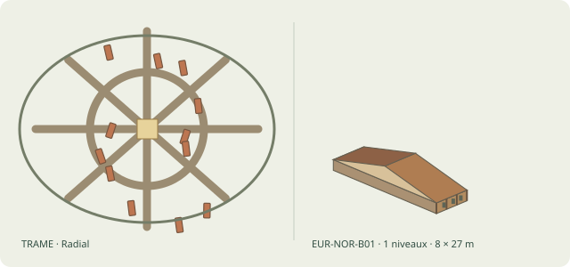

Plan : Radial · Maison illustrée : Maison longue nordique · Recette native : EUR-NOR-B01 · Agencement : single · Toiture native : RF-GABLE · Structure : post_beam · Étages : 1–1 · Dimensions : 6–10 m × 18–36 m · Famille architecturale : EUR-NOR · Parcellaire : burgage · Bâti urbain : streetFrontRow · Matériau porteur : MAT-TIMBER-POST · Remplissage : MAT-WATTLE-DAUB · Couverture : MAT-TURF

Le plan radial s’organise autour du noyau « none », de forme circle. Enceinte : circle ; fortification : palisade ; orientation : road.

Détails : Très long rectangle à allée ou foyer longitudinal ; Poteaux et bois, solins pierre possibles ; Grand toit deux pans de chaume/tourbe

Recettes : norse-ringfort/core, norse-ringfort/village, norse-ringfort/hamlet, norse-ringfort/grown-core, norse-ringfort/grown-ring, norse-ringfort/grown-faubourg

## Maya city (ceremonial core, sacbeob) (`maya`)

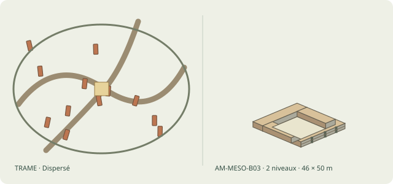

Plan : Dispersé · Maison illustrée : Ensemble résidentiel teotihuacain · Recette native : AM-MESO-B03 · Agencement : multiyard · Toiture native : RF-FLAT · Structure : earth_wall · Étages : 1–2 · Dimensions : 36–56 m × 40–60 m · Famille architecturale : AM-MESO · Parcellaire : burgage · Bâti urbain : streetFrontRow · Matériau porteur : MAT-STONE-MORTAR · Remplissage : MAT-ADOBE · Couverture : MAT-MUD-PLASTER

Le plan dispersé s’organise autour du noyau « none », de forme circle. Enceinte : circle ; fortification : none ; orientation : road.

Détails : Gros rectangle à plusieurs cours et suites de pièces ; Pierre/adobe et enduits peints ; Terrasses plates et volumes composés

Recettes : maya/core, maya/village, maya/hamlet

## Khmer city (Angkor) (`khmer`)

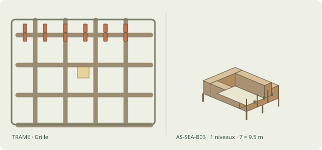

Plan : Grille · Maison illustrée : Maison thaïe/loase sur pilotis · Recette native : AS-SEA-B03 · Agencement : kancha · Toiture native : RF-GABLE · Structure : post_beam · Étages : 1–1 · Dimensions : 5–9 m × 7–12 m · Famille architecturale : AS-SEA · Parcellaire : burgage · Bâti urbain : streetFrontRow · Matériau porteur : MAT-TIMBER-POST · Remplissage : MAT-BAMBOO · Couverture : MAT-PALM

Le plan grille s’organise autour du noyau « none », de forme circle. Enceinte : rect ; fortification : none ; orientation : cardinal.

Détails : Rectangles groupés autour de plateforme ouverte ; Bois sur pilotis, planches ; Grand toit aigu à deux pans, détails régionaux

Recettes : khmer/core, khmer/village, khmer/hamlet

## Celtic oppidum (`celtic-oppidum`)

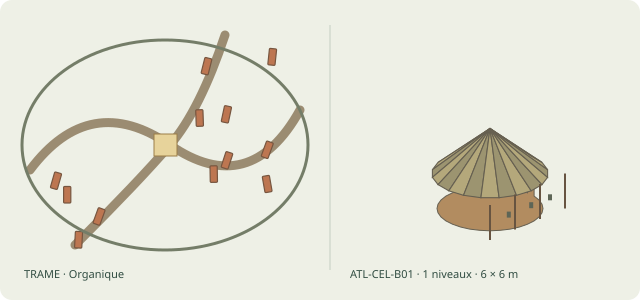

Plan : Organique · Maison illustrée : Roundhouse en torchis · Recette native : ATL-CEL-B01 · Agencement : single · Toiture native : RF-CONE · Structure : post_beam · Étages : 1–1 · Dimensions : 4–8 m × 4–8 m · Famille architecturale : ATL-CEL · Parcellaire : burgage · Bâti urbain : streetFrontRow · Matériau porteur : MAT-TIMBER-POST · Remplissage : MAT-WATTLE-DAUB · Couverture : MAT-THATCH

Le plan organique s’organise autour du noyau « none », de forme circle. Enceinte : organic ; fortification : wall ; orientation : terrain.

Détails : Disque/ovale simple, 1 niveau ; Poteaux, clayonnage, torchis ; Cône de chaume épais

Recettes : celtic-oppidum/core, celtic-oppidum/village, celtic-oppidum/hamlet, celtic-oppidum/grown-core, celtic-oppidum/grown-ring, celtic-oppidum/grown-faubourg

## Orcish war camp (`orcish`)

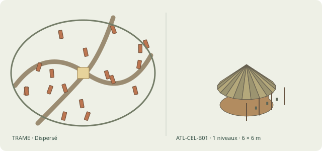

Plan : Dispersé · Maison illustrée : Roundhouse en torchis · Recette native : ATL-CEL-B01 · Agencement : single · Toiture native : RF-CONE · Structure : post_beam · Étages : 1–1 · Dimensions : 4–8 m × 4–8 m · Famille architecturale : ATL-CEL · Parcellaire : burgage · Bâti urbain : streetFrontRow · Matériau porteur : MAT-TIMBER-POST · Remplissage : MAT-WATTLE-DAUB · Couverture : MAT-THATCH

Le plan dispersé s’organise autour du noyau « none », de forme circle. Enceinte : circle ; fortification : none ; orientation : road.

Détails : Disque/ovale simple, 1 niveau ; Poteaux, clayonnage, torchis ; Cône de chaume épais

Recettes : orcish/core, orcish/village, orcish/hamlet, orcish/grown-core, orcish/grown-ring, orcish/grown-faubourg

## Halfling shire (`halfling`)

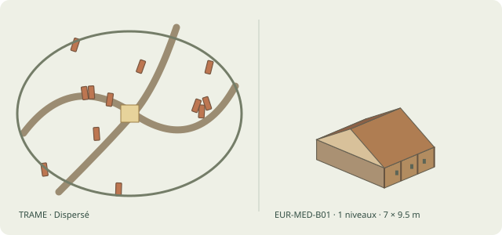

Plan : Dispersé · Maison illustrée : Chaumière rectangulaire · Recette native : EUR-MED-B01 · Agencement : single · Toiture native : RF-GABLE · Structure : post_beam · Étages : 1–1 · Dimensions : 5–9 m × 7–12 m · Famille architecturale : EUR-MED · Parcellaire : burgage · Bâti urbain : streetFrontRow · Matériau porteur : MAT-TIMBER-POST · Remplissage : MAT-WATTLE-DAUB · Couverture : MAT-THATCH

Le plan dispersé s’organise autour du noyau « none », de forme circle. Enceinte : circle ; fortification : none ; orientation : road.

Détails : Rectangle 1 niveau, parfois pignon en rue ; Torchis/clayonnage ou moellons ; Deux pans en chaume

Recettes : halfling/core, halfling/village, halfling/hamlet, halfling/grown-core, halfling/grown-ring, halfling/grown-faubourg

## Kraal (African homestead) (`kraal`)

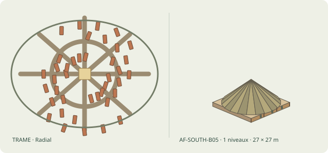

Plan : Radial · Maison illustrée : Concession familiale à plusieurs huttes · Recette native : AF-SOUTH-B05 · Agencement : hut_compound · Toiture native : RF-CONE · Structure : post_beam · Étages : 1–1 · Dimensions : 20–34 m × 20–34 m · Famille architecturale : AF-SOUTH · Parcellaire : burgage · Bâti urbain : streetFrontRow · Matériau porteur : MAT-TIMBER-POST · Remplissage : MAT-WATTLE-DAUB · Couverture : MAT-THATCH

Le plan radial s’organise autour du noyau « none », de forme circle. Enceinte : circle ; fortification : none ; orientation : road.

Détails : Groupe de disques autour d'une cour ; Enclos végétal/terre, petites annexes ; Cônes de tailles différentes

Recettes : kraal/core, kraal/village, kraal/hamlet, kraal/grown-core, kraal/grown-ring, kraal/grown-faubourg

## Native American: Iroquoian longhouse village (`native-iroquoian`)

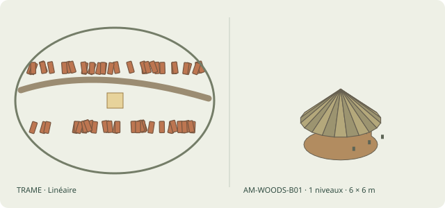

Plan : Linéaire · Maison illustrée : Wigwam / wickiup en dôme · Recette native : AM-WOODS-B01 · Agencement : single · Toiture native : RF-DOME · Structure : flexible_frame · Étages : 1–1 · Dimensions : 4–8 m × 4–8 m · Famille architecturale : AM-WOODS · Parcellaire : burgage · Bâti urbain : streetFrontRow · Matériau porteur : MAT-TIMBER-POST · Remplissage : MAT-BARK · Couverture : MAT-BARK

Le plan linéaire s’organise autour du noyau « none », de forme circle. Enceinte : oval ; fortification : palisade ; orientation : road.

Détails : Petit plan rond/ovale ; Arceaux de jeunes arbres, nattes/écorce ; Coque basse d'écorce/végétal

Recettes : native-iroquoian/core, native-iroquoian/village, native-iroquoian/hamlet, native-iroquoian/grown-core, native-iroquoian/grown-ring, native-iroquoian/grown-faubourg

## Native American: Pueblo (`native-pueblo`)

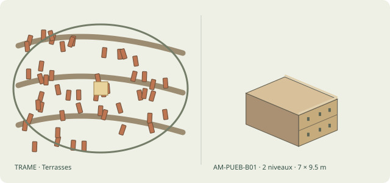

Plan : Terrasses · Maison illustrée : Maison pueblo en adobe · Recette native : AM-PUEB-B01 · Agencement : single · Toiture native : RF-FLAT · Structure : earth_wall · Étages : 1–2 · Dimensions : 5–9 m × 7–12 m · Famille architecturale : AM-PUEB · Parcellaire : burgage · Bâti urbain : streetFrontRow · Matériau porteur : MAT-ADOBE · Remplissage : MAT-ADOBE · Couverture : MAT-MUD-PLASTER

Le plan terrasses s’organise autour du noyau « none », de forme circle. Enceinte : terraces ; fortification : none ; orientation : terrain. Les escaliers accompagnent les différences de niveau.

Détails : Rectangle compact 1–3 niveaux ; Adobe et enduit terre ; Toit-terrasse en bois et terre

Recettes : native-pueblo/core, native-pueblo/village, native-pueblo/hamlet, native-pueblo/grown-core, native-pueblo/grown-ring, native-pueblo/grown-faubourg

## Native American: Plains tipi camp (`native-plains`)

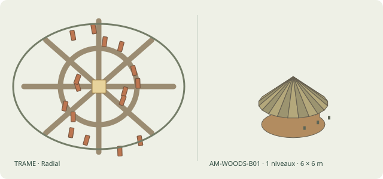

Plan : Radial · Maison illustrée : Wigwam / wickiup en dôme · Recette native : AM-WOODS-B01 · Agencement : single · Toiture native : RF-DOME · Structure : flexible_frame · Étages : 1–1 · Dimensions : 4–8 m × 4–8 m · Famille architecturale : AM-WOODS · Parcellaire : burgage · Bâti urbain : streetFrontRow · Matériau porteur : MAT-TIMBER-POST · Remplissage : MAT-BARK · Couverture : MAT-BARK

Le plan radial s’organise autour du noyau « none », de forme circle. Enceinte : circle ; fortification : none ; orientation : road.

Détails : Petit plan rond/ovale ; Arceaux de jeunes arbres, nattes/écorce ; Coque basse d'écorce/végétal

Recettes : native-plains/core, native-plains/village, native-plains/hamlet, native-plains/grown-core, native-plains/grown-ring, native-plains/grown-faubourg

## Nomad camp (steppe ordu) (`nomad-camp`)

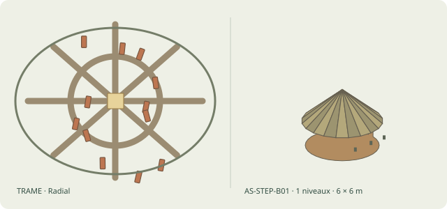

Plan : Radial · Maison illustrée : Yourte / ger · Recette native : AS-STEP-B01 · Agencement : single · Toiture native : RF-DOME · Structure : flexible_frame · Étages : 1–1 · Dimensions : 4–8 m × 4–8 m · Famille architecturale : AS-STEP · Parcellaire : burgage · Bâti urbain : streetFrontRow · Matériau porteur : MAT-TIMBER-POST · Remplissage : MAT-FELT · Couverture : MAT-FELT

Le plan radial s’organise autour du noyau « none », de forme circle. Enceinte : circle ; fortification : none ; orientation : road.

Détails : Cercle avec foyer central et porte orientée ; Treillis de bois, perches, revêtement de feutre ; Dôme-cone bas à couronne sommitale

Recettes : nomad-camp/core, nomad-camp/village, nomad-camp/hamlet, nomad-camp/grown-core, nomad-camp/grown-ring, nomad-camp/grown-faubourg

## Swahili stone town (Lamu / Zanzibar) (`swahili-stone-town`)

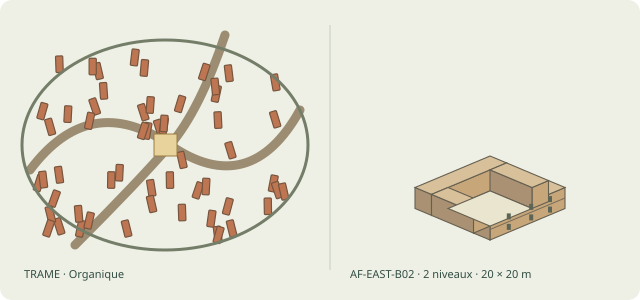

Plan : Organique · Maison illustrée : Maison swahilie de corail · Recette native : AF-EAST-B02 · Agencement : courtyard · Toiture native : RF-FLAT · Structure : masonry · Étages : 1–2 · Dimensions : 16–24 m × 16–24 m · Famille architecturale : AF-EAST · Parcellaire : courtyard · Bâti urbain : courtyardHouse · Matériau porteur : MAT-CORAL · Remplissage : MAT-CORAL · Couverture : MAT-MUD-PLASTER

Le plan organique s’organise autour du noyau « mosque », de forme rect. Enceinte : organic ; fortification : none ; orientation : road. Le front d’eau participe à la composition.

Détails : Rectangle dense et pièces en enfilade, petite cour ; Corail/calcaire corallien, chaux et bois ; Toit-terrasse ou charpente locale

Recettes : swahili-stone-town/core, swahili-stone-town/core-sector-0, swahili-stone-town/ring, swahili-stone-town/faubourg, swahili-stone-town/village, swahili-stone-town/hamlet

## Drow enclave (`drow-enclave`)

Plan : Organique · Maison illustrée : Maison levantine à cour · Recette native : AS-MIDE-B01 · Agencement : courtyard · Toiture native : RF-FLAT · Structure : earth_wall · Étages : 1–2 · Dimensions : 16–24 m × 16–24 m · Famille architecturale : AS-MIDE · Parcellaire : courtyard · Bâti urbain : courtyardHouse · Matériau porteur : MAT-ADOBE · Remplissage : MAT-ADOBE · Couverture : MAT-MUD-PLASTER

Le plan organique s’organise autour du noyau « precinct », de forme rect. Enceinte : organic ; fortification : none ; orientation : road.

Détails : Bloc rectangulaire 1–2 niveaux, patio ; Pierre/terre/enduit ; Toit plat, galerie ombragée

Recettes : drow-enclave/core, drow-enclave/ring, drow-enclave/faubourg, drow-enclave/village, drow-enclave/hamlet

## Duergar industrial hold (`duergar-hold`)

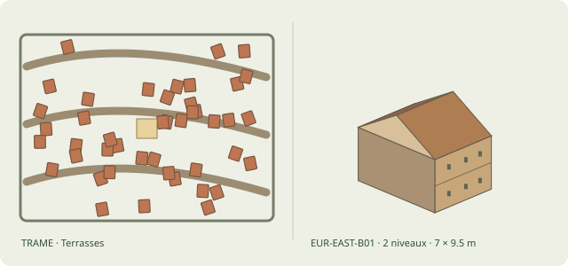

Plan : Terrasses · Maison illustrée : Isba/maison forestière en rondins · Recette native : EUR-EAST-B01 · Agencement : single · Toiture native : RF-GABLE · Structure : log · Étages : 1–2 · Dimensions : 5–9 m × 7–12 m · Famille architecturale : EUR-EAST · Parcellaire : burgage · Bâti urbain : duergarHall · Matériau porteur : MAT-LOG · Remplissage : MAT-LOG · Couverture : MAT-WOOD-SHINGLES

Le plan terrasses s’organise autour du noyau « precinct », de forme rect. Enceinte : rect ; fortification : wall ; orientation : terrain. Les escaliers accompagnent les différences de niveau.

Détails : Rectangle, 1–2 niveaux avec porche ; Troncs croisés et solin de pierre ; Double pente en bardeaux

Recettes : duergar-hold/core, duergar-hold/faubourg, duergar-hold/village, duergar-hold/hamlet

## Myconid colony (`myconid-colony`)

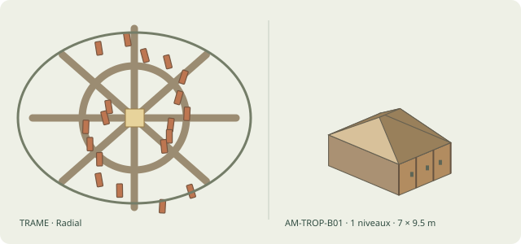

Plan : Radial · Maison illustrée : Maison de palmes légère · Recette native : AM-TROP-B01 · Agencement : single · Toiture native : RF-REED-HIP · Structure : post_beam · Étages : 1–1 · Dimensions : 5–9 m × 7–12 m · Famille architecturale : AM-TROP · Parcellaire : compound · Bâti urbain : fungalHouse · Matériau porteur : MAT-TIMBER-POST · Remplissage : MAT-WATTLE-DAUB · Couverture : MAT-THATCH

Le plan radial s’organise autour du noyau « precinct », de forme circle. Enceinte : circle ; fortification : none ; orientation : road.

Détails : Rectangle/ovale, 1 niveau ; Poteaux bois, nattes et claies ; Croupe de palmes très débordante

Recettes : myconid-colony/core, myconid-colony/village, myconid-colony/hamlet

## Égypte · ville planifiée du Nil (`egyptian-planned`)

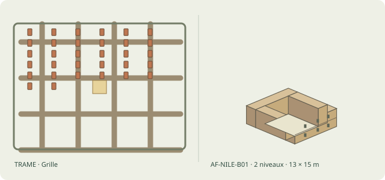

Plan : Grille · Maison illustrée : Maison égyptienne en adobe · Recette native : AF-NILE-B01 · Agencement : courtyard · Toiture native : RF-FLAT · Structure : earth_wall · Étages : 1–2 · Dimensions : 10–16 m × 12–18 m · Famille architecturale : AF-NILE · Parcellaire : courtyard · Bâti urbain : — · Matériau porteur : MAT-ADOBE · Remplissage : MAT-ADOBE · Couverture : MAT-MUD-PLASTER

Le plan grille s’organise autour du noyau « — », de forme —. Enceinte : rect ; fortification : none ; orientation : water. Le front d’eau participe à la composition.

Détails : Rectangle mitoyen, 1–2 niveaux, cour ; Briques crues enduites, bois rare ; Toit plat de poutres et terre

Recettes : egyptian-planned/core, egyptian-planned/ring, egyptian-planned/faubourg, egyptian-planned/village, egyptian-planned/hamlet

## Nubie · ville fortifiée (`nubian-fortified`)

Plan : Grille · Maison illustrée : Maison égyptienne en adobe · Recette native : AF-NILE-B01 · Agencement : courtyard · Toiture native : RF-FLAT · Structure : earth_wall · Étages : 1–2 · Dimensions : 10–16 m × 12–18 m · Famille architecturale : AF-NILE · Parcellaire : courtyard · Bâti urbain : — · Matériau porteur : MAT-ADOBE · Remplissage : MAT-ADOBE · Couverture : MAT-MUD-PLASTER

Le plan grille s’organise autour du noyau « — », de forme —. Enceinte : rounded-rect ; fortification : wall ; orientation : water. Le front d’eau participe à la composition.

Détails : Rectangle mitoyen, 1–2 niveaux, cour ; Briques crues enduites, bois rare ; Toit plat de poutres et terre

Recettes : nubian-fortified/core, nubian-fortified/ring, nubian-fortified/faubourg, nubian-fortified/village, nubian-fortified/hamlet

## Mésopotamie · quartiers de cours (`mesopotamian`)

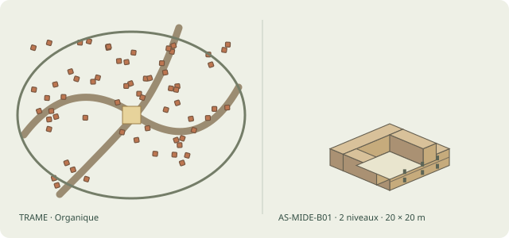

Plan : Organique · Maison illustrée : Maison levantine à cour · Recette native : AS-MIDE-B01 · Agencement : courtyard · Toiture native : RF-FLAT · Structure : earth_wall · Étages : 1–2 · Dimensions : 16–24 m × 16–24 m · Famille architecturale : AS-MIDE · Parcellaire : burgage · Bâti urbain : — · Matériau porteur : MAT-ADOBE · Remplissage : MAT-ADOBE · Couverture : MAT-MUD-PLASTER

Le plan organique s’organise autour du noyau « — », de forme —. Enceinte : organic ; fortification : wall ; orientation : road. Le front d’eau participe à la composition.

Détails : Bloc rectangulaire 1–2 niveaux, patio ; Pierre/terre/enduit ; Toit plat, galerie ombragée

Recettes : mesopotamian/core, mesopotamian/ring, mesopotamian/faubourg, mesopotamian/village, mesopotamian/hamlet

## Levant · ville fortifiée sur tell (`levantine-tell`)

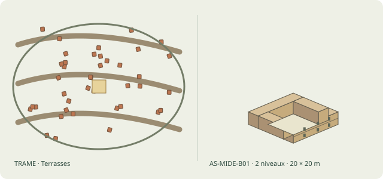

Plan : Terrasses · Maison illustrée : Maison levantine à cour · Recette native : AS-MIDE-B01 · Agencement : courtyard · Toiture native : RF-FLAT · Structure : earth_wall · Étages : 1–2 · Dimensions : 16–24 m × 16–24 m · Famille architecturale : AS-MIDE · Parcellaire : courtyard · Bâti urbain : — · Matériau porteur : MAT-ADOBE · Remplissage : MAT-ADOBE · Couverture : MAT-MUD-PLASTER

Le plan terrasses s’organise autour du noyau « — », de forme —. Enceinte : organic ; fortification : wall ; orientation : terrain. Les escaliers accompagnent les différences de niveau.

Détails : Bloc rectangulaire 1–2 niveaux, patio ; Pierre/terre/enduit ; Toit plat, galerie ombragée

Recettes : levantine-tell/core, levantine-tell/ring, levantine-tell/faubourg, levantine-tell/village, levantine-tell/hamlet

## Asie centrale · cité caravanière d’oasis (`oasis-caravan`)

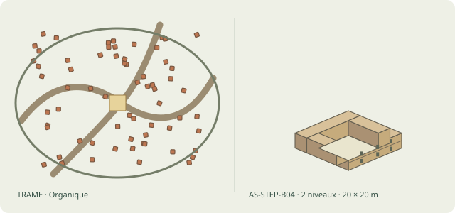

Plan : Organique · Maison illustrée : Maison à cour de Transoxiane · Recette native : AS-STEP-B04 · Agencement : courtyard · Toiture native : RF-FLAT · Structure : earth_wall · Étages : 1–2 · Dimensions : 16–24 m × 16–24 m · Famille architecturale : AS-STEP · Parcellaire : burgage · Bâti urbain : — · Matériau porteur : MAT-ADOBE · Remplissage : MAT-ADOBE · Couverture : MAT-MUD-PLASTER

Le plan organique s’organise autour du noyau « — », de forme —. Enceinte : rounded-rect ; fortification : wall ; orientation : road.

Détails : Bâtiments rectangulaires autour d'un patio ; Adobe/brique et bois ; Terrasses, auvents sur cour

Recettes : oasis-caravan/core, oasis-caravan/ring, oasis-caravan/faubourg, oasis-caravan/village, oasis-caravan/hamlet

## Maghreb · ksar d’oasis (`ksar-oasis`)

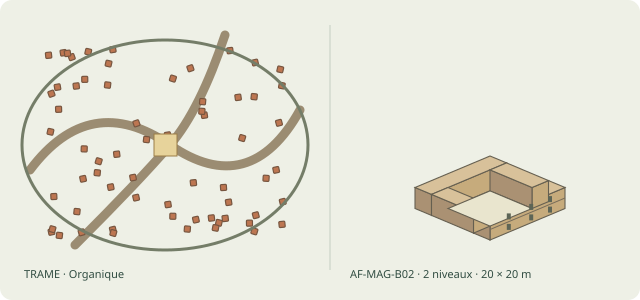

Plan : Organique · Maison illustrée : Dar à patio · Recette native : AF-MAG-B02 · Agencement : courtyard · Toiture native : RF-FLAT · Structure : earth_wall · Étages : 1–2 · Dimensions : 16–24 m × 16–24 m · Famille architecturale : AF-MAG · Parcellaire : burgage · Bâti urbain : — · Matériau porteur : MAT-ADOBE · Remplissage : MAT-ADOBE · Couverture : MAT-MUD-PLASTER

Le plan organique s’organise autour du noyau « — », de forme —. Enceinte : rounded-rect ; fortification : wall ; orientation : road.

Détails : Anneau ou U de pièces, patio ouvert ; Maçonnerie/terre et bois ; Terrasse, galeries intérieures

Recettes : ksar-oasis/core, ksar-oasis/ring, ksar-oasis/faubourg, ksar-oasis/village, ksar-oasis/hamlet

## Yoruba · ville de concessions (`yoruba`)

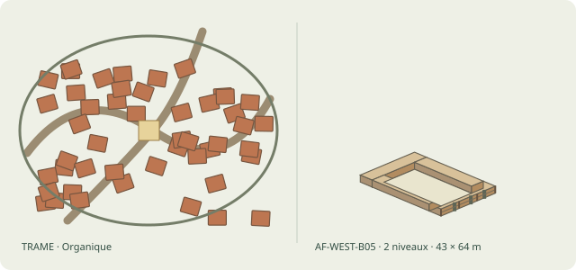

Plan : Organique · Maison illustrée : Maison de chef à cour(s) successives · Recette native : AF-WEST-B05 · Agencement : multiyard · Toiture native : RF-HIP · Structure : post_beam · Étages : 1–2 · Dimensions : 38–48 m × 56–72 m · Famille architecturale : AF-WEST · Parcellaire : compound · Bâti urbain : — · Matériau porteur : MAT-TIMBER-POST · Remplissage : MAT-COB · Couverture : MAT-THATCH

Le plan organique s’organise autour du noyau « — », de forme —. Enceinte : organic ; fortification : auto ; orientation : road.

Détails : Plusieurs bâtiments alignés vers cour centrale ; Terre, bois sculpté et clôture ; Grandes toitures en chaume

Recettes : yoruba/core, yoruba/ring, yoruba/faubourg, yoruba/village, yoruba/hamlet

## Tibet et Ladakh · habitat en terrasses (`himalayan-terraces`)

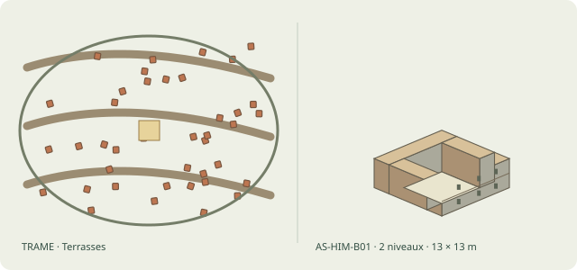

Plan : Terrasses · Maison illustrée : Maison tibétaine blanchie · Recette native : AS-HIM-B01 · Agencement : courtyard · Toiture native : RF-FLAT · Structure : earth_wall · Étages : 2–3 · Dimensions : 10–16 m × 10–16 m · Famille architecturale : AS-HIM · Parcellaire : courtyard · Bâti urbain : — · Matériau porteur : MAT-STONE-MORTAR · Remplissage : MAT-STONE-MORTAR · Couverture : MAT-MUD-PLASTER

Le plan terrasses s’organise autour du noyau « — », de forme —. Enceinte : terraces ; fortification : none ; orientation : terrain. Les escaliers accompagnent les différences de niveau.

Détails : Bloc rectangulaire de 2–3 niveaux, petite cour ; Pierre/terre massive enduite, bois ; Toit plat avec parapet

Recettes : himalayan-terraces/core, himalayan-terraces/ring, himalayan-terraces/faubourg, himalayan-terraces/village, himalayan-terraces/hamlet

## Népal newar · ville à places rituelles (`newar`)

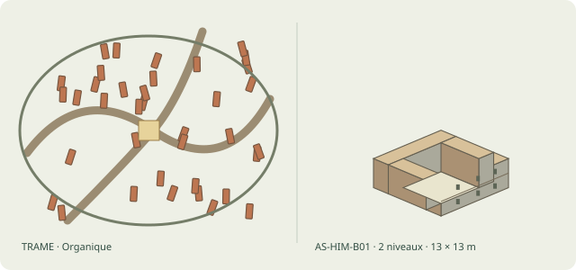

Plan : Organique · Maison illustrée : Maison tibétaine blanchie · Recette native : AS-HIM-B01 · Agencement : courtyard · Toiture native : RF-FLAT · Structure : earth_wall · Étages : 2–3 · Dimensions : 10–16 m × 10–16 m · Famille architecturale : AS-HIM · Parcellaire : courtyard · Bâti urbain : — · Matériau porteur : MAT-STONE-MORTAR · Remplissage : MAT-STONE-MORTAR · Couverture : MAT-MUD-PLASTER

Le plan organique s’organise autour du noyau « — », de forme —. Enceinte : organic ; fortification : none ; orientation : terrain. Les escaliers accompagnent les différences de niveau.

Détails : Bloc rectangulaire de 2–3 niveaux, petite cour ; Pierre/terre massive enduite, bois ; Toit plat avec parapet

Recettes : newar/core, newar/ring, newar/faubourg, newar/village, newar/hamlet

## Indus · cité harappéenne (`indus-planned`)

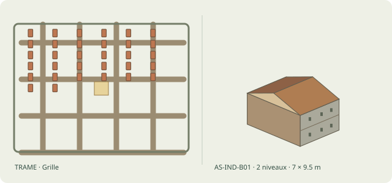

Plan : Grille · Maison illustrée : Maison rectangulaire indienne · Recette native : AS-IND-B01 · Agencement : single · Toiture native : RF-GABLE · Structure : masonry · Étages : 1–2 · Dimensions : 5–9 m × 7–12 m · Famille architecturale : AS-IND · Parcellaire : courtyard · Bâti urbain : — · Matériau porteur : MAT-STONE-MORTAR · Remplissage : MAT-STONE-MORTAR · Couverture : MAT-TILE-CLAY

Le plan grille s’organise autour du noyau « — », de forme —. Enceinte : rect ; fortification : wall ; orientation : cardinal.

Détails : Rectangle de 1 niveau, cour optionnelle ; Adobe/brique, terre et bois ; Tuiles, chaume ou toit-terrasse selon mousson

Recettes : indus-planned/core, indus-planned/ring, indus-planned/faubourg, indus-planned/village, indus-planned/hamlet

## Java · ville de cours et enclos (`javanese-courts`)

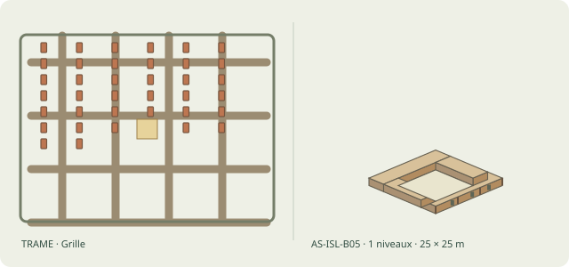

Plan : Grille · Maison illustrée : Maison balinaise en concession · Recette native : AS-ISL-B05 · Agencement : kancha · Toiture native : RF-EAVES · Structure : post_beam · Étages : 1–1 · Dimensions : 20–30 m × 20–30 m · Famille architecturale : AS-ISL · Parcellaire : compound · Bâti urbain : — · Matériau porteur : MAT-WOOD-MORTISE · Remplissage : MAT-BAMBOO · Couverture : MAT-TILE-CLAY

Le plan grille s’organise autour du noyau « — », de forme —. Enceinte : rect ; fortification : none ; orientation : cardinal.

Détails : Petits rectangles séparés dans un mur d'enclos ; Maçonnerie basse, bois et bambou ; Tuiles végétales/argile, petites couvertures

Recettes : javanese-courts/core, javanese-courts/ring, javanese-courts/faubourg, javanese-courts/village, javanese-courts/hamlet

## Mississippien · centre à place palissadée (`mississippian`)

Plan : Radial · Maison illustrée : Maison mississippienne rectangulaire · Recette native : AM-MISS-B01 · Agencement : single · Toiture native : RF-GABLE · Structure : post_beam · Étages : 1–1 · Dimensions : 5–9 m × 7–12 m · Famille architecturale : AM-MISS · Parcellaire : compound · Bâti urbain : — · Matériau porteur : MAT-TIMBER-POST · Remplissage : MAT-WATTLE-DAUB · Couverture : MAT-THATCH

Le plan radial s’organise autour du noyau « — », de forme —. Enceinte : oval ; fortification : palisade ; orientation : road.

Détails : Rectangle 1 niveau, foyer intérieur ; Poteaux/terre, clayonnage torchis ; Toit deux pans de chaume

Recettes : mississippian/core, mississippian/ring, mississippian/faubourg, mississippian/village, mississippian/hamlet

## Al-Andalus · médina ibérique à patios (`al-andalus`)

Plan : Organique · Maison illustrée : Dar à patio · Recette native : AF-MAG-B02 · Agencement : courtyard · Toiture native : RF-FLAT · Structure : earth_wall · Étages : 1–2 · Dimensions : 16–24 m × 16–24 m · Famille architecturale : AF-MAG · Parcellaire : burgage · Bâti urbain : — · Matériau porteur : MAT-ADOBE · Remplissage : MAT-ADOBE · Couverture : MAT-MUD-PLASTER

Le plan organique s’organise autour du noyau « mosque », de forme rect. Enceinte : organic ; fortification : wall ; orientation : terrain. Les escaliers accompagnent les différences de niveau.

Détails : Anneau ou U de pièces, patio ouvert ; Maçonnerie/terre et bois ; Terrasse, galeries intérieures

Recettes : al-andalus/core, al-andalus/ring, al-andalus/faubourg, al-andalus/village, al-andalus/hamlet

## Italie · commune à piazza et tours (`italian-comune`)

Plan : Organique · Maison illustrée : Maison de portique italien · Recette native : EUR-MED-B09 · Agencement : strip · Toiture native : RF-GABLE · Structure : masonry · Étages : 2–3 · Dimensions : 6–10 m × 12–18 m · Famille architecturale : EUR-MED · Parcellaire : burgage · Bâti urbain : — · Matériau porteur : MAT-STONE-MORTAR · Remplissage : MAT-STONE-MORTAR · Couverture : MAT-TILE-CLAY

Le plan organique s’organise autour du noyau « market », de forme hull. Enceinte : organic ; fortification : wall ; orientation : terrain. Les escaliers accompagnent les différences de niveau.

Détails : Rectangle en rangée, rez-de-chaussée ouvert ; Pierre/brique, colonnes et voûtes ; Faîtage parallèle à l'axe de rue

Recettes : italian-comune/core, italian-comune/ring, italian-comune/faubourg, italian-comune/village, italian-comune/hamlet

## Flandre · ville drapière à beffroi (`flemish-cloth-town`)

Plan : Organique · Maison illustrée : Maison aux pignons à redents · Recette native : EUR-MED-B11 · Agencement : single · Toiture native : RF-STEEP-STEP · Structure : masonry · Étages : 2–3 · Dimensions : 5–9 m × 7–12 m · Famille architecturale : EUR-MED · Parcellaire : burgage · Bâti urbain : — · Matériau porteur : MAT-BURNT-BRICK · Remplissage : MAT-BURNT-BRICK · Couverture : MAT-TILE-CLAY

Le plan organique s’organise autour du noyau « clocktower », de forme rect. Enceinte : organic ; fortification : wall ; orientation : water. Le front d’eau participe à la composition.

Détails : Rectangle de ville avec façade étagée ; Brique et pierre ; Toit deux pans masqué par redents

Recettes : flemish-cloth-town/core, flemish-cloth-town/ring, flemish-cloth-town/faubourg, flemish-cloth-town/village, flemish-cloth-town/hamlet

## Europe centrale · ville à rynek (`rynek-town`)

Plan : Grille · Maison illustrée : Maison à pans de bois en encorbellement · Recette native : EUR-MED-B03 · Agencement : strip · Toiture native : RF-GABLE · Structure : half_timber · Étages : 2–3 · Dimensions : 4–6 m × 10–18 m · Famille architecturale : EUR-MED · Parcellaire : burgage · Bâti urbain : — · Matériau porteur : MAT-HALF-TIMBER · Remplissage : MAT-WATTLE-DAUB · Couverture : MAT-TILE-CLAY

Le plan grille s’organise autour du noyau « market », de forme rect. Enceinte : oval ; fortification : wall ; orientation : road.

Détails : Rectangle, étage avançant sur rue ; Ossature bois visible, remplissage terre/brique ; Tuiles/ardoises, pignon parfois sculpté

Recettes : rynek-town/core, rynek-town/ring, rynek-town/faubourg, rynek-town/village, rynek-town/hamlet

## Slaves · gród palissadé et podgrodzie (`slavic-gord`)

Plan : Radial · Maison illustrée : Isba/maison forestière en rondins · Recette native : EUR-EAST-B01 · Agencement : single · Toiture native : RF-GABLE · Structure : log · Étages : 1–2 · Dimensions : 5–9 m × 7–12 m · Famille architecturale : EUR-EAST · Parcellaire : burgage · Bâti urbain : — · Matériau porteur : MAT-LOG · Remplissage : MAT-LOG · Couverture : MAT-WOOD-SHINGLES

Le plan radial s’organise autour du noyau « castle », de forme circle. Enceinte : oval ; fortification : palisade ; orientation : terrain.

Détails : Rectangle, 1–2 niveaux avec porche ; Troncs croisés et solin de pierre ; Double pente en bardeaux

Recettes : slavic-gord/core, slavic-gord/ring, slavic-gord/faubourg, slavic-gord/village, slavic-gord/hamlet

## Caucase · bourg fortifié géorgien et arménien (`caucasian-highland`)

Plan : Terrasses · Maison illustrée : Maison caucasienne en pierre · Recette native : EUR-EAST-B03 · Agencement : single · Toiture native : RF-FLAT · Structure : masonry · Étages : 1–2 · Dimensions : 5–9 m × 7–12 m · Famille architecturale : EUR-EAST · Parcellaire : burgage · Bâti urbain : — · Matériau porteur : MAT-STONE-MORTAR · Remplissage : MAT-STONE-MORTAR · Couverture : MAT-MUD-PLASTER

Le plan terrasses s’organise autour du noyau « precinct », de forme rect. Enceinte : organic ; fortification : wall ; orientation : terrain. Les escaliers accompagnent les différences de niveau.

Détails : Rectangle compact autour de foyer ; Moellons épais et poutres bois ; Toit-terrasse ou pente légère selon région

Recettes : caucasian-highland/core, caucasian-highland/ring, caucasian-highland/faubourg, caucasian-highland/village, caucasian-highland/hamlet

## Éthiopie · cité d’altitude (Aksum, Lalibela) (`ethiopian-highland`)

Plan : Organique · Maison illustrée : Tukul du plateau · Recette native : AF-EAST-B01 · Agencement : single · Toiture native : RF-CONE · Structure : post_beam · Étages : 1–1 · Dimensions : 4–8 m × 4–8 m · Famille architecturale : AF-EAST · Parcellaire : compound · Bâti urbain : — · Matériau porteur : MAT-TIMBER-POST · Remplissage : MAT-WATTLE-DAUB · Couverture : MAT-THATCH

Le plan organique s’organise autour du noyau « precinct », de forme circle. Enceinte : organic ; fortification : none ; orientation : terrain. Les escaliers accompagnent les différences de niveau.

Détails : Hutte ronde avec petite véranda ; Terre/pierre et poteaux bois ; Cône de chaume

Recettes : ethiopian-highland/core, ethiopian-highland/ring, ethiopian-highland/faubourg, ethiopian-highland/village, ethiopian-highland/hamlet

## Zimbabwe · enclos de pierre sèche (`great-zimbabwe`)

Plan : Organique · Maison illustrée : Concession familiale à plusieurs huttes · Recette native : AF-SOUTH-B05 · Agencement : hut_compound · Toiture native : RF-CONE · Structure : post_beam · Étages : 1–1 · Dimensions : 20–34 m × 20–34 m · Famille architecturale : AF-SOUTH · Parcellaire : compound · Bâti urbain : roundHouse · Matériau porteur : MAT-TIMBER-POST · Remplissage : MAT-WATTLE-DAUB · Couverture : MAT-THATCH

Le plan organique s’organise autour du noyau « royal-enclosure », de forme circle. Enceinte : oval ; fortification : none ; orientation : terrain.

Détails : Groupe de disques autour d'une cour ; Enclos végétal/terre, petites annexes ; Cônes de tailles différentes

Recettes : great-zimbabwe/core, great-zimbabwe/ring, great-zimbabwe/faubourg, great-zimbabwe/village, great-zimbabwe/hamlet

## Hausa · cité-État à enceinte de terre (Kano) (`hausa-kano`)

Plan : Organique · Maison illustrée : Maison de banco à terrasse · Recette native : AF-SAHEL-B02 · Agencement : courtyard · Toiture native : RF-FLAT · Structure : earth_wall · Étages : 1–2 · Dimensions : 16–24 m × 16–24 m · Famille architecturale : AF-SAHEL · Parcellaire : courtyard · Bâti urbain : — · Matériau porteur : MAT-ADOBE · Remplissage : MAT-ADOBE · Couverture : MAT-MUD-PLASTER

Le plan organique s’organise autour du noyau « mosque », de forme rect. Enceinte : organic ; fortification : wall ; orientation : road.

Détails : Rectangle compact autour d'une cour ; Brique crue, bauge, mortier terre ; Toit plat en perches/enduit

Recettes : hausa-kano/core, hausa-kano/ring, hausa-kano/faubourg, hausa-kano/village, hausa-kano/hamlet

## Hadramaout · cité verticale de maisons-tours (Shibam) (`hadhrami-tower`)

Plan : Organique · Maison illustrée : Maison-tour hadramie haute · Recette native : AS-MIDE-B13 · Agencement : single · Toiture native : RF-FLAT · Structure : earth_wall · Étages : 4–7 · Dimensions : 5–7 m × 8–12 m · Famille architecturale : AS-MIDE · Parcellaire : burgage · Bâti urbain : — · Matériau porteur : MAT-ADOBE · Remplissage : MAT-ADOBE · Couverture : MAT-MUD-PLASTER

Le plan organique s’organise autour du noyau « mosque », de forme rect. Enceinte : rect ; fortification : wall ; orientation : road.

Détails : Rectangle étroit, 4–7 étages ; Briques de boue séchées, poutres ; Terrasse haute, enduits blancs ; L

Recettes : hadhrami-tower/core, hadhrami-tower/village, hadhrami-tower/hamlet

## Rajputana · ville au pied du fort (Jaisalmer, Amber) (`rajput-fort`)

Plan : Organique · Maison illustrée : Maison harappéenne en brique · Recette native : AS-IND-B02 · Agencement : courtyard · Toiture native : RF-FLAT · Structure : masonry · Étages : 1–2 · Dimensions : 16–24 m × 16–24 m · Famille architecturale : AS-IND · Parcellaire : burgage · Bâti urbain : — · Matériau porteur : MAT-BURNT-BRICK · Remplissage : MAT-BURNT-BRICK · Couverture : MAT-MUD-PLASTER

Le plan organique s’organise autour du noyau « castle », de forme square. Enceinte : organic ; fortification : wall ; orientation : terrain. Les escaliers accompagnent les différences de niveau.

Détails : Pièces fermées autour de petite cour ; Brique cuite et crue ; Terrasse/structure bois, évacuation des eaux

Recettes : rajput-fort/core, rajput-fort/ring, rajput-fort/faubourg, rajput-fort/village, rajput-fort/hamlet

## Inde du Sud · ville-temple à rues concentriques (Madurai) (`dravidian-temple`)

Plan : Grille · Maison illustrée : Maison rectangulaire indienne · Recette native : AS-IND-B01 · Agencement : single · Toiture native : RF-GABLE · Structure : masonry · Étages : 1–2 · Dimensions : 5–9 m × 7–12 m · Famille architecturale : AS-IND · Parcellaire : burgage · Bâti urbain : — · Matériau porteur : MAT-STONE-MORTAR · Remplissage : MAT-STONE-MORTAR · Couverture : MAT-TILE-CLAY

Le plan grille s’organise autour du noyau « temple », de forme square. Enceinte : square ; fortification : none ; orientation : cardinal.

Détails : Rectangle de 1 niveau, cour optionnelle ; Adobe/brique, terre et bois ; Tuiles, chaume ou toit-terrasse selon mousson

Recettes : dravidian-temple/core, dravidian-temple/ring, dravidian-temple/faubourg, dravidian-temple/village, dravidian-temple/hamlet

## Birmanie · cité royale de Pagan (`bagan`)

Plan : Grille · Maison illustrée : Maison sur pilotis de mousson · Recette native : AS-SEA-B01 · Agencement : platform · Toiture native : RF-REED-HIP · Structure : post_beam · Étages : 1–1 · Dimensions : 5–9 m × 7–12 m · Famille architecturale : AS-SEA · Parcellaire : compound · Bâti urbain : — · Matériau porteur : MAT-TIMBER-POST · Remplissage : MAT-BAMBOO · Couverture : MAT-THATCH

Le plan grille s’organise autour du noyau « temple », de forme square. Enceinte : square ; fortification : wall ; orientation : cardinal. Le front d’eau participe à la composition.

Détails : Rectangle sur poteaux, 1 plancher haut, escalier ; Bois et bambou, panneaux tressés ; Double pente/croupe raide en chaume

Recettes : bagan/core, bagan/ring, bagan/faubourg, bagan/village, bagan/hamlet

## Viêt · citadelle et quartier marchand (Thăng Long) (`vietnamese-citadel`)

Plan : Grille · Maison illustrée : Maison vietnamienne traditionnelle à cour · Recette native : AS-SEA-B04 · Agencement : kancha · Toiture native : RF-GABLE · Structure : masonry · Étages : 1–2 · Dimensions : 22–32 m × 20–28 m · Famille architecturale : AS-SEA · Parcellaire : compound · Bâti urbain : — · Matériau porteur : MAT-STONE-MORTAR · Remplissage : MAT-STONE-MORTAR · Couverture : MAT-TILE-CLAY

Le plan grille s’organise autour du noyau « castle », de forme square. Enceinte : square ; fortification : wall ; orientation : cardinal. Le front d’eau participe à la composition.

Détails : Rectangle long, cour et annexes ; Bois, terre/brique, bambou ; Tuiles et avant-toits

Recettes : vietnamese-citadel/core, vietnamese-citadel/ring, vietnamese-citadel/faubourg, vietnamese-citadel/village, vietnamese-citadel/hamlet

## Tibet · bourg monastique de pente (`tibetan-monastery`)

Plan : Terrasses · Maison illustrée : Maison tibétaine blanchie · Recette native : AS-HIM-B01 · Agencement : courtyard · Toiture native : RF-FLAT · Structure : earth_wall · Étages : 2–3 · Dimensions : 10–16 m × 10–16 m · Famille architecturale : AS-HIM · Parcellaire : burgage · Bâti urbain : — · Matériau porteur : MAT-STONE-MORTAR · Remplissage : MAT-STONE-MORTAR · Couverture : MAT-MUD-PLASTER

Le plan terrasses s’organise autour du noyau « temple », de forme rect. Enceinte : terraces ; fortification : none ; orientation : terrain. Les escaliers accompagnent les différences de niveau.

Détails : Bloc rectangulaire de 2–3 niveaux, petite cour ; Pierre/terre massive enduite, bois ; Toit plat avec parapet

Recettes : tibetan-monastery/core, tibetan-monastery/ring, tibetan-monastery/faubourg, tibetan-monastery/village, tibetan-monastery/hamlet

## Mongols · ordu, camp princier de yourtes (`mongol-ordu`)

Plan : Radial · Maison illustrée : Yourte / ger · Recette native : AS-STEP-B01 · Agencement : single · Toiture native : RF-DOME · Structure : flexible_frame · Étages : 1–1 · Dimensions : 4–8 m × 4–8 m · Famille architecturale : AS-STEP · Parcellaire : compound · Bâti urbain : — · Matériau porteur : MAT-TIMBER-POST · Remplissage : MAT-FELT · Couverture : MAT-FELT

Le plan radial s’organise autour du noyau « none », de forme circle. Enceinte : circle ; fortification : none ; orientation : cardinal.

Détails : Cercle avec foyer central et porte orientée ; Treillis de bois, perches, revêtement de feutre ; Dôme-cone bas à couronne sommitale

Recettes : mongol-ordu/core, mongol-ordu/village, mongol-ordu/hamlet, mongol-ordu/grown-core, mongol-ordu/grown-ring, mongol-ordu/grown-faubourg

## Māori · pā fortifié en terrasses (`maori-pa`)

Plan : Terrasses · Maison illustrée : Fale samoan ouvert · Recette native : OC-PAC-B01 · Agencement : single · Toiture native : RF-REED-HIP · Structure : post_beam · Étages : 1–1 · Dimensions : 5–8 m × 8–14 m · Famille architecturale : OC-PAC · Parcellaire : burgage · Bâti urbain : — · Matériau porteur : MAT-TIMBER-POST · Remplissage : MAT-PALM · Couverture : MAT-PALM

Le plan terrasses s’organise autour du noyau « none », de forme circle. Enceinte : organic ; fortification : palisade ; orientation : terrain. Les escaliers accompagnent les différences de niveau.

Détails : Ovale/rectangle sous toiture, côtés ouverts ; Poteaux bois et ligatures végétales ; Toit bombé/chaume en croupe

Recettes : maori-pa/core, maori-pa/village, maori-pa/hamlet

## Côte Nord-Ouest · village de maisons de planches (`pnw-plank-village`)

Plan : Linéaire · Maison illustrée : Longhouse côtière en planches · Recette native : AM-PNW-B01 · Agencement : single · Toiture native : RF-GABLE · Structure : post_beam · Étages : 1–1 · Dimensions : 10–18 m × 22–40 m · Famille architecturale : AM-PNW · Parcellaire : burgage · Bâti urbain : — · Matériau porteur : MAT-TIMBER-POST · Remplissage : MAT-WOOD-SHINGLES · Couverture : MAT-WOOD-SHINGLES

Le plan linéaire s’organise autour du noyau « none », de forme circle. Enceinte : oval ; fortification : none ; orientation : water. Le front d’eau participe à la composition.

Détails : Très grand rectangle, travées et foyers ; Poteaux/poutres de cèdre, planches verticales ; Deux pans longs en planches de bois

Recettes : pnw-plank-village/core, pnw-plank-village/village, pnw-plank-village/hamlet

## Arctique · camp inuit d’hiver (`inuit-camp`)

Plan : Dispersé · Maison illustrée : Tente de peaux arctique · Recette native : AM-ARC-B01 · Agencement : single · Toiture native : RF-DOME · Structure : flexible_frame · Étages : 1–1 · Dimensions : 4–8 m × 4–8 m · Famille architecturale : AM-ARC · Parcellaire : compound · Bâti urbain : — · Matériau porteur : MAT-TIMBER-POST · Remplissage : MAT-HIDE · Couverture : MAT-HIDE

Le plan dispersé s’organise autour du noyau « none », de forme circle. Enceinte : circle ; fortification : none ; orientation : water. Le front d’eau participe à la composition.

Détails : Disque/ovale, 1 espace de couchage ; Perches/os et peaux tendues ; Dôme ou cône textile

Recettes : inuit-camp/core, inuit-camp/village, inuit-camp/hamlet

## Sibérie · campement de chums des éleveurs de rennes (`siberian-camp`)

Plan : Radial · Maison illustrée : Chum conique · Recette native : AS-SIB-B01 · Agencement : single · Toiture native : RF-TENT · Structure : flexible_frame · Étages : 1–1 · Dimensions : 4–8 m × 4–8 m · Famille architecturale : AS-SIB · Parcellaire : compound · Bâti urbain : — · Matériau porteur : MAT-TIMBER-POST · Remplissage : MAT-HIDE · Couverture : MAT-HIDE

Le plan radial s’organise autour du noyau « none », de forme circle. Enceinte : circle ; fortification : none ; orientation : terrain.

Détails : Rond à poteau central implicite ; Longues perches, écorces/peaux/toile ; Cône aigu démontable

Recettes : siberian-camp/core, siberian-camp/village, siberian-camp/hamlet

## Guaraní · village de grandes maisons (tekoha) (`guarani-village`)

Plan : Radial · Maison illustrée : Longhouse guaraní · Recette native : AM-SOUTH-B03 · Agencement : single · Toiture native : RF-HIP · Structure : post_beam · Étages : 1–1 · Dimensions : 6–10 m × 18–36 m · Famille architecturale : AM-SOUTH · Parcellaire : compound · Bâti urbain : — · Matériau porteur : MAT-TIMBER-POST · Remplissage : MAT-WATTLE-DAUB · Couverture : MAT-PALM

Le plan radial s’organise autour du noyau « none », de forme circle. Enceinte : circle ; fortification : palisade ; orientation : road.

Détails : Très long rectangle avec travées ; Bois, feuillage, armature ligaturée ; Grande croupe en palmes

Recettes : guarani-village/core, guarani-village/village, guarani-village/hamlet

## Australie · village de pierre du Budj Bim (`budj-bim`)

Plan : Dispersé · Maison illustrée : Cabane de pierre locale · Recette native : OC-AUS-B03 · Agencement : single · Toiture native : RF-CONE · Structure : masonry · Étages : 1–1 · Dimensions : 4–8 m × 4–8 m · Famille architecturale : OC-AUS · Parcellaire : compound · Bâti urbain : — · Matériau porteur : MAT-BASALT · Remplissage : MAT-BASALT · Couverture : MAT-THATCH

Le plan dispersé s’organise autour du noyau « none », de forme circle. Enceinte : organic ; fortification : none ; orientation : water. Le front d’eau participe à la composition.

Détails : Petit rond ou ovale, mur bas ; Basalte/roche locale en pierre sèche ; Couverture végétale hypothétique/configurable

Recettes : budj-bim/core, budj-bim/village, budj-bim/hamlet

## Hommes-lézards · cité lacustre sur pilotis (`lizardfolk-swamp`)

Plan : Dispersé · Maison illustrée : Maison sur pilotis de lagune · Recette native : AM-TROP-B05 · Agencement : platform · Toiture native : RF-REED-HIP · Structure : post_beam · Étages : 1–1 · Dimensions : 5–9 m × 7–12 m · Famille architecturale : AM-TROP · Parcellaire : compound · Bâti urbain : — · Matériau porteur : MAT-TIMBER-POST · Remplissage : MAT-BAMBOO · Couverture : MAT-PALM

Le plan dispersé s’organise autour du noyau « precinct », de forme circle. Enceinte : organic ; fortification : none ; orientation : water. Le front d’eau participe à la composition.

Détails : Rectangle à plateforme haute ; Pieux bois, tressage ; Croupe légère en palmes

Recettes : lizardfolk-swamp/core, lizardfolk-swamp/ring, lizardfolk-swamp/faubourg, lizardfolk-swamp/village, lizardfolk-swamp/hamlet

## Ondins · village de grève et de grottes marines (`merfolk-tidal`)

Plan : Organique · Maison illustrée : Maison sur pilotis de lagune · Recette native : OC-PAC-B08 · Agencement : platform · Toiture native : RF-REED-HIP · Structure : post_beam · Étages : 1–1 · Dimensions : 5–9 m × 7–12 m · Famille architecturale : OC-PAC · Parcellaire : compound · Bâti urbain : — · Matériau porteur : MAT-TIMBER-POST · Remplissage : MAT-BAMBOO · Couverture : MAT-PALM

Le plan organique s’organise autour du noyau « temple », de forme circle. Enceinte : organic ; fortification : none ; orientation : water. Le front d’eau participe à la composition. Les escaliers accompagnent les différences de niveau.

Détails : Rectangle léger sur pieux ; Bois local et bambou ; Croupe végétale, ponton attenant

Recettes : merfolk-tidal/core, merfolk-tidal/ring, merfolk-tidal/faubourg, merfolk-tidal/village, merfolk-tidal/hamlet

## Géants · bourg mégalithique (`giant-hold`)

Plan : Radial · Maison illustrée : Maison longue nordique · Recette native : EUR-NOR-B01 · Agencement : single · Toiture native : RF-GABLE · Structure : post_beam · Étages : 1–1 · Dimensions : 6–10 m × 18–36 m · Famille architecturale : EUR-NOR · Parcellaire : compound · Bâti urbain : — · Matériau porteur : MAT-TIMBER-POST · Remplissage : MAT-WATTLE-DAUB · Couverture : MAT-TURF

Le plan radial s’organise autour du noyau « castle », de forme rect. Enceinte : circle ; fortification : wall ; orientation : terrain.

Détails : Très long rectangle à allée ou foyer longitudinal ; Poteaux et bois, solins pierre possibles ; Grand toit deux pans de chaume/tourbe

Recettes : giant-hold/core, giant-hold/ring, giant-hold/faubourg, giant-hold/village, giant-hold/hamlet

## Gobelins · terrier à flanc de colline (`goblin-warren`)

Plan : Organique · Maison illustrée : Maison semi-souterraine complexe · Recette native : AS-SIB-B08 · Agencement : parallel · Toiture native : RF-FLAT · Structure : post_beam · Étages : 1–1 · Dimensions : 16–24 m × 14–22 m · Famille architecturale : AS-SIB · Parcellaire : compound · Bâti urbain : — · Matériau porteur : MAT-TIMBER-POST · Remplissage : MAT-TURF · Couverture : MAT-TURF

Le plan organique s’organise autour du noyau « none », de forme circle. Enceinte : organic ; fortification : palisade ; orientation : terrain. Les escaliers accompagnent les différences de niveau.

Détails : Réseau de petites pièces excavées ; Bois, pierre et terre ; Voûtes plates sous butte

Recettes : goblin-warren/core, goblin-warren/ring, goblin-warren/faubourg, goblin-warren/village, goblin-warren/hamlet
