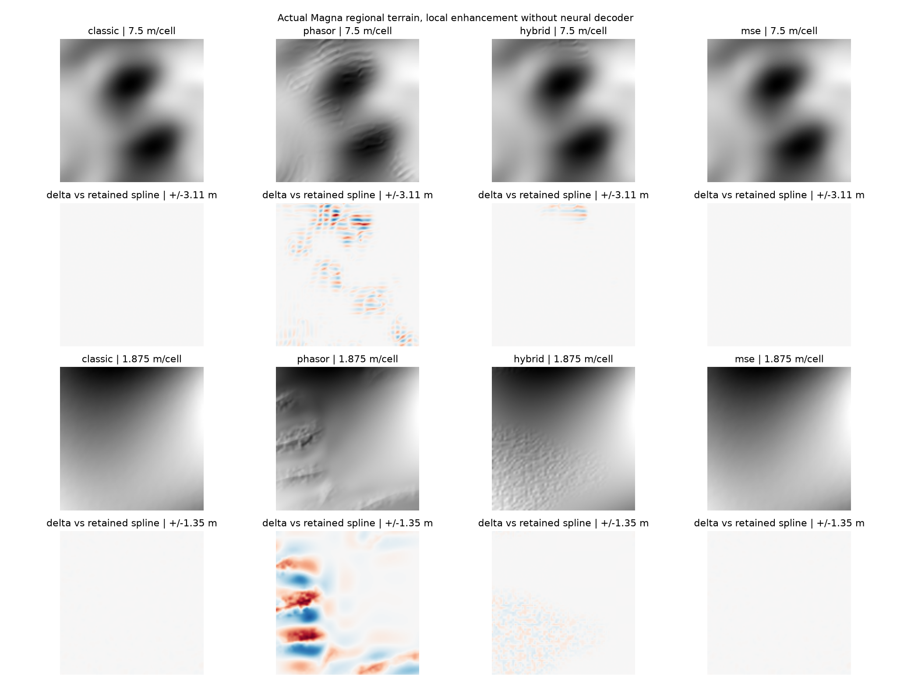

# Générer rapidement un relief régional réaliste pour Magna Urbis

Étude du 29 octobre 2026, avec lecture des ajouts récents de Neural Earth et premiers essais sur le moteur de Magna Urbis. Domaine visé : jusqu'à **50 × 50 km**, utilisable dans le navigateur, avec des paysages variés et une hydrologie cohérente. Les durées locales, les résultats publiés et les objectifs de développement sont distingués ci-dessous.

## 1. Choix recommandé

La première piste à évaluer est **le procédural GPU existant complété par Phasor directement sur GPU**. Magna possède déjà le soulèvement, le drainage et une incision implicite régionale : il faut mesurer si le détail structuré manquant suffit à obtenir le résultat voulu avant de remplacer ce socle. Le branchement Python livré permet de comparer les formes ; il ne mesure pas cette future chaîne entièrement navigateur.

Si les vallées et bassins restent insuffisants après ce test, une troisième source pourrait établir leur structure autrement, puis produire les altitudes et le détail. Trois candidats de remplacement sont étudiés ci-dessous, sans priorité sur l'amélioration du moteur existant :

1. **Relief structuré et érosion analytique**, d'après Tzathas et al. 2024, avec les approches de drainage de Génevaux 2013 et de soulèvement de Schott 2023 comme références de contrôle. Ce candidat explore surtout un autre budget de convergence et une autre structure régionale. Son avantage sur notre solveur GPU n'est pas établi et reste à mesurer.
2. **Assemblage d'exemples par bassins et formes géomorphologiques**, préparés hors ligne. C'est le candidat le plus intéressant si la priorité devient « très beau tout de suite, avec un petit catalogue téléchargé ». Les raccords hydrologiques font partie du problème à résoudre ; une simple mosaïque de heightmaps ne suffit pas.
3. **Structure par isocontours**, Huftier et al. 2026, suivie d'un détail contraint. Très prometteur pour un atelier contrôlable et léger ; moins établi pour les lits de largeur variable et les paysages alluviaux. Ce n'est pas encore un remplacement démontré de notre terrain.

Pour les détails, **Phasor et l'hybride de Neural Earth sont testables dès maintenant dans le banc terrain de Magna Urbis**. Ils constituent une couche complémentaire, pas un générateur de bassins de 50 km. L'adaptation actuelle de MSE ne justifie pas d'en faire la source initiale : dans les essais ci-dessous, elle reste presque identique au classique.

La priorité « rapide » impose une hiérarchie : calcul régional à quelques dizaines de mètres, réseau hydrographique conservé, détails métriques uniquement autour de la caméra. Calculer une région entière à la résolution d'une rue annulerait l'avantage d'un algorithme sans poids.

## 2. Ce que contient réellement le code actuel

### 2.1 Magna Urbis

L'inspection porte sur le répertoire de travail, qui contenait déjà de nombreuses modifications. Les essais utilisent ses sources courantes ; leur provenance est conservée dans [provenance.json](evidence/terrain-study-2026-10-29/provenance.json).

| Partie | Code inspecté | Conséquence |
| --- | --- | --- |
| Relief procédural | `rust/crates/core/src/erosion.rs`, `rust/bridge/terrainErosion.ts`, `terrainErosion.wgsl` | Priority-Flood, drainage fractionné D∞, incision implicite, brèches, relaxation thermique et détails existent déjà. Proposer seulement « utiliser stream power » ne serait pas une troisième méthode. |
| Sources neuronales | `rust/models/neural-earth/README.md`, `web/scripts/neural_python.py`, `rust/bridge/neuralBrowser.ts` | Plusieurs poids distillés sont disponibles ; les modèles Python et navigateur n'ont pas le même contrat. Le catalogue Python local totalise environ 100 Mo pour neuf fichiers ; cela ne représente pas le téléchargement réel de toute la version web. |
| Reconstruction et hydrologie | `rust/bridge/terrain.ts`, `rust/crates/core/src/hydrology*.rs` | Le terrain peut être corrigé avant et pendant la production de l'eau. La fidélité au relief initial et le coût des corrections doivent être mesurés. |
| Raffinement conservé | `web/scripts/neural_refinement.py`, `web/src/ui/terrainRefinement.ts` | Un raster déjà produit est conservé ; on ajoute le résidu fin de Neural Earth sans régénérer le monde. Sans latents conservés, aucun vrai décodeur neuronal n'est utilisé. |

La génération neuronale régionale du service utilise une emprise native de **40 km**. Demander une carte de 50 km doit donc préciser découpe, extension ou changement d'échelle. Il ne faut pas confondre cette adaptation avec la génération native d'un terrain de 50 km aux mêmes statistiques physiques.

### 2.2 Derniers ajouts de Neural Earth

Le dépôt voisin présent ici s'appelle `../infinite_map`. Révision inspectée : `44681b358990fd00e0c8a978dbc586167400a938`. Le commit `c0e068b` apporte l'amplification et l'interpolation jusqu'au LOD −12. Les commits plus récents concernent surtout les ressources, la géologie réalisée et leur affichage ; ce ne sont pas de nouveaux générateurs de relief régional.

| Méthode présente | Implémentation observée | Ce qu'elle apporte | Limite pertinente |
| --- | --- | --- | --- |
| Classique | `backend/terrain_refinement.py`, decoder-v12 | Spline côtière, octave décodeur si disponible, puis convolution parcimonieuse déterministe | Détail plausible, pas reconstruction de terrain mesuré |
| Phasor | `backend/terrain_phasor.py`, phasor-v3 | Ravines orientées par le relief, cascade de longueurs d'onde 60 / 20 / 6,67 m ; irrégularités et limitation des amplitudes | Aucune résolution d'un réseau fluvial régional |
| Hybride | `backend/terrain_hybrid.py` | Hauteurs Phasor guidées par un drainage natif ; diagnostics flow/deposit/scree/rock calculés sur les hauteurs finales | Le drainage natif est une approximation à horizon fini ; pas un calcul global de bassin |
| MSE | `backend/terrain_amplification.py`, mse-v5 | Incision, transport thermique et dépôt à 7,5 / 1,875 / 0,46875 m ; héritage du drainage | Budget court par fenêtre ; l'amplification locale ne reproduit pas une longue évolution de massif |
| Interpolation fine | `backend/terrain_lod_interpolation.py` | Interpolation C2 bornée sous un plancher de relief, actuellement LOD −6 | Le LOD −12 augmente la densité d'échantillonnage, **pas la quantité de relief nouvellement généré** |
| Orogen et érosion City | `native/orogen`, `backend/terrain_city_erosion.py` | Tectonique, climat, biomes, étapes conservées, érosion GPU optionnelle | Contexte planétaire ; un extrait de son maillage ne remplace pas automatiquement une topographie locale détaillée |

Ces conclusions viennent du code, pas seulement des intitulés du sélecteur. Les descriptions générales de Neural Earth se trouvent dans [sa documentation d'amplification](../../infinite_map/docs/terrain-amplification.md) et [le suivi d'Orogen](../../infinite_map/docs/orogen-maintenance.md). Ces liens sont locaux et supposent le dépôt voisin.

## 3. Essais réalisés dans Magna Urbis

### 3.1 Branchement disponible

Le sélecteur **Raffinement**, dans les vues Render3D et perspective du banc terrain, propose maintenant Classique, Phasor, Hybride et MSE via le service Python local. Le choix est enregistré dans l'URL. Les méthodes peuvent s'appliquer à une source procédurale ou importée sans poids neuronaux, et à une source neuronale conservée lorsque son contexte est disponible.

Le serveur importe les trois implémentations du dépôt voisin. L'identité de source distingue méthode et intensité. Un ancien service qui ignore la nouvelle méthode est refusé explicitement. Le rendu utilise le même chemin de tuiles que le raffinement Neural Earth existant.

**Périmètre livré :** comparaison des hauteurs dans le banc terrain historique, avec son Render3D. Les quatre canaux de matériaux produits en amont ne sont pas transmis dans ce branchement. L'atelier V2 autonome n'a pas reçu un nouveau moteur de raffinement. La branche avec décodeur neuronal conservé reste disponible mais n'a pas été exercée dans ces mesures sans poids. La [note de méthode embarquée](methods/neural-earth-amplification.md) décrit le contrat exact.

Le build et les appels au service réel passent. Le contrôle interactif dans un navigateur headless n'a pas abouti : les chargements des serveurs locaux ont expiré. La planche de comparaison a été inspectée séparément ; la validation visuelle complète de l'interface reste à faire.

### 3.2 Relief régional et coût de l'hydrologie

Le programme `terrain_literature_probe` construit un vrai terrain du moteur Rust, avec érosion 1 et motif 8 km, puis appelle `HydrologyEngine` sur ce terrain. Graine : `literature-2026-10-29`, largeur 50 000 m. Les rapports complets sont dans [les preuves de l'étude](evidence/terrain-study-2026-10-29/provenance.json).

| Source | Raster | Pas | Génération CPU native | Préparation hydro | Hydro tempérée | Correction RMS | Correction maximale |
| --- | --- | --- | --- | --- | --- | --- | --- |
| Montagnes | 512² | 97,66 m | 5,83 s | 34 ms | 700 ms | 2,23 m | 78,34 m |
| Collines | 512² | 97,66 m | 7,35 s | 41 ms | 940 ms | 2,85 m | 52,74 m |
| Montagnes | 1024² | 48,83 m | 10,06 s | 282 ms | 2,96 s | 2,22 m | 104,64 m |

Il s'agit de mesures uniques sur cette machine, avec une activité de développement concurrente possible ; elles donnent un ordre de grandeur local, pas une médiane ni une mesure WASM/WebGPU. Les deux premiers cas ont aussi été exécutés en climat aride et humide. Les sorties sont finies. Sur les montagnes à 512², 4,25 % des cellules changent de plus d'un centimètre en climat tempéré, contre 7,30 % en aride.

Ces durées CPU ne permettent pas de juger la vitesse du procédural GPU existant, ni de conclure qu'un autre générateur serait plus rapide. Le benchmark prioritaire manquant est bien « procédural GPU seul / même source avec Phasor GPU », à budget régional et qualité identiques.

Ces maxima ne prouvent pas à eux seuls une erreur du modèle : une incision ou une politique de lac peut modifier le sol volontairement. Ils montrent néanmoins pourquoi « l'hydrologie réussit » ne suffit pas pour juger un générateur. Il faut également connaître **où et pourquoi le relief a dû changer**. Les rapports [montagnes](evidence/terrain-study-2026-10-29/mountains.json), [collines](evidence/terrain-study-2026-10-29/hills.json) et [montagnes 1024²](evidence/terrain-study-2026-10-29/mountains-1024.json) permettent de vérifier ces valeurs.

### 3.3 Amplification locale sur le même terrain réel

Une fenêtre rugueuse intérieure est sélectionnée dans le vrai terrain montagneux de 50 km, sans remplacer sa source par une fonction analytique. La source conservée est à 512² ; les sorties locales sont à 128², soit 960 m de large au pas de 7,5 m et 240 m au pas de 1,875 m. Aucun poids ni décodeur neuronal ne participe à l'expérience. GPU annoncé par ce processus : RTX 4090, PyTorch 2.11.0+cu128.

| Méthode | Tuile 7,5 m : calcul distinct après réchauffement | Tuile 1,875 m : calcul distinct après réchauffement | Résidu RMS à 7,5 m | Résidu max à 7,5 m |
| --- | --- | --- | --- | --- |
| Classique | 36,8 ms | 53,9 ms | 0,0056 m | 0,041 m |
| Phasor | 49,8 ms | 75,7 ms | 0,285 m | 3,112 m |
| Hybride | 65,6 ms | 84,9 ms | 0,071 m | 1,092 m |
| MSE | 60,9 ms | 69,7 ms | 0,0056 m | 0,041 m |

Le résidu est mesuré par rapport à la spline conservée de Magna, pas par rapport à un terrain fin de référence. Les premières requêtes comprennent initialisation et compilation : 13,06 s pour le premier appel classique, puis 207 ms Phasor, 592 ms hybride et 644 ms MSE au niveau 2. L'ordre de passage et les caches partagés empêchent d'en faire un classement équitable du démarrage à froid. Une relecture exacte en cache coûte environ 5–7 ms ; elle n'est pas confondue avec le calcul d'une autre tuile.

Les huit combinaisons méthode/niveau sont finies, déterministes, et identiques bit à bit lorsque la même fenêtre est assemblée en quatre quadrants. La conservation du signe terre/mer passe sur ce cas terrestre ; ce n'est pas une validation côtière. [Données détaillées](evidence/terrain-study-2026-10-29/amplification.json).



**Lecture visuelle :** Phasor ajoute clairement des ravines, avec un motif encore assez ondulé sur ce terrain lisse. L'hybride concentre davantage ses changements. MSE et classique se distinguent à peine. L'hybride de Neural Earth n'est donc pas automatiquement le meilleur réglage visuel de Magna : le résultat dépend de la rugosité et du drainage de la source.

Le même moteur hydrologique Rust accepte les quatre sorties à 7,5 m. Chaque fenêtre produit ici une rivière et aucun lac. La correction RMS reste entre 0,0459 et 0,0465 m ; le maximum varie de 0,686 à 0,734 m. C'est un contrôle de compatibilité local à frontières ouvertes, sans débit amont régional. Il **ne valide pas** la connectivité de tous les bassins d'une région raffinée. Rapports : [classique](evidence/terrain-study-2026-10-29/hydro-classic.json), [Phasor](evidence/terrain-study-2026-10-29/hydro-phasor.json), [hybride](evidence/terrain-study-2026-10-29/hydro-hybrid.json), [MSE](evidence/terrain-study-2026-10-29/hydro-mse.json).

## 4. Ce que veut dire rapide à 50 km

Une méthode rapide par échantillon peut rester trop coûteuse si elle traite toute la région à très haute résolution. Voici les tailles **calculées** pour un unique raster FP32, sans halo, mipmap, copie CPU/GPU ni autre champ :

| Pas approximatif | Dimensions à 50 km | Nombre de cellules | Mémoire d'une hauteur |
| --- | --- | --- | --- |
| 100 m | 500² | 0,25 million | 1 Mo |
| 50 m | 1000² | 1 million | 4 Mo |
| 30 m | environ 1667² | 2,78 millions | 11,1 Mo |
| 25 m | 2000² | 4 millions | 16 Mo |
| 12,5 m | 4000² | 16 millions | 64 Mo |
| 5 m | 10000² | 100 millions | 400 Mo |
| 2 m | 25000² | 625 millions | 2,5 Go |
| 1 m | 50000² | 2,5 milliards | 10 Go |

Une simulation conserve plusieurs champs : hauteur, eau ou aire contributive, récepteurs, sédiments, masques, tampons. Les copies et transferts comptent autant que le noyau de calcul. Un raster généré de 11 Mo peut être préférable à un modèle de 100 Mo, mais un solveur qui garde vingt grandes grilles peut malgré tout dépasser le budget visé.

**Objectifs proposés, pas performances déjà obtenues :**

- Aperçu du relief en moins de 0,3 s, terrain régional exploitable en moins de 2 s sur ordinateur courant ; version dégradée acceptable sur appareil modeste.
- Première eau connectée en moins d'une seconde supplémentaire à résolution de calcul réduite, puis amélioration progressive.
- Aucun téléchargement de poids pour cette troisième source ; viser moins de 5 Mo supplémentaires de code/données obligatoires, les atlas d'exemples restant optionnels et chargés par famille.
- Budget de travail initial de l'ordre de 128–256 Mo supplémentaires pour terrain et calcul hydro, à vérifier sur navigateur ; détails avec cache borné.
- Petites requêtes de détail amorties sur plusieurs images. Un appel Python de 80 ms n'autorise pas à annoncer du 60 Hz navigateur.

Le chemin le plus rapide est probablement **un calcul régional court et des détails locaux sans simulation longue**, à condition que les vallées et les exutoires existent déjà. L'érosion MSE complète reste une option de qualité ou de précalcul, pas une opération à lancer systématiquement pour chaque changement de caméra.

## 5. Comparaison des familles de méthodes

Les appréciations de portabilité et d'intégration sont des inférences de conception, à vérifier par prototype. Elles ne sont pas des mesures comparatives des articles sur notre matériel.

| Famille | Génère le relief initial ? | Réalisme et contrôle | Hydrologie | Coût attendu dans Magna | Décision |
| --- | --- | --- | --- | --- | --- |
| fBm, ridged noise, domain warp | Oui | Rapide ; tendance aux motifs uniformes et aux cuvettes arbitraires | À construire/corriger ensuite | Petit code, excellent parallélisme | Baseline et modulation, insuffisant comme nouvelle proposition |
| Phasor structuré | Non, demande une base | Bon détail de ravinement orienté | Ne construit pas le réseau global | Bon candidat shader ; nos appels Python ne mesurent pas ce portage | Retenir en finition |
| MSE multirésolution | Amplifie une base | Processus complémentaires et détails cohérents lorsque la simulation a assez de budget | Meilleur fondement physique, sans garantie universelle après dépôt | Plusieurs passes et grilles ; adapté à des régions conservées | Option qualité, pas priorité vitesse |
| Réseau hydrographique puis terrain | Oui | Contrôle des vallées et bassins ; formes secondaires à enrichir | Connectivité maîtrisable dès la construction | Graphe compact puis rasterisation parallèle | Priorité pour l'architecture |
| Érosion analytique régionale | Oui ou transforme une base | Relief fluvial et âge géomorphologique contrôlables | Couplage du relief et du drainage | Pas de longue histoire temporelle ; coût de convergence réel | Candidat scientifique principal |
| Évolution fluviale implicite | Oui depuis soulèvement et germe | Cohérent, mais convergence/paramètres à régler | Réseau intégré au modèle | Déjà partiellement dans Magna ; passes régionales | Baseline physique à améliorer, pas nouveauté en soi |
| Exemples DEM et dictionnaires | Oui | Très bonne variété si la bibliothèque est choisie correctement | Coutures et bassins doivent être contraints | Petit calcul en ligne, coût du catalogue | Candidat vitesse/réalisme à comparer |
| Isocontours / primitives vectorielles | Oui | Atelier intuitif, relief organisé et compact | Bonnes propriétés sur le graphe ; vérifier la reconstruction | Petit graphe puis évaluation, résolution indépendante | Prototype léger prioritaire après l'analytique |
| GAN ou petit réseau distillé | Oui | Styles variés possibles | Pas de garantie topologique | Un passage peut coûter moins qu'une diffusion, mais poids et runtime subsistent | Réserve, pas réponse principale à la contrainte sans poids |
| Diffusion hiérarchique | Oui | Excellente variété et contexte | Des contrôles hydro restent nécessaires | Runtime et modèles déjà identifiés comme gênants | Conserver comme source de qualité et professeur hors ligne |
| Tectonique planétaire Orogen | Oui à grande échelle | Bon contexte de provinces et climat | Le contexte ne fournit pas tous les chenaux locaux | Trop de travail si l'on ne veut qu'une région indépendante | Réutiliser les champs existants d'un monde, éviter une planète par carte |

### 5.1 Construire le terrain autour des rivières

[Génevaux et al. 2013](https://perso.liris.cnrs.fr/eric.galin/Articles/2013-river-networks.pdf) construisent un réseau hiérarchique, ses bassins et des primitives continues de relief et de lit. Les exemples de l'article couvrent notamment environ 2500–3400 km² : notre domaine de 2500 km² appartient donc à une échelle déjà explorée, sans que cela démontre les temps de notre future implémentation. L'intérêt est de faire des rivières une entrée structurante plutôt qu'une conséquence à réparer.

Dans Magna, cela permettrait de choisir d'abord une vallée principale, des tributaires et des zones habitables, puis de produire les versants. Les contraintes restent physiques : lit descendant jusqu'à un exutoire, confluences à altitude compatible, divisions de bassins cohérentes. Les lits larges, méandres, cônes et terrasses nécessitent leurs propres primitives. Un graphe descendant ne garantit pas à lui seul que sa rasterisation puis sa spline soient dépourvues de petites cuvettes.

### 5.2 Érosion analytique plutôt que milliers de pas de temps

[Tzathas, Gailleton, Steer et Cordonnier 2024](https://diglib.eg.org/items/0a412929-2e29-4bcb-a597-1a4b2cc558e2), DOI 10.1111/cgf.15033, exploitent les solutions analytiques de la loi de puissance des cours d'eau. L'âge devient un paramètre de génération. Leur passage à deux dimensions résout cependant une dépendance circulaire : le drainage dépend des altitudes, et les altitudes du drainage. Ils utilisent une itération accélérée par multigrille et traitent aussi les processus de versant.

**Ce n'est donc pas une formule par pixel sans préparation.** Le bénéfice à tester est la suppression de la longue intégration temporelle. Le code de référence est annoncé sur [Inria GitLab](https://gitlab.inria.fr/landscapes/analytical-terrains) ; son accès automatisé a été refusé par la protection du site dans cette session. L'article a été consulté, mais le code n'a ni été exécuté ni porté. Les temps web et la licence précise du code restent à vérifier avant adoption.

Une intégration raisonnable calculerait une grille grossière complète, la raffinerait progressivement et garderait les exutoires et le bassin dominant comme contraintes. On peut préparer le soulèvement, la lithologie et le ruissellement dans les zones de l'atelier actuel. Cette proposition est une adaptation à concevoir, pas une implémentation déjà fournie par l'article.

### 5.3 Assemblage d'exemples et dictionnaires compacts

[Zhou et al. 2007](https://experts.illinois.edu/en/publications/terrain-synthesis-from-digital-elevation-models/) assemblent des exemples guidés par crêtes et vallées, avec raccords par graph cuts et édition de Poisson. [Gain, Merry et Marais 2015](https://onlinelibrary.wiley.com/doi/abs/10.1111/cgf.12545) montrent une synthèse parallèle contrôlable à partir d'exemples. [Guérin et al. 2016](https://perso.liris.cnrs.fr/eric.galin/Articles/2016-sparse-terrains.pdf) apprennent un dictionnaire de formes pour une construction parcimonieuse et multirésolution. Ce dernier apprentissage n'implique pas un réseau neuronal massif à exécuter dans le navigateur.

La proposition pour Magna serait un catalogue de **bassins et versants étiquetés**, plutôt que de carrés arbitraires : type morphologique, crêtes et cols, exutoires, aire amont, profil longitudinal, roche, relief local et pas métrique. Les transformations autorisées conserveraient un exutoire et des profils cohérents ; un solveur contraint traiterait les raccords. Les formes rares — karst, mesas, vallées glaciaires, cônes volcaniques — bénéficieraient particulièrement d'exemples.

Le coût en ligne peut être bas, mais il se paie par le précalcul et le téléchargement. À titre de calcul de stockage, 64 patchs de 256² en uint16 représentent environ 8 Mio avant compression, hors métadonnées et pyramides. Il faut garder les unités et la quantification explicites : une quantification verticale globale trop grossière peut effacer la pente d'une plaine. Aucun atlas n'a été téléchargé ni construit dans cette étude.

### 5.4 Isocontours et représentation vectorielle

[Huftier et al. 2026](https://onlinelibrary.wiley.com/doi/10.1111/cgf.70389) génèrent un ordre d'élévation sur un graphe par croissance d'Eden intérieure, puis des isocontours. L'absence de minima parasites sur le graphe est une propriété intéressante ; des cuvettes voulues restent possibles. L'article indique sur Ryzen 5 5600X environ **86 ms pour 10 000 particules**, 297 ms pour 20 000 et 5,827 s pour 100 000, pour la phase de croissance. Ce ne sont pas les temps d'un DEM détaillé complet avec hydro et rendu. [Code MIT disponible](https://github.com/Arches-Team/Contours).

Notre inférence : un petit graphe de structure pourrait être très compétitif, mais il faut éviter de densifier ce graphe jusqu'à chaque cellule fine. Les auteurs signalent encore la difficulté des rivières à largeur et pente variables. La reconstruction et l'amplification doivent être contrôlées pour préserver les sorties. [Perche et al. 2025](https://diglib.eg.org/items/1701ed03-a449-41d3-ae0f-fa771c9c7cb8) apportent, de manière complémentaire, des primitives vectorielles efficaces et la conversion de DEM en représentation éditable ; cela fournit une piste pour réutiliser des exemples sous une forme compacte.

### 5.5 Pourquoi ne pas seulement améliorer l'érosion actuelle

[Braun et Willett 2013](https://www.sciencedirect.com/science/article/pii/S0169555X12004618) rendent l'incision implicite efficace avec un coût linéaire pour la résolution décrite. Ce coût ne signifie pas que toute la génération, la détection des cuvettes et la convergence sont gratuites. [Cordonnier et al. 2016](https://perso.liris.cnrs.fr/apeytavi/website/publication/hal-01262376/) structurent les massifs autour du soulèvement et de l'érosion. [Schott et al. 2023](https://aparis69.github.io/public_html/projects/schott2023_Uplift.html) rendent le contrôle par soulèvement interactif avec une approximation parallèle du drainage ; [leur code](https://github.com/H-Schott/StreamPowerErosion) est une référence utile pour notre WebGPU.

Ces travaux restent pertinents pour stabiliser l'existant, mais l'innovation à rechercher dans la troisième source est surtout **la qualité de la structure initiale et le budget de convergence**, pas le simple ajout d'une autre passe thermique. Deux générateurs fondés sur le même bruit initial et les mêmes réparations peuvent échouer de la même manière malgré des interfaces différentes.

### 5.6 Processus supplémentaires et travaux récents

[Jain, Beneš et Cordonnier 2024](https://aryamaanjain.github.io/pdf/2024/debrisflow.pdf) introduisent des laves torrentielles et dépôts qui enrichissent les versants raides au pas de l'ordre de 5–30 m. [Cordonnier et al. 2023](https://people.cs.uct.ac.za/~jgain/wp-content/papercite-data/pdf/cordonnier2023.pdf) traitent l'érosion glaciaire. Ces processus expliquent des formes que des ravines Phasor ne peuvent pas remplacer ; ils sont de bons outils hors ligne ou des références pour des primitives spécialisées.

[McDonald et Cordonnier 2026](https://erosiv.studio/publications/stochastic-geomorphological-transport) proposent un transport géomorphologique stochastique avec des résultats incluant méandres, tresses, deltas et cônes. Le [code geotransport](https://github.com/erosiv/geotransport) est en C++/CUDA et ne contient pas à lui seul tout le simulateur d'érosion. Très intéressant pour une chaîne de référence ou un atlas ; ce n'est pas une bibliothèque navigateur à brancher directement.

[Guérin et al. 2022](https://people.cs.uct.ac.za/~jgain/wp-content/papercite-data/pdf/guerin2022.pdf) montrent l'intérêt du domaine des gradients et d'une reconstruction de Poisson multigrille pour l'édition et le raccord. [Argudo et al. 2019](https://people.cs.uct.ac.za/~jgain/wp-content/papercite-data/pdf/argudo2019.pdf) fournissent des statistiques orométriques de sommets et cols : utiles comme métriques et comme signature de chaînes montagneuses, plutôt que comme unique critère de réalisme.

Les méthodes de style neuronal de [Perche et al. 2023](https://diglib.eg.org/items/7cde22a5-15d7-4661-a138-53a95c8b3f58), la [diffusion contrôlée de Lochner et al. 2023](https://pubs.cs.uct.ac.za/1583/1/Diffusion%20Terrain.pdf) et [InfiniteDiffusion, Goslin, version 2026](https://arxiv.org/abs/2512.08309v4) restent d'excellentes références de variété. Un petit réseau en un passage peut mériter un essai ultérieur, mais il faut mesurer son fichier, son initialisation et son hydrologie ; changer la famille du modèle ne résout pas automatiquement ces trois coûts.

## 6. Des reliefs adaptés aux biomes sans confondre climat et géologie

Un biome ne détermine pas un relief unique. Une forêt tropicale peut couvrir une plaine alluviale, un plateau ancien ou une chaîne active. Un désert peut être une mer de dunes, un bassin fermé ou un massif rocheux. La source devrait exposer une **famille géomorphologique**, un climat et quelques caractéristiques de substrat, puis en déduire les processus et l'habillage. Les relations entre densité de drainage, climat et lithologie sont notamment étudiées par [Schneider et al. 2017](https://doi.org/10.1002/2016GL071844) ; elles ne se résument pas à un seuil d'accumulation constant.

La table suivante propose des recettes pour Magna ; ce sont des choix de conception à calibrer, pas des presets validés par ces publications.

| Paysage recherché | Structure initiale utile | Processus ou détails | Point de vigilance hydrologique |
| --- | --- | --- | --- |
| Collines tempérées | Bassins dendritiques, crêtes arrondies, vallées ouvertes | Incision modérée, diffusion de versant, faible Phasor local | Éviter les petits barrages dans les fonds agricoles |
| Montagne alpine | Hiérarchie crêtes/cols et vallées encaissées | Équilibre soulèvement/incision, escarpements, éboulis | Profils de lits monotones ; confluences et seuils explicites |
| Ancienne montagne glaciaire | Vallées en U, cirques, verrous et bassins | Exemples ou primitives glaciaires, talus | Garder les vrais lacs de verrou ; ne pas tout remplir/vider |
| Tropical humide | Distinguer chaîne active et plateau altéré | Réseau dense si cohérent avec substrat, versants régularisés | Utiliser le ruissellement effectif et le sol ; pas seulement la pluie annuelle |
| Méditerranéen | Vallées courtes, relief contrasté, cônes | Ravinement spatialement limité, lits temporaires | Saisonnalité et intermittence ; un chenal n'est pas toujours de l'eau visible |
| Désert rocheux / badlands | Plateaux, couches résistantes, réseau temporaire | Ravinement marqué dans certains matériaux, talus | Endoréisme et playas possibles ; préserver les bassins voulus |
| Désert sableux | Socle à grande échelle et champs dunaires distincts | Primitives éoliennes orientées ; Phasor de ravines inadapté | Le drainage de surface peut être discontinu, infiltration forte |
| Plaine alluviale | Vallée régionale et chenaux de très faible pente | Méandres, terrasses et levées, microrelief très réduit | Une erreur verticale décimétrique peut changer les connexions |
| Delta / littoral bas | Embouchures, distributaires et niveau marin partagé | Dépôt ou primitives de lobes ; évolution de chenaux séparée | Le réseau peut diverger : ne pas imposer un arbre convergent universel |
| Karst | Plateau et drainage souterrain explicite ou simplifié | Formes d'exemples, dolines et poljés | Des minima naturels sont attendus ; le drainage D8 de surface ne suffit pas |
| Volcanique | Cône, caldeira, coulées ou plateau basaltique | Primitives analytiques, incision secondaire | Cuvettes fermées voulues et écoulements radiaux |
| Boréal / toundra | Relief hérité glaciaire ou surfaces peu drainées | Dépôts, marais et rugosité faible selon contexte | Réseau lacustre, stockage et faibles gradients plutôt que brèches systématiques |

Les paramètres partagés pourraient être `landform`, `reliefScaleM`, `lithology`, `erodibility`, `geomorphicAge`, `runoff`, `sedimentSupply`, `glacialLegacy`, `closedBasins` et `vegetationCover`. Les noms exacts sont une proposition ; les zones et les champs climatiques actuels fournissent déjà une partie des entrées.

Le climat doit moduler le ruissellement, les seuils d'initiation, le stockage et les processus, sans transformer instantanément un relief ancien au changement de couleur de biome. On peut proposer une action explicite « régénérer la morphologie pour ce climat », distincte de la saison d'affichage. Dans le probe de collines actuel, les trois climats produisent le même nombre de rivières ; la diversité de morphologie climatique reste donc à tester au niveau du générateur, pas seulement du budget des lacs.

## 7. Une hydrologie propre demande un contrat de terrain

Il faut distinguer quatre propriétés :

1. **Apparence érodée** : sillons, talus et vallées visuellement plausibles.
2. **Drainage topologique** : chaque cellule rejoint un exutoire ou un stockage déclaré, sans boucle ni terminaison accidentelle.
3. **Cohérence géométrique** : le lit dessiné et le DEM autoritaire correspondent ; l'eau ne franchit pas un barrage invisible créé par une autre interpolation.
4. **Bilan hydrologique** : les débits et niveaux respectent apports, pertes et stockage, y compris aux frontières des régions.

Phasor traite surtout le premier point. La littérature rapporte une meilleure continuité que du fBm, mais pas un réseau global garanti ; les plaines sédimentaires et plateaux figurent parmi ses limites. L'amplification ne peut donc pas tenir lieu de validation des trois autres points. [Grenier et al., sections 5.3–5.4](https://onlinelibrary.wiley.com/doi/full/10.1111/cgf.14992).

### 7.1 Traiter les cuvettes de façon explicite

[Priority-Flood, Barnes, Lehman et Mulla 2014](https://rbarnes.org/sci/2014_depressions.pdf) est un socle efficace pour les dépressions et les connexions. Leur [résolution des surfaces plates](https://richard.science/sci/2014_flats.pdf) évite d'inventer arbitrairement une pente physique importante. [Lindsay 2016](https://jblindsay.github.io/ghrg/pubs/Lindsay-HP-preprint.pdf) compare des stratégies de brèche et de remplissage, avec contraintes de longueur et de profondeur. Ce sont des outils de conditionnement, pas des modèles de formation d'un paysage.

La politique recommandée est de déclarer les bassins naturels, puis de traiter les autres obstacles avec un coût de modification borné. En cas de modification dépassant le budget, conserver un diagnostic du générateur au lieu de faire disparaître la différence dans la chaîne. Une plaine transformée en entonnoir pour obtenir un réseau connecté n'est pas un succès de synthèse.

Pour le stockage réel, [Fill–Spill–Merge, Barnes et al. 2021](https://esurf.copernicus.org/articles/9/105/2021/) représente les connexions et débordements des dépressions. On peut s'en inspirer pour une hiérarchie régionale de bassins. Une cuvette remplissable géométriquement n'est pas nécessairement un lac permanent : pluie, évaporation, pertes et apport amont restent nécessaires.

### 7.2 Détail conservant l'eau

La surface régionale et son réseau hydrographique doivent être des données conservées. Une tuile de détail ne décide pas seule de son aire amont. Les tronçons qui traversent une frontière partagent identifiant, altitude du lit, débit entrant et état de lac. Les lacs qui traversent plusieurs tuiles partagent un seul niveau.

L'[Iterative Hydrography Upscaling d'Eilander et al. 2021](https://hess.copernicus.org/articles/25/5287/2021/) montre l'intérêt de préserver les connexions lors des changements d'échelle. Il agrège un réseau connu ; ce n'est pas une méthode pour inventer gratuitement le fin à partir du grossier. Pour nous, le principe utile est de conserver des traversées et attributs sous-maille, puis de les contraindre au raffinement.

Lorsqu'on ajoute un résidu `d` à une hauteur `h`, la moyenne nulle du résidu ne garantit pas l'absence de barrage. Même un détail de faible amplitude peut inverser une pente presque nulle. Il faut protéger les couloirs de lit, limiter le gradient ajouté dans la direction d'écoulement et contrôler les cols. Après rasterisation et interpolation, on vérifie les connexions sur la surface réellement consommée par l'hydrologie.

Les filtres utilisés pour afficher des hauteurs et les filtres pour des masques ne sont pas interchangeables. Une reconstruction qui dépasse ses données peut créer un seuil. Le portage shader doit donc préserver la définition de surface, les unités, les coordonnées et les halos, en plus de produire une image ressemblante.

### 7.3 Lits, méandres et deltas

[Procedural Riverscapes, Peytavie et al. 2019](https://diglib.eg.org/items/555e713d-c93f-4c7c-987e-674f7153d34d), donne des outils pour inscrire un lit dans un DEM et animer l'eau correspondante. [Paris et al. 2023](https://www.ring-team.org/home/team?id=600141&view=pub) traite l'évolution et l'édition de réseaux méandriformes, coupures et avulsions. Ces modèles complètent un relief régional ; leur représentation vectorielle est pertinente pour Magna. Les tresses et distributaires nécessitent une topologie plus riche qu'un arbre de récepteurs unique.

## 8. Architecture proposée pour une troisième source

Nom de travail : **relief géomorphologique**. Les étapes ci-dessous décrivent une proposition à prototyper ; seul le branchement d'amplification décrit plus haut est implémenté dans cette livraison.

```text
graine, emprise métrique, esquisse, familles de relief, climat/substrat
             |
             v
structure régionale compacte
bassins, exutoires, vallée(s), crêtes/cols, zones de dépôt
             |
             v
altitudes régionales et convergence drainage/relief
analytique ou reconstruction contrainte ; résolution progressive
             |
             v
DEM et hydrologie de référence conservés
diagnostic des corrections, connexions, stockage et bilan
             |
             v
raffinement local contraint et cache borné
Phasor / primitives / exemples, MSE optionnelle sur régions fixes
             |
             v
même surface pour eau, implantation, navigation et rendu
```

### 8.1 Premier candidat : structure et érosion analytique

Entrées : cartes de soulèvement et d'érodabilité, ruissellement approximatif, âge, niveau marin et exutoires imposés. Une vallée maîtresse peut venir du dessin ou d'un choix seedé. Le solveur travaille sur toute la région à résolution progressive, avec suivi de convergence du relief et de stabilité des bassins.

La loi fluviale simplifiée explique l'intérêt de la structure :

```text
dz/dt = U - K A^m S^n
à l'équilibre : S = (U / (K A^m))^(1/n)
sur un graphe descendant fixé : z_i ≈ z_récepteur + longueur_i × S_i
```

Ici `z` est l'altitude, `U` le soulèvement par unité de temps, `A` l'aire contributive et `S` la pente ; les unités de `K` dépendent des exposants et du choix aire/débit. Sur un réseau fixé, une accumulation puis un parcours depuis l'aval rendent cette construction peu coûteuse. La difficulté est de produire un réseau et des versants compatibles avec les altitudes obtenues. Cette formule d'équilibre ne reproduit ni le traitement transitoire ni l'ensemble de la méthode de Tzathas ; elle expose le principe du prototype et sa dépendance à la topologie.

Le premier prototype doit rester en CPU compilé/Rust pour mesurer le coût sans transferts et servir de référence. On porte ensuite les opérations parallèles en WebGPU si elles dominent réellement le profil. Les parcours de graphe, files de priorité et décisions de convergence ne doivent pas être déplacés aveuglément vers des balayages Jacobi nombreux : un GPU très rapide par passe peut perdre au total.

L'eau actuelle de Magna consomme le résultat via l'import de surface existant. Ce point d'entrée permet une comparaison indépendante sans remplacer immédiatement `TerrainGenerator` dans toute l'application. Le contrat de la nouvelle source doit inclure son propre réseau structurant, même si le moteur hydrologique courant est encore utilisé pour la validation.

### 8.2 Deuxième candidat : bassins d'exemples

Le traitement hors ligne prépare des exemples à plusieurs pas, avec profils et connexions. En ligne, le moteur choisit la morphologie régionale, sélectionne des bassins compatibles et raccorde leurs altitudes et versants. Les détails ne sont décompressés qu'à proximité. Le réseau global reste autoritaire, et les patches ne peuvent pas déplacer arbitrairement son lit.

Les données doivent être des modèles de terrain, pas des surfaces de canopée : le [Copernicus DEM](https://dataspace.copernicus.eu/explore-data/data-collections/copernicus-contributing-missions/collections-description/COP-DEM) est un **DSM**, incluant végétation et bâtiments. Les produits [USGS 3DEP](https://www.usgs.gov/3d-elevation-program-standards-and-specifications) proposent des DEM de terrain nu, dont du métrique selon couverture. Ces sources ont des règles d'attribution et des caractéristiques différentes ; la préparation du catalogue doit garder leur provenance. Les exemples devraient également être débarrassés des infrastructures modernes si l'on veut un paysage naturel ou historique.

Un atlas permet un démarrage très rapide à condition de limiter le catalogue obligatoire et de précalculer la sélection. Une bibliothèque de morphologies peut aussi être produite hors ligne avec les modèles neuronaux ou des simulations coûteuses, puis livrée en données compactes ; le coût neural quitte alors le chemin d'initialisation web.

### 8.3 Troisième candidat : petit graphe d'isocontours

Reprendre la génération d'ordre et les contraintes d'altitude sur un graphe peu dense, puis reconstruire un DEM régional. Les zones peintes actuelles peuvent définir des régions de contrôle et des distributions d'altitude. Ajouter des lignes de vallées et profils de lit explicitement imposés avant tout détail.

Pour la vitesse, le nombre de nœuds décrit la structure, pas la résolution de rendu. Le prototype doit comparer 10k et 20k nœuds, mesurer la reconstruction complète et détecter les cuvettes après passage dans les splines de Magna. Les temps publiés de croissance ne permettent pas d'omettre ces deux dernières mesures.

### 8.4 Ce qu'il faut réutiliser de Neural Earth

Réutiliser le code de Phasor et ses tests d'ancrage global, les diagnostics de surface, la séparation des étapes conservées, et la politique de plancher de détail. Si un monde Orogen existe déjà, ses cartes de relief/climat/géologie peuvent fournir le contexte de la région ; une région autonome n'a pas besoin de recalculer cette planète.

La documentation de suivi locale d'Orogen indique un ensemble de modules JavaScript et des adaptations serveur, GPU et unités physiques. Copier uniquement l'appel principal risquerait de perdre ces contrats. Le code de terrain de Magna et Orogen portent ici une licence GPL-3.0 ; les références MSE et Contours annoncent MIT. Cette observation de provenance ne dispense pas de vérifier les fichiers et dépendances effectivement repris lors d'un portage.

## 9. Protocole pour choisir sur preuves

### 9.1 Matrice commune

Comparer la source procédurale actuelle, le neural de référence et les trois candidats. Pour chaque méthode, utiliser les mêmes limites métriques et contraintes de terrain, avec au moins dix graines par famille : collines tempérées, montagne fluviale, relief glaciaire, badlands arides, plateau, plaine alluviale, littoral/delta, volcan, karst et paysage boréal. Le choix final ne doit pas reposer sur une seule belle montagne.

Trois niveaux de coût sont à distinguer : aperçu 256–512², surface régionale 1024–2048² et détails locaux. Les cartes de 5, 20 et 50 km vérifieront que les paramètres sont physiques, plutôt que des fractions d'image qui changent involontairement la taille des vallées. Une scène urbaine doit ensuite utiliser la même source pour vérifier les terrains constructibles et les franchissements.

### 9.2 Mesures de vitesse et de volume

| Mesure | Procédure |
| --- | --- |
| Démarrage à froid | Cache navigateur vide, compilation et téléchargement comptés ; inclure les octets réseau |
| Recalcul distinct à chaud | Autre graine ou autre fenêtre ; distinguer d'une simple relecture en cache |
| Temps exploitable | Première surface stable, première hydrologie connectée, détails ensuite |
| Latence et débit | Médiane et p95 sur plusieurs répétitions, temps par lot de tuiles et images bloquées |
| Mémoire | Pic CPU/WASM/GPU, copies, pyramides, taille des caches et comportement après navigation prolongée |
| Matériel | Navigateur et backend, ordinateur avec GPU intégré, GPU dédié et appareil plus modeste |

La campagne locale de cette étude est une exploration préliminaire. Elle n'a pas mesuré les performances de l'érosion analytique, de Contours ou de l'assemblage d'exemples dans le navigateur. Le classement définitif sur la rapidité attend ces trois prototypes.

### 9.3 Mesures de terrain et d'eau

- Minima accidentels, fraction de sol changée, volume et profondeur de remplissage/brèche ; distinguer les dépressions voulues.
- Longueur des chenaux par aire, ordre de Strahler, distribution des aires amont, courbe pente/aire et profils longitudinaux.
- Continuité du lit et de la surface d'eau, absence de boucle et de segment terminal inexpliqué ; connexions de lac et de bord.
- Conservation des flux aux confluences et aux frontières ; débit sortant plus stockage et pertes égal aux apports dans la tolérance numérique déclarée.
- Stabilité des bassins quand on change de LOD, de découpage ou d'ordre d'arrivée ; contrôle sur le DEM réellement affiché.
- Distributions de pente, courbure, relief local, hypsométrie, sommets/cols et surfaces habitables ; comparer à des terrains réels d'une famille correspondante.
- Comparaisons visuelles à plusieurs échelles, sans matériau puis avec matériau identique, pour que la texture ne masque pas un problème de forme.

Les seuils d'acceptation doivent être calibrés par famille et par pas. On peut exiger dès le début **zéro boucle de drainage, zéro terminaison inexpliquée et aucune différence de raccord à tolérance fixée**. En revanche, imposer « zéro cuvette » à tous les biomes détruirait les lacs, le karst et les bassins arides.

### 9.4 Séquence de développement la plus utile

1. **Évaluer en priorité le procédural GPU existant avec Phasor GPU**, guidé par ses pentes et son drainage conservé, avec protection des lits. Comparer au procédural seul sur plusieurs vrais terrains et une côte ; mesurer rendu, mémoire et modifications hydrologiques. Le premier branchement Python fourni sert à comparer les formes, pas à valider la vitesse de cette chaîne navigateur.
2. **Si la structure régionale reste insuffisante, prototyper les altitudes analytiques**, en important leur DEM par l'entrée existante. Mesurer leur avantage réel sur notre solveur avant de développer une interface.
3. **Comparer alors le petit graphe d'isocontours** sous le même contrat. Ce test est particulièrement intéressant pour une variante rapide contrôlable.
4. **Préparer un petit atlas de bassins** pour les morphologies qui résistent aux deux précédentes. Mesurer téléchargement et raccord ; éviter une grande bibliothèque avant de connaître son bénéfice.
5. **Choisir le moteur régional**, puis porter en shader le détail qui améliore réellement les résultats. Réserver MSE aux régions fixes avec un budget qualité explicite.

Le critère décisif est le temps jusqu'à un relief et une eau utilisables, pour un résultat suffisamment réaliste. Le nombre de passes de détail ou de publications combinées n'est pas un objectif.

## 10. Reproduire les essais et essayer les modes

Depuis `web/`, démarrer le service habituel :

```powershell
npm run neural:python
```

Dans le banc terrain, générer ou importer un relief, choisir Render3D ou la perspective, puis sélectionner **Neural Earth · Phasor**, **Hybride** ou **MSE** dans Raffinement. Zoomer à une échelle où le pas demandé est inférieur à 30 m. Le classique reste accessible pour comparer. Les liens portent par exemple `refinement3d=neural-earth-phasor` ou `refinement3d=neural-earth-hybrid`. Le bouton d'aide ouvre la note scientifique embarquée. Ces modes nécessitent encore le service local ; ils ne constituent pas le futur portage autonome en WGSL.

Depuis `rust/`, produire une source mesurable :

```powershell
cargo run --release -p magna-urbis-core --example terrain_literature_probe -- ../.tmp/terrain-study/mountains 512 50000 mountains
```

Depuis la racine du dépôt, avec l'environnement Python de Neural Earth :

```powershell
../infinite_map/.venv/Scripts/python.exe web/scripts/benchmark_neural_amplification.py --source .tmp/terrain-study/mountains/height.f32 --out .tmp/terrain-study/amplification
node web/scripts/check_neural_amplification.mjs .tmp/terrain-study/mountains/height.f32
```

Le second script teste le vrai contrat HTTP registration/tuile/libération, les quatre identités de méthode, ainsi que le refus des modes et intensités invalides. `MAGNA_NEURAL_EARTH` permet de choisir un autre emplacement du dépôt voisin. Le benchmark accepte `--device cpu`, d'autres résolutions et d'autres niveaux ; la vitesse sera différente. Les grands rasters et sorties temporaires restent dans `.tmp/terrain-study`, les petits rapports et la planche inspectée sont conservés sous `docs/evidence/terrain-study-2026-10-29`.

Les [vérifications conservées](evidence/terrain-study-2026-10-29/validation.json) comprennent 22 tests de raffinement, d'érosion et d'hydrologie, le typage TypeScript, le build du banc terrain, la syntaxe Python et les appels HTTP réels. Elles ne valident pas les performances web des candidats proposés.

## 11. Bibliographie de travail classée

Les liens ci-dessous sont des sources primaires ou des pages des auteurs/éditeurs. La revue est orientée vers une décision d'implémentation, pas une recherche systématique exhaustive. Les sources déjà développées dans le texte sont rappelées pour retrouver rapidement leurs rôles.

| Référence | Apport à la décision |
| --- | --- |
| [Galin et al., 2019, A Review of Digital Terrain Modeling](https://diglib.eg.org/items/47f03175-46e8-44e8-94ef-663bef354d1c), DOI 10.1111/cgf.13657 | Cadre de comparaison : contrôle, variété des formes, réalisme et coûts ; base du classement par familles |
| [Génevaux et al., 2013, Terrain Generation Using Procedural Models Based on Hydrology](https://perso.liris.cnrs.fr/eric.galin/Articles/2013-river-networks.pdf), DOI 10.1145/2461912.2461996 | Réseau d'abord et primitives continues ; référence structurelle principale |
| [Braun et Willett, 2013, solveur implicite de stream power](https://www.sciencedirect.com/science/article/pii/S0169555X12004618), DOI 10.1016/j.geomorph.2012.10.008 | Efficacité d'une résolution physique compilée ; ne pas confondre une étape linéaire et la convergence totale |
| [Cordonnier et al., 2016, Large Scale Terrain Generation from Tectonic Uplift and Fluvial Erosion](https://perso.liris.cnrs.fr/apeytavi/website/publication/hal-01262376/), DOI 10.1111/cgf.12820 | Cohérence de la structure de massif et du drainage |
| [Schott et al., 2023, Large-scale Terrain Authoring through Interactive Erosion Simulation](https://aparis69.github.io/public_html/projects/schott2023_Uplift.html), DOI 10.1145/3592787 | Contrôle par soulèvement et approximation parallèle du drainage ; [code](https://github.com/H-Schott/StreamPowerErosion) |
| [Tzathas et al., 2024, Physically-based Analytical Erosion for fast Terrain Generation](https://diglib.eg.org/items/0a412929-2e29-4bcb-a597-1a4b2cc558e2), DOI 10.1111/cgf.15033 | Candidat principal pour éviter la longue histoire temporelle |
| [Grenier et al., 2024, Real-time Terrain Enhancement with Controlled Procedural Patterns](https://onlinelibrary.wiley.com/doi/full/10.1111/cgf.14992), DOI 10.1111/cgf.14992 | Détail Phasor et limites du pur relief fonctionnel ; premier article en ligne en novembre 2023 |
| [Schott et al., 2024, Terrain Amplification using Multi-scale Erosion](https://research.adobe.com/publication/terrain-amplification-using-multi-scale-erosion/) | Processus à plusieurs échelles ; [code MIT](https://github.com/H-Schott/MultiScaleErosion) |
| [Zhou et al., 2007, Terrain Synthesis from Digital Elevation Models](https://experts.illinois.edu/en/publications/terrain-synthesis-from-digital-elevation-models/), DOI 10.1109/TVCG.2007.1027 | Réutilisation de la richesse des DEM, guidage par traits et raccord |
| [Gain, Merry et Marais, 2015, Parallel, Realistic and Controllable Terrain Synthesis](https://onlinelibrary.wiley.com/doi/abs/10.1111/cgf.12545), DOI 10.1111/cgf.12545 | Synthèse parallèle d'exemples avec contrôle local |
| [Guérin et al., 2016, Sparse Representation of Terrains for Procedural Modeling](https://perso.liris.cnrs.fr/eric.galin/Articles/2016-sparse-terrains.pdf) | Dictionnaire de formes compact et amplification multirésolution |
| [Guérin et al., 2022, Gradient Terrain Authoring](https://people.cs.uct.ac.za/~jgain/wp-content/papercite-data/pdf/guerin2022.pdf), DOI 10.1111/cgf.14460 | Reconstruction et raccord dans le domaine des gradients |
| [Argudo et al., 2019, Orometry-based Terrain Analysis and Synthesis](https://people.cs.uct.ac.za/~jgain/wp-content/papercite-data/pdf/argudo2019.pdf), DOI 10.1145/3355089.3356535 | Statistiques de sommets et cols pour distinguer les massifs |
| [Perche et al., 2025, Vector-Based Terrain Modelling](https://diglib.eg.org/items/1701ed03-a449-41d3-ae0f-fa771c9c7cb8), DOI 10.1111/cgf.70160 | Primitives compactes et édition adaptée aux formes |
| [Huftier et al., 2026, Terrain Synthesis and Authoring based on Iso-Contours](https://onlinelibrary.wiley.com/doi/10.1111/cgf.70389), DOI 10.1111/cgf.70389 | Structure sans minima parasites sur graphe, entrée par contours ; [code](https://github.com/Arches-Team/Contours) |
| [Jain et al., 2024, Efficient Debris-flow Simulation for Steep Terrain Erosion](https://aryamaanjain.github.io/pdf/2024/debrisflow.pdf), DOI 10.1145/3658213 | Versants raides et dépôts, limites d'une seule érosion fluviale |
| [Cordonnier et al., 2023, Forming Terrains by Glacial Erosion](https://people.cs.uct.ac.za/~jgain/wp-content/papercite-data/pdf/cordonnier2023.pdf) | Morphologies glaciaires spécifiques |
| [McDonald et Cordonnier, 2026, Stochastic Geomorphological Transport for Terrain Erosion Simulation](https://erosiv.studio/publications/stochastic-geomorphological-transport), DOI 10.1145/3811336 | Transport et variété de formes ; [référence CUDA](https://github.com/erosiv/geotransport), piste hors ligne |
| [Perche et al., 2023, Authoring Terrains with Spatialised Style](https://diglib.eg.org/items/7cde22a5-15d7-4661-a138-53a95c8b3f58), DOI 10.1111/cgf.14936 | Contrôle de style neuronal ; référence qualitative et option petit modèle |
| [Lochner et al., 2023, Interactive Authoring of Terrain using Diffusion Models](https://pubs.cs.uct.ac.za/1583/1/Diffusion%20Terrain.pdf), DOI 10.1111/cgf.14941 | Variété et contrôle des formes, amplification conditionnée |
| [Goslin, 2025–2026, InfiniteDiffusion](https://arxiv.org/abs/2512.08309v4), arXiv 2512.08309v4 | Publication de référence du framework Terrain Diffusion ; titre actualisé dans la version 2026 |
| [Barnes, Lehman et Mulla, 2014, Priority-Flood](https://rbarnes.org/sci/2014_depressions.pdf), DOI 10.1016/j.cageo.2013.04.024 | Dépressions et exutoires, noyau de validation |
| [Barnes, Lehman et Mulla, 2014, Drainage Direction over Flat Surfaces](https://richard.science/sci/2014_flats.pdf), DOI 10.1016/j.cageo.2013.01.009 | Routage sur surfaces plates sans grande pente artificielle |
| [Lindsay, 2016, Efficient Hybrid Breaching-Filling Sink Removal](https://jblindsay.github.io/ghrg/pubs/Lindsay-HP-preprint.pdf), DOI 10.1002/hyp.10648 | Choix et limitation du coût des corrections |
| [Barnes et al., 2021, Fill–Spill–Merge](https://esurf.copernicus.org/articles/9/105/2021/), DOI 10.5194/esurf-9-105-2021 | Stockage et débordements dans une hiérarchie de dépressions |
| [Eilander et al., 2021, Hydrography Upscaling](https://hess.copernicus.org/articles/25/5287/2021/), DOI 10.5194/hess-25-5287-2021 | Connexions hydrologiques entre résolutions |
| [Schneider et al., 2017, River Network Extraction Constrained by Lithology and Climate](https://doi.org/10.1002/2016GL071844) | Densité et intermittence des chenaux à calibrer selon milieu |
| [Peytavie et al., 2019, Procedural Riverscapes](https://diglib.eg.org/items/555e713d-c93f-4c7c-987e-674f7153d34d), DOI 10.1111/cgf.13814 | Inscription des lits et eau correspondante |
| [Paris et al., 2023, Authoring and Simulating Meandering Rivers](https://www.ring-team.org/home/team?id=600141&view=pub), DOI 10.1145/3618350 | Méandres, coupures et avulsions sur réseau vectoriel |
| [Barnhart et al., 2020, Landlab v2.0](https://esurf.copernicus.org/articles/8/379/2020/), DOI 10.5194/esurf-8-379-2020 | Boîte à outils modulaire pour construire des références de processus ; pas runtime web à embarquer tel quel |

Sources de données et d'implémentation complémentaires : [USGS 3DEP](https://www.usgs.gov/3d-elevation-program-standards-and-specifications), [Copernicus DEM](https://dataspace.copernicus.eu/explore-data/data-collections/copernicus-contributing-missions/collections-description/COP-DEM), [Neural Earth](https://github.com/dunkean/neural-earth), [Orogen](https://github.com/raguilar011095/planet_heightmap_generation). Les quatre modes ont été mesurés via leurs implémentations locales de Neural Earth, sans prétendre reproduire les figures ou les performances des articles.
