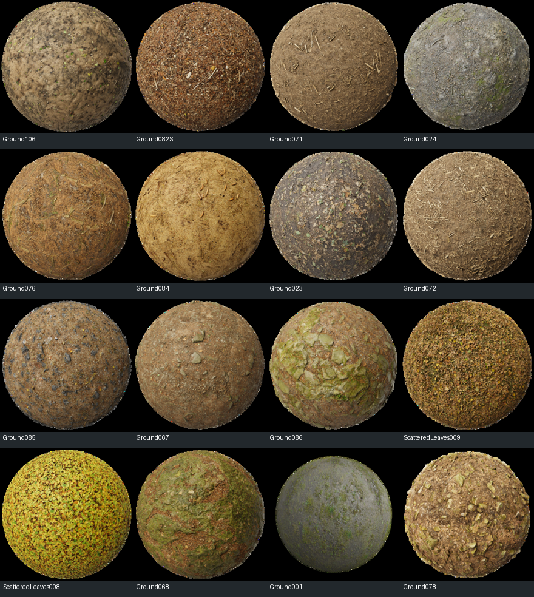
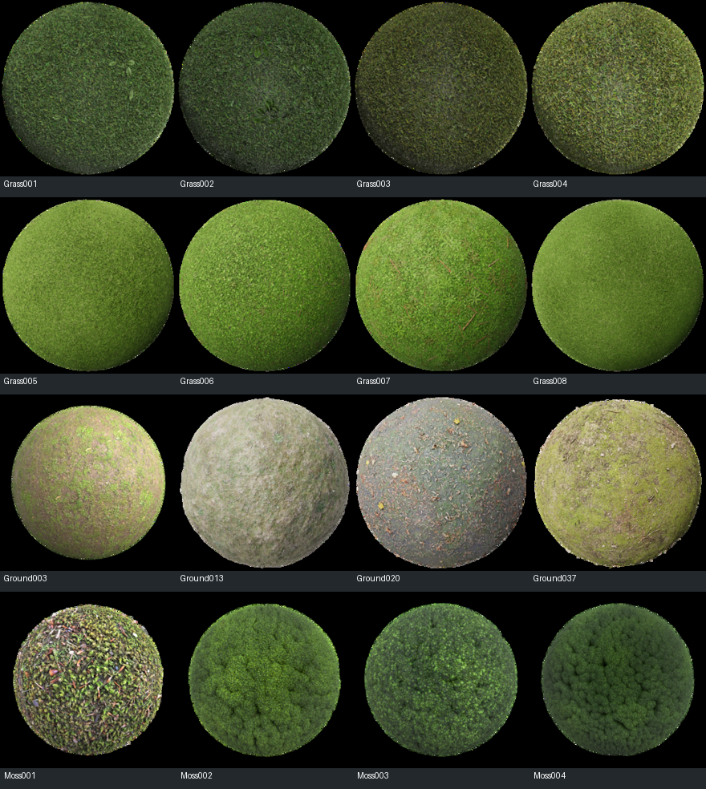
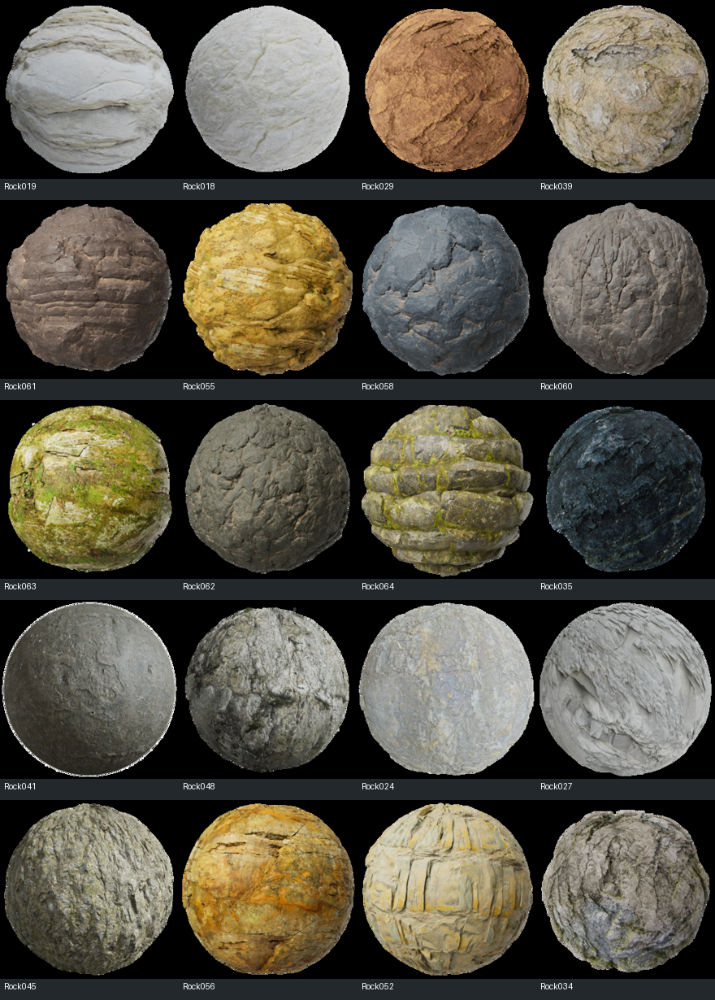
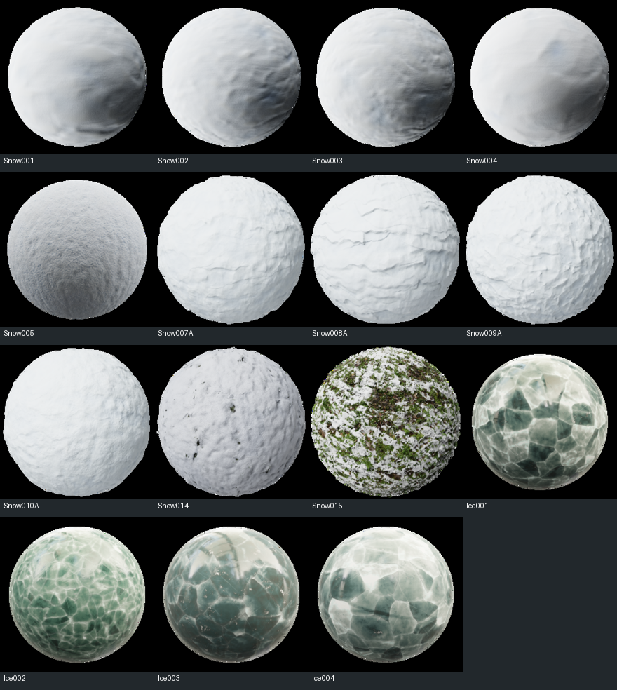

# Carte de textures du sol à partir des informations de terrain

[English](GROUND_TEXTURE_MAPPING_V1.md)

Proposition de palette et de classement pour Test-Render, 25 octobre 2026.

Le lot retient **90 types visuels**, associés à **142 textures candidates** de Poly Haven et ambientCG. Il inclut les terres, les sables et fragments, **22 types de roches**, les sols forestiers et leurs litières, les prairies, steppes, savanes, mousses, neiges et glaces de surface. Les arbres, leurs couronnes et les constructions restent séparés. Les textures du couvert au ras du sol font partie de cette carte, conformément au périmètre demandé ici.

Les quatre blocs **N1–N4 de la section 4.1** de [l'étude exhaustive](GROUND_MATERIAL_MAPPING_FR.md) sont considérés disponibles. Les extensions physiques et historiques de sa section 4.2 ne sont pas requises. Les types sont des choix d'apparence : un sol forestier, une roche veinée ou une neige transformée peuvent être représentés sans simuler leur formation.

**Un seul asset est choisi par type pour toute la carte**, parmi ses candidats compatibles. Les conditions de terrain choisissent ensuite les types et leurs transitions ; elles ne relancent pas un tirage de texture à chaque endroit. Toutes les occurrences de `F04`, par exemple, emploient le même matériau de litière d'aiguilles. Une autre seed peut choisir un autre candidat pour F04 sur une autre carte.

Le [catalogue associé](GROUND_TEXTURE_PALETTE_V1.json) contient les types, conditions, pools et références des assets. Il décrit la sélection proposée ; il ne modifie pas le générateur ni le renderer.

## 1 Sources et réduction du périmètre

La sélection part des banques de [RENDER_REVIEW.md du worktree height-chain-budget](../../magna-urbis-height-chain-budget/docs/RENDER_REVIEW.md), §6–9. Poly Haven et ambientCG couvrent le présent catalogue ; MatSynth reste une réserve et n'est pas une dépendance du lot. La bibliothèque de 15 sources déjà déclarée dans [surface/materials/catalogue.json](../../magna-urbis-height-chain-budget/surface/materials/catalogue.json) est réutilisable en partie, mais ne constitue pas une limite au nombre de types.

Les assets sont fournis sous CC0 selon les [conditions de Poly Haven](https://polyhaven.com/license) et celles [d'ambientCG](https://docs.ambientcg.com/license/). Le catalogue conserve le fournisseur et le lien de chaque fiche. Il faut distinguer cette licence des modalités d'accès aux API.

La disponibilité des canaux couleur, normale, rugosité et hauteur des 142 candidats a été contrôlée dans les métadonnées de téléchargement des fournisseurs. Des albedos Poly Haven et des aperçus officiels ambientCG ont aussi été examinés pour une partie des candidats ; le JSON indique cette portée par asset. **Disponibilité dans une banque et pré-sélection visuelle ne valent pas validation artistique dans Test-Render.** Les packs complets ne sont pas tous téléchargés ou intégrés.

La réduction porte sur les besoins de simulation et la sélection des textures, pas sur la diversité visible :

| Groupe | Types |
| --- | ---: |
| Terres et matrices | 12 |
| Sables et fragments | 12 |
| Roches | 22 |
| Sols forestiers | 12 |
| Prairies, steppes, savanes et autres couverts ras | 16 |
| Sols humides et mousses | 6 |
| Neiges et glaces de surface | 10 |
| **Total** | **90** |

Toutes les cartes n'ont pas vocation à présenter les 90 types. Un catalogue riche permet de couvrir des climats et reliefs différents ; une carte donnée ne charge que les types présents et nécessaires à la vue.

## 2 Informations utilisées

| Entrée | Rôle dans le choix de texture |
| --- | --- |
| N1 : exposition de roche, couverture de matrice et rugosité structurelle | Support rocheux, mosaïque roche-terre ou sol meuble ; aspect compact, grossier ou fracturé |
| N2 : sable, fines, graviers, pierres, tailles, arrondi et origine | Sable libre, terre sableuse, gravier, galets ou fragments ; couleur du dépôt issue de sa source |
| N3 : eaux typées, connexions, rives et emprises mouillées | Lit mouillé, banc émergé, berge, rive lacustre et côte ; maintien des masques et niveaux d'eau |
| N4 : état et saison d'affichage | Sec/humide, état herbacé vert/sec, neige fraîche/ancienne/ventée/partielle, glace si le preset la demande |
| Roche mère et altération déjà disponibles | Compatibilité des aspects rocheux et des teintes minérales ; transition vers les résidus meubles |
| Climat, altitude, pente, exposition, courbures et géomorphons | Préférences d'apparence et de rétention ; contexte humide/sec, froid/chaud, stable/exposé, creux/versant/crête |
| Humidité, drainage et organique déjà disponibles | Terre sombre, boue, tapis humide ou mousseux ; ces proxys ne deviennent pas une classification de tourbe |

Les catégories N4 de neige et de glace sont des **presets d'apparence de scène**, avec modulation locale par le relief et l'humidité. Par rapport au N4 minimal de l'étude exhaustive, on élargit ici le vocabulaire du préréglage ; cela ne demande pas une nouvelle simulation ni les extensions 4.2. Ces presets ne constituent pas des cartes d'histoire glaciaire, de pergélisol ou un bilan d'accumulation. Sans preset neige/glace, le froid seul ne recouvre pas la carte de blanc.

### 2.1 Forêt prairie savane et autres contextes

Le contexte du couvert sert à sélectionner les textures de sol, sans imposer de générer des arbres ou des brins d'herbe. Deux chemins sont possibles :

1. Si le générateur fournit déjà une occupation ou un potentiel canonique de couvert, le réutiliser : forêt feuillue/résineuse/mixte, herbacé ouvert, etc. Ne pas reconstruire ces informations en lisant les couleurs de l'image Render.
2. À défaut, calculer des **préférences d'apparence** depuis les entrées existantes, puis les départager avec un profil global stable. Ce classement produit une carte plausible ; il ne prétend pas retrouver exactement une canopée déjà peinte dans une image aplatie.

| Contexte d'apparence | Préférences calculables avec les entrées disponibles |
| --- | --- |
| Forestier humide | Eau disponible et climat favorables, manteau de sol, stabilité et organique ; adapter feuillu/résineux/mixte au climat local et au profil global |
| Forestier sec | Potentiel forestier retenu, état sec N4 ou climat plus sec ; litière et matrice sèches |
| Prairie | Sol stable, eau suffisante pour un couvert herbacé, contexte ouvert retenu |
| Steppe | Eau limitée, sol minéral apparent, herbacé clairsemé ; ne pas convertir automatiquement en sable |
| Savane | Contexte chaud et profil herbacé saisonnier retenu ; N4 distingue phase verte et sèche, sans dessiner les arbres |
| Couvert ras froid | Température locale basse, sol émergé, humidité et stabilité compatibles ; aucune histoire de pergélisol nécessaire |
| Mousse | Eau disponible élevée et surface favorable relativement stable ; roche ou matrice selon N1 |

Les préférences restent continues. Dans les cas ambigus forêt/prairie ou feuillu/résineux, un **profil d'apparence tiré une fois pour la carte** peut biaiser les scores admissibles. Ce tirage est distinct du tirage des assets par type et ne fabrique pas un bruit de biomes pixel par pixel. Le profil, ses biais et les textures choisies sont sauvegardés.

La litière et les herbes de cette version sont donc des apparences contextuelles de surface. Leur présence n'exige pas l'historique biologique détaillé de l'ancienne extension O7. Si la correspondance exacte avec les arbres du générateur est souhaitée, il faut brancher son champ de couvert existant ; une inférence à partir du climat seul ne suffit pas à cette égalité exacte.

### 2.2 Vingt aspects rocheux de base et deux aspects colonisés

Les cinq parents actuels — granite, calcaire, grès, argilo-marneux et basalte — restent inchangés dans les données. Chacun porte quatre profils d'apparence : compact, plus grossier/structuré, fracturé et altéré, adaptés à son cas. On obtient ainsi vingt types rocheux de base, plus deux types à mousse/lichens.

Ce sont des **types visuels**, pas vingt nouvelles lithologies déduites de cinq fractions. Les noms des banques ne certifient pas toujours la pétrographie : un exemplaire est retenu pour son grain, sa structure et ses possibilités de coloration. La provenance physique du terrain reste distincte du nom de la photo.

Une répartition possible entre quatre profils, pour chaque parent, est :

```text
compact  = (1 - alteration) * (1 - rugosite)
grossier = (1 - alteration) * rugosite * (1 - expositionForte)
fracture = (1 - alteration) * rugosite * expositionForte
altere   = alteration
```

Ces poids totalisent 1. Ils sont ensuite multipliés par la fraction du parent et l'exposition rocheuse N1. `rugosite` et `expositionForte` sont des proxys d'apparence, pas une mesure de taille des cristaux ou de fracturation géologique. La légende peut donner un type dominant, mais le renderer conserve des transitions entre types.

## 3 Table informations de carte vers textures

Chaque ligne ci-dessous constitue un type persistant. **PH** désigne Poly Haven, **ACG** ambientCG. Les candidats liés sur une même ligne sont des alternatives ; un seul est sélectionné pour toute la carte. La présence d'un asset dans plusieurs pools est permise, mais ses réglages peuvent différer selon le type.

Les conditions sont des règles d'apparence à calibrer, pas des lois universelles. Les noms « forêt chaude », « savane » ou « alpine » désignent le contexte visuel ; les photos ne certifient pas une essence ou une région de capture. Les paramètres de couleur et d'état complètent la texture, sans remplacer une structure différente par une simple teinte.

### Terres et matrices

| Type | Informations de carte / conditions | Textures candidates | Adaptation |
| --- | --- | --- | --- |
| **B01 — Terre brune fine** | Matrice émergée dominante, ni sable libre ni couvert ras choisi | [PH brown_mud](https://polyhaven.com/a/brown_mud), [ACG Ground048](https://ambientcg.com/a/Ground048) | Teinte minérale et humidité |
| **B02 — Terre sombre riche en organique** | Matrice stable, organique élevé, sans tapis forestier dense | [PH dirt_floor](https://polyhaven.com/a/dirt_floor), [ACG Ground051](https://ambientcg.com/a/Ground051) | Assombrissement organique, pas de tourbe revendiquée |
| **B03 — Terre claire limoneuse** | Fines limoneuses disponibles, faible pierrosité, surface stable | [ACG Ground102](https://ambientcg.com/a/Ground102), [ACG Ground103](https://ambientcg.com/a/Ground103) | Détail très fin et couleur parentale ; pas de loess historique |
| **B04 — Terre argileuse compacte** | Argile dominante, fines exposées, sans dessiccation active | [ACG Ground026](https://ambientcg.com/a/Ground026), [PH brown_mud](https://polyhaven.com/a/brown_mud) | Faible relief, humidité variable |
| **B05 — Terre argileuse fissurée** | Matrice argileuse, N4 sec et cycle humide-sec autorisé | [PH dry_ground_01](https://polyhaven.com/a/dry_ground_01), [PH mud_cracked_dry_03](https://polyhaven.com/a/mud_cracked_dry_03) | Échelle des fissures modeste ; pas de vertisol déduit |
| **B06 — Terre poussiéreuse sèche** | Fines disponibles, faible humidité, surface meuble découverte | [ACG Ground104](https://ambientcg.com/a/Ground104), [ACG Ground099](https://ambientcg.com/a/Ground099) | Palette claire et faible relief |
| **B07 — Terre grumeleuse** | Matrice meuble irrégulière, humidité intermédiaire et faible exposition rocheuse | [ACG Ground104](https://ambientcg.com/a/Ground104), [PH brown_mud_dry](https://polyhaven.com/a/brown_mud_dry) | Granularité de motte ; pas de sillons agricoles |
| **B08 — Terre sèche caillouteuse** | Matrice avec fragments épars, stock grossier modéré | [PH brown_mud_dry](https://polyhaven.com/a/brown_mud_dry), [ACG Ground091](https://ambientcg.com/a/Ground091) | Pierrosité à l'échelle de l'exemplaire |
| **B09 — Boue fine humide** | Matrice fine émergée, état humide/saturé N4, hors eau libre | [ACG Ground036](https://ambientcg.com/a/Ground036), [ACG Ground083](https://ambientcg.com/a/Ground083) | Rugosité abaissée, eau libre traitée séparément |
| **B10 — Boue desséchée en plaques** | Fines cohésives, cycle sec-humide N4, surface desséchée | [PH mud_cracked_dry_riverbed_002](https://polyhaven.com/a/mud_cracked_dry_riverbed_002), [PH mud_cracked_dry_03](https://polyhaven.com/a/mud_cracked_dry_03) | Plaques et fissures calibrées ; pas de nouvelle histoire pédologique |
| **B11 — Terre chaude ocre ou rougeâtre** | Source minérale et palette compatibles, exposition sèche | [PH red_dirt_mud_01](https://polyhaven.com/a/red_dirt_mud_01), [ACG Ground098](https://ambientcg.com/a/Ground098) | Variante d'apparence ; ne signifie pas latérite ou cuirasse |
| **B12 — Résidu minéral friable** | Altération élevée, manteau résiduel exposé, stock de fines | [PH dirt](https://polyhaven.com/a/dirt), [ACG Ground105](https://ambientcg.com/a/Ground105) | Couleur du parent et rugosité ; pas de profil géologique profond |

### Sables et fragments

| Type | Informations de carte / conditions | Textures candidates | Adaptation |
| --- | --- | --- | --- |
| **S01 — Sable fin clair** | Sable libre disponible et dominant, peu de grossiers | [PH sand_02](https://polyhaven.com/a/sand_02), [ACG Ground052](https://ambientcg.com/a/Ground052) | Palette sableuse compatible, sec ou humide |
| **S02 — Sable fin ocre** | Sable libre dominant, parent/palette plus chauds | [PH sand_03](https://polyhaven.com/a/sand_03), [ACG Ground080](https://ambientcg.com/a/Ground080) | Teinte choisie sans créer une province minérale |
| **S03 — Sable graveleux** | Stock sableux avec petits fragments abondants | [PH gravelly_sand](https://polyhaven.com/a/gravelly_sand), [PH sandy_gravel_02](https://polyhaven.com/a/sandy_gravel_02) | Pré-mélange photographique sable et gravier |
| **S04 — Sable humide compact** | Stock sableux, N4 humide, proximité typée ou rétention | [PH damp_sand](https://polyhaven.com/a/damp_sand), [PH damp_beach_sand](https://polyhaven.com/a/damp_beach_sand) | Reste une surface de sol, pas un plan d'eau |
| **S05 — Sable à rides fines** | Sable libre, vent ou courant pertinent, pas de grande dune à fabriquer | [PH sand_02](https://polyhaven.com/a/sand_02), [PH sand_03](https://polyhaven.com/a/sand_03) | Base PBR et rides directionnelles fines ; ensemble choisi une fois |
| **S06 — Sable ferme peu texturé** | Sable compact ou mélange fin stable, faible rugosité | [ACG Ground092C](https://ambientcg.com/a/Ground092C), [ACG Ground101](https://ambientcg.com/a/Ground101) | Relief faible ; pas de sel ou gypse inféré |
| **G01 — Gravier fin anguleux** | Stock grossier fin, angularité élevée, couverture importante | [PH gravel_stones](https://polyhaven.com/a/gravel_stones), [ACG Gravel043](https://ambientcg.com/a/Gravel043) | Taille réelle des éléments à calibrer |
| **G02 — Gravier grossier** | Stock anguleux plus gros, dépôt ou versant connecté | [PH rock_ground](https://polyhaven.com/a/rock_ground), [ACG Gravel022](https://ambientcg.com/a/Gravel022) | Fragments et matrice déjà présents dans la photo |
| **G03 — Petits galets roulés** | N2 arrondi et petites tailles, dépôt remanié | [PH clean_pebbles](https://polyhaven.com/a/clean_pebbles), [ACG Gravel020](https://ambientcg.com/a/Gravel020) | Provenance du dépôt, pas roche locale imposée |
| **G04 — Galets moyens et gros** | N2 arrondi et tailles plus grandes, stock remanié suffisant | [PH dry_river_pebbles](https://polyhaven.com/a/dry_river_pebbles), [PH ganges_river_pebbles](https://polyhaven.com/a/ganges_river_pebbles) | Échelle cohérente, pas grossissement arbitraire d'un grain |
| **G05 — Sol à pierres dispersées** | Fragments sur matrice, couverture intermédiaire | [PH rocks_ground_03](https://polyhaven.com/a/rocks_ground_03), [ACG Rocks009](https://ambientcg.com/a/Rocks009) | Texture de zone pré-mélangée |
| **G06 — Roche et fragments en mosaïque** | N1 roche partielle avec manteau meuble et fragments | [PH rocks_ground_06](https://polyhaven.com/a/rocks_ground_06), [PH rocks_ground_05](https://polyhaven.com/a/rocks_ground_05) | Pas de double ajout de la matrice ni de gros volumes nouveaux |

### Roches

| Type | Informations de carte / conditions | Textures candidates | Adaptation |
| --- | --- | --- | --- |
| **R01 — Aspect granitique fin compact** | Parent granitique, faible altération et rugosité faible | [PH rock_01](https://polyhaven.com/a/rock_01), [ACG Rock024](https://ambientcg.com/a/Rock024) | Grain et couleur de roche ; exemplaires non certifiés pétrographiquement |
| **R02 — Aspect granitique à gros grain** | Parent granitique, rugosité intermédiaire, roche exposée | [PH rock_boulder_dry](https://polyhaven.com/a/rock_boulder_dry), [ACG Rock048](https://ambientcg.com/a/Rock048) | Préserver le détail minéral, teinte granitique |
| **R03 — Roche granitique très fracturée** | Parent granitique, forte rugosité structurelle ou pente exposée | [ACG Rock058](https://ambientcg.com/a/Rock058), [PH rock_05](https://polyhaven.com/a/rock_05) | Fractures de l'exemplaire, pas faille géologique ajoutée |
| **R04 — Roche granitique altérée** | Parent granitique et altération forte, transition vers fines | [PH rock_surface](https://polyhaven.com/a/rock_surface), [PH rock_08](https://polyhaven.com/a/rock_08) | Atténuation du relief et palette d'altération |
| **R05 — Roche carbonatée claire massive** | Parent calcaire, roche exposée compacte | [ACG Rock018](https://ambientcg.com/a/Rock018), [PH rock_08](https://polyhaven.com/a/rock_08) | Couleur claire, sans karst nouveau |
| **R06 — Roche carbonatée en bancs** | Parent calcaire, structure orientée exposée | [ACG Rock019](https://ambientcg.com/a/Rock019), [ACG Rock017](https://ambientcg.com/a/Rock017) | Orientation du motif ; pas de pendage supplémentaire exigé |
| **R07 — Roche carbonatée fissurée** | Parent calcaire, forte rugosité ou exposition | [ACG Rock027](https://ambientcg.com/a/Rock027), [PH rock_boulder_dry](https://polyhaven.com/a/rock_boulder_dry) | Fissures locales de texture, pas de dolines |
| **R08 — Roche carbonatée altérée ou piquetée** | Parent calcaire, altération et couverture mince | [ACG Rock032](https://ambientcg.com/a/Rock032), [PH rock_08](https://polyhaven.com/a/rock_08) | Aspect érodé générique ; pas de dissolution simulée |
| **R09 — Grès stratifié** | Parent gréseux, exposition de structure orientée | [PH cliff_side](https://polyhaven.com/a/cliff_side), [ACG Rock061](https://ambientcg.com/a/Rock061) | Aligner les bancs, éviter rotations aléatoires |
| **R10 — Grès massif ocre** | Parent gréseux, roche compacte et palette chaude | [PH rock_face](https://polyhaven.com/a/rock_face), [ACG Rock029](https://ambientcg.com/a/Rock029) | Conserver la structure sans revendiquer une chimie précise |
| **R11 — Grès clair altéré** | Parent gréseux, altération et teinte claire compatibles | [PH worn_rock_natural_01](https://polyhaven.com/a/worn_rock_natural_01), [ACG Rock052](https://ambientcg.com/a/Rock052) | Teinte et échelle des aspérités |
| **R12 — Grès grossier fracturé** | Parent gréseux, forte rugosité et pente exposée | [PH rock_boulder_cracked](https://polyhaven.com/a/rock_boulder_cracked), [ACG Rock056](https://ambientcg.com/a/Rock056) | Gros reliefs limités à leur représentation de texture |
| **R13 — Roche argilo-marneuse compacte** | Parent argilo-marneux, roche accessible et compacte | [PH rock_surface](https://polyhaven.com/a/rock_surface), [ACG Rock041](https://ambientcg.com/a/Rock041) | Substitut visuel fin, adouci et recoloré |
| **R14 — Roche argilo-marneuse en plaquettes** | Parent argilo-marneux, texture structurale rugueuse | [ACG Rock060](https://ambientcg.com/a/Rock060), [ACG Rock034](https://ambientcg.com/a/Rock034) | Plaquettes visuelles ; pas de schistosité physique déduite |
| **R15 — Roche argilo-marneuse finement stratifiée** | Parent argilo-marneux, structure orientée, altération modérée | [ACG Rock027](https://ambientcg.com/a/Rock027), [ACG Rock038](https://ambientcg.com/a/Rock038) | Direction fournie, variation de relief limitée |
| **R16 — Roche argilo-marneuse friable** | Parent argilo-marneux, altération forte et fines disponibles | [ACG Rock062](https://ambientcg.com/a/Rock062), [PH rock_2](https://polyhaven.com/a/rock_2) | Transition vers B12/B04, pas d'alternance de classes sèches |
| **R17 — Roche basaltique sombre compacte** | Parent basaltique, faible altération, rugosité faible | [PH dark_rock_02](https://polyhaven.com/a/dark_rock_02), [ACG Rock031](https://ambientcg.com/a/Rock031) | Apparence de roche sombre, pas lave récente |
| **R18 — Roche basaltique sombre fissurée** | Parent basaltique, rugosité ou exposition fortes | [PH dark_rock](https://polyhaven.com/a/dark_rock), [ACG Rock035](https://ambientcg.com/a/Rock035) | Réseau de fractures du matériau, pas coulée inventée |
| **R19 — Roche basaltique très rugueuse** | Parent basaltique, forte rugosité et fragmentation | [ACG Rock047](https://ambientcg.com/a/Rock047), [ACG Rock048](https://ambientcg.com/a/Rock048) | Aspect massif ou bréchique générique ; pas de scorie identifiée |
| **R20 — Roche basaltique altérée** | Parent basaltique, altération élevée, humidité et dépôts compatibles | [ACG Rock033](https://ambientcg.com/a/Rock033), [ACG Rock037](https://ambientcg.com/a/Rock037) | Patine et teinte d'altération, sans diagnostic minéralogique |
| **R21 — Roche à mousse** | Roche exposée et contexte humide à couvert ras, exposition favorable | [ACG Rock064](https://ambientcg.com/a/Rock064), [PH mossy_rock](https://polyhaven.com/a/mossy_rock) | Texture combinant déjà roche et mousse ; contexte identifié |
| **R22 — Roche à lichens ou mouchetures végétales** | Roche exposée, contexte frais/relativement stable de couvert ras | [PH lichen_rock](https://polyhaven.com/a/lichen_rock), [ACG Rock046S](https://ambientcg.com/a/Rock046S) | Apparence de surface, sans nouvelle carte biologique |

### Sols forestiers

| Type | Informations de carte / conditions | Textures candidates | Adaptation |
| --- | --- | --- | --- |
| **F01 — Litière feuillue sèche dense** | Contexte feuillu, sec ou saison sèche N4, manteau accessible | [PH forest_leaves_03](https://polyhaven.com/a/forest_leaves_03), [PH forest_leaves_04](https://polyhaven.com/a/forest_leaves_04) | Feuilles et sol déjà mélangés, aucun arbre peint |
| **F02 — Litière feuillue claire** | Contexte feuillu, palette claire ou saison de chute déclarée | [ACG ScatteredLeaves008](https://ambientcg.com/a/ScatteredLeaves008), [ACG ScatteredLeaves009](https://ambientcg.com/a/ScatteredLeaves009) | Choix saisonnier global, pas changement à chaque pixel |
| **F03 — Sol feuillu humide sombre** | Contexte feuillu, humidité forte et organique | [ACG Ground023](https://ambientcg.com/a/Ground023), [PH mud_forest](https://polyhaven.com/a/mud_forest) | Pas de tourbe physique revendiquée |
| **F04 — Litière d'aiguilles dense** | Contexte résineux, manteau d'aiguilles stable | [PH forrest_ground_03](https://polyhaven.com/a/forrest_ground_03), [ACG Ground082S](https://ambientcg.com/a/Ground082S) | Détail d'aiguilles, sans génération de conifères |
| **F05 — Sol résineux sableux** | Contexte résineux, matrice sableuse disponible | [PH forrest_sand_01](https://polyhaven.com/a/forrest_sand_01), [ACG Ground084](https://ambientcg.com/a/Ground084) | Conserver le sable et les débris, pas vert uniforme |
| **F06 — Sol forestier mixte** | Contexte forestier mélangé ou profil d'apparence mixte | [PH leaves_forest_ground](https://polyhaven.com/a/leaves_forest_ground), [ACG Ground078](https://ambientcg.com/a/Ground078) | Mélange déjà présent dans la texture |
| **F07 — Sol forestier caillouteux** | Contexte forestier, N1/N2 fragments ou roche partielle | [PH forest_ground_04](https://polyhaven.com/a/forest_ground_04), [ACG Ground085](https://ambientcg.com/a/Ground085) | Pas reclassé en roche massive |
| **F08 — Sol forestier mousseux** | Contexte forestier humide, couverture ras mousseux autorisée | [PH forest_leaves_02](https://polyhaven.com/a/forest_leaves_02), [ACG Ground024](https://ambientcg.com/a/Ground024) | Mousse et feuilles d'un même exemplaire |
| **F09 — Sol forestier à racines apparentes** | Contexte forestier, manteau mince ou décapage relatif | [PH roots](https://polyhaven.com/a/roots), [ACG Ground076](https://ambientcg.com/a/Ground076) | Racines au sol, pas tronc ou houppier |
| **F10 — Terre de clairière forestière** | Contexte forestier ouvert, peu de litière, matrice exposée | [ACG Ground071](https://ambientcg.com/a/Ground071), [PH dirt_floor](https://polyhaven.com/a/dirt_floor) | Raccord vers les sols herbacés et nus |
| **F11 — Sol de forêt sèche** | Contexte forestier chaud/sec ou phase sèche N4 | [PH dry_decay_leaves](https://polyhaven.com/a/dry_decay_leaves), [PH winter_leaves](https://polyhaven.com/a/winter_leaves) | Débris secs, recoloration bornée |
| **F12 — Sol de forêt chaude humide** | Contexte forestier chaud/humide, matrice organique et litière | [PH leaves_forest_ground](https://polyhaven.com/a/leaves_forest_ground), [ACG Ground106](https://ambientcg.com/a/Ground106) | Approximation de l'apparence au sol, pas identification d'essences tropicales |

### Prairies steppes savanes et couverts ras

| Type | Informations de carte / conditions | Textures candidates | Adaptation |
| --- | --- | --- | --- |
| **P01 — Prairie verte dense** | Contexte herbacé, humidité moyenne à forte, matrice stable | [ACG Grass001](https://ambientcg.com/a/Grass001), [ACG Grass002](https://ambientcg.com/a/Grass002) | Texture au ras du sol, pas arbres |
| **P02 — Pelouse ou prairie très rase** | Contexte herbacé ras, surface régulière et stable | [ACG Grass005](https://ambientcg.com/a/Grass005), [ACG Grass006](https://ambientcg.com/a/Grass006) | Usage d'apparence, pas preuve de tonte humaine |
| **P03 — Prairie verte hétérogène** | Contexte herbacé, sol et humidité variables | [ACG Grass003](https://ambientcg.com/a/Grass003), [ACG Grass004](https://ambientcg.com/a/Grass004) | Hétérogénéité de l'exemplaire, identité stable |
| **P04 — Prairie à feuilles larges** | Contexte herbacé relativement chaud/humide | [PH leafy_grass](https://polyhaven.com/a/leafy_grass), [ACG Grass001](https://ambientcg.com/a/Grass001) | Petites plantes du couvert ras, pas canopée |
| **P05 — Prairie dense à aspect haut** | Contexte herbacé productif et humide | [PH leafy_grass](https://polyhaven.com/a/leafy_grass), [ACG Grass004](https://ambientcg.com/a/Grass004) | Aspect de dessus ; la texture ne crée pas des tiges en volume |
| **P06 — Prairie sèche feutrée** | Contexte herbacé, N4 sec, faible eau disponible | [PH withered_grass](https://polyhaven.com/a/withered_grass), [PH grass_ground](https://polyhaven.com/a/grass_ground) | Structure sèche conservée, pas seul changement de couleur du gazon |
| **P07 — Prairie clairsemée sur terre** | Couvert herbacé ouvert, matrice visible | [PH sparse_grass](https://polyhaven.com/a/sparse_grass), [ACG Ground003](https://ambientcg.com/a/Ground003) | Texture pré-mélangée plantes/terre |
| **P08 — Steppe sèche** | Contexte herbacé sec, eau limitée, peu de couvert dense | [PH sparse_grass](https://polyhaven.com/a/sparse_grass), [ACG Ground013](https://ambientcg.com/a/Ground013) | Palette paille et terre, densité adaptée au type |
| **P09 — Steppe pierreuse** | Contexte herbacé ouvert et froid/sec, fragments/roche partielle | [PH aerial_grass_rock](https://polyhaven.com/a/aerial_grass_rock), [ACG Ground067](https://ambientcg.com/a/Ground067) | Pré-mélange minéral/herbacé ; pas matériau de roche nue |
| **P10 — Savane verte de saison humide** | Contexte chaud saisonnier, herbacé dominant, N4 humide | [PH leafy_grass](https://polyhaven.com/a/leafy_grass), [ACG Grass004](https://ambientcg.com/a/Grass004) | Aucun arbre dans cette texture de sol |
| **P11 — Savane sèche à herbes continues** | Contexte chaud saisonnier, N4 sec, couvert herbacé continu | [PH withered_grass](https://polyhaven.com/a/withered_grass), [PH grass_ground](https://polyhaven.com/a/grass_ground) | Graminées sèches, sans convertir tout le sol en sable |
| **P12 — Savane ouverte à terre visible** | Contexte chaud, eau limitée et couverture herbacée discontinue | [PH sparse_grass](https://polyhaven.com/a/sparse_grass), [ACG Ground003](https://ambientcg.com/a/Ground003) | Matrice visible et teintée selon source |
| **P13 — Savane pierreuse** | Contexte chaud herbacé ouvert et stock grossier | [PH brown_mud_rocks_01](https://polyhaven.com/a/brown_mud_rocks_01), [ACG Ground067](https://ambientcg.com/a/Ground067) | Herbe/terre/pierres comme une seule recette de zone |
| **P14 — Prairie alpine rase** | Contexte froid d'altitude, sol émergé non enneigé, couvert ras | [ACG Grass003](https://ambientcg.com/a/Grass003), [ACG Grass004](https://ambientcg.com/a/Grass004) | Pas de pergélisol ni glacier inféré |
| **P15 — Tapis herbeux et mousseux froid** | Contexte froid humide, couvert ras et matrice stable | [ACG Moss003](https://ambientcg.com/a/Moss003), [ACG Grass003](https://ambientcg.com/a/Grass003) | Apparence de type toundra, sans histoire de pergélisol |
| **P16 — Lande herbacée mêlée de débris** | Contexte frais, ouvert, humidité moyenne, couvert ras mixte | [ACG Ground037](https://ambientcg.com/a/Ground037), [PH forrest_ground_01](https://polyhaven.com/a/forrest_ground_01) | Petites plantes et débris, sans arbustes ou arbres en volume |

### Sols humides et mousses

| Type | Informations de carte / conditions | Textures candidates | Adaptation |
| --- | --- | --- | --- |
| **H01 — Herbe humide sombre** | Couvert herbacé, bas-fond ou rétention et état humide | [ACG Grass002](https://ambientcg.com/a/Grass002), [ACG Ground037](https://ambientcg.com/a/Ground037) | Fines et vert sombre, pas végétation flottante |
| **H02 — Sol humide organique découvert** | Matrice riche en organique et N4 humide, hors eau libre | [ACG Ground051](https://ambientcg.com/a/Ground051), [PH mud_forest](https://polyhaven.com/a/mud_forest) | Aspect organique, pas tourbe épaisse |
| **H03 — Mousse dense en coussinets** | Profil de couvert ras humide et support stable | [ACG Moss002](https://ambientcg.com/a/Moss002), [ACG Moss004](https://ambientcg.com/a/Moss004) | Texture complète de mousse, pas forêt |
| **H04 — Mousse mêlée de litière** | Contexte humide, débris et couvert ras mêlés | [ACG Moss001](https://ambientcg.com/a/Moss001), [PH forest_leaves_02](https://polyhaven.com/a/forest_leaves_02) | Un pré-mélange, pas deux couches comptées deux fois |
| **H05 — Pierres humides et mousse** | Support ou fragments rocheux partiels et couvert ras humide | [ACG Ground068](https://ambientcg.com/a/Ground068), [ACG Ground086](https://ambientcg.com/a/Ground086) | Roche/mousse, identité locale minérale conservée |
| **H06 — Berge humide à petits débris** | N3 rive typée, matrice fine humide et couvert ras/débris | [ACG Ground024](https://ambientcg.com/a/Ground024), [PH mud_forest](https://polyhaven.com/a/mud_forest) | Pas de marée, salinité ou tourbière requises |

### Neiges et glaces de surface

| Type | Informations de carte / conditions | Textures candidates | Adaptation |
| --- | --- | --- | --- |
| **N01 — Neige fraîche fine** | Preset neige fraîche N4 et rétention locale positive | [ACG Snow005](https://ambientcg.com/a/Snow005), [ACG Snow001](https://ambientcg.com/a/Snow001) | Manteau de surface, pas glacier |
| **N02 — Neige fraîche irrégulière** | Preset neige N4, surface moins régulière | [ACG Snow002](https://ambientcg.com/a/Snow002), [ACG Snow004](https://ambientcg.com/a/Snow004) | Relief de surface calibré |
| **N03 — Neige compacte** | Preset neige compacte ou tassée naturellement N4 | [ACG Snow007A](https://ambientcg.com/a/Snow007A), [ACG Snow010A](https://ambientcg.com/a/Snow010A) | Candidats sans traces humaines explicites |
| **N04 — Neige transformée granuleuse** | Preset neige ancienne/transformée N4 | [ACG Snow003](https://ambientcg.com/a/Snow003), [ACG Snow010A](https://ambientcg.com/a/Snow010A) | Variante d'apparence, pas simulation de métamorphisme |
| **N05 — Neige soufflée à ondulations** | Preset neige ventée N4 et direction régionale disponible | [ACG Snow008A](https://ambientcg.com/a/Snow008A), [ACG Snow009A](https://ambientcg.com/a/Snow009A) | Alignement du motif, pas corniche nouvelle |
| **N06 — Neige salie ou fondante** | Preset fonte N4, support minéral ou organique affleurant | [ACG Snow014](https://ambientcg.com/a/Snow014), [PH snow_04](https://polyhaven.com/a/snow_04) | Couverture et humidité séparées de la roche mère |
| **N07 — Neige discontinue sur herbe** | Preset neige partielle N4, contexte herbacé sous-jacent | [ACG Snow015](https://ambientcg.com/a/Snow015) | Pré-mélange déjà enneigé ; ne pas ajouter une seconde neige complète |
| **N08 — Neige discontinue sur minéral** | Preset neige partielle N4, support rocheux/minéral | [ACG Snow014](https://ambientcg.com/a/Snow014), [PH snow_05](https://polyhaven.com/a/snow_05) | Taches minérales et raccord au support ; pas une histoire glaciaire |
| **I01 — Glace à petites fractures** | Preset glace de surface N4, sol ou eau gelée explicitement sélectionné | [ACG Ice002](https://ambientcg.com/a/Ice002), [ACG Ice003](https://ambientcg.com/a/Ice003) | Niveau d'eau conservé si domaine aquatique |
| **I02 — Glace à grandes fractures** | Preset glace fracturée N4 et domaine compatible | [ACG Ice001](https://ambientcg.com/a/Ice001), [ACG Ice004](https://ambientcg.com/a/Ice004) | Aucune banquise ou crevasse de glacier générée par le choix de texture |


## 4 Résolution des choix et couverture de toute la carte

### 4.1 Ordre de classement

1. **Domaine eau** : conserver l'eau et ses niveaux N3. Les états de glace N4 concernent explicitement ce domaine ou le support émergé ; ils ne changent pas la hauteur d'un lac. Sans fond qualifié, une eau profonde n'est pas repeinte avec un sol sableux.
2. **Support minéral** : N1/N2 déterminent les possibilités roche/matrice/fragments. Les parents et les proportions du dépôt contraignent les types R, B, S et G. Une terre au-dessus d'un basalte n'est pas forcément une dalle noire.
3. **Contexte de surface** : sélectionner les possibilités F, P et H à partir du couvert fourni ou des préférences dérivées de §2.1. Les zones rocheuses exposées restent rocheuses ; un climat humide ne peint pas de feuilles sur une paroi.
4. **État N4** : appliquer les variantes sèches/humides et les types N/I autorisés. La neige peut masquer le support qui reste conservé en dessous.
5. **Transitions et couleur** : produire les poids de types, la teinte et l'humidité. Aucun de ces calculs ne relance le choix d'asset global.

Le climat ne sélectionne donc pas à lui seul un matériau : savane sur sable, savane sur terre pierreuse et savane en phase humide peuvent donner des types distincts, sans nouvelle simulation.

Pour traduire les conditions des tables en poids, distinguer les contraintes nécessaires des préférences. Un type sans support admissible reçoit zéro : pas de galets sans stock arrondi, de litière sans contexte forestier, ni de neige sans preset. Les autres critères donnent des scores continus, avec des plages de transition à calibrer : humidité, froid, altération, ouverture du couvert, rugosité. Normaliser les scores admissibles **à l'intérieur du budget de support concerné**, puis appliquer les couvertures de contexte et d'état ; ne pas normaliser ensemble toutes les lignes du catalogue. En l'absence de score admissible, appliquer le repli de §4.3.

Les cas qui partagent les mêmes entrées peuvent rester un mélange ou être départagés par le profil global enregistré. Par exemple, une prairie haute et une prairie dense ne sont pas deux observations mesurées si aucune information de hauteur n'existe : ce sont alors deux options d'apparence. On ne fabrique pas un nouveau champ de hasard pour les distribuer localement. Les seuils numériques de ces scores et les échelles des textures restent à calibrer sur les plages réelles des layers ; la présente table ne les présente pas comme déjà validés dans le renderer.

### 4.2 Textures homogènes et textures déjà mélangées

Une texture de forêt contient souvent terre, feuilles et brindilles ; une texture de savane ouverte contient herbe et terre ; G06 contient déjà roche et matrice ; N07 contient déjà herbe et neige. Ces types sont des **recettes de zone pré-mélangées**. Leurs poids ne sont pas des fractions granulométriques exactes.

Quand un tel type est utilisé, ne pas rajouter une seconde fois tout ce qu'il contient. En particulier, ne pas additionner N07 et une neige complète, ni F01 et une litière intégrale, ni G06 et une matrice complète. On peut le remplacer progressivement par ses voisins de palette à ses limites. Si des parts physiques exactes ou une coloration séparée de chaque composant deviennent nécessaires, il faudra préparer des masques de matériau ou séparer les composants ; ce n'est pas une condition d'entrée du présent lot.

N1/N2 fixent ou bornent la couverture de support ; les textures sont choisies dans les types compatibles avec ce budget. Les transitions ne peuvent pas supprimer une roche connue exposée pour augmenter arbitrairement une prairie. Le budget exact peut être approximé par une recette photographique pré-mélangée : cette approximation reste identifiée comme telle.

### 4.3 Repli sans trou

| Situation restant sans candidat spécialisé | Type de repli |
| --- | --- |
| Matrice minérale émergée ordinaire | B01 ; B08 si des petits fragments sont connus |
| Sable meuble connu | S01 ; pas de sable inventé lorsqu'il n'est pas disponible |
| Stock grossier sans variante d'apparence plus précise | G01/G02 selon taille ; arrondi connu conduit à G03/G04 |
| Roche exposée | Type compact du parent dominant, avec proportions de parents conservées |
| Contexte herbacé sans sous-type retenu | P01 humide, P06 sec, P07 ouvert selon N4/N1 |
| Contexte forestier sans sous-type retenu | F06 ; F10 si la matrice est surtout découverte |
| Neige demandée sans autre détail | N01 ; le masque de couverture vient du preset N4 |
| Eau sans fond décrit | Autorité eau, sans faux matériau de fond |

Ce repli couvre les surfaces valides de la carte ; les régions hors domaine et les données absentes restent signalées. Un problème de téléchargement se traite à la préparation de la palette, avec un candidat de repli compatible et enregistré ; il n'entraîne pas un autre tirage lors du déplacement de la caméra.

Les types de sols salins, gypseux, tourbeux spécifiques, hydrothermaux ou pyroclastiques spécialisés ne sont pas activés par défaut faute des informations 4.2. Cela n'empêche ni les sols organiques d'apparence, ni les nombreuses roches, ni les neiges de scène demandées. Les glaciers, dunes majeures et falaises restent des formes du terrain, pas des effets produits par le choix d'une photo.

## 5 Un tirage par type pour toute la carte

```text
pour chaque type T :
    candidats = pool[T] validé et trié par identifiant stable
    index = hash(worldSeed, paletteVersion, T.id) modulo len(candidats)
    palette[T] = {asset choisi, échelle, teinte de référence, paramètres d'état}
    sauvegarder le résultat et les hashes des images

pour chaque position x :
    typesEtPoids = classer(infosCarte(x), N1(x), N2(x), N3(x), N4, profilGlobal)
    textures = palette[typesEtPoids.types]
    synthétiser ces mêmes textures en coordonnées physiques
```

Le choix du profil global de surface, s'il est nécessaire, possède sa propre clé de seed. Il n'est pas caché dans le choix de l'image. Les listes de candidats sont versionnées ; une carte sauvegardée garde ses assets résolus même si la banque ou la sélection évolue.

La même texture peut être décalée ou tournée localement pour casser le tuilage, sans changer d'identité. Tous ses canaux PBR subissent les mêmes transformations. Les textures orientées — bancs rocheux, rides, stries de neige — conservent leur direction cohérente plutôt qu'une rotation libre à chaque patch. Une même seed et une même version produisent la même palette, indépendamment de la caméra et du LOD.

Une version 1 peut prendre des probabilités égales entre candidats admis. Des poids de préférence peuvent ensuite favoriser les sources les mieux adaptées ; ils sont globaux par type, pas recalculés avec une préférence de photo différente dans chaque zone.

## 6 Recoloration et texturing à plusieurs échelles

### 6.1 Couleur de référence et détail

L'albédo source est converti en lumière linéaire. Sa moyenne `mu` est mesurée après préparation. Pour une cible `C` compatible, un premier réglage est :

```text
gain = bornes(C / max(mu, epsilon))
albedoRecolore(x) = albedoSource(x) * gain
```

Le gain reste borné pour conserver le contraste et éviter l'amplification des canaux presque noirs. Une cible incompatible demande un autre asset admis, pas un gain extrême. Il faut recalculer la moyenne du matériau préparé/recoloré : cette moyenne est celle affichée à distance. Ne pas employer les couleurs arbitraires des calques diagnostiques comme couleurs du sol.

Pour les minéraux, la cible vient du type, de la source rocheuse ou du dépôt N2, de l'organique et de l'humidité. Les verts des prairies, les feuilles, la mousse, les neiges et les glaces ont leurs palettes propres ; ils ne prennent pas la teinte de la roche mère. Pour les textures pré-mélangées sans masque interne, la recoloration est modérée ou désactivée si elle dénature leurs composants.

Changer le bleu d'une normale ou une valeur de rugosité ne constitue pas une recoloration. Les normales, hauteurs et rugosités suivent leurs propres conventions et échelles. L'humidité modifie les réponses du matériau ; elle ne crée pas à elle seule des mares ni une nouvelle surface d'eau.

### 6.2 Du survol au détail

| Régime | Valeur à afficher |
| --- | --- |
| Texture non résolue au survol | Moyenne linéaire du matériau recoloré, combinée avec les mêmes poids de types |
| Détail en cours de résolution | Apparition filtrée du résidu de couleur, normales, rugosité et hauteur |
| Texture proche | Même asset et même échelle physique, synthèse stochastique cohérente |
| Détail plus fin que la photo | Grains, fines rides ou petits débris compatibles avec le type ; pas un bruit rocheux identique appliqué à toutes les matières |

La moyenne et le détail ne sont pas deux palettes choisies séparément. Une prairie verte distante ne doit pas devenir un autre sol au zoom ; une neige blanche ne disparaît pas lorsque ses grains apparaissent. Les transitions entre types sont filtrées, tout en respectant les rivages et emprises N3. Les canaux PBR sont mélangés avec des poids cohérents et des amplitudes physiques comparables.

Les dimensions de capture et les échelles de rendu ne sont pas interchangeables. Les anciens `physicalExtentMetres` du catalogue sont des réglages d'auteur, pas une attestation de taille de capture. À l'ingestion, conserver les métadonnées du fournisseur et calibrer les tailles des éléments reconnaissables. Ne pas étirer un gravier pour représenter des blocs métriques ou agrandir une neige à petits grains pour fabriquer une corniche.

## 7 Carte produite et critères de contrôle

La sortie peut rester compacte :

```text
palette globale : typeId -> assetId + canaux + échelle + paramètres + hashes
carte : type dominant + voisins/poids de transition + teinte + humidité
domaines : eau / sol / neige-glace d'affichage + masques de validité
diagnostic : règle appliquée + profil de couvert + repli éventuel
```

Les poids complets utiles à la classification restent la référence. Une réduction à deux ou trois types pour l'affichage ne doit pas provoquer de changement brutal aux jonctions ni altérer la moyenne distante. Une exportation de carte peut cuire la vue ou des pages de texture ; elle n'exige pas une image unique du territoire entier au centimètre.

| Contrôle | Attendu |
| --- | --- |
| Diversité | Les 90 types sont accessibles par leurs règles ; une carte n'est pas forcée de tous les montrer |
| Références réelles | Chaque candidat pointe vers un asset existant et les quatre canaux annoncés ; aucune texture de mur/pavage n'est confondue avec un sol naturel |
| Tirage global | Un type possède un seul asset résolu sur toute la carte ; panoramique et zoom ne le changent pas |
| Forestier et herbacé | Les feuilles, aiguilles, mousses, herbes vertes/sèches et sols ouverts restent distincts ; aucun houppier n'est peint dans le sol |
| Roche | Les cinq parents gardent leur identité physique ; les 22 aspects de surface n'inventent pas 22 observations lithologiques |
| Neige et glace | Preset N4 explicite, support conservé, absence de nouvelle histoire glaciaire exigée |
| Couverture | Aucun trou sur le domaine valide ; eau traitée explicitement ; repli compatible avec le support |
| Pré-mélanges | Une texture qui contient déjà terre/herbe/pierres/neige n'est pas doublée par les mêmes couches |
| Qualité des assets | Examiner les répétitions, empreintes humaines, éclairage résiduel et échelle ; les candidats non adaptés sortent du pool avant son tirage |
| Plusieurs échelles | Moyenne lointaine et texture proche issues des mêmes assets, teintes et proportions |

## 8 Exemples de sources examinées

Ces planches montrent des albedos ou aperçus de banque pour comparer la diversité des matières. Les sphères ambientCG sont des aperçus éclairés du fournisseur, pas le rendu de notre carte ni la couleur moyenne à y recopier. Elles illustrent une partie des candidats, pas une qualification intégrale des 142 packs dans le moteur.

### Sols forestiers : aiguilles, feuilles, racines, terre et mousses



### Couverts ras : prairies, sols ouverts et mousses



### Roches : structures, grains, fractures et surfaces colonisées



### Neiges et glaces : textures fines, ondulations et couvertures partielles



