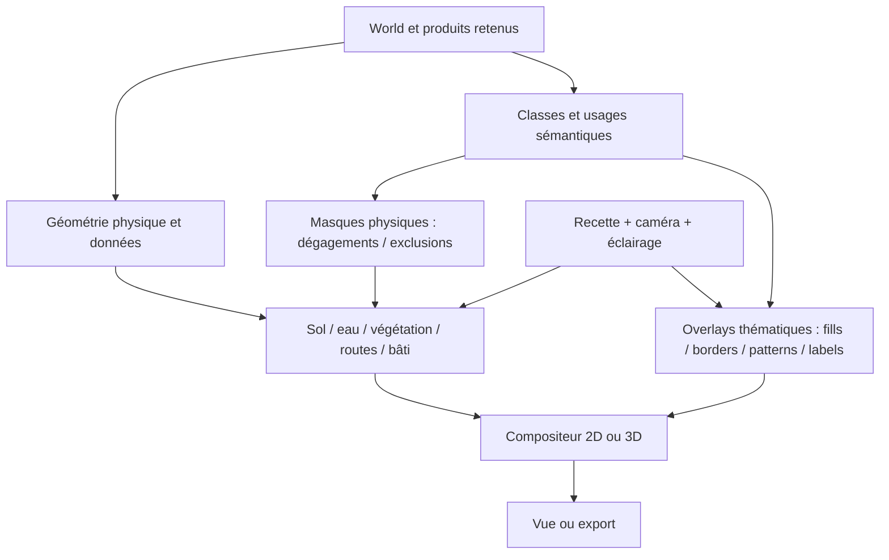

# Magna Urbis V2 — Spécification de composition des rendus 2D et 3D

**Statut :** proposition d'architecture et plan d'implémentation pour Codex  
**Date :** 5 novembre 2026  
**Portée :** affichage des scènes existantes ; aucune modification des algorithmes de génération de terrain, d'hydrologie, de villes ou d'occupation des sols.

## Statut d'implémentation (6 novembre 2026)

**Implémenté** (code sous `web/src/`) :

- `render/composition.ts` : `CompositionRecipe`, 6 styles (`StyleId` : `atlas`, `cadastre`, `topographic`, `satellite`, `parchment`, `illustration`, à la fois préréglages et fonds ; `atlas-night` est supprimé), `presetComposition`, `GROUND_VARIANTS` (variante par défaut du cadastre : `cadastre`), `applyComposition`, `resolveComposition` (`r.composition` sur chaque `ResolvedAppearance`), `limitationsOf`, `withGroundVariant`, `validateComposition`.
- Effets globaux : le bloc `effects { ambience, season, relief, lighting }` de la recette remplace `ambience`, `ground.relief` et les réglages avancés `season` / `lighting` ; la nuit est un effet, pas un style. La saison n'agit encore que sur le style satellite (limitation déclarée ailleurs). Le ton de la forêt d'occupation du sol vit aussi dans la recette (`vegetation.forestTone`).
- `render/textLayer.ts` : groupes, densité, halo et police des toponymes (`TextSettings`, `cityTextLabels`, `textPlacement`).
- `render/semanticLayer.ts` : peintre sémantique partagé (classes rurales et urbaines, légendes `ruralSemanticLegend` / `urbanSemanticLegend`).
- `render/roadStyle.ts` : encre ou rendu naturel des routes, emphase, utilisé par le canvas 2D, les tuiles et la 3D.
- `ui/compositionControls.ts` : panneau Composition (une ligne par passe) et raisons de limitation en français.
- `ui/textOverlay3d.ts`, `ui/semanticLimits3d.ts`, `ui/legendOverlay3d.ts` : toponymes, limites sémantiques (profondeur `readable`) et légende/cartouche en 3D.
- `ui/benchComposition.ts` : recette des benches (URL `composition`, `localStorage`), capacités, `syncBenchAnnotations`.

**Abandonné volontairement** : la section 10 (migration et compatibilité) et le test d'acceptation 10 (héritage). Règle du projet : pas de migration ni d'alias ; `legacyAppearanceToComposition` n'existe pas, les anciennes recettes et URLs peuvent casser.

### Matrice de capacités

Lue dans `limitationsOf` (`render/composition.ts`) et `ui/benchComposition.ts` (`setBenchRenderCapabilities`, `benchVegetationLimitations`), plus les limites posées par `ui/citybench.ts` et `ui/terrainbench.ts`. « OK » = aucune limitation déclarée dans le code ; « données » = limitation dépendante des produits retenus ; « à vérifier » = le code ne tranche pas.

| Passe | 2D | 3D | Export | City Bench | Terrain Bench |
| --- | --- | --- | --- | --- | --- |
| Sol | OK ; données : sans raster de terrain, réglages d'éclairage, forêt et fantasy indisponibles | OK ; mêmes limites de données | à vérifier (`exportSnapshot.ts` reçoit des options, pas la recette) | pas de diagnostics de ressources ; diagnostic sans données retenues signalé | idem ; diagnostics selon la source (vecteur, Rust, aucune) |
| Végétation | canopée procédurale absente si le relief est masqué (benches) | « peint » absent hors sols Illustrés (pas d'atlas 3D) | à vérifier | canopée procédurale impossible sur sol cartographique avec le backend raster | forêts des sols Illustrés toujours peintes, quel que soit le choix |
| Occupation rurale | données : exige `landuse` | limites seulement (`semanticLimits3d.ts`, profondeur `readable`) ; aplats 3D à vérifier | à vérifier | données : exige `landuse` | données : exige `landuse` |
| Occupation urbaine | données : exige des villes natives | limites seulement (profondeur `readable`) ; aplats 3D à vérifier | à vérifier | données : exige les layouts urbains | idem |
| Routes | OK (`roadStyle.ts`) | OK (`roadInk`) ; détail à vérifier | à vérifier | OK | OK |
| Eau | OK | OK | à vérifier | méandres abandonnés (oxbows) absents | à vérifier |
| Bâtiments | données : exige des bâtiments ; parcelles exigent des partitions | pas de drapage d'emprises depuis les projections si aucune scène n'est retenue | à vérifier | idem 3D | idem 3D |
| Ambiance | aucune limitation déclarée ; nuit appliquée aux sols carte | aucune limitation déclarée ; à vérifier | à vérifier | aucune déclarée | aucune déclarée |
| Texte | OK (`syncBenchAnnotations`) | OK (`textOverlay3d.ts`) | calque « Names » : lien avec la recette à vérifier | OK | OK |
| Légende et cartouche | OK ; la légende n'apparaît que s'il y a des classes à lister | OK (`legendOverlay3d.ts`) | à vérifier (calque « Frame, title & legend ») | OK | OK |

---

## 0. Décision fondamentale

**Un style global n'est pas un renderer monolithique : c'est une recette qui configure plusieurs passes de rendu indépendantes.**

L'utilisateur doit pouvoir afficher simultanément, par exemple :

> Fond Parchemin + arbres volumiques produits par shader + occupation du sol en aplats discrets + routes tracées à l'encre + bâtiments en emprises de plan + toponymes.

Ou :

> Fond satellite réaliste + arbres procéduraux + limites de cultures en traits contrastés + quartiers colorés selon leur usage + bâtiments 3D, de jour ou de nuit.

**Ne pas limiter les combinaisons au nom du style sélectionné.** Les noms « Atlas », « Parchemin », « Plan », « Illustré », « Topographique » et « Naturel » restent de bons **presets cohérents**, pas des types de scènes exclusifs. « Atlas nuit » est un preset/une variante conservée. Chaque passe peut être ajustée indépendamment, avec un nombre maîtrisé de moteurs visuels.

Le système sépare **cinq concepts orthogonaux** :

1. **Données géographiques sémantiques** : relief, biomes, occupation rurale, zones urbaines, voies, eau, bâtiments, noms. Elles ne dépendent jamais du style.
2. **Représentation physique** : matériaux du sol, végétation et bâtiments volumétriques, défrichements. Elle peut être réaliste ou stylisée.
3. **Représentation cartographique/thématique** : aplats, hachures, frontières de zones, contours, symboles, étiquettes. Elle explique les données indépendamment de leur aspect physique.
4. **Composition** : ordre, visibilité, masques, opacité, fusion raster/vecteur, projection sur relief en 3D.
5. **Présentation** : preset global, caméra (2D/3D), éclairage jour/nuit, variantes artistiques, options d'export et de partage.

La visibilité d'un overlay sémantique ne doit **jamais** modifier la réalité physique : masquer l'affichage de la zone « champ » ne doit pas y faire réapparaître une forêt.

---

## 1. Constat vérifié dans le dépôt

Références :

- [`web/src/render/appearanceRecipe.ts`](https://github.com/dunkean/magna-urbis/blob/main/web/src/render/appearanceRecipe.ts) : `AppearanceInput`, `ResolvedAppearance`, `StyleTraits`, composants `ground`, `vegetation`, `cartography`, `city`, clés de passes ; un bon point de départ à **faire évoluer**, pas à remplacer aveuglément.
- [`web/src/render/terrainStyle.ts`](https://github.com/dunkean/magna-urbis/blob/main/web/src/render/terrainStyle.ts) : styles hérités, traits `cartographicVegetation`, `ground3d`, `forestBrushes`, variantes satellite. Certains comportements de couches sont donc encore implicitement déterminés par le style du fond.
- [`web/src/v2/benchRenderer.ts`](https://github.com/dunkean/magna-urbis/blob/main/web/src/v2/benchRenderer.ts) : passes distinctes `terrainData`, `terrainLook`, `forest`, `water`, `frame`, `cartography`, `overlays`, `city`. Le fond WebGL est déjà séparé de l'overlay Canvas. **Point bloquant précis :** la passe `cartographyPass` exclut `forest`, `meadow`, `marsh`, `commons` via `CARTOGRAPHIC_ONLY_VEGETATION` dès que le style ne réclame pas `cartographicVegetation` ; la sémantique disparaît visuellement alors même que les usages existent dans les données.
- [`web/src/v2/renderScene.ts`](https://github.com/dunkean/magna-urbis/blob/main/web/src/v2/renderScene.ts) : données retenues accessibles par référence et révisions `terrain`, `roads`, `landuse`, `settlements`, `names`, `cities`. Exploiter cette séparation pour les caches.
- [`web/src/gen/types.ts`](https://github.com/dunkean/magna-urbis/blob/main/web/src/gen/types.ts) : `LandUseLayer.areas` et huit types `field`, `meadow`, `pasture`, `forest`, `orchard`, `garden`, `marsh`, `commons`, plus réserves, chemins, fermes, bandes agricoles. Les usages de quartiers/bâtiments sont dans les produits urbains, pas dans cette unique enum.
- [`web/src/render/landuse.ts`](https://github.com/dunkean/magna-urbis/blob/main/web/src/render/landuse.ts) : SVG des occupations rurales, motifs, bandes, silhouettes et sous-couches végétales ; base à réutiliser ou à découpler en **sémantique** et **dessin de végétation**.
- [`web/src/ui/forestOccupation.ts`](https://github.com/dunkean/magna-urbis/blob/main/web/src/ui/forestOccupation.ts) : texture d'occupation rasterisée avec distances signées, classes et zones de dégagement de forêt ; **outil physique** existant, pas une couche sémantique complète. La classe `marsh` n'est notamment pas inscrite dans son `CLASS`, et les usages urbains détaillés n'y figurent pas.
- [`web/src/ui/city3d.ts`](https://github.com/dunkean/magna-urbis/blob/main/web/src/ui/city3d.ts) : accepte `getForest()?.occupation`, sait draper une texture sur un relief et dessine déjà les voies et plans de ville dans des tuiles de texture ; infrastructure très utile pour le MVP 3D.
- [`web/src/v2/urban3d.ts`](https://github.com/dunkean/magna-urbis/blob/main/web/src/v2/urban3d.ts) : son raccord `getForest` retourne actuellement le champ forestier, **sans exposer l'occupation rurale depuis V2** ; les `getPlanOptions` concernent le plan urbain. Donc le fait qu'un `ForestOccupation` existe ailleurs ne signifie pas que le rendu 3D V2 montre les catégories d'occupation.
- [`web/src/render/cityCanvas.ts`](https://github.com/dunkean/magna-urbis/blob/main/web/src/render/cityCanvas.ts) : vues `tissue`, `uses`, `parcels`, `buildings`, `roles`, palettes urbaines et nombreux switches. Ne pas confondre **usage urbain** et **apparence d'un bâtiment**.
- [`web/src/v2/renderControls.ts`](https://github.com/dunkean/magna-urbis/blob/main/web/src/v2/renderControls.ts) et [`web/src/v2/appearance.ts`](https://github.com/dunkean/magna-urbis/blob/main/web/src/v2/appearance.ts) : persistance/validation à faire migrer sans perdre les anciennes recettes.

**À préserver :** les moteurs CPU/WebGL, les données retenues, la logique des passes et leurs caches, la fidélité des formes, les fonctions d'export et les styles existants. Pas de « rewrite » du pipeline Rust ou de tous les renderers.

---

## 2. Modèle mental : couches de données ≠ couches visuelles ≠ technologie

Une *couche de données* (ex. forêt) peut produire plusieurs effets de rendu :

- **physique** : le shader place des arbres, change l'albédo, supprime les arbres dans un champ ;
- **cartographique** : des polygones vert clair, une limite forestière, des hachures, un symbole ;
- **informationnel** : le label « Forêt de X », une légende, un tooltip, une fiche interactive.

Une *passe de rendu* peut combiner plusieurs technologies : shader de terrain, raster pré-calculé, tuiles raster produites à la volée, vecteurs, géométries 3D, texte en espace écran. Ces formats ne sont pas les unités de choix de l'utilisateur : ce sont des backends.

### Ordre logique de composition

```
ÉCRAN / IMAGE FINALE
  P8  Interface / annotations / lieux / labels / secrets filtrés
  P7  Bâtiments et constructions : empreintes, toits, volumes 3D
  P6  Urbanisme thématique : quartiers, blocs, parcelles, usages
  P5  Réseaux visibles : routes, chemins, rues, ponts, rivières, berges
  P4  Occupation rurale THÉMATIQUE : aplats, contours, hachures, labels
  P3  Couverture PHYSIQUE : arbres, canopées, cultures, rochers, broussailles
  P2  Sol et eau PHYSIQUES : matières, ombres, altitudes, surface de l'eau
  P1  Fond géographique : papier, atlas, hypsométrie, image, shader
  P0  Relief / coordonnées / données : support, non graphique
```

**Important :** il s'agit d'un **ordre logique** et non d'une obligation de créer neuf canvases. L'eau peut être physiquement intégrée au shader du sol, puis ses berges/vecteurs dessinés dans P5 ; les volumes 3D sont soumis au depth-test, et les overlays thématiques peuvent être projetés ou dessinés après la scène selon la visibilité voulue. Ne pas dupliquer la même surface d'eau ou la même forêt dans deux passes. Les passes P6 et P7 sont distinctes précisément pour autoriser « bâtiments en emprise plan sur fond satellite ».

### Diagramme de données



**Couplage permis :** des données d'occupation influencent physiquement arbres et matériaux. **Couplage interdit :** le style visuel du sol décide si les classes d'occupation sont affichables ou non.

---

## 3. Catalogue final des composants, pas des « styles monolithiques »

Voici le **minimum fonctionnel** de modes indépendants à exposer, avec le reste dans « Avancé ».

| Passe | Sélecteur utilisateur | Valeurs recommandées | Backends existants / cible |
|---|---|---|---|
| **Fond / terrain** | Aspect du fond | Atlas, Parchemin, Plan clair, Topographique, Naturel/satellite, Illustré | Palette SVG/Canvas ; raster et shader WebGL ; pinceaux |
| **Couverture / arbres** | Végétation visible | Auto, Aucune, Symboles, Peinte, Volumique/procédurale | Canvas/SVG/brush ; shader/forest field |
| **Occupation rurale** | Lecture du territoire | Aucune, Discrète, Catégorielle, Contours | Polygones/raster thématique indépendant |
| **Réseaux** | Aspect des voies/eaux | Adapté au fond, Encré/plan, Matériaux naturels | Vecteurs, textures, matériaux et géométries |
| **Ville / usages** | Urbanisme thématique | Aucun, Discret, Catégoriel, Contours | Polygones quartiers/îlots/parcelles, couleurs de rôles |
| **Bâtiments** | Représentation du bâti | Emprises, Toits cartographiques, Volumes simples, Volumes détaillés | CityBench Canvas/GL ; géométrie 3D |
| **Annotations** | Informations | Noms, lieux, frontières, légendes, annotations ; filtres MJ/joueur | Vecteur + interface |
| **Ambiance** | Éclairage | Jour, Nuit ; éclairage personnalisable | Palette `night` ou shader selon backend |

**Auto** signifie « valeur préférée du preset », jamais « choix technique déterminé silencieusement par le fond ». Si l'utilisateur choisit *Volumique*, le moteur doit essayer ce rendu même sur Parchemin, en 2D comme en 3D si le backend le supporte. Un support indisponible doit être **signalé explicitement**, pas remplacé en silence par une autre catégorie de données.

Ne pas exposer pour chaque passe une liste de 19 styles historiques. Le fond détermine son matériau/palette ; la végétation détermine son mode ; l'occupation détermine son code graphique ; les bâtiments déterminent leur représentation. Cette limitation empêche l'explosion combinatoire.

### Cas de référence obligatoires

**Cas A — la combinaison volontairement hétérogène :**
- Fond `parchment`.
- Végétation `procedural-canopy` (shader de couronnes, avec transparences correctes).
- Occupation rurale `categorical` ou `subtle` indépendante, visible sur le papier et sous/à travers la canopée selon le mode de lisibilité.
- Routes `ink`.
- Bâtiments `footprints`, y compris si la scène possède des volumes détaillés.
- Ville `district-outlines` et couches cadastrales optionnelles.

**Cas B — satellite cartographiquement lisible :**
- Fond `render-v2`, végétation volumique.
- Champs : matériau de champ **et** contours fins contrastés ; forêts : canopée **et** bordure facultative ; marais : sol humide **et** hachures facultatives.
- Quartiers urbains colorés de manière translucide selon leur rôle, même si bâtiments/sol sont réalistes.
- Routes et hydrographie visibles ; bâtiments `volumes-detailed` ou `footprints` au choix.

**Cas C — plan de travail :**
- Fond `plain`, végétation `none` ou `symbols`, occupation `categorical`, usages urbains `categorical`, bâtiments `footprints`, parcelles activées. Vue 2D orthographique ; option 3D maquette.

**Cas D — présentation au joueur :**
- Fond `atlas-night` (conserver le rendu actuel), végétation choisie par le preset, occupation `subtle`, bâtiments `roofs`, annotations filtrées par visibilité joueur.

---

## 4. Schémas d'occupation du sol : combler le vrai manque

Le rendu **physique** et le rendu **sémantique** d'une même occupation sont deux produits différents, tous deux dérivés des données existantes. Ne jamais forcer l'utilisateur à choisir l'un *à la place* de l'autre.

### 4.1 Classes canoniques

Pour l'occupation rurale, partir des huit valeurs existantes de `LandKind` et conserver leurs géométries (trous inclus) :

| Classe | Manifestation physique possible | Manifestation thématique 2D/3D |
|---|---|---|
| `field` | Culture, rangs, sol travaillé | Jaune/ocre, limites de champs, rayures ou sillons |
| `meadow` | Herbe, prairie | Vert clair, bordure discrète |
| `pasture` | Herbe pâturée, faible végétation | Vert olive et pointillés |
| `forest` | Couronnes/arbres/shader | Vert profond, contours ou hachures forestières |
| `orchard` | Arbres alignés | Vert moyen, points réguliers, parcelles |
| `garden` | Jardins, potagers | Vert jardin, motifs fins |
| `marsh` | Sol humide, roseaux, eau intermittente | Bleu-vert, hachures humides |
| `commons` | Sol partagé variable | Lavis neutre, bordure et/ou label |

Les zones de réserve urbaine, passages agricoles et emprises de constructions ne sont **pas** à confondre avec ces huit catégories : elles peuvent influencer physiquement le couvert, mais elles ont leur propre logique d'affichage.

Pour la ville, créer un **second canal sémantique** à partir des données de `CityScene`, allocations, districts et usages des bâtiments. Exemples : résidence, commerce, artisanat/tanneries, religion, administration, entrepôts, port, défense, espaces publics. **Ne pas inventer une classification exhaustive qui n'est pas dans les produits retenus :** réutiliser rôles, fonctions et labels existants, avec un fallback « autre/inconnu ».

### 4.2 Quatre schémas visuels utiles

| Mode | Apparence | Usage | 2D / 3D |
|---|---|---|---|
| **Off** | Aucun overlay sémantique | Image immersive | Oui / Oui |
| **Subtle** | Contours et teintes très transparents, sans cacher la matière | **Défaut sur fond Naturel** | Oui / Oui |
| **Categorical** | Aplats contrastés semi-transparents, motifs éventuels, légende | **Défaut en Plan / Analyse** | Oui / Oui |
| **Outlines** | Limites, contours, hachures sélectives, pas d'aplat | Lecture sans recouvrir le satellite | Oui / Oui |

Les quatre modes concernent **l'information sur les usages** : ils ne remplacent pas les rendus physiques des champs/forêts. Paramètres avancés partagés : opacité, largeur des frontières, motifs, classes visibles, palette, légende, profondeur de projection. Les couleurs devraient être déterminées **par classe**, stables entre 2D et 3D, distinctes de la couleur du matériau naturel et modifiables ; hachures/patterns et contours assurent la lecture en niveaux de gris.

**Point critique :** un shader de forêt ne donne pas à lui seul les limites du polygone « forêt », et un champ peint n'indique pas systématiquement la catégorie « pâture », « jardin », etc. La couche thématique doit rester rendue même quand le fond/les arbres sont physiques.

### 4.3 Deux ressources GPU distinctes

Ne pas transformer `ForestOccupation` en source unique de vérité pour le thématique. Conserver / généraliser :

1. **`PhysicalOccupationMask`** : coupes de canopée, réserves, sols bâtis, chemins, exclusion d'arbres ; peut réutiliser le SDF existant. Sa validité dépend **des données**, non du style ou de la visibilité de l'overlay.
2. **`SemanticLanduseIndex`** : masque d'ID de catégorie, emprises, trous, éventuellement IDs d'entités pour picking/labels ; rasterisation dérivée des **polygones canoniques**. Sa visualisation dépend du mode `subtle/categorical/outlines`.

Garder en source de vérité les polygones et les référentiels de classes ; les textures ne sont que des caches tuilés ou résolutions adaptées. L'information sur les usages urbains constitue une troisième couche sémantique, construite à partir des données urbaines, pour éviter de forcer des catégories rurales sur les quartiers.

---

## 5. Implémentation 3D de l'occupation : indispensable

### 5.1 Objectif

La vue 3D doit pouvoir montrer **simultanément** une terre réaliste, les défrichements physiques, les limites des usages ruraux, les zones fonctionnelles des quartiers et les bâtiments 3D. Un bouton « occupation visible » doit concerner l'overlay, pas l'existence des champs.

### 5.2 MVP raisonnable (réutiliser les tuiles 3D existantes)

1. Faire parvenir le `World.landuse` et une ressource d'occupation physique à `mountV2Urban3d` (via le `RenderScene` ou des callbacks dédiés) ; ne pas générer une nouvelle occupation.
2. Utiliser **le même producteur d'overlay sémantique** pour la vue 2D et pour la carte drapée sur le terrain 3D. Dans `city3d.ts`, le chargement des tuiles `loadTile` fournit déjà un endroit pour composer les éléments sur le sol, **avant** le dessin des voies et du plan urbain. Dans le mode matériau procédural, vérifier la composition alpha réelle du shader (le « texture » sert déjà aux masques d'eau et au plan) avant d'y ajouter les nouvelles teintes : elles doivent se superposer au matériau et non le remplacer.
3. Surélever/projeter les limites sur le relief avec un léger bias géré en espace profondeur ; ne pas déplacer physiquement les sommets de la carte. Prendre en compte relief exagéré, déplacement multiscale, coupure des tuiles, trous de polygones, zones sous l'eau.
4. Dessiner une seule fois les usages et les emprises. Quand un fond physique fournit déjà des arbres/cultures, **désactiver uniquement leur doublon illustré**, pas les limites ni les aplats thématiques.
5. Garder `city.view = uses/roles/parcels` et les usages urbains disponibles en 3D ; décorréler ces vues de `ground=render-v2`.

### 5.3 Si le drapage ne suffit pas

Le raster drapé sur le sol devient masqué par de grandes couronnes ou les bâtiments. Proposer **un seul** réglage avancé `semanticDepth` :

- `surface` (défaut immersif) : le thématique est effectivement sur le terrain, occultable par les objets physiques ;
- `readable` (défaut en Analyse/Plan) : limites et labels ont un rendu de lecture (screen-space ou passes de traits avec gestion contrôlée de profondeur) qui reste visible au-dessus des couronnes et bâtiments, sans transformer tout le terrain en calque « rayons X ».

La transparence du thématique doit rester raisonnable. Pour les limites de quartiers situées sous les bâtiments, le mode lisible doit prioriser les **limites** et les labels, pas remplir les toits d'une couche opaque.

### 5.4 Comportement sans géométrie détaillée

La représentation `footprints` doit être possible en 3D **même lorsque les volumes existent** ; masquer les meshes, conserver l'empreinte et son contour drapés sur le sol. Inversement, montrer les volumes ne doit pas forcer l'overlay cadastral ni cacher les limites de quartiers.

L'absence de bâtis détaillés ne doit pas empêcher l'affichage de leurs empreintes canoniques. Si un backend 3D ne peut pas afficher un mode, l'UI indique la limitation et propose explicitement une substitution ; ne pas altérer la recette enregistrée.

---

## 6. Contrat TypeScript proposé

**Ce contrat est un objectif conceptuel**, à ajuster aux noms existants, pas une API dont il faut faire une copie littérale en cassant `V2Appearance`. En particulier, réutiliser `appearanceRecipe.ts`, le resolver et les `StyleTraits`, tout en retirant les dépendances inappropriées entre fond et overlays.

```ts
export type BaseLook =
  | 'atlas' | 'parchment' | 'plain' | 'topographic'
  | 'illustrated' | 'natural';

export type VegetationLook =
  | 'none' | 'symbols' | 'painted' | 'procedural-canopy';

export type SemanticLook =
  | 'off' | 'subtle' | 'categorical' | 'outlines';

export type BuildingLook =
  | 'footprints' | 'cartographic-roofs'
  | 'simple-volumes' | 'detailed-volumes';

export type NetworkLook = 'inherit' | 'ink' | 'natural';
export type SceneView = '2d' | 'oblique3d' | 'free3d';

export interface CompositionRecipeV2 {
  version: 2;
  /** Preset selected, not an irreversible restriction on child passes. */
  presetId?: string;
  view: SceneView;
  ground: {
    look: BaseLook;
    /** Concrete legacy material/palette (e.g. render-v2 / parchment). */
    backendId?: string;
    showRelief: boolean;
  };
  vegetation: {
    look: VegetationLook;
    visible: boolean;
    density?: number;
  };
  landuse: {
    visible: boolean;
    rural: SemanticLook;
    urban: SemanticLook;
    opacity?: number;
    showLegend?: boolean;
    semanticDepth?: 'surface' | 'readable';
    classes?: Partial<Record<string, boolean>>;
  };
  networks: {
    roads: { visible: boolean; look: NetworkLook };
    water: { visible: boolean; look: NetworkLook };
  };
  buildings: {
    visible: boolean;
    look: BuildingLook;
    showParcels?: boolean;
    showBlocks?: boolean;
    showDistricts?: boolean;
  };
  annotations: {
    labels: boolean;
    legend: boolean;
    cartouche: boolean;
    // MJ/joueur : contrôlé par autorisation des données, pas le shader.
  };
  lighting: {
    mode: 'day' | 'night' | 'custom';
    azimuth?: number;
    elevation?: number;
  };
}
```

### Résolution et capacités

- `resolveComposition(recipe, dataCapabilities, rendererCapabilities, target)` renvoie une **recette résolue par passe**, ses dépendances et les limitations explicites. Ne pas perdre les choix sauvegardés si la cible ne sait pas les rendre.
- Différencier la disponibilité des **données** et celle du **backend**. Exemple : `landuse data available`, `3d semantic overlay renderer not available`, `procedural canopy not supported on this hardware`.
- L'héritage de palette est une **valeur par défaut**, pas un verrou. Les `StyleTraits` peuvent déclarer les capacités d'un backend mais ne doivent plus supprimer le rendu sémantique en fonction du style de fond.
- Fournir un registre d'adaptateurs ou des `canRender(pass, mode, target)` pour 2D Canvas, WebGL et 3D ; éviter les `if (styleId === ...)` éparpillés dans les couches métiers.
- Ne pas permettre d'ordre z arbitraire dans l'interface initiale : la topologie des passes est fixe, avec une poignée d'options de profondeur compatibles avec les contraintes physiques.

### Exemple de recette à rendre sans perte

```json
{
  "version": 2,
  "presetId": "custom",
  "view": "oblique3d",
  "ground": { "look": "parchment", "backendId": "parchment", "showRelief": true },
  "vegetation": { "look": "procedural-canopy", "visible": true },
  "landuse": {
    "visible": true,
    "rural": "categorical",
    "urban": "outlines",
    "opacity": 0.4,
    "showLegend": true,
    "semanticDepth": "readable"
  },
  "networks": {
    "roads": { "visible": true, "look": "ink" },
    "water": { "visible": true, "look": "inherit" }
  },
  "buildings": {
    "visible": true,
    "look": "footprints",
    "showParcels": true,
    "showBlocks": false,
    "showDistricts": true
  },
  "annotations": { "labels": true, "legend": true, "cartouche": false },
  "lighting": { "mode": "day" }
}
```

*Le JSON ci-dessus est un contrat cible, pas une recette actuellement acceptée par Magna Urbis.*

---

## 7. Presets : les styles reviennent comme recettes pratiques

Créer un **catalogue de recettes**, composé de valeurs des passes précédentes. La sélection d'un preset **remplit** les composantes ; les changements d'une passe placent l'interface en « Personnalisé » sans modifier les autres.

| Preset | Fond | Végétation | Occupation rurale | Urbanisme | Bâtiment | Éclairage |
|---|---|---|---|---|---|---|
| Atlas | Atlas | Symboles/canopy | Subtle | Discret | Toits cartographiques | Jour |
| Parchemin | Parchemin | Symboles/peinte | Subtle | Discret | Toits | Jour |
| Illustré | Illustré | Peinte | Subtle | Discret | Toits | Jour |
| Plan | Plan clair | Aucune/symboles | Categorical | Categorical | Emprises | Jour |
| Topographique | Topographique | Symboles | Outlines | Outlines | Emprises | Jour |
| Naturel | Naturel `render-v2` | Procédurale | **Subtle, non Off** | Discret | Volumes | Jour |
| Atlas nuit | Atlas, palette `night` | Selon atlas | Subtle | Discret | Toits/fenêtres éclairées | **Nuit artistique** |

Les variantes historiques restent accessibles **sans devenir des moteurs supplémentaires** : Gravure et Enluminure sous Parchemin ; Aquarelle et Encre sous Illustré ; Cadastre, Blueprint et Classique sous Plan ; Night sous Atlas. Les rendus physiques jour/nuit sont séparés de la palette Night artistique : ne pas promettre que la nuit est physiquement éclairée en 3D si le pipeline ne possède pas les lumières correspondantes.

Les presets métier (Cartographe, Urbanisme, MJ, Joueur, Analyse) sont un **second axe** : ils choisissent les couches visibles, la caméra et les annotations, mais pas une technologie de rendu exclusive. Ainsi « MJ + fond Naturel + parcelles visibles » reste parfaitement valide.

---

## 8. Composition technique et performances

### 8.1 En 2D

- **Raster / GPU** pour le fond matériel et les couronnes procédurales.
- **Passes thématiques** rasterisées depuis la géométrie vectorielle, par tuiles ou par viewport, en alpha prémultiplié ; bordures et textes vectoriels aussi longtemps que leur densité le permet.
- **Passes urbaines** (routes, réseaux, blocs, parcelles, bâtiments) conservées, avec représentation du bâti choisie indépendamment.
- Éviter de rerasteriser tout le terrain après changement de couleur d'une classe, d'affichage de parcelles ou de label : seules leurs passes doivent être invalidées.
- Ne dessiner les arbres qu'une seule fois ; `forest shader visible` et `forest polygons thematic visible` ne constituent **pas** un doublon, puisqu'ils sont physique et sémantique.

### 8.2 En 3D

- Conserver le terrain canonique existant et son échantillonneur. Les composantes physiques restent dans leur passe 3D.
- Texte/catégories 2D convertis en tuiles de projection ou en géométries de lignes sur terrain ; prévoir mips, alignement géographique, anti-aliasing et légère correction de profondeur.
- Respecter les polygones avec trous, les découpes des tuiles, les rivières, les côtes, le niveau de la mer, les surfaces d'eau et la géométrie verticale (ponts et quais ne se réduisent pas au sol).
- S'assurer que les **mêmes usages ruraux et urbains** ont une représentation cartographique disponible en 2D et en 3D ; seules les techniques changent.
- La vue 3D libre ne doit pas perdre l'information thématique simplement parce que les objets sont devenus volumétriques.

### 8.3 Caches et clés de dépendance

Réutiliser `PassState`, `ResourceCache`, `PassKeys` et les révisions de `RenderScene` :

| Changement | À invalider | À conserver |
|---|---|---|
| Fond Parchemin → Naturel | Shader/fond | Géométrie, index sémantiques, bâtiments |
| Végétation symboles → shader | Dessin de végétation | Classes d'occupation, routes, relief source |
| Occupation Off → Categorical | Overlay rural/urbain | Champ forestier, terrain, eau, géométries |
| Opacité de l'occupation | Uniforme/overlay seul | Texture d'IDs de classes |
| Routes masquées | Passe routes | Occupation physique et rendu forestier |
| Bâtiments 3D → empreintes | Passe bâtiments, éventuellement plan tile | Position et matériaux du terrain |
| Nuit ↔ jour | Palette/éclairage concerné | Géométries, champs physiques |
| Zoom, translation | Tuiles visibles / LOD | Champs et données canoniques |

Les masques physiques dépendent des données et de leurs révisions ; les masques sémantiques dépendent des polygones ; **les palettes ne changent ni l'un ni l'autre**. Si l'index spatial/les textures sémantiques sont recalculés à chaque frame, l'implémentation est incorrecte.

### 8.4 Arbitrages graphiques

- Composition alpha cohérente entre WebGL, Canvas et export (attention espaces colorimétriques, `premultipliedAlpha` et double-blending).
- Modes `Subtle` et `Categorical` doivent avoir des contours lisibles en clair, sombre, relief élevé et sur texture satellite contrastée ; ne pas dépendre uniquement d'une faible teinte.
- Rivières et routes à priorité visuelle explicite sur les aplats de catégories ; les limites de parcelles ne sont pas des routes.
- Conservation du contraste labels/fond en 2D/3D ; cadrages identiques lors des comparaisons.
- Pas de z-fighting ou de scintillement des limites de parcelles sur un terrain bruité/déplacé.

---

## 9. UI utilisateur : simple malgré la composition libre

### Niveau 1 : choix rapide

- **Preset visuel** : Atlas, Parchemin, Illustré, Plan, Topographique, Naturel, Atlas nuit.
- **Vue** : 2D, oblique 3D, libre 3D.
- **Couches** : Nature, Civilisation, Territoires, Lieux/entités, Aventure (grands groupes de visibilité).

### Niveau 2 : Composition (accessible et persistante)

```
Fond             [Parchemin                 v]
Végétation       [Arbres procéduraux        v]
Occupation rurale [Aplats + contours        v]   Opacité [40%]
Occupation ville [Contours quartiers        v]
Routes / eau     [Encre / Adapté au fond    v]
Bâtiments        [Emprises                  v]
Ambiance         [Jour                      v]
```

### Niveau 3 : avancé

Réglages détaillés des palettes/couleurs, largeur/contraste, filtres de classes, trames, lumière, saison, détail LOD, relief exagéré, ajustements GPU et diagnostics techniques.

**Ne pas présenter** « occupation du territoire visible » comme un switch qui supprime en même temps ses manifestations naturelles. Le sous-menu doit séparer :

- `Effets sur le paysage` (toujours activés lorsqu'ils représentent la réalité générée : défrichements, disposition physique du sol) ;
- `Affichage des usages` (Off/Subtle/Categorical/Outlines et classes visibles) ;
- `Annotations` (étiquettes, frontières, rôle des quartiers).

Dans l'interface, l'option « fonds / style » ne doit donc jamais désactiver ou redéfinir un autre menu. Un changement manuel de composante conserve les autres valeurs (pas de reset du reste de la recette).

---

## 10. Migration et compatibilité

1. Introduire un objet `composition` **optionnel** dans le schéma d'apparence V2 ; le code actuel peut rester un chemin de compatibilité. Une recette ancienne doit continuer à donner le même rendu sans migration destructrice.
2. Écrire une **fonction pure** `legacyAppearanceToComposition(...)` et, si utile, un adaptateur inverse *partiel* (ne pas fabriquer un `terrainStyle` qui prétend coder toutes les nouvelles combinaisons).
3. Garder les anciens IDs/URLs (`night`, `render3d-brush`, `render-v2-*`, `cadastre`, etc.) et la fidélité de leur rendu historique lorsqu'ils sont lus sans composition explicite. Les diagnostics de matière `render-v2-substrate`, `moisture`, etc. restent accessibles comme diagnostics, pas comme presets globaux obligatoires.
4. Séparer explicitement `appearance.landuse` (ancien toggle) du futur `composition.landuse.rural` et de son effet physique ; ne pas réutiliser le même booléen pour deux responsabilités.
5. Ne **pas** modifier les données retenues ni re-générer un monde pour une préférence d'affichage.
6. Export raster, capture 2D, capture 3D et liens sauvegardés utilisent la recette résolue ; annoncer les éventuelles limites SVG vectoriel au lieu d'exporter un document qui ne ressemble pas à l'écran.

---

## 11. Plan Codex en six PRs testables

### PR 1 — Modèle et resolver

- Ajouter contrats TS, recettes nommées, migration compatibilité et validation.
- Réorganiser `appearanceRecipe.ts` autour d'une résolution indépendante du fond, de la végétation, des deux thématiques (rurale/urbaine), des réseaux, du bâti et de l'ambiance.
- Conserver `PassState`, `ResourceCache` et l'ancienne API ; tests unitaires resolver/compatibilité. Aucun changement d'affichage attendu par défaut.

### PR 2 — Occupation sémantique 2D indépendante

- Détacher les overlays de classes de la réalisation physique/des pinceaux dans le flux `render/landuse.ts` et `v2/benchRenderer.ts`.
- Retirer l'exclusion **globale** via `CARTOGRAPHIC_ONLY_VEGETATION` : exclure uniquement les duplications de **symboles végétaux**, jamais les frontières et aplats thématiques explicitement demandés.
- Implémenter Off/Subtle/Categorical/Outlines, par catégorie, sur fond Atlas, Parchemin et Render v2 ; export cohérent.

### PR 3 — Couverture procédurale indépendante du fond

- Définir `vegetation.look` distinct de `ground.look` avec capacité par backend.
- Autoriser le rendu de canopée shader sur fond Parchemin / Atlas quand le moteur le permet, via une composante alpha/composite, sans basculer le fond vers `render-v2`.
- Séparer masque de défrichement physique et visibilité de l'overlay. Tests « champ sans forêt, mais limites visibles ou masquées indépendamment ».

### PR 4 — Occupation thématique 3D

- Exposer les données d'occupation retenues au pipeline `v2/urban3d.ts` ; réutiliser les tuiles déjà drapées par `city3d.ts` ou introduire une petite passe projetée dédiée selon la composition réelle du shader.
- Activer la représentation rurale et urbaine en 3D, avec `surface` et `readable` si le second est possible sans complexité excessive ; au minimum, mode surface avec contours visibles.
- Intégrer correctement terrain, canopée, eau, routes et bâtiments, sans modifier leur géométrie.

### PR 5 — Bâtiments et réseaux indépendants

- Pouvoir choisir empreintes/toits/volumes simples/volumes détaillés sans changement de fond.
- Conserver le rendu des quartiers, rôles, parcelles et emprises sur tout fond, y compris satellite et en 3D.
- Dissocier le « fond urbain » du choix du fond de carte global et les routes/rivières de leurs styles de base.

### PR 6 — UI, presets et tests de régression

- Ajouter deux niveaux de contrôle (preset puis composition) ; Night conservé comme Atlas nuit.
- Tests de combinaisons, export, sauvegarde/chargement, mêmes cartes 2D/3D, comparaison d'images et invalidations de passes.
- Documenter la table des capacités de chaque backend et leurs limites ; supprimer/masquer les anciens sélecteurs redondants dans l'UI, **pas** dans la compatibilité.

Chaque PR doit être intégrable et testable isolément. Si une PR n'est pas entièrement implémentable, garder les contrats et un diagnostic explicite plutôt que de masquer la limitation en changeant silencieusement de style.

---

## 12. Tests d'acceptation fonctionnels (non négociables)

1. **Mix demandé** : Parchemin + canopée procédurale + occupation catégorielle + routes encrées + bâtiments en empreintes s'affiche avec les mêmes géométries et cadrage qu'avant.
2. **Satellite lisible** : Render v2 + couverture forestière physique + frontières des huit classes rurales ; les champs, pâtures, jardins, vergers et marais restent identifiables (pas seulement les forêts).
3. **3D fonctionnelle** : occupation rurale et zones urbaines visibles sur le terrain 3D ; même emprise et mêmes catégories qu'en 2D.
4. **Dissociation** : masquer `landuse.rural` n'efface pas les champs physiques et ne recrée aucun arbre ; masquer la canopée n'efface pas l'overlay forestier.
5. **Bâtiments** : passer de volumes détaillés à empreintes conserve exactement les implantations et ne modifie ni le terrain ni les quartiers.
6. **Ordre** : routes et rivières restent lisibles au-dessus des aplats ; plans urbains et toits visibles sans double peinture ; labels ne disparaissent pas sous un calque opaque.
7. **Holes** : parcelles, bâtiments, lacs et zones à trous ne sont pas remplis incorrectement par les overlays.
8. **Zoom/LOD** : absence de déplacement des limites entre niveaux de détail, pas de halo, de z-fighting ni de couture au bord des tuiles.
9. **Export** : capture et export 2D reproduisent les couches affichées ; capture 3D suit la même recette et la même politique de visibilité.
10. **Héritage** : une ancienne URL `style=night` ouvre toujours une carte visuellement équivalente ; les anciens exports/recettes restent lisibles.
11. **Caches** : changer seulement l'opacité des usages du sol ne regénère ni le terrain, ni les villes, ni le champ d'arbres.
12. **Robustesse** : backend incapable ou données absentes donnent un état de capacité clair ; le choix de l'utilisateur reste stocké.
13. **Identité** : une catégorie d'occupation a le même sens, le même ID et une symbologie compatible en 2D/3D, même si ses textures naturelles sont différentes.
14. **Nuit** : Atlas nuit conserve le rendu sombre et ses fenêtres éclairées ; le style n'est pas effacé au nom du découplage.

### Tests automatiques à privilégier

- Unitaires : migration, validation, resolver, dépendances de caches, priorité des polygones et masques, filtres par classes.
- Intégration : tests sur une scène retenue contenant forêt + champ + pâture + verger + marais + rivière + route + ville + bâtiment.
- Visuels : captures 2D et 3D comparées aux combinaisons A/B/C/D, avant/après zoom et permutation des passes ; pas de simple test de code qui conclut que l'image est correcte.
- Performance : vérifier que les grandes tuiles conservent le LOD, que les mises à jour visuelles n'entraînent aucune recalculation de géométrie.

---

## 13. Périmètre et points de décision

### Décisions recommandées par défaut

- **Fond et végétation sont totalement dissociés.** Le shader de couronnes est réutilisable sur un fond Parchemin si le framebuffer/composite et le matériel le permettent.
- **Occupation rurale et urbaine ont des rendus sémantiques séparés.** Le premier s'appuie sur `LandUseLayer`, le second sur `CityScene`/rôles/allocations.
- **L'occupation existe en 3D** ; la première version utilise le drapage et des contours plutôt qu'une seconde simulation réaliste des cultures.
- **Les effets physiques de l'occupation sont indépendants de son affichage** ; le masque de défrichement ne peut pas être désactivé en cachant un calque de carte.
- **Styles = presets** ; réglages de composition = source d'autorité si personnalisés.
- **Nuit reste visible** : Atlas nuit comme recette graphique distincte ; nuit physique 3D à traiter séparément.

### Points facultatifs à arbitrer après le MVP (ne bloquent pas Codex)

1. Jusqu'où pousser `readable` en 3D : contours et labels au-dessus de la canopée, ou vrai mode x-ray des zones ? Recommandation : contours + labels uniquement.
2. Faut-il autoriser des palettes totalement personnalisées **par classe d'occupation**, ou d'abord une palette thématique fixe avec opacité ? Recommandation : palette fixe puis overrides avancés.
3. Le rendu volumique sur fond non physique doit-il réutiliser les couronnes du shader ou représenter de véritables arbres 3D individuels ? Recommandation : réutiliser le champ et les couronnes procédurales déjà existants, pas générer des meshes nouveaux.
4. Le « style Illustré » nécessite-t-il d'emblée un équivalent 3D entièrement dessiné ? Recommandation : non, commencer par le drapage illustré et la végétation peinte.

---

## 14. Brief opérationnel à donner à Codex

> **Mission :** implémenter progressivement la composition indépendante des passes visuelles dans Magna Urbis V2, en conservant les géométries, les comportements historiques et la compatibilité des recettes.
>
> **Priorité fonctionnelle :** permettre les mélanges *fond Parchemin + végétation shader + occupation rurale thématique + routes encrées + bâtiments en empreintes*, ainsi que *fond satellite + occupation rurale lisible + quartiers/usages visibles en 3D*. Les quatre problèmes sont : le style de fond commande encore indirectement la végétation et la présence de classes thématiques ; les usages ruraux ne sont pas exposés visuellement en 3D V2 ; les choix du bâti sont trop liés à ceux du fond ; l'UI présente des techniques de rendu comme des styles exclusifs.
>
> **Approche :** inspecter d'abord les fichiers cités en §1, relever leurs contrats actifs, établir une matrice réelle des capacités, puis commencer par PR 1 et PR 2. Réutiliser `appearanceRecipe.ts`, `RenderScene`, `PassState`, `ResourceCache`, `forestOccupation.ts`, `city3d.ts`, `cityCanvas.ts`. Éviter un nouveau moteur généraliste si les passes et callbacks existants suffisent. Après chaque étape, démontrer les cas A/B/C/D et les tests du §12.
>
> **Contraintes :** aucune régénération de monde sur un changement de style ; aucune disparition silencieuse des données sémantiques ; pas de dédoublement d'arbres/routes/eau ; parité des coordonnées et des classes en 2D/3D ; rétrocompatibilité ; suivi des invalidations et des performances ; conserver la variante Night.
>
> **Livrables attendus pour chaque PR :** fichiers modifiés, responsabilités des nouvelles passes, captures avant/après, matrice de capacités mise à jour, tests automatisés, limitations résiduelles et impacts de performance.

## Saisons

Le curseur `effects.season` (0 hiver, .25 printemps, .5 été, .75 automne) vaut pour tous les styles.

- `ZONE_SEASONS` (`rust/bridge/terrainRenderV2Zones.ts`) décrit l’année de chaque zone climatique : herbes, feuillage, banquise, nappe, neige, pluie, froid hivernal, mélèzes.
- Les styles matière lisent ce calendrier dans leurs shaders, en 2D comme en 3D : couleur et forme des cimes, conifères enneigés, feuillus nus, sol, gel des eaux.
- Les styles vectoriels passent par `seasonPalette.ts`, appliqué dans `biomePalette` : seule l’occupation du sol change (champs, prés, forêts, arbres, haies) ; le papier, le relief et l’eau restent fixes.
- La banquise de Neural Earth (`v2Ice`) reçoit un plancher de concentration par zone : l’arctique toute l’année, le nordique en hiver. Sa taille est ramenée à l’échelle locale par `V2_ICE_ZOOM`.
- Réglages : `effects.calendar` (panneau « Effets globaux », V2 et bancs Rust) remplace champ par champ le calendrier de la zone : dégel de printemps et d’automne, froid hivernal, morcellement de la neige, régime des pluies, intensité des couleurs, feuillage caduc, mélèzes, banquise par saison. Vide = valeur de la zone.
- Planche de contrôle : `web/scripts/season_sheet.mjs`, puis `season_sheet_page.py`.
