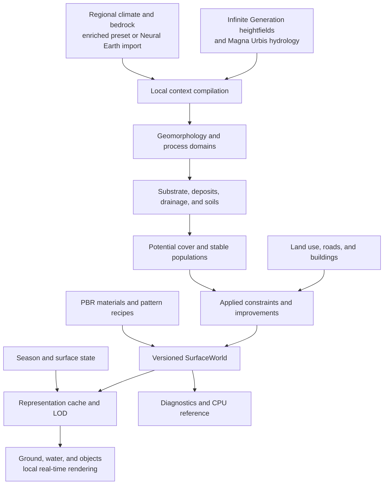

# A new surface-rendering layer for Magna Urbis

Design document and backlog — October 23, 2026.

> English translation of the [French original](RENDER_SURFACE_DESIGN_FR.md).

This document describes the initial design. The state of the code, evidence actually collected, and remaining gaps are maintained in [SurfaceWorld — implementation](surface/IMPLEMENTATION.md). The distinction between **ground, low cover, and trees** is specified in the [layer contract](SURFACE_RENDER_LAYERS.md): a historical visual composite does not replace the ground material under grasses or crowns.

**Proposal: build an explicit surface world, then render it using a combination of existing PBR materials, procedural patterns, and instanced objects.** The main work is deciding what exists at each location and how that description crosses scales. Building a new texture library is not the central task.

The first vertical slice targets the **2D and 3D role-playing maps and plans** produced by Magna Urbis: chosen styles, orthographic projection, perspective views, and usable exports. It is tested in a separate local application over an area of approximately **40 × 40 km**, observable down to **1–5 cm per pixel**, with an experimental extension to **5 mm/px**. This separation helps qualify the engine; it does not determine its final role. Web integration and transfer to Neural Earth follow validation of this complete slice.

**Infinite Generation remains the reference for producing heightfields and their detail on demand.** The 40 × 40 km area defines the initial rendering validation window, not a generator limit or a requirement to freeze the world into a heightmap. Godot and Terrain3D are initially evaluated as consumers of that terrain. An additional or alternative height source remains possible if it provides a demonstrated benefit while preserving the desired generation, continuity, and multi-scale refinement capabilities.

## 1. Objective and proposed decisions

“Like Google Earth” here means continuous navigation, legible landscape forms, rich ground detail, and consistent lighting from regional to close views. The territory remains procedural: this project does not reconstruct a real photograph or retrieve Google's imagery.

The system should let a rocky slope be followed down to its fragments, a valley down to its deposits and banks, and a forest down to its clearings and litter. Under the same climate, it should show distinct sandy plains, basalt plateaus, limestone slopes, and alluvial valleys. A new palette per biome is insufficient.

The proposed design decisions are:

1. **Replace biome as the main material selector** with local context: geomorphology, bedrock, deposits, drainage, soil, land use, and seasonal state. Climate constrains this composition; it does not directly select a texture.
2. **Separate landscape production from display.** Environmental fields and objects have stable identities; the camera decides only their representation and filtering.
3. **Reuse Render3D and Render v2 as sources of algorithms and visual references.** Rework their composition if necessary, without being obliged to preserve their color corrections and shader architecture.
4. **Assemble existing technologies.** Poly Haven/ambientCG materials; stochastic synthesis; pattern generators; terrain with LOD; instancing and lighting from a 3D engine.
5. **Start locally.** First option to evaluate: Godot + Terrain3D, with a dedicated surface shader and independent data compiler. This recommendation is an engineering hypothesis to validate at milestone J0, not a performance result already demonstrated.
6. **Finish a vertical slice before expanding the catalog.** A rocky landscape with scree, river, grassland, and forest, followed by a coast and a settled area. The hundreds of catalog variants are a target for progressive coverage.

The choice of terrain provider and renderer remain independent: adopting Godot does not require replacing Infinite Generation, and testing another generator does not require changing the renderer.

**Magna Urbis remains a city generator and mapping tool.** Its purpose is a map and city with a chosen style and a richer surface representation; the viewer does not turn it into a game application. Palettes, ink, road hierarchy, silhouettes, native materials, labels, and final composition belong to the product. Physically based aerial rendering is one presentation among others. Existing cartographic styles remain reference outputs, evaluated alongside the close ground view.

Godot/Terrain3D is a **candidate for the main rendering engine**, evaluated on these mapping uses as well as on the aerial view. Adoption and scope will be decided from results: quality of styles and plans, orthographic rendering, exports, city integration, navigation, and maintenance cost. The canonical model, recipes, presentation choices, and interchange formats remain independent of the engine. The current local implementation is a qualification prototype; existing outputs remain available during evaluation. Any extension to the Web or Neural Earth consumes the same descriptions. The save format and the Infinite Generation provider remain decisions separate from the renderer choice.

The first delivery must show differences in terrain character from the regional view, then reveal corresponding structures when zooming in. A beautiful isolated square of gravel does not validate this product.

## 2. References and scope of the analysis

### 2.1. The two starting reviews

- **[RENDER_REVIEW.md](RENDER_REVIEW.md)**, especially §§3 and 7–10: example-based material combinations, structured patterns, deterministic scatter, filtering, and continuity across scales. This report contributes synthesis techniques and the distinction between continuous matter and recognizable objects.
- **[MATERIALS_REVIEW.md](MATERIALS_REVIEW.md)**, especially §§1–3 and 5: a landscape catalog and separation between material, morphology, pattern, cover, and state. This report defines what the system must be able to express; its material/generator counts indicate scale, rather than a scientific classification or a scope to implement all at once.

The catalog places many patterns at **0.2–5 m/px**. The project must therefore solve two related problems: produce this mesoscopic organization, then extend it down to the centimeter. A detailed PBR texture replaces neither an alluvial bar nor a scree front.

The hybrid recommendation of RENDER_REVIEW is retained, but its roadmap is reordered: **local context starts before large-scale texture integration**. One real material is nevertheless integrated very early to check the entire pipeline without waiting for a complete environmental simulator.

### 2.2. Code examined

Both working directories were on `main`. Snapshot branches were read without switching branches or modifying work in progress:

| Project | Design reference examined | Observed state |
| --- | --- | --- |
| Magna Urbis | `origin/codex/render-v2-snapshot-2026-10-23`, commit `bf3ccc7b5976dac059f902d914450f9bf60900be` | Historical renderer, Render3D, canonical forest, and regional Render v2 |
| Neural Earth, local `infinite_map` repository | Same branch name, commit `ce7f8cbef03218ce7977dc4591e83b637c5231dc` | WGSL/NumPy v2 equations, generated GLSL mirror, real-terrain audits, spatial climate, and regional soil science |

Existing code paths cited below are integration points. Modules proposed later have yet to be created. Snapshot measurements and checks are results documented by these projects; **no new rendering benchmark was run for this design**.

Additional internal sources: [RENDERING.md](RENDERING.md), [Render3D ground](methods/render3d-ground.md), [Render3D vegetation](methods/render3d-vegetation.md), [technical overview](TECHNICAL_AND_SCIENTIFIC_OVERVIEW.md), [Magna Urbis v2 note at the snapshot](https://github.com/dunkean/magna-urbis/blob/bf3ccc7b5976dac059f902d914450f9bf60900be/docs/methods/render-v2.md), [Neural Earth v2 implementation](https://github.com/dunkean/neural-earth/blob/ce7f8cbef03218ce7977dc4591e83b637c5231dc/docs/design/render-v2-implementation.fr.md).

## 3. Current state: strengths, limits, and necessary changes

### 3.1. What to retain

| Strength | Code or documentation | Proposed reuse |
| --- | --- | --- |
| Physical terrain, erosion, and hydrological network | `rust/crates/core/src/erosion.rs`, `rust/bridge/terrain*` bridges, hydrology documentation | Sources for the environmental compiler; avoid a second independently drawn network |
| Classification on a global source independent of the displayed mesh | `terrainMaterial.ts`, `terrain3d.ts`, R32F/B-splines documented in RENDERING | Same principle for local fields, with explicit physical resolutions |
| Physical detail and footprint-based filtering | `rust/bridge/terrainGround.ts` | Hashes, gradients, displacement/normal/variance separation; specialize materials |
| Canonical forest field and deterministic candidates | `terrainForest.ts`, `terrainForestRiparian.ts`, `web/src/ui/forestOccupation.ts` | Generalize stable populations to rocks, tufts, debris, and cover |
| Seasonal state and diagnostics | Snapshot: `terrainRenderV2.ts`, `terrainRenderV2Environment.ts` | Calendar, approximate persistent snow, phenology, diagnostics, and numerical fixtures |
| Equations shared between projects | Neural Earth: `tools/assets/sync_render_v2.cjs`, NumPy mirror, and JSON fixture | CPU reference and controlled generation of required shader portions |
| Known urban and rural land use | `web/src/gen/landuse`, road and building geometry | Explicit ground and population constraints incorporated in a single scene |

There is no need to rewrite terrain, hydrology, or city generators to begin. They need a neutral export contract and, where available, retention of useful intermediate data: routing, incision, deposits, basins, and footprints.

### 3.2. Local context is a greater gap than textures

Magna Urbis already has local data: terrain, water, rivers, and land use. Its reference climate context, however, is still a **map preset**. `ClimateValues` in `rust/bridge/terrain.ts` exposes annual temperature, variability, and precipitation; historical ground and forest inputs notably use global `[temperature, rainfall]` values and local terrain corrections.

Render v2 adds derived local environmental variables, seasons, and mineral provinces. Its large provinces of 180 and 690 km can provide a regional identity; they do not constitute a local lithology map within a 40 km square. Sand, clay, organic matter, and moisture remain largely appearance proxies. What is chiefly missing is a stable representation of **bedrock**, **sedimentary cover**, their **origin**, and the **processes distributing them**. See the [v2 snapshot note](https://github.com/dunkean/magna-urbis/blob/bf3ccc7b5976dac059f902d914450f9bf60900be/docs/methods/render-v2.md).

The change is therefore broader than replacing a shader. Data must explain why a surface is sandy here, stony there, organic in this hollow, and rocky on that escarpment.

### 3.3. Current detail does not span every scale

Render3D ground has four nominal bands of 8 m, 2.2 m, 0.32 m, and 0.055 m, plus analytical clasts. Filtering depends on the effective width of a pattern, not just its nominal length. The [Neural Earth detailed-ground audit](https://github.com/dunkean/neural-earth/blob/ce7f8cbef03218ce7977dc4591e83b637c5231dc/docs/design/render-v2-ground-detail-audit.fr.md) identifies a lack of structure between stands hundreds of meters across and detail that resolves only below approximately one meter per pixel.

That audit also identifies composition defects later corrected: lost detail in clearings, ground normals carried into crowns, litter reapplied after snow, and translucent trees at beach edges. **Not all of these defects remain in the final snapshot.** They nevertheless show why the new architecture must carry materials separately and explicitly compose their responses instead of reconstructing ground from a macro color.

Required changes: process- and cover-specific structures at 2–50 m, followed by spectra and objects specific to sand, earth, rock, litter, and grasses. Reducing the amplitude of the same rocky noise for every material is insufficient.

### 3.4. The scene must become truly shared

Historical documentation distinguishes a Terrain perspective from land use applied in Settlements. Close forest rendering remains mostly an analytical material or painted crowns; buildings and land use follow other paths. Silhouette, parallax, shadow, and ground-contact requirements call for a unified scene for the new view.

Required changes: one physical description feeds map, perspective, and capture; water, ground, vegetation, roads, and buildings share coordinates, depth, and lighting. Diagnostic layers remain data views. A river, beach, or biome is never identified by reading back the rendered color.

## 4. Target architecture: a surface compiler and a viewer



### 4.1. Three distinct responsibilities

**Context compilation.** Neighborhood and basin operations: terrain forms, drainage, sediment provenance, accumulation potential, soil units, and cover. Computed during generation or after relevant edits, outside the display loop.

**Spatial synthesis.** Deterministic recipes: positions of boulders and trees, fractures, ripples, litter patches, small channels, and signs of use. Evaluated by world cells and cached if costly. Their identity depends neither on GPU tiles nor on request order.

**Rendering.** Choice of representation according to projected size, sampling PBR maps, normals, shadows, and composition. A camera does not change geology, ground proportions, or whether a tree exists.

### 4.2. Proposed `SurfaceWorld` contract

This is a **data format**, not a single RGBA texture or a set of grids all stored at the same resolution.

| Group | Useful variables | Proposed initial resolution or support |
| --- | --- | --- |
| Metadata | version, seed, coordinate system, units, extent, source identities, resolutions, and confidence | manifest |
| Canonical terrain | elevation, defined reconstruction, gradient, residual bounds | source DEM and error pyramid |
| Geomorphology | slope, curvatures, multi-radius topographic position, landform classes | derived fields at a spacing compatible with the DEM |
| Geology | lithology, visual mineral proportions, weatherability, hardness, bedding/fracture planes | regional vector units or ~100–500 m fields, refined at known contacts |
| Hydrology | directed network, contributing area, basins, water class and level, distance to banks, height relative to drainage | graph + basin grids; precise vector banks |
| Deposits and soil | residual/colluvial/alluvial/aeolian origin, relative thickness, grain size, organic matter, drainage | ~10–40 m depending on source; conditioned sub-grid detail |
| Climate | seasonal temperatures and rainfall, prevailing wind, exposure, approximate water balance | ~0.5–2 km regional conditions and topographic corrections |
| Cover | potential herbaceous/shrub/tree cover, stand structure, disturbances, litter | ~10–40 m fields + object populations |
| Land improvements | footprints, use, compaction, open areas, furrow/paving directions, artificial surfaces | geometry + local mask/distance pages |
| Recipes | allowed material families, weights, orientation, scales, object distributions | fields and recipe catalog |
| State | date, surface moisture, snow/ice, flooding if supplied | parameters and fields separate from permanent properties |

These spacings are initial budgets to adjust; a field interpolated to 10 m from a 30 m DEM does not become a 10 m observation. Each family retains its source spacing and the provenance of its synthetic details. Categories have integer identifiers; weights and continuous values are filtered according to their semantics.

A season can change moisture or snow without rebuilding bedrock and potential populations. Simulated rain or flooding, however, requires a state model and dedicated inputs; a date alone does not provide discharge.

The terrain contract also includes an on-demand provider: a request with extent and physical resolution, source/seed identity, actually available source level, cancellation, and asynchronous delivery of new data. An exported package serves reproducible captures and offline mode; it is not the renderer's only input path. When the generator provides genuine heightfield refinement, affected environmental dependencies and supports are explicitly updated. This differs from simply subdividing the display mesh, which adds no terrain information and must not redefine context.

### 4.3. Versioning and invalidation

Define separate identities for `terrain`, `hydrology`, `geology`, `environment`, `occupation`, `population`, `materialLibrary`, and `surfaceState`. Recipe and schema versions enter the keys. For example:

```text
environment = hash(terrain, hydrology, geology, climate, compilerVersion)
population  = hash(environment, occupation, populationRecipeVersion, seed)
renderPage  = hash(environment, occupation, materialLibrary, state, pageAddress, mip)
```

Replacing a texture file invalidates the render pages that use it, not the terrain. Changing topography also invalidates affected drainage derivatives. Asynchronous responses carry their world identity; an old response must never overwrite a newer edit.

## 5. Deciding what goes where

### 5.1. Step A: describe forms before colors

On canonical terrain, compute slope, aspect, curvatures, and topographic position at several physical radii. Identify ridges, shoulders, slopes, hollows, slope feet, and valleys. **Geomorphons** provide a reference for these classes; also retain continuous descriptors to avoid artificial boundaries. See [Jasiewicz and Stepinski, 2013](https://doi.org/10.1016/j.geomorph.2012.11.005) and the [GRASS `r.geomorphon` implementation](https://grass.osgeo.org/grass-stable/manuals/r.geomorphon.html).

Start, for example, with ~150, 600, and 2,000 m neighborhoods on a 30 m DEM, then calibrate on Magna Urbis terrain. Coarser terrain requires larger radii. Classification must not be recomputed on the camera's simplified mesh. Basins, channels, and closed depressions remain topological objects; they are not inferred from color noise.

### 5.2. Step B: introduce explicit bedrock

Terrain and climate **do not uniquely determine lithology**. An additional input is required: an imported map, user choice, regional scenario, or declared procedural prior.

For an initial version, offer a few contexts: granite basement, limestone series, layered sandstone, clay-marl terrain, and basalt volcanism. Build coherent spatial units, possibly with contacts, strata, and simple intrusions, rather than a per-cell texture roulette. Each unit supplies mineral color, weathering response, fragment grain size, and structural orientation, among other properties.

One bedrock type can yield massive outcrops, weathered sand, weathered blocks, and reworked deposits. Conversely, an alluvial plain can receive materials different from its underlying rock. **Bedrock, surface deposit, and soil must therefore remain separate.**

### 5.3. Step C: describe surface dynamics

The first version represents **process domains and potentials** without claiming to simulate the landscape's entire history:

| Process | Required conditions and information | Produced distribution |
| --- | --- | --- |
| Residual weathering | bedrock, exposure, climate, slope stability | weathered rock, thin or thick soil, compatible fragments |
| Gravity transport | upstream rock source, slope, convergence, and slope break | scree channels and cones, angular blocks, discontinuous vegetation |
| Fluvial transport | drainage graph, slope, contributing area, upstream origin | channels, coarse bars, fine floodplain deposits, and wet banks |
| Aeolian transport | sand/dust stock, wind, exposure, and obstacles | accumulations, oriented ripples, dunes only where their form is represented |
| Coastal dynamics | coast type, slope, water exposure, sediment stock | rock, pebbles, sand, mudflats; variable widths and interruptions |
| Frost and snow | cold climate, available water, slope, exposure, and declared history | retained snow, frost debris; optional periglacial patterns |

For fluvial deposits, at minimum transport a provenance mixture along the network, then vary grain-size classes using proxies for transport and deposition capacity. Simple distance to water does not distinguish a rocky torrent from a silty plain. For scree, connect the accumulation area to a source and a downhill path; do not populate every steep slope with identical blocks.

A later version may route volumes by class and maintain a mass balance. Until then, thicknesses and proportions remain plausible synthesis parameters, not outputs of calibrated sediment transport. Meter-scale forms that change silhouette, drainage, or bank level belong in the terrain or explicit geometry, not only in albedo.

### 5.4. Step D: calculate available water and soil

Combine climate, soil storage, mineral texture, drainage, height above the network, and exposure. **TWI** relates specific contributing area and slope; **HAND** provides height relative to drainage along the network, which differs from Euclidean distance to a river. These are useful descriptors, not direct moisture measurements or flood forecasts. References: [Beven et al., history of TOPMODEL](https://hess.copernicus.org/articles/25/527/2021/) and [Nobre et al., HAND, 2011](https://doi.org/10.1016/j.jhydrol.2011.03.051).

Maintain **sand + silt + clay = 1** fractions for the mineral phase, and organic matter, stoniness, depth, and moisture separately. The existing appearance model's sand/clay/humus triplet must be explicitly adapted; humus does not replace silt in a grain-size classification.

Respect special cases: endorheic basins, lakes, outlets, poorly permeable soils, springs, and karst environments where declared. A dry closed basin does not automatically imply a salt crust; compatible evaporation and input conditions are also needed. At the square's edges, provide outside context or inflow/outflow conditions: a halo of a few texels does not replace the upstream basin.

### 5.5. Step E: distribute cover and apply land use

Derive potential cover from local climate, available water, soil, elevation, outcrops, and disturbances. Use Render3D/v2 work for height, cover, conifers, clearings, and phenology. Then apply Magna Urbis constraints: crops, meadows, pastures, orchards, roads, building footprints, and compacted ground.

Land use must do more than erase trees: it also selects the surface material, its orientation, and its traces. A street supplies longitudinal/transverse coordinates for paving; a field supplies furrow direction; a courtyard supplies traffic areas and edges. Fertility changes that would alter urban generation remain a later evolution separate from this first view.

### 5.6. Contextual recipe examples

| Context | Dominant materials | Structures and objects | Exclusions and transitions |
| --- | --- | --- | --- |
| Dry limestone slope, convex shoulder | carbonate rock, thin soil | fracture planes, slabs, angular blocks, shrubs in pockets | no generalized sand; soil in hollows/fractures |
| Foot of basalt cliff | dark blocks and compatible fine matrix | scree cone, piles, parameterized size sorting | upstream source; gradual return of cover on stable deposits |
| River in an alluvial valley | channel pebbles/gravel, sand then silt outside channel | bars, wrack lines, riparian vegetation | upstream provenance; distinct banks and bed; trees rooted outside permanent water |
| Humid temperate forest | organic soil, leaves, dead wood, moss | stand, clearings, litter piles, near-surface roots | litter under cover; wet soils in hollows; rock retained at outcrops |
| Arid plain | fine soil, desert pavement, or sand depending on stock | cracks, desert pavement, bushes along drains | arid climate alone does not create an erg |
| Exposed coast | rock/pebbles or sand depending on geology and supply | wet line, wrack, and oriented deposits | no automatic sand belt around every body of water |
| Street or path | paving stones, gravel, compacted earth | joints, curbs, gutter, wear, and debris | structure aligned with the road; vegetation at compatible edges |

These recipes are synthesis policies to calibrate, not universal laws. Their explanation should be visible in an inspector: “alluvial deposit, upstream basalt source, moderate drainage, moist soil.”


## 6. Reusing Neural Earth and Orogen at the right level

| Source | Reusable contribution | Limitation and required adaptation |
| --- | --- | --- |
| `backend/terrain_orogen*.py`, `native/orogen/` | seasonal climate, winds, ocean influence, regional terrain, and persisted stages | regional/planetary generator; not a complete local soil simulation |
| `backend/terrain_pedology.py`, `terrain_soil.py` | substrate mixture and consistent regional identity | ~40 km provinces in the default world; too coarse to place alluvium and outcrops on a 40 km map |
| `web/terrain_render_v2.js`, Python mirror, and GLSL synchronization | equations, states, fixtures, and separation of appearance identities | transport and composition specific to the renderer; do not import the entire planetary cache |
| Render3D and its audits | deterministic populations, filtering, appearance preservation | analytical crowns do not automatically provide close 3D geometry |

Two inputs must be possible without two architectures:

**Standalone Magna Urbis map.** The current preset becomes an enriched regional condition: seasonal climate, prevailing wind, continental/coastal context, and bedrock scenario. Local topographic corrections feed the surface field. Generating a planet for every map is unnecessary.

**Extract from a Neural Earth/Orogen world.** Import extent, coordinates, climate, and regional context from physical fields, then recompute derivatives on Magna Urbis's local DEM. Preserve upstream conditions and elevation reference; avoid correcting temperature for altitude twice. In particular, Orogen's normalized fields must be converted to physical units by the adapter, not consumed as °C or mm.

Orogen can provide tectonic clues and regional origin, but **plates and uplift do not make a lithology map**. The adapter must indicate what is supplied, inferred, and synthesized. The [existing Orogen integration](D:/workspace/self/infinite_map/native/orogen/PROVENANCE.md) already records provenance and local adaptations; its [maintenance notes](D:/workspace/self/infinite_map/docs/orogen-maintenance.md) rule out treating the latest upstream as a direct replacement.

The priority is to extract useful modules and an interchange format, not make Flask/CUDA/Orogen mandatory viewer dependencies. Heavy computation can remain in a local preparation tool. Exported data then enables navigation without a server or active neural model.

## 7. Materials, patterns, and objects: combining techniques

### 7.1. A recipe catalog fed by existing assets

First use textures from **[Poly Haven](https://polyhaven.com/textures)** and **[ambientCG](https://ambientcg.com/)**, whose asset terms are published [here](https://polyhaven.com/license) and [here](https://docs.ambientcg.com/license/), respectively. Import retains source, identifier, license, and physical scale. **[Material Maker](https://github.com/RodZill4/material-maker)** helps complete or harmonize missing maps; map export is the initial path, not executing its graphs inside the engine.

A material entry describes at least:

```text
MaterialRecipe
  id, version, provenance, compatibleSubstrates, compatibleProcesses
  baseColor, normal, roughness, height, optionalAO
  physicalExtentMetres, heightAmplitudeMetres, normalConvention
  macroStatistics, slopeStatistics, directionalFrame
  synthesisMode, variantSet, objectRecipes, wetAndSnowResponse
```

Albedo has no directional lighting baked in; normals and heights have compatible scales. Color follows an explicit sRGB/linear conversion; normals, weights, and roughness are linear data. AO maps must not double shadows or occlusion from actually instanced objects.

Start with **12–20 base materials** and a few variants useful to the vertical slice: light and dark rock, angular fragments, pebbles, gravel, sand, fine earth, mud, litter, humus, short grass, moss, snow, paving stones, and compacted ground. The MATERIALS_REVIEW catalog (§5) then points toward 30–50 bases and more variants. Adding an asset alone does not cover a new landscape: its eligibility rules, pattern, and transitions are also needed.

### 7.2. Choose the technique to suit the structure

| Need | Selected technique | What it must not decide |
| --- | --- | --- |
| Fine irregular material: earth, humus, granite, sand | stochastic patch/hex-tiling sampling of PBR maps | location of a valley, beach, or outcrop |
| Fractures, joints, pavements | SDF/structured networks; Wang tiles if suited to the catalog | road network or regional geology |
| Ripples, strata, fibers | oriented patterns, controlled-spectrum/Gabor noise if useful | physical direction, supplied by wind, strata, or flow |
| Blocks, pebbles, tufts, leaves, and dead wood | deterministic populations, textons, then close instances | distribution independent of substrate and processes |
| Bars, cones, tongues, and channels | geometry/masks from the context compiler | hydrological topology reconstructed in fragment noise |
| Missing materials or rare variants | offline creation, potentially neural generation | image generation every frame or zoom change |

For stochastic surfaces, compare **[Heitz and Neyret, HPG 2018](https://eheitzresearch.wordpress.com/722-2/)** and **[Mikkelsen, Practical Real-Time Hex-Tiling, 2022](https://jcgt.org/published/0011/03/05/)**. [Mikkelsen's code](https://github.com/mmikk/hextile-demo) is a practical starting point; its blending choices do not guarantee exact preservation of every asset's statistics. The [supplement by Deliot and Heitz](https://eheitzresearch.wordpress.com/738-2/) addresses color variation with mipmaps, among other topics.

All maps of a material must use the **same patch transformations and weights**. Rotations also apply to tangent components of normals and pattern directions. Preserve correct UV derivatives for filtered reads; blending color, height, and normals independently would put the lighting of stones somewhere other than their drawing.

**[Wang tiles by Cohen et al., 2003](https://www.cs.jhu.edu/~misha/Fall25/Readings/Cohen03.pdf)** suit structures that connect. They require edge and, depending on objects, corner codes compatible with evaluation in arbitrary order. Street paving remains oriented in the street coordinate system; it is not replaced with randomly rotated hex-tiling of pavers. For cliffs, use strata coordinates or a suitable projection; reserve triplanar projection for cases where its cost and blending are acceptable.

### 7.3. Physical and spatial blending

The local field provides proportions and arrangement rules. A “60% gravel, 25% sand, 15% silt” mixture must produce compatible clusters, interstices, and patches, rather than a uniform average of three images.

Composition modes are distinct: footprint replacement, material mosaic, deposit filling hollows, seasonal layer, or objects occluding the background. Height blending helps some transitions but does not by itself represent a geological deposit. Do not compare asset heights directly without harmonizing their amplitudes in meters.

Fine boundaries are evaluated from canonical distances/geometry or stable sub-grid recipes. A 40 m weight texture does not draw a 2 m bank. Visible materials may be limited to two or three dominant bases per page to fit the GPU budget; this representation compression does not change the canonical mixture and must preserve its filtered appearance.

### 7.4. Generalizing the Render3D forest idea

For each object family, describe density, size distribution, clustering, orientation, support, and exclusions. The existing forest field becomes one case of this contract:

```text
ObjectPopulation = f(worldSeed, familyId, canonicalCell, candidateId, context)
Candidate = {stableId, position, supportHeight, size, orientation, variant}
```

Position and eligibility are decided at the candidate's center/support, never separately for every pixel in its drawing. Neighboring cells and maximum object radius are accounted for to prevent boundary cuts. Stable subsampling by identifier enables nested populations; independently generating a different grid at each LOD would make objects drift.

| Family | Far | Intermediate | Near |
| --- | --- | --- | --- |
| Trees and large shrubs | cover and mean stand response | analytical crowns or impostors with depth | simplified instanced trees, then more detailed models depending on view |
| Blocks and pebbles | mineral coverage, roughness, and integrated shadow effect | textons/relief or impostors | instanced meshes with physical size and orientation |
| Grasses and low plants | cover and carpet statistics | clumps and specific normals | tufts/instances or oriented cards, budget limited to the near area |
| Litter and debris | average material and deposit variation | clumps and textons | selected leaves, branches, and fragments |
| Ponds and mud | wet fraction and compatible contrast | geometry and edges | distinct water surface, bank and ground detail |

Render3DBrush watercolor atlases remain interesting for an artistic variant. For the realistic target, prefer PBR impostors with normals/depth or meshes. A top-view sprite does not become a credible silhouette from a grazing camera.

The background retains its own detail in clearings. Crowns retain their normals and materials; mineral grains must not deform them. An explicit representation progressively replaces its statistical contribution to avoid counting color, cover, shadow, or occlusion twice.

### 7.5. Progressive coverage of the MATERIALS_REVIEW catalog

This matrix connects the catalog's fifteen families to the proposed work. An available material does not mean every landform in its family is already generated.

| Catalog family | Required representation foundation | Initial target coverage |
| --- | --- | --- |
| §1.1 Bare mineral soils | local composition, wet/dry state, grains and crusts | J2; specialized salts/gypsum in J4 |
| §1.2 Rock outcrops | lithology, structures, fractures, and weathering | J2 for selected contexts |
| §1.3 Aeolian landforms | sand stock, wind, and actual dune shape | sand in J2; specialized ripples/dunes in J4 |
| §1.4 Eroded arid relief | erosion network, soils, stratification, and closed basins | desert pavement/soils in J2; badlands, yardangs, and salars in J4 |
| §1.5 Mountains and gravity deposits | relief, rock sources, and slope transport | J1–J2 for outcrops/scree |
| §1.6 Karst | soluble rock, dissolution, and specific drainage | J4; no sinkhole inferred from climate alone |
| §1.7 Volcanism | volcanic units and flow/crater geometry | basalt substrate in J2; specialized landscapes in J4 |
| §1.8 Rivers and alluvial plains | network, provenance, deposits, and channel forms | simple case in J1–J2; complex braids/paleochannels later |
| §1.9 Lakes and inland waters | hydraulic surface, bottom, and optical properties | basic water from J0; variety in J3 |
| §1.10 Wetlands | drainage, saturation, and compatible microrelief | J3; structured peatlands in J4 |
| §1.11 Sandy coasts and estuaries | supply, exposure, levels, and coastal forms | simple cases in J3; structured deltas/tides later |
| §1.12 Rocky coasts | lithology, cliffs, blocks, and waterline | J3; arches/overhangs via dedicated meshes in J4 |
| §1.13 Seabeds and oceans | visible bottom, depth, clarity, and water surfaces | J3; specialized reefs and underwater cover later |
| §1.14 Vegetation cover | populations, structure, supporting ground, and phenology | forest/herbaceous cover in J2; mangroves and rare patterns in J4 |
| §1.15 Snow, ice, and periglacial environments | retention, supports, cold history/processes | snow in J3; glaciers and structured soils in J4 |

The cross-cutting patterns in §2 — granular, banded, polygonal, dendritic, lobate, etc. — become reusable generators with different parameters and conditions. The same polygonal generator can serve mud cracks and some cold soils; it does not assign them the same physical size, context, or geometry.

## 8. Landscape continuity down to the centimeter

### 8.1. Three LODs to keep separate

There is a **data LOD** (what is known or synthesized), a **geometric LOD** (what the mesh represents), and a **material LOD** (what the pixel resolves). Decoupling them is a condition of the redesign.

| Indicative footprint | Expected visible organization | Dominant representation |
| --- | --- | --- |
| ~20–40 m/px | terrain, surface units, regional waters and cover | simplified terrain, filtered fields, and mean population response |
| 10–2 m/px | bars, outcrops, stands, clusters, large clearings | mesoscopic materials, process geometry, major objects |
| 2–0.2 m/px | crowns, blocks, tufts, and deposit variations | impostors/instances, PBR, surface-specific detail |
| 20–2 cm/px | pebbles, leaves, cracks, roots, and grouped blades | stochastic materials and close objects |
| 2 cm–5 mm/px | fine structure that can actually be sampled | selected details, height/normals, and filtered microstructure |

These intervals overlap; transitions follow projected size and angle, not a rigid zoom number. A 40 km-wide orthographic view at 1,920 pixels is approximately 20.8 m/px; at 1 cm/px it shows only 19.2 m in width. Perspective can present both regimes simultaneously.

### 8.2. Canonical terrain and added details

Keep the DEM and its reconstruction as the macro surface. Add mesoscopic forms only with explicit provenance: either supplied by generation or synthesized by a context-compatible recipe. A residual that changes banks, the bed, or building support must be shared by geometry, water, objects, picking, and culling bounds.

Resolved small relief feeds nearby geometry when it creates a perceptible silhouette or parallax. Farther away it feeds normals and reflectance. Parallax mapping may be a bounded supplement for some grounds; it does not replace block geometry or cliffs in grazing views. Overhangs and arches require dedicated meshes beyond a simple heightfield.

Objects retain their support elevation on the canonical surface; they are not repositioned on every simplified mesh. Geometric transitions must avoid visible floating and penetration. Roads, thresholds, water, and foundations have contact constraints that take priority over decorative noise.

### 8.3. Coordinates and filtering

Keep logical coordinates in meters, in double precision on the CPU, and integer cells for identifiers. Send the GPU a cell origin and a small local position. Moving the rendering origin changes neither texture phases nor seeds. Hash calculation is defined on integers with identical semantics across implementations.

Filter from projected surface derivatives, including perspective anisotropy and pattern coordinate-frame changes. Subpixel detail contributes to average color, coverage, and slope statistics; it does not disappear while remaining contrast changes arbitrarily. See [PBRT, texture sampling and antialiasing](https://www.pbr-book.org/4ed/Textures_and_Materials/Texture_Sampling_and_Antialiasing) and [LEAN Mapping, Olano and Baker, 2010](https://userpages.cs.umbc.edu/olano/papers/lean/).

Average lighting of a canopy or pebbles is not the lighting of an average-color plane. Use suitable statistics/preintegrations, reusing the v2 crown-integral idea. The current scalar variance approximation is neither full LEAN nor LEADR; its validity with the chosen BRDF must be measured.

Parameter maps do not all use the same filter: renormalized weights, preserved categories, integrated coverage, normals accompanied by their dispersion. Pages contain borders calculated using real neighbors; long-range operators are compiled upstream rather than artificially confined to a local halo.

### 8.4. One lighting pipeline

Move to a linear HDR scene pipeline: materials without baked lighting, direct and ambient light, terrain/object shadows, then one exposure and display transform. The [Filament PBR model](https://google.github.io/filament/main/filament.html) is a reference for conventions; the chosen engine provides its concrete model, to be documented and calibrated.

Historical “Render color × BRDF ratio” corrections are not a compatibility requirement for the new renderer. They remain useful for comparison and understanding differences. Do not combine baked hillshade with lighting of the same slope. Fix exposure during comparisons; changing tonemapping can mask material drift when zooming.

Water has an explicit surface, level, and class, with separate bottom, depth, and turbidity. Flow maps can begin as network-derived orientations without claiming to be simulated velocity. Snow covers compatible supports; emerging objects and ground snow are composed separately. V2 ice/sea-ice effects can be reused for relevant scenes after ordinary ground and water.


## 9. Local execution and engine choice

### 9.1. Comparison and recommendation

| Solution | Main benefit | Project-specific work and risk | Proposed decision |
| --- | --- | --- | --- |
| Extend current WebGL2 directly | existing UI and geometry integration | inherited composition, multiple paths, large shaders, and limits of a true close scene | keep as reference; do not make the first delivery depend on it |
| Separate local WebGPU viewer | reuse Neural Earth WGSL and control the pipeline | assemble terrain/objects/shadows and HDR pipeline; remains a browser application | fallback if engine port cost exceeds its benefit |
| **Local Godot + Terrain3D** | terrain, 3D scene, shadows, and instancing available | adapter, custom shader, large scale, and detail stitching must be validated | **first candidate for fast delivery**, accepted only after J0 |
| Rust + wgpu, possibly Bevy | close to Rust core and WGSL shaders | wgpu is an API, not a terrain system; a complete renderer remains to be built | option if justified by measured constraints; not the default start |

Project references: [Godot](https://github.com/godotengine/godot), [Terrain3D](https://github.com/TokisanGames/Terrain3D), [wgpu](https://github.com/gfx-rs/wgpu), and [Bevy](https://github.com/bevyengine/bevy). The environmental compiler and `SurfaceWorld` depend on none of these engines.

Terrain3D is clipmap- and region-based terrain with a replaceable shader. Its [documentation](https://terrain3d.readthedocs.io/en/stable/docs/introduction.html) states a limit of 32 × 32 regions and a maximum extent of 65.536 km per side at base spacing. This geometrically covers the 40 km requirement, but does not make a 1 m grid loaded everywhere reasonable. Its [base shader](https://terrain3d.readthedocs.io/en/stable/docs/shader_design.html) supplies height; contextual composition remains to be developed.

**Generation capability checked on October 23, 2026.** Terrain3D can import external heightmaps and offers procedural background noise for areas without regions. Its [heightmap documentation, including the development version](https://terrain3d.readthedocs.io/en/latest/docs/heightmaps.html), points to external generators; the [integrated generation issue #101](https://github.com/TokisanGames/Terrain3D/issues/101) remains open. The maintainer distinguishes the existing infinite world noise from more complete heightmap generation to be integrated. These features therefore do not, by themselves, demonstrate an equivalent alternative to Infinite Generation's terrain and refinement.

Distinguish three configurations:

- **Reference:** Infinite Generation supplies heightfields; Terrain3D represents them and receives updates.
- **Complement:** Terrain3D or another tool adds an explicitly bounded local residual. This does not silently replace detail requested from the generator; its effects on water, supports, and hydrology are addressed as in §8.2.
- **Alternative:** another terrain provider is compared on geomorphological diversity, quality at different scales, consistency between levels/neighbors, hydrology, determinism, latency, and memory. Adoption is a separate decision based on this comparison; a large noise terrain is not enough to establish equivalence.

Terrain3D region limits apply to the rendering adapter. They must not become limits of the existing generator. Test loading, replacement, and refinement of data in the active window; if the adapter requires entirely prebaked terrain or blocks these uses, replace that display component. The initial 40 km objective does not yet require planetary navigation, but must not remove terrain-provider capabilities.

J0 must decide using measurements: input from Infinite Generation, on-demand loading and refinement of a real 40 km map, centimeter zoom at center and edges, camera stability, stochastic PBR shader, water, and 100,000 object candidates distributed in the world with selection of only visible ones. Check that a new source level integrates without being replaced by mere interpolation of the previous level. Record the exact engine/addon version and tested GPU backend. If a structural failure occurs, choose the separate WebGPU viewer; do not maintain two complete new renderers simultaneously.

### 9.2. Avoiding the uniform fine-grid trap

[Geometry clipmaps](https://hhoppe.com/proj/gpugcm/) motivate terrain whose density follows the camera. Using them does not automatically solve data and material storage.

A starting point to test is background terrain at 8–16 m representation spacing, reconstructed from the available DEM, and a small near area containing genuinely resolved residuals and objects. With Terrain3D this area may need supplementary patches: **their stitching is not assumed to be a provided addon feature**. Shader and masks must prevent overlapping ground, z-fighting, holes, and broken shadows. If cost is excessive, retain DEM geometry and start with PBR/object detail before extending microdisplacement.

[Terrain3D double precision](https://terrain3d.readthedocs.io/en/stable/docs/double_precision.html) requires specific builds and is documented as experimental. It does not provide arbitrary doubles in shaders. First test a relative rendering frame with canonical reconstruction of material coordinates; naively shifting the terrain node can break region addressing. Correct support for this frame is a blocking J0 criterion.

### 9.3. Data and rendering budgets

A 40 km square at 1 cm/texel represents **16 trillion texels**, or **64 decimal TB for one RGBA8 image**, without mips. At 1 m spacing its height grid alone represents 1.6 billion values, or 6.4 GB in float32. Exhaustive centimeter-scale storage is ruled out.

As a budget example: a 10 m context grid covers 16 million cells; 16 bytes per cell occupy 256 MB, approximately 341 MB with a complete pyramid. A 40 m grid has only one million cells. These are payload figures; temporary buffers, CPU/GPU duplication, borders, and caches add to them. There is no reason to put every field at 10 m spacing.

The runtime loads compact regional context, a material catalog, and bounded nearby pages. Initially prefer texture arrays, mipmaps, and a simple page cache. Introduce software virtual texturing only if residency or bandwidth measurements justify it. Compressed formats must suit the engine/backend; [KTX-Software](https://github.com/KhronosGroup/KTX-Software) may serve the asset pipeline if its integration is chosen, without being a default dependency.

Initial targets **to measure on an identified machine**, at 1,920 × 1,080 with warm rendering:

| Measure | Starting target | Method |
| --- | --- | --- |
| Smoothness | target 60 fps; 30 fps quality tier if necessary | CPU and GPU p50/p95/p99, not only average |
| Frame budget | ≤16.7 ms at p95 for 60 Hz tier | total budget, including water, shadows, and vegetation |
| Graphics residency | ≤2 GiB for context + materials + surface caches | excluding other engine resources; count peak and transitions |
| Navigation | no compilation or basin processing on frame thread | measure stutters, queues, and cancellations |
| Near-detail appearance | parent remains visible until detail is available | no black surface or abrupt palette fallback |

These targets are not extrapolated from existing Render3D benchmarks. Settings reduced first are fine-instance distance/density, shadow range, number of PBR layers, and near-page resolution. Adaptive quality never changes the canonical world or its identifiers.

## 10. Validation: appearance, placement, and continuity

### 10.1. A small real-terrain campaign

Select maps actually generated by Magna Urbis, retaining seed, DEM source, native spacing, climate, and configuration. Terrain constructed to illustrate an equation is useful as a visual unit test, but does not replace these cases:

1. Rocky basement with slope, slope foot, grassland, and forest with clearings.
2. Alluvial valley with channel, bars, wetlands, and riparian cover.
3. Arid plain with separate desert pavement, fine soil, and available sand areas.
4. Coast alternating between rock and localized beaches.
5. Cold environment for snow, apparent melting, and summer retention.
6. Settled area with road, courtyard, field, hedge, and building supports.

For each scene: views 40 km, 10 km, 2.56 km, 640 m, 160 m, 40 m, and 10 m wide at fixed resolution, plus a continuous trajectory. The last two frames yield approximately 3.9 cm/px and 9.8 mm/px at 1,024 pixels. Include an oblique perspective, page boundaries, and a return to the same site after cache eviction.

Compare Render, Render3D, snapshot v2, and the new renderer over the same extents. Terrain photos and assets provide material and organization references, without demanding pixel identity with a different real landscape. The [v2 real-ground audit](https://github.com/dunkean/neural-earth/blob/ce7f8cbef03218ce7977dc4591e83b637c5231dc/docs/design/render-v2-audit-real-open-ground.fr.md) shows why terrain labels and DEM spacing must be checked rather than trusting a fixture name.

### 10.2. Acceptance criteria

| Area | Expected verification |
| --- | --- |
| Placement | bedrock, deposit, drainage, and cover diagnostics explaining surfaces; controlled exclusions and compatible transitions |
| Identity | same candidates and materials at fixed coordinates after pan, zoom, restart, and different request order |
| Multi-scale | preservation of averages/coverage under reduction, without losing patches, clearings, or bars; consistent lighting response |
| Materials | physically sized grains, aligned PBR maps, unobtrusive repetition, no baked photographic shadows |
| Scene | no repeated ground, implausibly sloping water, floating trees, buried roads, or rock detail on canopy |
| Motion | no pervasive shimmer, popping, or phase change; sequences of several seconds, not only captures |
| Performance | per-pass statistics, memory, and cold start on declared hardware/backend; generation and navigation measured separately |

Set comparison thresholds for selected scenes at J1. Proposed starting point: linear-albedo mean error <3% over the same reduced extents, and coverage error <2 percentage points outside geometric boundaries; object identity strictly preserved. These thresholds are engineering contracts to adjust, not proof of photorealism or a requirement for equality between different lighting engines.

For radiance, compare at constant lighting/exposure and compatible pixel size; a simple RGB difference between different framings does not measure continuity. Document environmental fidelity, visual quality, and geometric fidelity separately. CPU/GPU equation parity alone is insufficient to accept the final image.


## 11. Prioritized backlog and delivery milestones

**S/M/L** sizes indicate relative difficulty; this document gives no reliable schedule before J0–J1. Each work package must deliver inspectable data and images. P0 is required for the first slice; P1 completes the product; P2 extends environments and simulation.

### 11.1. J0 — Show the landscape in a local engine

| ID | Priority / size | Work | Dependencies | Deliverable and acceptance |
| --- | --- | --- | --- | --- |
| B01 | P0 / S | pin examined sources, choose real terrains, and export configurations | none | snapshot and scene manifest without modifying shared branches |
| B02 | P0 / M | adapt Infinite Generation heightfields to a neutral on-demand provider; also export water, network, land use, and buildings for benchmarks | B01 | extent/resolution requests, source levels, cancellation, and reproducible import; units and coordinate systems checked |
| B03 | P0 / M | evaluate Godot/Terrain3D over 40 km, generator updates, shader, precision, and close navigation; qualify any alternative source separately | B02 | written engine choice, genuine source refinement retained, 40 km → 1 cm/px video; no phase drift at edges |
| B04 | P0 / M | integrate one real stochastic PBR material and a limited visible population | B03 | same scene with ground, water, shadows, and instances; time/memory instrumented |

**Exit decision:** qualify Godot/Terrain3D as the RPG 2D/3D map/plan renderer if Infinite Generation input, updates, addressing, styles, orthographic projection, exports, and shader cost are controlled. Its role may then become primary. If a structural obstacle remains, port the same slice to the WebGPU candidate before continuing. Any alternative generation source needs its own comparison; it does not follow from the engine choice. General UI migration must follow this decision and its measurements.

### 11.2. J1 — Build the context explaining materials

| ID | Priority / size | Work | Dependencies | Deliverable and acceptance |
| --- | --- | --- | --- | --- |
| B05 | P0 / M | define `SurfaceWorld`, units, resolutions, versions, and provenance | B02 | documented schema, CPU reader, and point inspection; old formats not confused |
| B06 | P0 / M | multi-radius morphological derivatives on canonical terrain | B05 | landform map and continuous fields stable across zoom, compared with visible forms |
| B07 | P0 / M | initial bedrock units and regional recipes | B05 | at least two distinct substrates under one climate, explainable contacts |
| B08 | P0 / M | basin graph, contributing area, height above drainage, and banks | B05–B06 | diagnostics without page breaks; external conditions and closed basins explicit |
| B09 | P0 / L | gravity/fluvial transport domains and deposits with provenance | B06–B08 | complete slope and valley; fragments compatible with their sources |
| B10 | P0 / M | local soil and available water from regional climate | B07–B09 | valid mineral fractions, separate organic matter, visible ridge/slope/hollow differences |

**Exit decision:** before expanding assets, diagnostics must explain a rock → scree → soil → alluvial deposit sequence. If locations remain random or derived only from biome, revisit context.

### 11.3. J2 — Deliver a landscape slice down to the centimeter

| ID | Priority / size | Work | Dependencies | Deliverable and acceptance |
| --- | --- | --- | --- | --- |
| B11 | P0 / M | import and normalize the initial 12–20 materials | B04–B05 | catalog with scale, maps, provenance, and variants; no network required at runtime |
| B12 | P0 / L | compile conditioned recipes and mosaics, transitions, and orientations | B09–B11 | distinct rock/soil/gravel/litter in one scene; no generalized uniform blending |
| B13 | P0 / L | generic populations for blocks, tufts, and debris | B12 | stable identity, neighbors at boundaries, bounded density, efficient visible selection |
| B14 | P0 / L | transfer forest model and states to the shared scene | B10, B13 | consistent distant cover, clearings, litter, and close trees; no double shadow |
| B15 | P0 / L | material/object LOD, semantic mips, and mean response | B12–B14 | trajectories without palette changes; correctly filtered subpixel detail |
| B16 | P0 / M | linear scene, exposure, explicit water, and consistent shadows | B04, B12–B14 | readable multiple lighting conditions; ground and canopy separate; water level retained |
| B17 | P0 / M | execute captures, sequences, profiles, and vertical-slice review | B15–B16 | report on real terrains from 40 km to ~1 cm/px; remaining limits named |

**First useful delivery:** local viewer, world package, limited catalog, environmental inspector, one validated complete scene, and performance report. It does not wait for every climate or pattern.

### 11.4. J3 — Extend to water, land improvements, and regional data

| ID | Priority / size | Work | Dependencies | Deliverable and acceptance |
| --- | --- | --- | --- | --- |
| B18 | P1 / M | adapt Neural Earth/Orogen climate/substrate as an optional source | B05, B10 | same schema for standalone map and extract; units/lapse rate/provenance controlled |
| B19 | P1 / L | coasts, bars, marshes, visible bottom, and turbidity | B09, B12, B16 | two distinct coasts; no universal sand ring; banks consistent across zoom |
| B20 | P1 / L | rural land use, roads, courtyards, and building contacts | B02, B12–B14 | shared inhabited perspective scene, oriented paving/furrows, object exclusions |
| B21 | P1 / M | wet/dry states, phenology, and snow on separate supports | B10, B14–B16 | seasonal change without changing rock/populations; no litter above snowpack |
| B22 | P1 / L | supplementary close geometry and terrain/object stitching | B03, B15–B16 | visible oblique-view improvement; compatible picking, bounds, and supports; budget met |
| B23 | P1 / M | harden streaming, eviction, cancellation, and reconstruction after edits | B17, B20–B22 | identical return to site after eviction; no old page on a new world |

### 11.5. J4 — Catalog coverage and reuse

| ID | Priority / size | Work | Dependencies | Deliverable and acceptance |
| --- | --- | --- | --- | --- |
| B24 | P2 / L | declared aeolian processes, saline soils, frost patterns, volcanism, and karst | J2–J3 | for each family: conditions, required geometry, recipe, real example, and limits |
| B25 | P2 / L | more explicit sediment transport and mass balance | B09 | controlled volumes/provenances; distinguish simulation from appearance |
| B26 | P2 / M | enrich materials/variants and authoring tools | B11–B12 | progress toward MATERIALS_REVIEW catalog without a new complete shader per variant |
| B27 | P2 / L | export to Neural Earth and possibly the web view | B05, B17, B23 | reusable package/recipes and tests; planetary projection and LOD adaptations separate |
| B28 | P2 / M | offline neural generation of rare missing assets | need identified in B26 | consistent PBR maps and provenance; no real-time-loop dependency |

B24 features must not disguise forms absent from terrain: painting a glacier pattern does not create a glacial valley, and striping a plain does not create dunes. Major morphological changes become terrain generators or explicit scene objects.

### 11.6. Proposed code organization

Indicative tree, to adapt after J0; names do not denote already existing components:

```text
surface/
  schema/                  SurfaceWorld and unit/provenance rules
  compiler/                landforms, substrate, local hydrology, soils, and cover
  recipes/                 placement policies and populations
  materials/               manifests and asset preparation
  reference/               CPU evaluators and small parity fixtures
  tools/                   export/import and reproducible captures
viewer-local/
  adapters/                SurfaceWorld to the chosen engine
  shaders/                 material, filtering, and composition
  scene/                   terrain, water, instances, and buildings
  diagnostics/             data inspection and profiles
```

Use the Rust core for available terrain processing. Initial analysis prototypes can use existing Python tools, then move if cost or integration requires it. Share schema, recipes, mathematical primitives, and fixtures; do not force the entire scene API to be shared between Godot, WebGL, and WebGPU.

## 12. Questions for prototypes to settle

| Question | Initial choice | Evidence expected to confirm or change it |
| --- | --- | --- |
| Does the local engine actually accelerate delivery? | Godot/Terrain3D | J0: import, precision, shader, objects, water, and port cost |
| Which terrain provider? | Infinite Generation as reference; complements and alternatives allowed | preserve on-demand input; compare any alternative on terrain, multi-scale behavior, hydrology, and cost, separately from renderer |
| What context resolution is useful? | coarse regional + ~10–40 m local fields depending on source + fine geometry | J1: diagnostic stability and readable boundaries without excessive memory |
| Is centimeter geometry necessary? | materials/objects first; small patches if silhouettes require them | J2/J3: matched oblique views and GPU profile |
| Is virtual texturing necessary? | bounded simple cache first | residency and stutters measured after real material diversity |
| Is a full Orogen climate necessary? | optional regional input | useful improvement on 40 km scenes compared with the enriched preset |
| Are new generated textures necessary? | existing library first | concrete material/scale gap identified after correcting placement |

The guiding criterion remains landscape readability: **a surface must have a consistent origin, organization, and material at every distance at which it is visible**. The two reviews provide techniques and vocabulary, respectively; the proposed redesign adds the local model and representation contracts needed to combine them.
