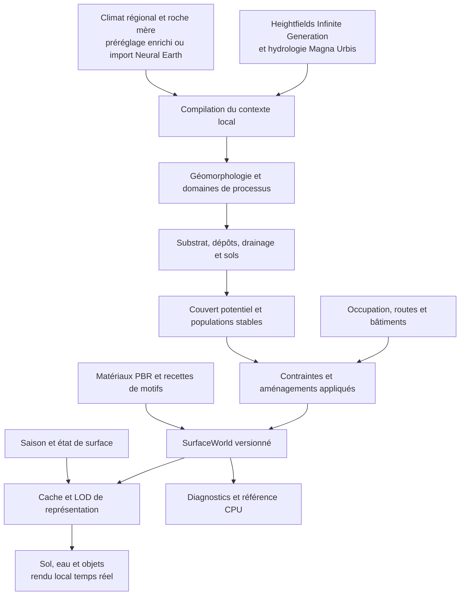

# Nouvelle couche de rendu des surfaces de Magna Urbis

Document de conception et backlog — 23 octobre 2026.

**Proposition : construire un monde de surfaces explicite, puis le rendre avec une combinaison de matériaux PBR existants, de motifs procéduraux et d'objets instanciés.** Le principal travail est de décider ce qui existe à chaque endroit et comment cette description traverse les échelles. Constituer une nouvelle bibliothèque de textures n'est pas le chantier central.

Le premier produit visé est un visualiseur local de Magna Urbis, indépendant de son interface actuelle, pour un territoire d'environ **40 × 40 km**, observable du dessus et en perspective jusqu'à **1–5 cm par pixel**, avec une extension expérimentale vers **5 mm/px**. Une intégration web et un transfert vers Neural Earth viennent après la validation de cette tranche complète.

**Infinite Generation reste la référence pour produire les heightfields et leur détail à la demande.** Les 40 × 40 km définissent la fenêtre initiale de validation du rendu, pas une limite du générateur ni l'obligation de figer le monde dans une heightmap. Godot et Terrain3D sont d'abord évalués comme consommateurs de ce relief. Une source de hauteur complémentaire ou alternative reste possible si elle apporte un gain démontré en préservant les capacités recherchées de génération, de continuité et de raffinement multi-échelle.

## 1. Objectif et décisions proposées

« Façon Google Earth » désigne ici la continuité de navigation, la lisibilité des formes du paysage, la richesse du sol et la cohérence de l'éclairage entre vue régionale et vue proche. Le territoire reste procédural : ce projet ne reconstitue pas une photographie réelle et ne récupère pas les images de Google.

Le système doit permettre de suivre une pente rocheuse jusque dans ses fragments, une vallée jusque dans ses dépôts et ses berges, une forêt jusque dans ses trouées et sa litière. À climat identique, il doit pouvoir montrer une plaine sableuse, un plateau basaltique, un versant calcaire ou une vallée alluviale distincts. Une nouvelle palette par biome ne suffit pas.

Les décisions de conception proposées sont les suivantes :

1. **Remplacer le biome comme sélecteur principal de matière** par un contexte local : géomorphologie, roche mère, dépôts, drainage, sol, occupation et état saisonnier. Le climat contraint cette composition ; il ne choisit pas directement une texture.
2. **Séparer la fabrication du paysage de son affichage.** Les champs environnementaux et les objets ont une identité stable ; la caméra ne décide que de leur représentation et de leur filtrage.
3. **Réutiliser Render3D et Render v2 comme sources d'algorithmes et de références visuelles.** Refaire leur composition si nécessaire, sans obligation de préserver leurs corrections de couleurs et leur architecture de shaders.
4. **Assembler des technologies existantes.** Matériaux de Poly Haven/ambientCG ; synthèse stochastique ; générateurs de motifs ; terrain avec LOD ; instanciation et éclairage d'un moteur 3D.
5. **Commencer en local.** Première option à éprouver : Godot + Terrain3D, avec un shader de surface spécifique et un compilateur de données indépendant. Cette recommandation est une hypothèse d'ingénierie à valider au jalon J0, pas une performance déjà démontrée.
6. **Finir une tranche verticale avant d'élargir le catalogue.** Un paysage rocheux avec éboulis, rivière, prairie et forêt, puis une côte et un secteur habité. Les centaines de variantes du catalogue sont une cible de couverture progressive.

Le choix du fournisseur de relief et celui du renderer restent indépendants : adopter Godot n'impose pas de remplacer Infinite Generation, et tester un autre générateur n'impose pas de changer le renderer.

**Magna Urbis reste un générateur de villes et un outil de cartographie.** La finalité est une carte et une ville dont le style est choisi, avec une représentation de surface plus riche ; le visualiseur n'en fait pas une application de jeu. Les palettes, l'encre, la hiérarchie des routes, les silhouettes, les matériaux natifs, les étiquettes et la composition finale appartiennent au produit. Un rendu physique aérien est une présentation parmi d'autres. Les styles cartographiques existants restent des sorties de référence, évaluées au même titre que la vue proche du sol.

Godot/Terrain3D est donc un **adaptateur local optionnel**. Le modèle canonique, les recettes, les choix de présentation et les formats d'échange restent indépendants du moteur. Le projet Godot ne devient ni l'éditeur de ville ni le format de sauvegarde. Toute extension vers le Web ou Neural Earth consomme les mêmes descriptions. L'engagement définitif sur le moteur doit inclure la qualité des styles finaux et des exports cartographiques, au-delà des performances de terrain.

La première livraison doit montrer une différence de nature du terrain dès la vue régionale, puis révéler les structures correspondantes au zoom. Un magnifique carré de gravier isolé ne valide pas ce produit.

## 2. Références et périmètre de l'analyse

### 2.1. Les deux reviews de départ

- **[RENDER_REVIEW.md](RENDER_REVIEW.md)**, notamment §3, §7–10 : combinaison de matériaux par exemples, motifs structurés, scatter déterministe, filtrage et continuité entre échelles. Ce rapport apporte les techniques de synthèse et la distinction entre matière continue et objets reconnaissables.
- **[MATERIALS_REVIEW.md](MATERIALS_REVIEW.md)**, notamment §1–3 et §5 : catalogue de paysages et séparation entre matériau, morphologie, motif, couverture et état. Ce rapport définit ce que le système doit pouvoir exprimer ; ses nombres de matériaux/générateurs sont des indications de dimensionnement, pas une classification scientifique ni un périmètre à implémenter d'un bloc.

Le catalogue situe beaucoup de ses motifs à **0,2–5 m/px**. Le projet doit donc résoudre deux problèmes liés : produire cette organisation mésoscopique, puis la prolonger jusqu'au centimètre. Une texture PBR détaillée ne remplace ni un banc alluvial ni un front d'éboulis.

Je conserve la recommandation hybride de RENDER_REVIEW, mais change l'ordre de sa feuille de route : **le contexte local commence avant l'intégration massive des textures**. Un premier matériau réel est néanmoins intégré très tôt pour vérifier toute la chaîne, sans attendre un simulateur environnemental complet.

### 2.2. État du code consulté

Les deux répertoires de travail étaient sur `main`. Les branches snapshot ont été lues sans changer de branche ni modifier les travaux en cours :

| Projet | Référence de conception consultée | État observé |
| --- | --- | --- |
| Magna Urbis | `origin/codex/render-v2-snapshot-2026-10-23`, commit `bf3ccc7b5976dac059f902d914450f9bf60900be` | Render historique, Render3D, forêt canonique et Render v2 régional |
| Neural Earth, dépôt local `infinite_map` | même nom de branche, commit `ce7f8cbef03218ce7977dc4591e83b637c5231dc` | équations v2 WGSL/NumPy, génération du miroir GLSL, audits sur vrais terrains, climat spatial et pédologie régionale |

Les chemins de code existants cités ci-dessous sont des points d'intégration. Les modules proposés plus loin restent à créer. Les mesures et vérifications des snapshots sont des résultats documentés par ces projets ; **aucun nouveau benchmark de rendu n'a été exécuté pour cette conception**.

Sources complémentaires internes : [RENDERING.md](RENDERING.md), [sol Render3D](methods/render3d-ground.md), [végétation Render3D](methods/render3d-vegetation.md), [aperçu technique](TECHNICAL_AND_SCIENTIFIC_OVERVIEW.md), [note v2 Magna Urbis au snapshot](https://github.com/dunkean/magna-urbis/blob/bf3ccc7b5976dac059f902d914450f9bf60900be/docs/methods/render-v2.md), [implémentation v2 Neural Earth](https://github.com/dunkean/neural-earth/blob/ce7f8cbef03218ce7977dc4591e83b637c5231dc/docs/design/render-v2-implementation.fr.md).

## 3. État actuel : acquis, limites et changements nécessaires

### 3.1. Ce qu'il faut conserver

| Acquis | Code ou documentation | Réutilisation proposée |
| --- | --- | --- |
| Terrain physique, érosion et réseau hydrologique | `rust/crates/core/src/erosion.rs`, ponts `rust/bridge/terrain*`, documentation hydrologique | Sources du compilateur environnemental ; éviter un second réseau dessiné indépendamment |
| Classification sur une source globale indépendante du maillage affiché | `terrainMaterial.ts`, `terrain3d.ts`, R32F/B-splines documentées dans RENDERING | Même principe pour les champs locaux, avec des résolutions physiques explicites |
| Détail physique et filtrage selon l'empreinte | `rust/bridge/terrainGround.ts` | Hash, gradients, séparation déplacement/normale/variance ; matériaux à spécialiser |
| Champ forestier canonique et candidats déterministes | `terrainForest.ts`, `terrainForestRiparian.ts`, `web/src/ui/forestOccupation.ts` | Généraliser les populations stables aux rochers, touffes, débris et couverts |
| État saisonnier et diagnostics | snapshot : `terrainRenderV2.ts`, `terrainRenderV2Environment.ts` | Calendrier, neige persistante approximée, phénologie, diagnostics et fixtures numériques |
| Équations partagées entre projets | Neural Earth : `tools/assets/sync_render_v2.cjs`, miroir NumPy et fixture JSON | Référence CPU et génération contrôlée des portions de shader nécessaires |
| Occupation urbaine et rurale déjà connue | `web/src/gen/landuse`, géométries de voirie et bâtiments | Contraintes explicites du sol et des populations, reprises dans une scène unique |

Il n'est pas nécessaire de réécrire les générateurs de relief, d'hydrologie ou de ville pour commencer. Il faut leur ajouter un contrat d'export neutre et, quand elles existent, conserver leurs données intermédiaires utiles : routage, incision, dépôts, bassins et emprises.

### 3.2. Le contexte local manque davantage que les textures

Magna Urbis n'est pas dépourvu de données locales : il connaît le relief, les eaux, les rivières et des occupations. En revanche, son contexte climatique de référence est encore un **préréglage de carte**. `ClimateValues` dans `rust/bridge/terrain.ts` expose température annuelle, variabilité et précipitations ; les entrées historiques de sol et de forêt utilisent notamment le couple global `[température, pluie]` et des corrections locales de relief.

Render v2 ajoute des variables environnementales locales dérivées, des saisons et des provinces minérales. Ses grandes provinces de 180 et 690 km peuvent fournir une identité régionale ; elles ne constituent pas une carte de lithologie locale dans un carré de 40 km. Sable, argile, organique et humidité restent largement des proxys d'apparence. Il manque surtout une représentation stable de la **roche mère**, de la **couverture sédimentaire**, de leur **origine** et des **processus qui les distribuent**. Voir la [note v2 au snapshot](https://github.com/dunkean/magna-urbis/blob/bf3ccc7b5976dac059f902d914450f9bf60900be/docs/methods/render-v2.md).

Le changement est donc plus large qu'un remplacement de shader. Il faut construire des données qui expliquent pourquoi une surface est sableuse ici, pierreuse là, organique dans ce creux et rocheuse sur cet escarpement.

### 3.3. Le détail actuel n'occupe pas toutes les échelles

Le sol Render3D possède quatre bandes nominales de 8 m, 2,2 m, 0,32 m et 0,055 m, ainsi que des clastes analytiques. Le filtrage dépend de la largeur effective du motif, pas seulement de sa longueur nominale. L'[audit Neural Earth du sol détaillé](https://github.com/dunkean/neural-earth/blob/ce7f8cbef03218ce7977dc4591e83b637c5231dc/docs/design/render-v2-ground-detail-audit.fr.md) relève notamment un manque de structure entre les peuplements de centaines de mètres et les détails qui ne se résolvent qu'en dessous d'environ un mètre par pixel.

Cet audit distingue aussi des défauts de composition ensuite corrigés : perte du détail dans les trouées, normales du sol transportées vers les couronnes, litière réappliquée après la neige, arbres translucides au bord des plages. **Ce ne sont pas tous des défauts encore présents dans le snapshot final.** Ils montrent cependant pourquoi la nouvelle architecture doit transporter séparément les matériaux et composer leurs réponses explicitement, au lieu de reconstruire le sol à partir d'une couleur macro.

À changer : des structures à 2–50 m propres aux processus et aux couverts, puis des spectres et objets spécifiques au sable, à la terre, à la roche, à la litière et aux herbes. Réduire l'amplitude d'un même bruit rocheux pour tous les matériaux ne suffit pas.

### 3.4. La scène doit devenir réellement commune

La documentation historique distingue une perspective Terrain et une occupation appliquée dans Settlements. Le rendu forestier proche reste principalement un matériau analytique ou des couronnes peintes ; les bâtiments et occupations suivent d'autres chemins. Les besoins de silhouette, de parallaxe, d'ombres et de contact au sol imposent une scène unifiée pour la nouvelle vue.

À changer : une seule description physique alimente carte, perspective et capture ; eau, sol, végétation, voirie et bâtiments partagent repère, profondeur et éclairage. Les couches diagnostiques restent des vues de données. On n'identifie jamais une rivière, une plage ou un biome en relisant la couleur rendue.

## 4. Architecture cible : un compilateur de surfaces et un visualiseur



### 4.1. Trois responsabilités distinctes

**Compilation du contexte.** Opérations de voisinage et de bassin : formes du relief, drainage, provenance des sédiments, potentiels d'accumulation, unités de sol et couverts. Calculées à la génération ou après une édition pertinente, hors de la boucle d'affichage.

**Synthèse spatiale.** Recettes déterministes : position des blocs et arbres, fractures, rides, plages de litière, petits chenaux et traces d'usage. Évaluées par cellules mondiales, mises en cache si coûteuses. Leur identité ne dépend ni des tuiles GPU ni de l'ordre des requêtes.

**Rendu.** Choix des représentations selon la taille projetée, échantillonnage des cartes PBR, normales, ombres et composition. Une caméra ne change pas la géologie, les proportions du sol ou l'existence d'un arbre.

### 4.2. Contrat `SurfaceWorld` proposé

Il s'agit d'un **format de données**, pas d'une texture RGBA unique ni de toutes les grilles stockées à la même résolution.

| Groupe | Variables utiles | Résolution ou support de départ proposé |
| --- | --- | --- |
| Métadonnées | version, seed, repère, unités, emprise, identités des sources, résolutions et confiance | manifeste |
| Terrain canonique | altitude, reconstruction définie, gradient, bornes des résidus | DEM source et pyramide d'erreur |
| Géomorphologie | pente, courbures, position topographique multi-rayons, classes de forme | champs dérivés au pas compatible avec le DEM |
| Géologie | lithologie, proportions minérales visuelles, altérabilité, dureté, plans de stratification/fracturation | unités régionales vectorielles ou champs ~100–500 m, affinés aux contacts connus |
| Hydrologie | réseau orienté, aire contributive, bassins, classe d'eau, niveau d'eau, distance aux rives, hauteur relative au drainage | graphe + grilles de bassin ; rives vectorielles précises |
| Dépôts et sol | origine résiduelle/colluviale/alluviale/éolienne, épaisseur relative, granulométrie, organique, drainage | ~10–40 m selon la source ; détails submaille conditionnés |
| Climat | températures et pluies saisonnières, vent dominant, exposition, bilan hydrique approximé | conditions régionales ~0,5–2 km et corrections topographiques |
| Couvert | herbacé/arbustif/arboré potentiel, structure du peuplement, perturbations, litière | champs ~10–40 m + populations d'objets |
| Aménagement | emprises, usage, compactage, zones ouvertes, directions de sillons/pavage, surfaces artificielles | géométries + pages locales de masques/distances |
| Recettes | familles de matériaux autorisées, poids, orientation, échelles, distributions d'objets | champs et catalogue de recettes |
| État | date, humidité superficielle, neige/glace, inondation si alimentée | paramètres et champs séparés des propriétés permanentes |

Ces pas sont des budgets initiaux à ajuster ; un champ interpolé à 10 m depuis un DEM à 30 m ne devient pas une observation à 10 m. Chaque famille conserve son pas source et la provenance de ses détails synthétiques. Les catégories ont des identifiants entiers ; les poids et valeurs continues se filtrent selon leur sémantique.

La saison peut changer l'humidité ou la neige sans reconstruire la roche mère et les populations potentielles. Une pluie simulée ou une crue exige en revanche un modèle d'état et des entrées dédiées ; une date seule ne fournit pas le débit.

Le contrat de relief comporte aussi un fournisseur à la demande : requête d'emprise et de résolution physique, identité de source/seed, niveau source réellement disponible, annulation et livraison asynchrone de nouvelles données. Un paquet exporté sert aux captures reproductibles et au mode hors ligne ; il n'est pas l'unique chemin d'alimentation du renderer. Lorsque le générateur livre un raffinement réel du heightfield, les dépendances environnementales et les appuis concernés sont mis à jour explicitement. Cela se distingue d'une simple subdivision du maillage d'affichage, qui n'ajoute aucune information de relief et ne doit pas redéfinir le contexte.

### 4.3. Versionnement et invalidation

Définir des identités séparées pour `terrain`, `hydrology`, `geology`, `environment`, `occupation`, `population`, `materialLibrary` et `surfaceState`. Les versions de recettes et de schéma entrent dans les clés. Par exemple :

```text
environment = hash(terrain, hydrology, geology, climate, compilerVersion)
population  = hash(environment, occupation, populationRecipeVersion, seed)
renderPage  = hash(environment, occupation, materialLibrary, state, pageAddress, mip)
```

Remplacer un fichier de texture invalide les pages de rendu qui l'utilisent, pas le relief. Modifier la topographie invalide aussi les dérivés de drainage concernés. Les réponses asynchrones portent l'identité de leur monde ; une ancienne réponse ne doit jamais recouvrir une nouvelle édition.

## 5. Déterminer quoi mettre où

### 5.1. Étape A : décrire les formes avant les couleurs

Sur un terrain canonique, calculer pente, exposition, courbures et position topographique à plusieurs rayons physiques. Identifier crêtes, épaules, versants, creux, pieds de pente et vallées. Les **geomorphons** fournissent une référence pour ces classes ; conserver également les descripteurs continus pour éviter les frontières artificielles. Voir [Jasiewicz et Stepinski, 2013](https://doi.org/10.1016/j.geomorph.2012.11.005) et l'[implémentation GRASS `r.geomorphon`](https://grass.osgeo.org/grass-stable/manuals/r.geomorphon.html).

Commencer, par exemple, avec des voisinages de ~150, 600 et 2 000 m sur un DEM de 30 m, puis calibrer sur les terrains de Magna Urbis. Un relief plus grossier impose des rayons plus grands. La classification ne doit pas être recalculée sur le maillage simplifié de la caméra. Les bassins, chenaux et dépressions fermées restent des objets topologiques ; ils ne se déduisent pas d'un bruit de couleur.

### 5.2. Étape B : introduire une roche mère explicite

Le relief et le climat **ne permettent pas de déduire de manière unique la lithologie**. Il faut une entrée supplémentaire : carte importée, choix utilisateur, scénario régional ou prior procédural déclaré.

Pour une première version, proposer quelques contextes : socle granitique, série calcaire, grès stratifiés, terrains argilo-marneux et volcanisme basaltique. Construire des unités spatiales cohérentes, éventuellement avec contacts, strates et intrusions simples, plutôt qu'une roulette de textures par cellule. Chaque unité fournit notamment couleur minérale, réponse à l'altération, granulométrie des fragments et orientation structurale.

Une même roche mère peut donner un affleurement massif, une arène, des blocs altérés et des dépôts remaniés. Inversement, une plaine alluviale peut recevoir des matériaux différents de sa roche sous-jacente. **Roche mère, dépôt de surface et sol doivent donc rester séparés.**

### 5.3. Étape C : décrire la dynamique de surface

La première version représente des **domaines et potentiels de processus**, sans prétendre simuler toute l'histoire du paysage :

| Processus | Conditions et informations nécessaires | Distribution produite |
| --- | --- | --- |
| Altération résiduelle | roche mère, exposition, climat, stabilité du versant | roche altérée, sol mince ou épais, fragments compatibles |
| Transport gravitaire | source rocheuse amont, pente, convergence et rupture de pente | couloirs et cônes d'éboulis, blocs anguleux, végétation discontinue |
| Transport fluvial | graphe de drainage, pente, aire contributive, origine amont | chenaux, bancs grossiers, dépôts fins de plaine et berges humides |
| Transport éolien | stock de sable/poussière, vent, exposition et obstacles | accumulations, rides orientées, dunes seulement si leur forme est représentée |
| Dynamique littorale | type de côte, pente, exposition à l'eau, stock sédimentaire | roche, galets, sable, vasières ; largeur variable et interruptions |
| Gel et neige | climat froid, eau disponible, pente, exposition et histoire déclarée | neige retenue, débris de gel ; motifs périglaciaires optionnels |

Pour les dépôts fluviaux, transporter au minimum un mélange de provenance le long du réseau, puis faire varier les classes granulométriques avec des proxys de capacité de transport et de dépôt. Une simple distance à l'eau ne distingue pas un torrent rocheux d'une plaine limoneuse. Pour les éboulis, relier la zone d'accumulation à une source et à un chemin aval ; ne pas peupler toutes les pentes fortes de blocs identiques.

Une version ultérieure pourra router des volumes par classe et conserver un bilan matière. Tant que cette étape n'existe pas, les épaisseurs et proportions restent des paramètres de synthèse plausibles, pas les sorties d'un transport sédimentaire calibré. Les formes métriques qui changent silhouette, drainage ou niveau de berge doivent appartenir au terrain ou à une géométrie explicite, pas seulement à l'albédo.

### 5.4. Étape D : calculer l'eau disponible et le sol

Combiner climat, stockage du sol, texture minérale, drainage, hauteur au-dessus du réseau et exposition. Le **TWI** relie aire contributive spécifique et pente ; **HAND** apporte la hauteur relative au drainage suivant le réseau, différente de la distance euclidienne à une rivière. Ce sont des descripteurs utiles, pas des mesures directes d'humidité ni une prévision de crue. Références : [Beven et al., histoire de TOPMODEL](https://hess.copernicus.org/articles/25/527/2021/) et [Nobre et al., HAND, 2011](https://doi.org/10.1016/j.jhydrol.2011.03.051).

Conserver des fractions **sable + limon + argile = 1** pour la phase minérale, et séparément organique, pierrosité, profondeur et humidité. Le couple sable/argile/humus du modèle d'apparence existant devra être adapté explicitement ; l'humus ne remplace pas le limon dans une classification granulométrique.

Respecter les cas particuliers : bassins endoréiques, lacs, exutoires, sols peu perméables, sources et milieux karstiques si déclarés. Un bassin fermé sec n'implique pas automatiquement une croûte de sel ; il faut aussi un contexte d'évaporation et d'apport compatible. Sur les bords du carré, prévoir un contexte extérieur ou des conditions d'entrée/sortie : un halo de quelques texels ne remplace pas le bassin amont.

### 5.5. Étape E : distribuer le couvert et appliquer l'occupation

Déduire un couvert potentiel du climat local, de l'eau disponible, du sol, de l'altitude, des affleurements et des perturbations. Utiliser les acquis Render3D/v2 pour la hauteur, le couvert, les résineux, les clairières et la phénologie. Puis appliquer les contraintes de Magna Urbis : cultures, prés, pâtures, vergers, routes, emprises bâties et sols compactés.

L'occupation ne doit pas se contenter d'effacer les arbres : elle choisit aussi la matière de surface, son orientation et ses traces. Une rue fournit ses coordonnées longitudinales/transversales au pavage ; un champ fournit la direction des sillons ; une cour fournit ses zones de passage et ses bords. Les changements de fertilité qui modifieraient la génération urbaine restent une évolution ultérieure distincte de cette première vue.

### 5.6. Exemples de recettes contextuelles

| Contexte | Matières dominantes | Structures et objets | Exclusions et transitions |
| --- | --- | --- | --- |
| Versant calcaire sec, épaule convexe | roche carbonatée, terre mince | plans de fracture, dalles, blocs anguleux, arbustes en poches | pas de sable généralisé ; sol dans les creux/fractures |
| Pied de paroi basaltique | blocs sombres et matrice fine compatible | cône d'éboulis, amas et tri de tailles paramétré | source en amont ; retour progressif du couvert sur dépôts stables |
| Rivière dans vallée alluviale | galets/gravier en chenal, sable puis limon hors chenal | bancs, laisses, végétation riveraine | provenance amont ; berges et lit distincts ; arbres ancrés hors eau permanente |
| Forêt tempérée humide | sol organique, feuilles, bois mort, mousse | peuplement, trouées, amas de litière, racines proches | litière sous couvert ; sols humides dans creux ; roche conservée aux affleurements |
| Plaine aride | sol fin, reg ou sable selon le stock disponible | fissures, pavement désertique, buissons sur drains | le climat aride seul ne crée pas un erg |
| Littoral exposé | roche/galets ou sable selon géologie et apport | ligne humide, laisses et dépôts orientés | aucune ceinture de sable automatique autour de toute eau |
| Rue ou chemin | pavés, gravier, terre compactée | joints, bordures, caniveau, usure et débris | structure alignée sur la voie ; végétation aux bords compatibles |

Ces recettes sont des politiques de synthèse à calibrer, et non des lois universelles. Leur explication doit être visible dans un inspecteur : « dépôt alluvial, source amont basaltique, drainage moyen, sol humide ».

## 6. Réutiliser Neural Earth et Orogen au bon niveau

| Source | Apport réutilisable | Limite et adaptation requise |
| --- | --- | --- |
| `backend/terrain_orogen*.py`, `native/orogen/` | climat saisonnier, vents, influence océanique, relief régional et étapes persistées | générateur régional/planétaire ; pas une simulation locale complète des sols |
| `backend/terrain_pedology.py`, `terrain_soil.py` | mélange de substrat et identité régionale cohérente | provinces à ~40 km dans le monde par défaut ; trop grossières pour placer les alluvions et les affleurements d'une carte de 40 km |
| `web/terrain_render_v2.js`, miroir Python et synchronisation GLSL | équations, états, fixtures et séparation des identités d'apparence | transport et composition propres au renderer ; ne pas importer tout le cache planétaire |
| Render3D et ses audits | populations déterministes, filtrage, conservation d'apparence | les houppiers analytiques ne fournissent pas automatiquement une géométrie 3D proche |

Deux entrées doivent être possibles sans deux architectures :

**Carte Magna Urbis autonome.** Le préréglage actuel devient une condition régionale enrichie : climat saisonnier, vent dominant, contexte continental/côtier et scénario de roche mère. Des corrections topographiques locales alimentent le champ de surface. Il n'est pas nécessaire de générer une planète pour chaque carte.

**Extrait d'un monde Neural Earth/Orogen.** Importer emprise, repère, climat et contexte régional depuis les champs physiques, puis recalculer les dérivés sur le DEM local de Magna Urbis. Préserver les conditions amont et la référence d'altitude ; éviter une double correction de température avec l'altitude. En particulier, les champs normalisés d'Orogen doivent être convertis en unités physiques par l'adaptateur, pas consommés comme des °C ou mm.

Orogen peut fournir des indices tectoniques et une origine régionale, mais **plaques et uplift ne sont pas une carte de lithologie**. L'adaptateur doit signaler ce qui est fourni, inféré et synthétisé. L'[intégration Orogen existante](../../infinite_map/native/orogen/PROVENANCE.md) conserve déjà une provenance et des adaptations locales ; leur [maintenance](../../infinite_map/docs/orogen-maintenance.md) exclut de traiter le dernier upstream comme un remplacement direct.

La priorité est d'extraire des modules utiles et un format d'échange, pas d'ajouter Flask/CUDA/Orogen comme dépendances obligatoires au visualiseur. Les calculs lourds peuvent rester dans un outil de préparation local. Les données exportées permettent ensuite une navigation sans serveur ni modèle neuronal actif.

## 7. Matériaux, motifs et objets : agréger les techniques

### 7.1. Un catalogue de recettes, alimenté par les assets existants

Utiliser d'abord les textures de **[Poly Haven](https://polyhaven.com/textures)** et **[ambientCG](https://ambientcg.com/)**, dont les conditions d'assets sont publiées respectivement [ici](https://polyhaven.com/license) et [ici](https://docs.ambientcg.com/license/). L'import conserve source, identifiant, licence et échelle physique. **[Material Maker](https://github.com/RodZill4/material-maker)** sert à compléter ou harmoniser les cartes manquantes ; l'export de cartes est le chemin initial, pas l'exécution de ses graphes dans le moteur.

Une entrée de matériau décrit au minimum :

```text
MaterialRecipe
  id, version, provenance, compatibleSubstrates, compatibleProcesses
  baseColor, normal, roughness, height, optionalAO
  physicalExtentMetres, heightAmplitudeMetres, normalConvention
  macroStatistics, slopeStatistics, directionalFrame
  synthesisMode, variantSet, objectRecipes, wetAndSnowResponse
```

L'albédo est sans éclairage directionnel ; les normales et hauteurs sont compatibles en échelle. La couleur suit une conversion sRGB/linéaire explicite ; normales, poids et rugosité sont des données linéaires. Les cartes AO ne doivent pas doubler les ombres ou l'occlusion des objets réellement instanciés.

Partir de **12–20 matériaux de base** et de quelques variantes utiles à la tranche verticale : roche claire et sombre, fragments anguleux, galets, gravier, sable, terre fine, boue, litière, humus, herbe courte, mousse, neige, pavés et sol compacté. Le catalogue de MATERIALS_REVIEW (§5) donne ensuite la direction vers 30–50 bases et davantage de variantes. Ajouter un asset ne suffit pas à couvrir un nouveau paysage : il faut aussi ses règles d'éligibilité, son motif et ses transitions.

### 7.2. Choisir la technique selon la structure

| Besoin | Technique retenue | Ce qu'elle ne doit pas décider |
| --- | --- | --- |
| Matière irrégulière fine : terre, humus, granite, sable | échantillonnage stochastique par patches/hex-tiling sur cartes PBR | emplacement d'une vallée, d'une plage ou d'un affleurement |
| Fractures, joints, pavements | SDF/réseaux structurés ; Wang tiles si le catalogue s'y prête | réseau viaire ou géologie régionale |
| Rides, strates, fibres | motifs orientés, bruit à spectre contrôlé/Gabor si utile | direction physique, fournie par vent, strates ou écoulement |
| Blocs, galets, touffes, feuilles et bois mort | populations déterministes, textons puis instances proches | distribution indépendante du substrat et des processus |
| Bancs, cônes, langues et chenaux | géométrie/masques issus du compilateur de contexte | topologie hydrologique reconstruite en bruit de fragment |
| Matériaux absents ou variantes rares | création hors ligne, éventuellement génération neuronale | génération d'images à chaque frame ou changement de zoom |

Pour les surfaces stochastiques, comparer **[Heitz et Neyret, HPG 2018](https://eheitzresearch.wordpress.com/722-2/)** et **[Mikkelsen, Practical Real-Time Hex-Tiling, 2022](https://jcgt.org/published/0011/03/05/)**. Le [code de Mikkelsen](https://github.com/mmikk/hextile-demo) fournit un point de départ pratique ; ses choix de mélange ne garantissent pas la conservation exacte des statistiques de chaque asset. Le [complément de Deliot et Heitz](https://eheitzresearch.wordpress.com/738-2/) traite notamment les variations de couleur avec les mipmaps.

Toutes les cartes d'un matériau doivent utiliser les **mêmes transformations et poids de patches**. Les rotations s'appliquent aussi aux composantes tangentes des normales et aux directions de motifs. Conserver des dérivées UV correctes pour les lectures filtrées ; mélanger indépendamment couleur, hauteur et normales créerait des pierres éclairées à un autre endroit que leur dessin.

Les **[Wang tiles de Cohen et al., 2003](https://www.cs.jhu.edu/~misha/Fall25/Readings/Cohen03.pdf)** conviennent aux structures raccordables. Il faut un codage d'arêtes et, selon les objets, de coins, compatible avec une évaluation dans un ordre arbitraire. Le pavage d'une rue reste orienté dans le repère de la rue ; il n'est pas remplacé par un hex-tiling de pavés tournés au hasard. Pour les falaises, employer des coordonnées de strates ou une projection adaptée ; réserver la projection triplanaire aux cas où son coût et ses mélanges sont acceptables.

### 7.3. Un mélange physique et spatial, pas une soupe de textures

Le champ local fournit des proportions et des règles d'agencement. Un mélange « 60 % gravier, 25 % sable, 15 % limon » doit produire des amas, interstices et plages compatibles, plutôt qu'une moyenne uniforme des trois images.

Les modes de composition sont distincts : remplacement par emprise, mosaïque de matières, dépôt qui remplit les creux, couche saisonnière, ou objets qui occultent le fond. Le height blending aide à certaines transitions, mais ne représente pas à lui seul un dépôt géologique. Ne pas comparer directement des hauteurs d'assets sans harmoniser leurs amplitudes en mètres.

Les frontières fines sont évaluées depuis des distances/géométries canoniques ou des recettes submaille stables. Une texture de poids à 40 m ne dessine pas une berge de 2 m. Les matériaux visibles peuvent être limités à deux ou trois bases dominantes par page pour tenir le budget GPU ; cette compression de représentation ne change pas le mélange canonique et doit conserver son apparence filtrée.

### 7.4. Généraliser l'idée de la forêt Render3D

Pour chaque famille d'objets, décrire densité, distribution de tailles, regroupement, orientation, support et exclusions. Le champ forestier existant devient un cas de ce contrat :

```text
ObjectPopulation = f(worldSeed, familyId, canonicalCell, candidateId, context)
Candidate = {stableId, position, supportHeight, size, orientation, variant}
```

La position et l'éligibilité sont décidées au centre/support du candidat, jamais séparément pour chaque pixel de son dessin. Les voisins des cellules et le rayon maximal des objets sont pris en compte pour éviter les coupures aux frontières. Un sous-échantillonnage stable par identifiant permet des populations emboîtées ; générer indépendamment une grille différente à chaque LOD ferait dériver les objets.

| Famille | Lointain | Intermédiaire | Proche |
| --- | --- | --- | --- |
| Arbres et grands arbustes | couvert et réponse moyenne du peuplement | couronnes analytiques ou imposteurs avec profondeur | arbres simplifiés instanciés, puis modèles plus détaillés selon la vue |
| Blocs et galets | couverture minérale, rugosité et effet d'ombres intégré | textons/relief ou imposteurs | maillages instanciés avec taille et orientation physiques |
| Herbes et plantes basses | couvert et statistiques du tapis | amas et normales spécifiques | touffes/instances ou cartes orientées, budget limité à la zone proche |
| Litière et débris | matériau moyen et variation de dépôt | amas et textons | feuilles, branches et fragments sélectionnés |
| Mares et boue | fraction humide et contraste compatible | géométrie et bordures | surface d'eau distincte, détails de rive et de sol |

Les atlas aquarellés de Render3DBrush restent intéressants pour une variante artistique. Pour la cible réaliste, privilégier des imposteurs PBR avec normale/profondeur ou des maillages. Un sprite vu du dessus ne devient pas une silhouette crédible en caméra rasante.

Le fond conserve ses propres détails dans les trouées. Les couronnes gardent leurs normales et matériaux ; les grains minéraux ne doivent pas les déformer. Une représentation explicite prend progressivement la place de sa contribution statistique pour éviter de compter deux fois couleur, couvert, ombre ou occlusion.

### 7.5. Couverture progressive du catalogue de MATERIALS_REVIEW

Cette matrice relie les quinze familles du catalogue au travail proposé. Un matériau disponible n'implique pas que toutes les formes de sa famille soient déjà générées.

| Famille du catalogue | Socle de représentation nécessaire | Première couverture visée |
| --- | --- | --- |
| §1.1 Sols minéraux nus | composition locale, état humide/sec, grains et croûtes | J2 ; sels/gypse spécialisés en J4 |
| §1.2 Affleurements rocheux | lithologie, structures, fractures et altération | J2 pour les contextes retenus |
| §1.3 Formes éoliennes | stock de sable, vent et véritable forme des dunes | sable en J2 ; rides/dunes spécialisées en J4 |
| §1.4 Reliefs arides érodés | réseau d'érosion, sols, stratification et bassins fermés | reg/sols en J2 ; badlands, yardangs et salars en J4 |
| §1.5 Montagnes et dépôts gravitaires | relief, sources rocheuses et transport de versant | J1–J2 pour affleurements/éboulis |
| §1.6 Karst | roche soluble, dissolution et drainage spécifique | J4 ; aucune doline déduite du seul climat |
| §1.7 Volcanisme | unités volcaniques et géométries de coulées/cratères | substrat basaltique en J2 ; paysages spécialisés en J4 |
| §1.8 Rivières et plaines alluviales | réseau, provenance, dépôts et formes de chenaux | cas simple en J1–J2 ; tresses/paléochenaux complexes ensuite |
| §1.9 Lacs et eaux intérieures | surface hydraulique, fond et propriétés optiques | eau de base dès J0 ; variété en J3 |
| §1.10 Zones humides | drainage, saturation et microrelief compatible | J3 ; tourbières structurées en J4 |
| §1.11 Littoraux sableux et estuaires | apport, exposition, niveaux et formes littorales | cas simples en J3 ; deltas/marées structurés ensuite |
| §1.12 Côtes rocheuses | lithologie, falaises, blocs et ligne d'eau | J3 ; arches/surplombs par maillages dédiés en J4 |
| §1.13 Fonds marins et océans | fond visible, profondeur, clarté et surfaces aquatiques | J3 ; récifs et couverts sous-marins spécialisés ensuite |
| §1.14 Couvert végétal | populations, structure, sol support et phénologie | forêts/herbacées en J2 ; mangrove et motifs rares en J4 |
| §1.15 Neige, glace et périglaciaire | rétention, supports, historique/processus froids | neige en J3 ; glaciers et sols structurés en J4 |

Les motifs transversaux du §2 — granulaire, rubané, polygonal, dendritique, lobé, etc. — deviennent des générateurs réutilisables avec des paramètres et des conditions différents. Un même générateur polygonal peut servir aux fissures de boue et à certains sols froids ; il ne leur attribue ni la même taille physique, ni le même contexte, ni la même géométrie.

## 8. Continuité du paysage au centimètre

### 8.1. Les trois LOD à séparer

Il existe un **LOD de données** (ce qui est connu ou synthétisé), un **LOD géométrique** (ce que le maillage représente) et un **LOD de matériau** (ce que le pixel résout). Leur découplage est une condition de la refonte.

| Empreinte indicative | Organisation visible attendue | Représentation dominante |
| --- | --- | --- |
| ~20–40 m/px | relief, unités de surface, eaux et couverts régionaux | terrain simplifié, champs filtrés et réponse moyenne des populations |
| 10–2 m/px | bancs, affleurements, peuplements, amas, grandes clairières | matériaux mésoscopiques, géométrie de processus, objets majeurs |
| 2–0,2 m/px | couronnes, blocs, touffes et variations de dépôt | imposteurs/instances, PBR, détails propres à chaque surface |
| 20–2 cm/px | galets, feuilles, fissures, racines et brins groupés | matériaux stochastiques et objets proches |
| 2 cm–5 mm/px | structure fine réellement échantillonnable | détails sélectionnés, hauteur/normales et microstructure filtrée |

Ces intervalles se recouvrent ; les transitions suivent la taille projetée et l'angle, pas un numéro de zoom rigide. Une vue orthographique de 40 km de large à 1 920 pixels vaut environ 20,8 m/px ; à 1 cm/px elle ne montre plus que 19,2 m de large. La perspective peut présenter ces deux régimes simultanément.

### 8.2. Terrain canonique et détails ajoutés

Conserver le DEM et sa reconstruction comme surface macro. Ajouter les formes mésoscopiques uniquement avec une provenance explicite : soit fournies par la génération, soit synthétisées par une recette compatible avec le contexte. Un résidu qui modifie les berges, le lit ou l'appui des bâtiments doit être partagé par géométrie, eau, objets, picking et bornes de culling.

Le petit relief résolu alimente la géométrie proche lorsqu'il crée une silhouette ou une parallaxe perceptible. Plus loin, il alimente les normales et la réflectance. Le parallax mapping peut être un complément borné pour certains sols ; il ne remplace pas la géométrie des blocs ni les falaises en vue rasante. Les surplombs et arches exigent des maillages dédiés, au-delà d'un simple heightfield.

Les objets gardent leur altitude d'appui sur la surface canonique ; ils ne sont pas replacés sur chaque maillage simplifié. Les transitions géométriques doivent éviter flottement et pénétration visibles. Routes, seuils, eau et fondations ont des contraintes de contact prioritaires sur le bruit décoratif.

### 8.3. Coordonnées et filtrage

Conserver des coordonnées logiques en mètres, en double précision côté CPU, et des cellules entières pour les identifiants. Transmettre au GPU une origine de cellule et une position locale de petite amplitude. Le déplacement de l'origine de rendu ne change ni les phases de texture ni les seeds. Le calcul du hash est défini sur des entiers avec sémantique identique entre implémentations.

Filtrer depuis les dérivées de la surface projetée, y compris l'anisotropie en perspective et les changements de repère du motif. Les détails sous-pixel rejoignent couleur moyenne, couverture et statistiques de pentes ; ils ne disparaissent pas en faisant varier arbitrairement le contraste restant. Voir [PBRT, échantillonnage et antialiasing](https://www.pbr-book.org/4ed/Textures_and_Materials/Texture_Sampling_and_Antialiasing) et [LEAN Mapping, Olano et Baker, 2010](https://userpages.cs.umbc.edu/olano/papers/lean/).

La moyenne de l'éclairage d'une canopée ou de cailloux n'est pas l'éclairage d'un plan de couleur moyenne. Utiliser des statistiques/préintégrations adaptées, en reprenant l'idée de l'intégrale de couronne v2. L'approximation scalaire actuelle de variance n'est ni LEAN ni LEADR complet ; sa validité avec la BRDF retenue doit être mesurée.

Les cartes de paramètres n'ont pas toutes le même filtre : poids renormalisés, catégories préservées, couverture intégrée, normales accompagnées de leur dispersion. Les pages contiennent des bordures calculées avec de vrais voisins ; les opérateurs à longue portée sont compilés en amont, pas confinés artificiellement dans un halo local.

### 8.4. Une seule chaîne lumineuse

Passer à une chaîne scène linéaire HDR : matériaux sans éclairage précuit, lumière directe et ambiante, ombres du relief/objets, puis exposition et transformation d'affichage uniques. Le [modèle PBR de Filament](https://google.github.io/filament/main/filament.html) est une référence pour les conventions ; le moteur choisi fournit son modèle concret, à documenter et calibrer.

Les corrections historiques « couleur Render × ratio BRDF » ne sont pas une obligation de compatibilité pour le nouveau renderer. Elles restent utiles comme comparateur et pour comprendre les écarts. Ne pas cumuler hillshade précuit et éclairage de la même pente. Fixer l'exposition pendant les comparaisons ; un tonemapping changeant peut masquer une dérive du matériau au zoom.

L'eau possède une surface, un niveau et une classe explicites, avec fond, profondeur et turbidité séparés. Les flow maps peuvent commencer comme orientations dérivées du réseau, sans prétendre être une vitesse simulée. La neige recouvre les supports compatibles ; les objets émergents et le manteau au sol se composent séparément. Les effets v2 de glace/banquise se réutilisent pour les scènes pertinentes après les sols et les eaux ordinaires.

## 9. Exécution locale et choix du moteur

### 9.1. Comparaison et recommandation

| Solution | Gain principal | Travail propre au projet et risque | Décision proposée |
| --- | --- | --- | --- |
| Étendre directement le WebGL2 actuel | intégration UI et géométries déjà présentes | composition héritée, chemins multiples, gros shaders et limites d'une vraie scène proche | garder comme référence ; ne pas y conditionner la première livraison |
| Visualiseur WebGPU local séparé | réemploi du WGSL Neural Earth et bonne maîtrise du pipeline | terrain/objets/ombres et pipeline HDR à assembler ; reste une application navigateur | solution de repli si le coût du port moteur dépasse le gain |
| **Godot + Terrain3D en local** | terrain, scène 3D, ombres et instanciation disponibles | adaptateur, shader spécifique, grande échelle et raccord de détail à valider | **premier candidat pour aller vite**, accepté seulement après J0 |
| Rust + wgpu, éventuellement Bevy | proximité du cœur Rust et des shaders WGSL | wgpu est une API, pas un système de terrain ; un renderer complet reste à construire | option si des contraintes mesurées le justifient ; pas le démarrage par défaut |

Références des projets : [Godot](https://github.com/godotengine/godot), [Terrain3D](https://github.com/TokisanGames/Terrain3D), [wgpu](https://github.com/gfx-rs/wgpu) et [Bevy](https://github.com/bevyengine/bevy). Le compilateur environnemental et `SurfaceWorld` ne dépendent d'aucun de ces moteurs.

Terrain3D est un terrain à clipmaps et régions, avec un shader remplaçable. Sa [documentation](https://terrain3d.readthedocs.io/en/stable/docs/introduction.html) annonce une limite de 32 × 32 régions et un espace maximal de 65,536 km par côté au pas de base. Cela couvre géométriquement le besoin de 40 km, mais ne rend pas raisonnable une grille de 1 m chargée partout. Son [shader de base](https://terrain3d.readthedocs.io/en/stable/docs/shader_design.html) fournit la hauteur ; la composition contextuelle reste à développer.

**Capacité de génération vérifiée au 23 octobre 2026.** Terrain3D peut importer des heightmaps externes et propose un bruit de fond procédural pour les espaces sans régions. Sa [documentation des heightmaps, y compris la version de développement](https://terrain3d.readthedocs.io/en/latest/docs/heightmaps.html), renvoie à des générateurs externes ; le [chantier de génération intégrée #101](https://github.com/TokisanGames/Terrain3D/issues/101) reste ouvert. Le mainteneur y distingue le world noise infini existant d'une génération de heightmaps plus complète à intégrer. Ces fonctionnalités ne démontrent donc pas, à elles seules, une alternative équivalente au relief et au raffinement d'Infinite Generation.

Trois configurations sont à distinguer :

- **Référence :** Infinite Generation fournit les heightfields ; Terrain3D les représente et reçoit leurs mises à jour.
- **Complément :** des procédés de Terrain3D ou d'un autre outil ajoutent un résidu local explicitement borné. Celui-ci ne remplace pas silencieusement le détail demandé au générateur ; ses effets sur eau, appuis et hydrologie sont traités selon §8.2.
- **Alternative :** un autre fournisseur de relief est comparé sur diversité géomorphologique, qualité aux différentes échelles, cohérence entre niveaux/voisins, hydrologie, déterminisme, latence et mémoire. Son adoption est une décision distincte, fondée sur cette comparaison ; un terrain de bruit de grande étendue ne suffit pas à valider l'équivalence.

Les limites de régions de Terrain3D concernent l'adaptateur de rendu. Elles ne doivent pas devenir les limites du générateur existant. Tester le chargement, le remplacement et le raffinement des données dans la fenêtre active ; si l'adaptateur impose un relief entièrement précuit ou bloque ces usages, remplacer cette brique d'affichage. Le premier objectif de 40 km ne requiert pas encore une navigation planétaire, mais ne doit pas supprimer les capacités du fournisseur de relief.

Le jalon J0 doit décider avec des mesures : alimentation depuis Infinite Generation, chargement et raffinement à la demande d'une vraie carte de 40 km, zoom centimétrique au centre et aux bords, stabilité de caméra, shader PBR stochastique, eau et 100 000 candidats d'objets répartis dans le monde avec sélection des seuls visibles. Vérifier qu'un nouveau niveau source s'intègre sans être remplacé par une simple interpolation du niveau précédent. Conserver une version précise du moteur/addon et le backend GPU testé. En cas d'échec structurel, choisir le visualiseur WebGPU séparé ; ne pas entretenir simultanément deux nouveaux renderers complets.

### 9.2. Éviter le piège de la grille fine uniforme

Les [geometry clipmaps](https://hhoppe.com/proj/gpugcm/) motivent un terrain dont la densité suit la caméra. Leur emploi ne résout cependant pas automatiquement le stockage des données et des matériaux.

Un point de départ à tester est un terrain de fond au pas de représentation de 8–16 m, reconstruit depuis le DEM disponible, et une petite zone proche contenant résidus et objets réellement résolus. Avec Terrain3D, cette zone peut demander des patches complémentaires : **leur raccord n'est pas une fonction supposée acquise de l'addon**. Le shader et les masques doivent empêcher superposition de deux sols, z-fighting, trous et rupture des ombres. Si le coût est excessif, conserver la géométrie du DEM et commencer par les détails PBR/objets, avant d'étendre le microdéplacement.

La [double précision Terrain3D](https://terrain3d.readthedocs.io/en/stable/docs/double_precision.html) exige des builds spécifiques et est documentée comme expérimentale. Elle ne donne pas de doubles arbitraires dans les shaders. Tester d'abord un repère de rendu relatif avec une reconstruction canonique des coordonnées matériaux ; décaler naïvement le nœud terrain peut casser l'adressage des régions. Le support correct de ce repère est un critère bloquant de J0.

### 9.3. Budgets de données et de rendu

Un carré de 40 km à 1 cm/texel représente **16 000 milliards de texels**, soit **64 To décimaux pour une seule image RGBA8**, sans mips. À 1 m d'espacement, sa grille de hauteur seule représente 1,6 milliard de valeurs, soit 6,4 Go en float32. Le stockage exhaustif au centimètre est exclu.

À titre de budget : une grille de contexte à 10 m couvre 16 millions de cellules ; 16 octets par cellule occupent 256 Mo, environ 341 Mo avec une pyramide complète. Une grille à 40 m ne contient qu'un million de cellules. Ces calculs concernent les charges utiles ; buffers temporaires, duplication CPU/GPU, bordures et caches s'ajoutent. On n'a donc aucune raison de mettre tous les champs au pas de 10 m.

Le runtime charge un contexte régional compact, un catalogue de matériaux et des pages proches bornées. Préférer d'abord textures en tableaux, mipmaps et cache de pages simple. N'introduire une texture virtuelle logicielle que si les mesures de résidence ou de bande passante le justifient. Les formats compressés doivent être choisis selon le moteur/backend ; [KTX-Software](https://github.com/KhronosGroup/KTX-Software) peut servir à la chaîne d'assets si son intégration est retenue, sans être une dépendance de principe.

Objectifs initiaux **à mesurer sur une machine identifiée**, en 1 920 × 1 080, rendu chaud :

| Mesure | Cible de départ | Modalité |
| --- | --- | --- |
| Fluidité | 60 images/s visées ; palier de qualité à 30 images/s si nécessaire | p50/p95/p99 CPU et GPU ; pas seulement la moyenne |
| Budget frame | ≤16,7 ms au p95 pour le palier 60 Hz | budget total, eau, ombres et végétation incluses |
| Résidence graphique | ≤2 Gio pour contexte + matériaux + caches de surface | hors autres ressources du moteur ; compter le pic et les transitions |
| Navigation | pas de compilation ni de traitement de bassin sur le thread de frame | mesurer stutters, files d'attente et annulations |
| Apparition du proche | parent visible jusqu'à disponibilité du détail | aucune surface noire ni repli de palette brutal |

Ces cibles ne sont pas extrapolées des benchmarks Render3D existants. Les réglages qui diminuent en premier sont distance/densité des instances fines, portée des ombres, nombre de couches PBR et résolution des pages proches. La qualité adaptative ne modifie jamais le monde canonique ni ses identifiants.

## 10. Validation : apparence, placement et continuité

### 10.1. Une petite campagne de vrais terrains

Sélectionner des cartes réellement générées par Magna Urbis, avec seed, source DEM, pas natif, climat et configuration conservés. Un terrain construit pour illustrer une équation est utile comme test unitaire visuel, mais ne remplace pas ces cas :

1. Socle rocheux avec versant, pied de pente, prairie et forêt à trouées.
2. Vallée alluviale avec chenal, bancs, zones humides et couvert riverain.
3. Plaine aride avec zones de reg, sol fin et sable disponible séparément.
4. Littoral présentant successivement roche et plages localisées.
5. Milieu froid pour neige, fonte apparente et rétention estivale.
6. Secteur habité avec route, cour, champ, haie et appuis de bâtiments.

Pour chaque scène : vues de 40 km, 10 km, 2,56 km, 640 m, 160 m, 40 m et 10 m de large à résolution fixée, plus une trajectoire continue. Les deux derniers cadres donnent environ 3,9 cm/px et 9,8 mm/px à 1 024 pixels. Inclure une perspective oblique, des frontières de pages et un retour sur le même site après éviction du cache.

Comparer Render, Render3D, snapshot v2 et nouveau renderer sur les mêmes emprises. Des photos de terrain et assets servent de références de matière et d'organisation, sans exiger une identité de pixels avec un paysage réel différent. L'[audit des vrais sols v2](https://github.com/dunkean/neural-earth/blob/ce7f8cbef03218ce7977dc4591e83b637c5231dc/docs/design/render-v2-audit-real-open-ground.fr.md) montre pourquoi il faut vérifier les étiquettes de relief et le pas du DEM au lieu de se fier au nom d'une fixture.

### 10.2. Critères d'acceptation

| Axe | Vérification attendue |
| --- | --- |
| Placement | diagnostics de roche mère, dépôts, drainage et couvert expliquant les surfaces ; exclusions contrôlées et transitions compatibles |
| Identité | mêmes candidats et mêmes matières à coordonnées fixes après pan, zoom, redémarrage et ordre de requêtes différent |
| Multi-échelle | conservation des moyennes/couvertures sous réduction, sans disparition de plages, trouées ni bancs ; réponse lumineuse cohérente |
| Matériaux | grain à taille physique, cartes PBR alignées, répétition discrète, absence d'ombres photographiques figées |
| Scène | pas de sol répété, eau en pente incohérente, arbres flottants, route enfouie ou détails de roche sur canopée |
| Mouvement | absence de scintillement envahissant, popping ou changement de phase ; séquences de quelques secondes, pas uniquement des captures |
| Performance | statistiques par passe, mémoire et cold start, sur matériel/backend déclarés ; génération et navigation mesurées séparément |

Fixer au J1 des seuils de comparaison sur les scènes retenues. Point de départ proposé : erreur de moyenne d'albédo linéaire <3 % sur les mêmes emprises réduites, et de couverture <2 points hors frontières géométriques ; identité des objets strictement conservée. Ces seuils sont des contrats d'ingénierie à ajuster, pas une preuve de photoréalisme ni une exigence d'égalité entre moteurs d'éclairage différents.

Pour la radiance, comparer à éclairage/exposition constants et à taille de pixel compatible ; un simple écart RGB entre deux cadrages différents ne mesure pas la continuité. Documenter séparément fidélité environnementale, qualité visuelle et fidélité géométrique. La parité CPU/GPU des équations ne suffit pas à accepter l'image finale.

## 11. Backlog priorisé et jalons de livraison

Les tailles **S/M/L** indiquent un ordre de difficulté relatif ; ce document ne donne pas de calendrier fiable avant J0–J1. Chaque lot doit livrer des données et des images examinables. P0 est nécessaire à la première tranche ; P1 complète le produit ; P2 étend les milieux et la simulation.

### 11.1. J0 — Figurer le paysage dans un moteur local

| ID | Priorité / taille | Travail | Dépendances | Livrable et acceptation |
| --- | --- | --- | --- | --- |
| B01 | P0 / S | figer les sources consultées, choisir les vrais terrains et exporter leurs configurations | aucune | manifeste des snapshots et scènes sans modifier les branches partagées |
| B02 | P0 / M | adapter les heightfields d'Infinite Generation à un fournisseur neutre à la demande ; exporter aussi eau, réseau, occupation et bâtiments pour les benchmarks | B01 | requêtes emprise/résolution, niveaux source, annulation et import reproductible ; unités et repères vérifiés |
| B03 | P0 / M | éprouver Godot/Terrain3D sur 40 km, mises à jour du générateur, shader, précision et navigation proche ; qualifier séparément toute source alternative | B02 | choix moteur écrit, vrai raffinement source conservé, vidéo 40 km → 1 cm/px ; pas de dérive de phase aux bords |
| B04 | P0 / M | intégrer un vrai matériau PBR stochastique et une population visible limitée | B03 | même scène avec sol, eau, ombres et instances ; temps/mémoire instrumentés |

**Décision de sortie :** conserver Godot/Terrain3D seulement si son alimentation par Infinite Generation, ses mises à jour, son adressage et le coût du shader sont maîtrisés. Sinon, porter cette même tranche dans un viewer WebGPU dédié avant de poursuivre. Une éventuelle alternative de génération doit disposer de sa propre comparaison ; elle ne découle pas du choix du moteur. Ne pas lancer une migration générale d'interface à ce stade.

### 11.2. J1 — Construire le contexte qui explique les matières

| ID | Priorité / taille | Travail | Dépendances | Livrable et acceptation |
| --- | --- | --- | --- | --- |
| B05 | P0 / M | définir `SurfaceWorld`, unités, résolutions, versions et provenance | B02 | schéma documenté, lecteur CPU et inspection d'un point ; formats anciens non confondus |
| B06 | P0 / M | dérivés morphologiques multi-rayons sur terrain canonique | B05 | carte de formes et champs continus stables au zoom, comparés aux formes visibles |
| B07 | P0 / M | unités de roche mère et recettes régionales initiales | B05 | au moins deux substrats distincts sous un même climat, contacts explicables |
| B08 | P0 / M | graphe de bassin, aire contributive, hauteur au drainage et rives | B05–B06 | diagnostics sans coupure de page ; conditions extérieures et bassins fermés explicités |
| B09 | P0 / L | domaines de transport gravitaire/fluvial et dépôts avec provenance | B06–B08 | un versant et une vallée complets ; fragments compatibles avec leurs sources |
| B10 | P0 / M | sol local et eau disponible à partir du climat régional | B07–B09 | fractions minérales valides, organique séparé, différences crête/versant/creux visibles |

**Décision de sortie :** avant d'étendre les assets, le diagnostic doit expliquer une succession roche → éboulis → sol → dépôt alluvial. Si les emplacements restent aléatoires ou dérivés du seul biome, revoir le contexte.

### 11.3. J2 — Livrer une tranche du paysage au centimètre

| ID | Priorité / taille | Travail | Dépendances | Livrable et acceptation |
| --- | --- | --- | --- | --- |
| B11 | P0 / M | importer et normaliser les 12–20 matériaux initiaux | B04–B05 | catalogue avec échelle, cartes, provenance et variantes ; aucun réseau requis à l'exécution |
| B12 | P0 / L | compiler recettes et mosaïques conditionnées, transitions et orientations | B09–B11 | roche/terre/gravier/litière distincts dans une scène ; absence de mélange uniforme généralisé |
| B13 | P0 / L | populations génériques pour blocs, touffes et débris | B12 | identité stable, voisins aux frontières, densité bornée, sélection visible efficace |
| B14 | P0 / L | transférer le modèle forestier et ses états vers la scène commune | B10, B13 | couvert lointain, trouées, litière et arbres proches cohérents ; pas de double ombre |
| B15 | P0 / L | LOD matériaux/objets, mips sémantiques et réponse moyenne | B12–B14 | trajectoires sans changement de palette ; détail sous-pixel correctement filtré |
| B16 | P0 / M | scène linéaire, exposition, eau explicite et ombres cohérentes | B04, B12–B14 | éclairages multiples lisibles ; sol et canopée séparés ; niveau d'eau conservé |
| B17 | P0 / M | exécuter captures, séquences, profils et revue de la tranche verticale | B15–B16 | rapport sur vrais terrains de 40 km à ~1 cm/px ; limites restantes nommées |

**Première livraison utile :** visualiseur local, paquet de monde, catalogue restreint, inspecteur environnemental, une scène complète validée et rapport de performance. Elle n'attend ni tous les climats ni tous les motifs.

### 11.4. J3 — Étendre aux eaux, aménagements et données régionales

| ID | Priorité / taille | Travail | Dépendances | Livrable et acceptation |
| --- | --- | --- | --- | --- |
| B18 | P1 / M | adapter climat/substrat Neural Earth/Orogen comme source optionnelle | B05, B10 | même schéma pour carte autonome et extrait ; unités/lapse rate/provenance contrôlés |
| B19 | P1 / L | littoraux, bancs, marais, fond visible et turbidité | B09, B12, B16 | deux côtes distinctes ; pas d'anneau sableux universel ; rives cohérentes au zoom |
| B20 | P1 / L | occupation rurale, voirie, cours et contacts bâtiments | B02, B12–B14 | scène habitée commune en perspective, pavage/sillons orientés, exclusion des objets |
| B21 | P1 / M | états humide/sec, phénologie et neige sur supports séparés | B10, B14–B16 | changement saisonnier sans changer roche/populations ; pas de litière au-dessus du manteau |
| B22 | P1 / L | géométrie proche complémentaire et raccord terrain/objets | B03, B15–B16 | gain visible en oblique ; picking, bornes et appuis compatibles ; budget respecté |
| B23 | P1 / M | durcir streaming, éviction, annulation et reconstruction après édition | B17, B20–B22 | retour sur site identique après éviction ; aucune ancienne page sur un nouveau monde |

### 11.5. J4 — Couverture du catalogue et réemploi

| ID | Priorité / taille | Travail | Dépendances | Livrable et acceptation |
| --- | --- | --- | --- | --- |
| B24 | P2 / L | éolien, sols salins, motifs de gel, volcanisme et karst déclarés | J2–J3 | pour chaque famille : conditions, géométrie nécessaire, recette, exemple réel et limites |
| B25 | P2 / L | transport sédimentaire plus explicite et bilan matière | B09 | volumes/provenances contrôlés ; distinguer simulation et apparence |
| B26 | P2 / M | enrichir matériaux/variantes et outils d'auteur | B11–B12 | progression vers le catalogue de MATERIALS_REVIEW sans nouveau shader complet par variante |
| B27 | P2 / L | exporter vers Neural Earth et éventuellement la vue web | B05, B17, B23 | paquet/recettes et tests réutilisables ; adaptations de projection et LOD planétaires séparées |
| B28 | P2 / M | génération neuronale hors ligne de rares assets manquants | besoin constaté en B26 | cartes PBR cohérentes et provenance ; aucune dépendance dans la boucle temps réel |

Les fonctionnalités de B24 ne doivent pas maquiller des formes absentes du terrain : peindre un motif de glacier ne crée pas une vallée glaciaire, et strier une plaine ne crée pas des dunes. Les gros changements morphologiques deviennent des générateurs de terrain ou des objets de scène explicites.

### 11.6. Organisation proposée du code

Arborescence indicative, à adapter après J0 ; les noms ne désignent pas des composants déjà présents :

```text
surface/
  schema/                  SurfaceWorld et règles d'unités/provenance
  compiler/                formes, substrat, hydrologie locale, sols et couverts
  recipes/                 politiques de placement et populations
  materials/               manifestes et préparation des assets
  reference/               évaluateurs CPU et petites fixtures de parité
  tools/                   export/import et captures reproductibles
viewer-local/
  adapters/                SurfaceWorld vers le moteur retenu
  shaders/                 matière, filtrage et composition
  scene/                   terrain, eau, instances et bâtiments
  diagnostics/             inspection des données et profils
```

S'appuyer sur le cœur Rust pour les traitements de terrain déjà disponibles. Les premiers prototypes d'analyse peuvent être écrits avec les outils Python existants, puis déplacés si leur coût ou leur intégration le demande. Partager le schéma, les recettes, les primitives mathématiques et les fixtures ; ne pas tenter de partager de force toute l'API de scène entre Godot, WebGL et WebGPU.

## 12. Points à trancher par les prototypes

| Question | Choix initial | Preuve attendue pour le confirmer ou le changer |
| --- | --- | --- |
| Le moteur local accélère-t-il réellement la livraison ? | Godot/Terrain3D | J0 : import, précision, shader, objets, eau et coût du port |
| Quel fournisseur de relief ? | Infinite Generation comme référence ; compléments et alternatives autorisés | alimentation à la demande préservée ; comparer toute alternative sur relief, multi-échelle, hydrologie et coût, séparément du renderer |
| Quelle finesse de contexte est utile ? | régional grossier + champs locaux ~10–40 m selon source + géométries fines | J1 : stabilité des diagnostics et lisibilité des frontières sans mémoire excessive |
| Faut-il une géométrie centimétrique ? | matériau/objets d'abord ; petits patches si silhouette nécessaire | J2/J3 : vues obliques appariées et profil GPU |
| Faut-il une texture virtuelle ? | cache simple borné d'abord | résidence et stutters mesurés après diversité réelle des matériaux |
| Faut-il un climat Orogen complet ? | entrée régionale optionnelle | amélioration utile sur les scènes de 40 km par rapport au préréglage enrichi |
| Faut-il de nouvelles textures générées ? | bibliothèque existante d'abord | manque concret de matière/échelle constaté, après correction du placement |

Le critère directeur reste la lecture du paysage : **une surface doit avoir une origine, une organisation et une matière cohérentes à toutes les distances où elle est visible**. Les deux reviews fournissent respectivement les techniques et le vocabulaire ; la refonte proposée ajoute le modèle local et les contrats de représentation qui permettent de les assembler.
