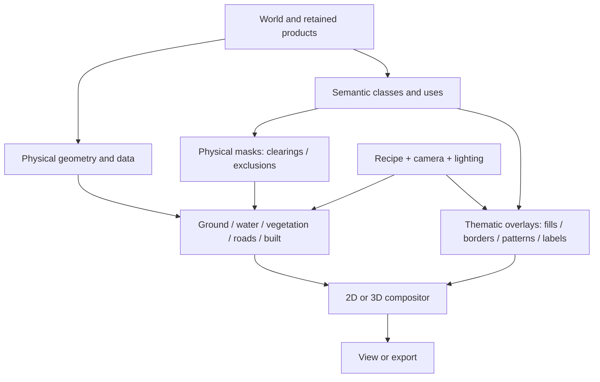

# Magna Urbis V2: 2D and 3D Rendering Composition Specification

**Status:** architecture proposal and implementation plan for Codex
**Date:** 5 November 2026
**Scope:** display of existing scenes; no changes to the terrain, hydrology, city or land-use generation algorithms.

## Implementation status (6 November 2026)

**Implemented** (code under `web/src/`):

- `render/composition.ts`: `CompositionRecipe`, 6 styles (`StyleId`: `atlas`, `cadastre`, `topographic`, `satellite`, `parchment`, `illustration`, both as presets and backgrounds; `atlas-night` is removed), `presetComposition`, `GROUND_VARIANTS` (default cadastre variant: `cadastre`), `applyComposition`, `resolveComposition` (`r.composition` on each `ResolvedAppearance`), `limitationsOf`, `withGroundVariant`, `validateComposition`.
- Global effects: the recipe's `effects { ambience, season, relief, lighting }` block replaces `ambience`, `ground.relief`, and the advanced `season` / `lighting` settings. Night is an effect, not a style. Season only affects the satellite style for now (limitation declared elsewhere). The land-use forest tone also lives in the recipe (`vegetation.forestTone`).
- `render/textLayer.ts`: groups, density, halo and font for place names (`TextSettings`, `cityTextLabels`, `textPlacement`).
- `render/semanticLayer.ts`: shared semantic painter (rural and urban classes, legends `ruralSemanticLegend` / `urbanSemanticLegend`).
- `render/roadStyle.ts`: ink or natural rendering of roads, emphasis; used by the 2D canvas, the tiles and 3D.
- `ui/compositionControls.ts`: Composition panel (one line per pass) and limitation reasons in French.
- `ui/textOverlay3d.ts`, `ui/semanticLimits3d.ts`, `ui/legendOverlay3d.ts`: place names, semantic boundaries (`readable` depth) and legend/title block in 3D.
- `ui/benchComposition.ts`: bench recipe (URL `composition`, `localStorage`), capabilities, `syncBenchAnnotations`.

**Deliberately dropped**: section 10 (migration and compatibility) and acceptance test 10 (inheritance). Project rule: no migration and no aliases; `legacyAppearanceToComposition` does not exist, and old recipes and URLs may break.

### Capability matrix

Read from `limitationsOf` (`render/composition.ts`) and `ui/benchComposition.ts` (`setBenchRenderCapabilities`, `benchVegetationLimitations`), plus the limits set by `ui/citybench.ts` and `ui/terrainbench.ts`. "OK" = no limitation declared in the code; "data" = limitation depending on the chosen products; "to verify" = the code does not settle it.

| Pass | 2D | 3D | Export | City Bench | Terrain Bench |
| --- | --- | --- | --- | --- | --- |
| Ground | OK; data: without a terrain raster, lighting settings, forest and fantasy unavailable | OK; same data limits | to verify (`exportSnapshot.ts` receives options, not the recipe) | no resource diagnostics; diagnostic without retained data reported | same; diagnostics depend on the source (vector, Rust, none) |
| Vegetation | procedural canopy absent if relief is hidden (benches) | "painted" absent outside Illustrated grounds (no 3D atlas) | to verify | procedural canopy impossible on cartographic ground with the raster backend | forests on Illustrated grounds always painted, whatever the choice |
| Rural land use | data: requires `landuse` | boundaries only (`semanticLimits3d.ts`, `readable` depth); 3D flat fills to verify | to verify | data: requires `landuse` | data: requires `landuse` |
| Urban land use | data: requires native cities | boundaries only (`readable` depth); 3D flat fills to verify | to verify | data: requires urban layouts | same |
| Roads | OK (`roadStyle.ts`) | OK (`roadInk`); detail to verify | to verify | OK | OK |
| Water | OK | OK | to verify | oxbow meanders missing | to verify |
| Buildings | data: requires buildings; parcels require subdivisions | no footprint draping from projections if no scene is retained | to verify | same as 3D | same as 3D |
| Ambience | no limitation declared; night applied to map grounds | no limitation declared; to verify | to verify | none declared | none declared |
| Text | OK (`syncBenchAnnotations`) | OK (`textOverlay3d.ts`) | "Names" layer: link with the recipe to verify | OK | OK |
| Legend and title block | OK; legend appears only if there are classes to list | OK (`legendOverlay3d.ts`) | to verify ("Frame, title & legend" layer) | OK | OK |

---

## 0. Core decision

**A global style is not a monolithic renderer: it is a recipe that configures several independent rendering passes.**

The user must be able to display simultaneously, for example:

> Parchment background + shader-produced volumetric trees + land use as discreet flat fills + roads drawn in ink + buildings as plan footprints + place names.

Or:

> Realistic satellite background + procedural trees + crop boundaries as high-contrast lines + districts coloured by their use + 3D buildings, by day or by night.

**Do not limit combinations because of the selected style.** The names "Atlas", "Parchment", "Plan", "Illustrated", "Topographic" and "Natural" remain good **coherent presets**, not exclusive scene types. "Atlas night" is a preset/variant that is kept. Each pass can be adjusted independently, with a controlled number of visual engines.

The system separates **five orthogonal concepts**:

1. **Semantic geographic data**: relief, biomes, rural land use, urban zones, roads, water, buildings, names. These never depend on the style.
2. **Physical representation**: ground materials, vegetation and volumetric buildings, clearings. It can be realistic or stylised.
3. **Cartographic/thematic representation**: flat fills, hatching, zone boundaries, contours, symbols, labels. It explains the data independently of its physical appearance.
4. **Composition**: order, visibility, masks, opacity, raster/vector blending, projection onto relief in 3D.
5. **Presentation**: global preset, camera (2D/3D), day/night lighting, artistic variants, export and sharing options.

The visibility of a semantic overlay must **never** change the physical reality: hiding the display of the "field" zone must not make a forest reappear there.

---
## 1. Verified findings in the repository

References:

- [`web/src/render/appearanceRecipe.ts`](https://github.com/dunkean/magna-urbis/blob/main/web/src/render/appearanceRecipe.ts): `AppearanceInput`, `ResolvedAppearance`, `StyleTraits`, components `ground`, `vegetation`, `cartography`, `city`, pass keys; a good starting point to **evolve**, not to replace blindly.
- [`web/src/render/terrainStyle.ts`](https://github.com/dunkean/magna-urbis/blob/main/web/src/render/terrainStyle.ts): legacy styles, `cartographicVegetation`, `ground3d`, `forestBrushes` traits, satellite variants. Some layer behaviours are therefore still implicitly determined by the background style.
- [`web/src/v2/benchRenderer.ts`](https://github.com/dunkean/magna-urbis/blob/main/web/src/v2/benchRenderer.ts): distinct passes `terrainData`, `terrainLook`, `forest`, `water`, `frame`, `cartography`, `overlays`, `city`. The WebGL background is already separated from the Canvas overlay. **Precise blocking issue:** the `cartographyPass` excludes `forest`, `meadow`, `marsh`, `commons` via `CARTOGRAPHIC_ONLY_VEGETATION` as soon as the style does not request `cartographicVegetation`; the semantics visually disappear even though these uses exist in the data.
- [`web/src/v2/renderScene.ts`](https://github.com/dunkean/magna-urbis/blob/main/web/src/v2/renderScene.ts): retained data accessible by reference and revisions `terrain`, `roads`, `landuse`, `settlements`, `names`, `cities`. Exploit this separation for the caches.
- [`web/src/gen/types.ts`](https://github.com/dunkean/magna-urbis/blob/main/web/src/gen/types.ts): `LandUseLayer.areas` and eight `field`, `meadow`, `pasture`, `forest`, `orchard`, `garden`, `marsh`, `commons` types, plus reserves, paths, farms, agricultural strips. Uses of districts/buildings are in the urban products, not in this single enum.
- [`web/src/render/landuse.ts`](https://github.com/dunkean/magna-urbis/blob/main/web/src/render/landuse.ts): SVG of rural land uses, patterns, strips, silhouettes and vegetation sub-layers; a base to reuse or to decouple into **semantics** and **vegetation drawing**.
- [`web/src/ui/forestOccupation.ts`](https://github.com/dunkean/magna-urbis/blob/main/web/src/ui/forestOccupation.ts): occupation texture rasterised with signed distances, classes and forest clearing zones; an existing **physical tool**, not a complete semantic layer. The `marsh` class in particular is not registered in its `CLASS`, and detailed urban uses are not listed there.
- [`web/src/ui/city3d.ts`](https://github.com/dunkean/magna-urbis/blob/main/web/src/ui/city3d.ts): accepts `getForest()?.occupation`, can drape a texture over a relief, and already draws roads and city plans into texture tiles; very useful infrastructure for the 3D MVP.
- [`web/src/v2/urban3d.ts`](https://github.com/dunkean/magna-urbis/blob/main/web/src/v2/urban3d.ts): its `getForest` binding currently returns the forest field, **without exposing the rural occupation from V2**; the `getPlanOptions` concern the urban plan. So the fact that a `ForestOccupation` exists elsewhere does not mean that the V2 3D rendering shows the occupation categories.
- [`web/src/render/cityCanvas.ts`](https://github.com/dunkean/magna-urbis/blob/main/web/src/render/cityCanvas.ts): `tissue`, `uses`, `parcels`, `buildings`, `roles` views, urban palettes and numerous switches. Do not confuse **urban use** with **building appearance**.
- [`web/src/v2/renderControls.ts`](https://github.com/dunkean/magna-urbis/blob/main/web/src/v2/renderControls.ts) and [`web/src/v2/appearance.ts`](https://github.com/dunkean/magna-urbis/blob/main/web/src/v2/appearance.ts): persistence/validation to migrate without losing the existing recipes.

**To preserve:** the CPU/WebGL engines, the retained data, the logic of the passes and their caches, shape fidelity, the export functions and the existing styles. No "rewrite" of the Rust pipeline or of all the renderers.

---

## 2. Mental model: data layers ≠ visual layers ≠ technology

A *data layer* (e.g. forest) can produce several rendering effects:

- **physical**: the shader places trees, changes the albedo, removes trees within a field;
- **cartographic**: light green polygons, a forest boundary, hatching, a symbol;
- **informational**: the label "Forest of X", a legend, a tooltip, an interactive sheet.

A *rendering pass* can combine several technologies: terrain shader, precomputed raster, raster tiles produced on the fly, vectors, 3D geometry, screen-space text. These formats are not the units of the user's choice: they are backends.

### Logical composition order

```
SCREEN / FINAL IMAGE
  P8  Interface / annotations / places / labels / filtered secrets
  P7  Buildings and constructions: footprints, roofs, 3D volumes
  P6  Thematic urbanism: districts, blocks, parcels, uses
  P5  Visible networks: roads, paths, streets, bridges, rivers, banks
  P4  THEMATIC rural occupation: flat fills, outlines, hatching, labels
  P3  PHYSICAL cover: trees, canopies, crops, rocks, scrub
  P2  PHYSICAL ground and water: materials, shadows, altitudes, water surface
  P1  Geographic background: paper, atlas, hypsometry, image, shader
  P0  Relief / coordinates / data: support, non-graphic
```

**Important:** this is a **logical order** and not an obligation to create nine canvases. Water may be physically integrated into the ground shader, then its banks/vectors drawn in P5; 3D volumes are subject to depth-testing, and thematic overlays may be projected or drawn after the scene depending on the desired visibility. Do not duplicate the same water surface or the same forest in two passes. Passes P6 and P7 are distinct precisely to allow "building footprints in plan over a satellite background".

### Data diagram



**Permitted coupling:** occupation data influence trees and materials physically. **Forbidden coupling:** the visual style of the ground decides whether occupation classes are displayable or not.
## 3. Final component catalogue, not "monolithic styles"

Here is the **functional minimum** of independent modes to expose, with the rest under "Advanced".

| Pass | User selector | Recommended values | Existing / target backends |
|---|---|---|---|
| **Background / terrain** | Background appearance | Atlas, Parchment, Plain map, Topographic, Natural/satellite, Illustrated | SVG/Canvas palette; raster and WebGL shader; brushes |
| **Cover / trees** | Visible vegetation | Auto, None, Symbols, Painted, Volumetric/procedural | Canvas/SVG/brush; shader/forest field |
| **Rural land use** | Territory reading | None, Subtle, Categorical, Outlines | Independent polygons/thematic raster |
| **Networks** | Roads/water appearance | Background-adapted, Ink/plan, Natural materials | Vectors, textures, materials and geometries |
| **City / uses** | Thematic urban planning | None, Subtle, Categorical, Outlines | Polygons for quarters/blocks/parcels, role colours |
| **Buildings** | Building representation | Footprints, Cartographic roofs, Simple volumes, Detailed volumes | CityBench Canvas/GL; 3D geometry |
| **Annotations** | Information | Names, places, borders, legends, annotations; GM/player filters | Vector + interface |
| **Ambiance** | Lighting | Day, Night; customisable lighting | `night` palette or shader depending on backend |

**Auto** means "the preset's preferred value", never "a technical choice silently determined by the background". If the user chooses *Volumetric*, the engine must attempt this rendering even on Parchment, in 2D as well as in 3D if the backend supports it. An unavailable feature must be **explicitly reported**, not silently replaced by another data category.

Do not expose a list of 19 historical styles for each pass. The background determines its material/palette; the vegetation determines its mode; land use determines its graphic code; the buildings determine their representation. This limitation avoids combinatorial explosion.

### Mandatory reference cases

**Case A — the deliberately heterogeneous combination:**
- Background `parchment`.
- Vegetation `procedural-canopy` (crown shader, with correct transparencies).
- Rural land use `categorical` or `subtle`, independent, visible on the paper and under/through the canopy depending on the readability mode.
- Roads `ink`.
- Buildings `footprints`, including when the scene has detailed volumes.
- City `district-outlines` and optional cadastral layers.

**Case B — cartographically readable satellite view:**
- Background `render-v2`, volumetric vegetation.
- Fields: field material **and** contrasting fine outlines; forests: canopy **and** optional border; marshes: wet ground **and** optional hatching.
- Urban quarters coloured translucently according to their role, even when buildings/ground are realistic.
- Roads and hydrography visible; buildings `volumes-detailed` or `footprints`, as preferred.

**Case C — working map:**
- Background `plain`, vegetation `none` or `symbols`, land use `categorical`, urban uses `categorical`, buildings `footprints`, parcels enabled. Orthographic 2D view; optional 3D mock-up view.

**Case D — player presentation:**
- Background `atlas-night` (keep the current rendering), vegetation chosen by the preset, land use `subtle`, buildings `roofs`, annotations filtered by player visibility.
## 4. Land-use schemes: filling the real gap

The **physical** rendering and the **semantic** rendering of the same land use are two different products, both derived from the existing data. Never force the user to choose one *instead of* the other.

### 4.1 Canonical classes

For rural land use, start from the eight existing values of `LandKind` and keep their geometries (holes included):

| Class | Possible physical manifestation | Thematic 2D/3D manifestation |
|---|---|---|
| `field` | Crops, rows, tilled soil | Yellow/ochre, field boundaries, stripes or furrows |
| `meadow` | Grass, meadow | Light green, discreet border |
| `pasture` | Grazed grass, sparse vegetation | Olive green and dotted lines |
| `forest` | Crowns/trees/shader | Deep green, forest outlines or hatching |
| `orchard` | Aligned trees | Medium green, regular dots, plots |
| `garden` | Gardens, kitchen gardens | Garden green, fine patterns |
| `marsh` | Wet ground, reeds, intermittent water | Blue-green, wet hatching |
| `commons` | Variable shared ground | Neutral wash, border and/or label |

Urban reserve zones, agricultural passages and building footprints must **not** be confused with these eight categories: they may physically influence the cover, but they have their own display logic.

For the town, create a **second semantic channel** based on the data from `CityScene`, allocations, districts and building uses. Examples: residence, commerce, crafts/tanneries, religion, administration, warehouses, port, defence, public spaces. **Do not invent an exhaustive classification that is not part of the retained products:** reuse existing roles, functions and labels, with an "other/unknown" fallback.

### 4.2 Four useful visual schemes

| Mode | Appearance | Use | 2D / 3D |
|---|---|---|---|
| **Off** | No semantic overlay | Immersive image | Yes / Yes |
| **Subtle** | Very transparent outlines and tints, without hiding the material | **Default on Natural background** | Yes / Yes |
| **Categorical** | Contrasting semi-transparent flat fills, optional patterns, legend | **Default in Map / Analysis** | Yes / Yes |
| **Outlines** | Boundaries, contours, selective hatching, no flat fill | Reading without covering the satellite view | Yes / Yes |

The four modes concern **information about uses**: they do not replace the physical renderings of fields/forests. Shared advanced parameters: opacity, border width, patterns, visible classes, palette, legend, projection depth. Colours should be determined **per class**, stable between 2D and 3D, distinct from the colour of the natural material, and editable; hatching/patterns and outlines ensure readability in greyscale.

**Critical point:** a forest shader alone does not provide the limits of the "forest" polygon, and a painted field does not systematically indicate the category "pasture", "garden", etc. The thematic layer must remain rendered even when the ground/trees are physical.

### 4.3 Two distinct GPU resources

Do not turn `ForestOccupation` into the single source of truth for the thematic layer. Keep / generalise:

1. **`PhysicalOccupationMask`**: canopy cuts, reserves, built ground, paths, tree exclusion; may reuse the existing SDF. Its validity depends on the **data**, not on the style or visibility of the overlay.
2. **`SemanticLanduseIndex`**: category ID mask, footprints, holes, optionally entity IDs for picking/labels; rasterisation derived from the **canonical polygons**. Its visualisation depends on the `subtle/categorical/outlines` mode.

Keep the polygons and class reference data as the source of truth; textures are only tiled caches or resolutions adapted to need. The information on urban uses constitutes a third semantic layer, built from urban data, to avoid forcing rural categories onto neighbourhoods.
## 5. 3D Implementation of Land Use: Essential

### 5.1 Objective

The 3D view must be able to show **simultaneously** a realistic terrain, physical land clearings, the boundaries of rural uses, the functional zones of neighbourhoods and the 3D buildings. An "land use visible" button must concern the overlay, not the existence of fields.

### 5.2 Reasonable MVP (reuse the existing 3D tiles)

1. Pass `World.landuse` and a physical land-use resource to `mountV2Urban3d` (via the `RenderScene` or dedicated callbacks); do not generate a new land use.
2. Use **the same semantic overlay producer** for the 2D view and for the map draped over the 3D terrain. In `city3d.ts`, the loading of `loadTile` tiles already provides a place to compose elements on the ground, **before** drawing roads and the urban plan. In procedural material mode, check the actual alpha composition of the shader (the "texture" already serves the water masks and the plan) before adding the new tints: they must be overlaid on the material and not replace it.
3. Raise/project the boundaries onto the relief with a slight bias managed in depth space; do not physically move the vertices of the map. Take into account exaggerated relief, multiscale displacement, tile cutting, polygon holes and areas under water.
4. Draw uses and footprints only once. When a physical base already provides trees/crops, **disable only their illustrated duplicate**, not the boundaries or the thematic flat fills.
5. Keep `city.view = uses/roles/parcels` and the urban uses available in 3D; decouple these views from `ground=render-v2`.

### 5.3 If draping is not enough

The raster draped on the ground becomes masked by large tree crowns or buildings. Propose **a single** advanced setting `semanticDepth`:

- `surface` (immersive default): the thematic layer is actually on the terrain, occludable by physical objects;
- `readable` (default in Analysis/Plan mode): boundaries and labels have a readability rendering (screen-space or line passes with controlled depth handling) that remains visible above crowns and buildings, without turning the whole terrain into an "X-ray" layer.

The transparency of the thematic layer must remain reasonable. For neighbourhood boundaries located under buildings, the readable mode must prioritise the **boundaries** and labels, rather than filling the roofs with an opaque layer.

### 5.4 Behaviour without detailed geometry

The `footprints` representation must be possible in 3D **even when volumes exist**: hide the meshes, keep the footprint and its outline draped on the ground. Conversely, showing volumes must not force the cadastral overlay nor hide neighbourhood boundaries.

The absence of detailed buildings must not prevent the display of their canonical footprints. If a 3D backend cannot display a mode, the UI indicates the limitation and explicitly proposes a substitute; do not alter the saved recipe.
## 6. Proposed TypeScript contract

**This contract is a conceptual target**, to be adjusted to the existing names, not an API to copy literally while breaking `V2Appearance`. In particular, reuse `appearanceRecipe.ts`, the resolver and the `StyleTraits`, while removing the inappropriate dependencies between ground and overlays.

```ts
export type BaseLook =
  | 'atlas' | 'parchment' | 'plain' | 'topographic'
  | 'illustrated' | 'natural';

export type VegetationLook =
  | 'none' | 'symbols' | 'painted' | 'procedural-canopy';

export type SemanticLook =
  | 'off' | 'subtle' | 'categorical' | 'outlines';

export type BuildingLook =
  | 'footprints' | 'cartographic-roofs'
  | 'simple-volumes' | 'detailed-volumes';

export type NetworkLook = 'inherit' | 'ink' | 'natural';
export type SceneView = '2d' | 'oblique3d' | 'free3d';

export interface CompositionRecipeV2 {
  version: 2;
  /** Preset selected, not an irreversible restriction on child passes. */
  presetId?: string;
  view: SceneView;
  ground: {
    look: BaseLook;
    /** Concrete legacy material/palette (e.g. render-v2 / parchment). */
    backendId?: string;
    showRelief: boolean;
  };
  vegetation: {
    look: VegetationLook;
    visible: boolean;
    density?: number;
  };
  landuse: {
    visible: boolean;
    rural: SemanticLook;
    urban: SemanticLook;
    opacity?: number;
    showLegend?: boolean;
    semanticDepth?: 'surface' | 'readable';
    classes?: Partial<Record<string, boolean>>;
  };
  networks: {
    roads: { visible: boolean; look: NetworkLook };
    water: { visible: boolean; look: NetworkLook };
  };
  buildings: {
    visible: boolean;
    look: BuildingLook;
    showParcels?: boolean;
    showBlocks?: boolean;
    showDistricts?: boolean;
  };
  annotations: {
    labels: boolean;
    legend: boolean;
    cartouche: boolean;
    // GM/player: controlled by data authorization, not the shader.
  };
  lighting: {
    mode: 'day' | 'night' | 'custom';
    azimuth?: number;
    elevation?: number;
  };
}
```

### Resolution and capabilities

- `resolveComposition(recipe, dataCapabilities, rendererCapabilities, target)` returns a **resolved recipe per pass**, its dependencies and the explicit limitations. Do not lose the saved choices if the target cannot render them.
- Differentiate the availability of **data** from that of the **backend**. Example: `landuse data available`, `3d semantic overlay renderer not available`, `procedural canopy not supported on this hardware`.
- Palette inheritance is a **default value**, not a lock. `StyleTraits` may declare the capabilities of a backend but must no longer suppress semantic rendering based on the ground style.
- Provide an adapter registry or `canRender(pass, mode, target)` functions for 2D Canvas, WebGL and 3D; avoid scattered `if (styleId === ...)` checks in the business layers.
- Do not allow arbitrary z-ordering in the initial interface: the pass topology is fixed, with a handful of depth options compatible with the physical constraints.

### Example recipe to render without loss

```json
{
  "version": 2,
  "presetId": "custom",
  "view": "oblique3d",
  "ground": { "look": "parchment", "backendId": "parchment", "showRelief": true },
  "vegetation": { "look": "procedural-canopy", "visible": true },
  "landuse": {
    "visible": true,
    "rural": "categorical",
    "urban": "outlines",
    "opacity": 0.4,
    "showLegend": true,
    "semanticDepth": "readable"
  },
  "networks": {
    "roads": { "visible": true, "look": "ink" },
    "water": { "visible": true, "look": "inherit" }
  },
  "buildings": {
    "visible": true,
    "look": "footprints",
    "showParcels": true,
    "showBlocks": false,
    "showDistricts": true
  },
  "annotations": { "labels": true, "legend": true, "cartouche": false },
  "lighting": { "mode": "day" }
}
```

*The JSON above is a target contract, not a recipe currently accepted by Magna Urbis.*

---

## 7. Presets: styles return as practical recipes

Create a **catalogue of recipes**, composed of values from the previous passes. Selecting a preset **fills in** the components; changing one pass switches the interface to "Custom" without modifying the others.

| Preset | Ground | Vegetation | Rural landuse | Urban planning | Building | Lighting |
|---|---|---|---|---|---|---|
| Atlas | Atlas | Symbols/canopy | Subtle | Discreet | Cartographic roofs | Day |
| Parchment | Parchment | Symbols/painted | Subtle | Discreet | Roofs | Day |
| Illustrated | Illustrated | Painted | Subtle | Discreet | Roofs | Day |
| Plan | Light plan | None/symbols | Categorical | Categorical | Footprints | Day |
| Topographic | Topographic | Symbols | Outlines | Outlines | Footprints | Day |
| Natural | Natural `render-v2` | Procedural | **Subtle, not Off** | Discreet | Volumes | Day |
| Atlas night | Atlas, `night` palette | Depends on atlas | Subtle | Discreet | Roofs/lit windows | **Artistic night** |

The historical variants remain accessible **without becoming additional engines**: Engraving and Illumination under Parchment; Watercolour and Ink under Illustrated; Cadastre, Blueprint and Classic under Plan; Night under Atlas. Physical day/night renderings are separate from the artistic Night palette: do not promise that the night is physically lit in 3D if the pipeline does not have the corresponding lights.

The role-based presets (Cartographer, Urban planner, GM, Player, Analysis) are a **second axis**: they choose the visible layers, the camera and the annotations, but not an exclusive rendering technology. Thus "GM + Natural ground + parcels visible" remains perfectly valid.
## 8. Technical composition and performance

### 8.1 In 2D

- **Raster / GPU** for the material background and the procedural (tree) crowns.
- **Thematic passes** rasterised from the vector geometry, by tile or by viewport, in premultiplied alpha; borders and vector text kept for as long as their density allows.
- **Urban passes** (roads, networks, blocks, parcels, buildings) kept, with the representation of built-up areas chosen independently.
- Avoid re-rasterising the entire terrain after a change of class colour, parcel display or label: only their passes should be invalidated.
- Draw trees only once; `forest shader visible` and `forest polygons thematic visible` do **not** constitute a duplicate, since they are physical and semantic respectively.

### 8.2 In 3D

- Keep the existing canonical terrain and its sampler. The physical components remain in their 3D pass.
- 2D text/categories converted into projection tiles or into line geometries on the terrain; provide for mips, geographic alignment, anti-aliasing and slight depth correction.
- Respect polygons with holes, tile clipping, rivers, coasts, sea level, water surfaces and vertical geometry (bridges and quays are not reduced to the ground).
- Ensure that the **same rural and urban uses** have a cartographic representation available in both 2D and 3D; only the techniques change.
- The free 3D view must not lose thematic information simply because the objects have become volumetric.

### 8.3 Caches and dependency keys

Reuse `PassState`, `ResourceCache`, `PassKeys` and the revisions of `RenderScene`:

| Change | To invalidate | To keep |
|---|---|---|
| Background Parchment → Natural | Shader/background | Geometry, semantic indices, buildings |
| Vegetation symbols → shader | Vegetation drawing | Land-use classes, roads, source relief |
| Land use Off → Categorical | Rural/urban overlay | Forest field, terrain, water, geometries |
| Land-use opacity | Uniform/overlay only | Class ID texture |
| Roads hidden | Road pass | Physical land use and forest rendering |
| 3D buildings → footprints | Building pass, possibly tile plane | Terrain position and materials |
| Night ↔ day | Affected palette/lighting | Geometries, physical fields |
| Zoom, translation | Visible tiles / LOD | Fields and canonical data |

Physical masks depend on the data and its revisions; semantic masks depend on the polygons; **palettes change neither one**. If the spatial index/semantic textures are recalculated every frame, the implementation is incorrect.

### 8.4 Graphic trade-offs

- Consistent alpha compositing between WebGL, Canvas and export (watch colour spaces, `premultipliedAlpha` and double-blending).
- `Subtle` and `Categorical` modes must have legible outlines in light, dark, high relief and on high-contrast satellite texture; do not rely solely on a faint tint.
- Rivers and roads with explicit visual priority over category flat fills; parcel boundaries are not roads.
- Preservation of label/background contrast in 2D/3D; identical framing when making comparisons.
- No z-fighting or flickering of parcel boundaries on noisy/displaced terrain.

---

## 9. User UI: simple despite free composition

### Level 1: quick choice

- **Visual preset**: Atlas, Parchment, Illustrated, Plan, Topographic, Natural, Atlas night.
- **View**: 2D, oblique 3D, free 3D.
- **Layers**: Nature, Civilisation, Territories, Places/entities, Adventure (broad visibility groups).

### Level 2: Composition (accessible and persistent)

```
Background       [Parchment                 v]
Vegetation       [Procedural trees          v]
Rural land use   [Flat fills + outlines     v]   Opacity [40%]
Urban land use   [District outlines         v]
Roads / water    [Ink / Adapted to background v]
Buildings        [Footprints                v]
Mood             [Day                       v]
```

### Level 3: advanced

Detailed settings for palettes/colours, width/contrast, class filters, hatching, light, season, LOD detail, exaggerated relief, GPU adjustments and technical diagnostics.

**Do not present** "land use visible" as a switch that simultaneously removes its natural manifestations. The sub-menu must separate:

- `Effects on the landscape` (always enabled when they represent the generated reality: clearings, physical layout of the ground);
- `Display of uses` (Off/Subtle/Categorical/Outlines and visible classes);
- `Annotations` (labels, borders, role of districts).

In the interface, the "background / style" option must therefore never disable or redefine another menu. A manual change to one component keeps the other values (no reset of the rest of the recipe).

---

## 10. Migration and compatibility

1. Introduce an **optional** `composition` object in the V2 appearance schema; the current code may remain as a compatibility path. An old recipe must continue to produce the same rendering without destructive migration.
2. Write a **pure function** `legacyAppearanceToComposition(...)` and, if useful, a *partial* reverse adapter (do not fabricate a `terrainStyle` that claims to encode all the new combinations).
3. Keep the old IDs/URLs (`night`, `render3d-brush`, `render-v2-*`, `cadastre`, etc.) and the fidelity of their historical rendering when read without explicit composition. The material diagnostics `render-v2-substrate`, `moisture`, etc. remain accessible as diagnostics, not as mandatory global presets.
4. Explicitly separate `appearance.landuse` (old toggle) from the future `composition.landuse.rural` and its physical effect; do not reuse the same boolean for two responsibilities.
5. Do **not** modify retained data or regenerate a world for a display preference.
6. Raster export, 2D capture, 3D capture and saved links use the resolved recipe; announce any SVG vector limitations instead of exporting a document that does not look like the screen.
## 11. Codex plan in six testable PRs

### PR 1 — Model and resolver

- Add TS contracts, named recipes, compatibility migration and validation.
- Reorganise `appearanceRecipe.ts` around an independent resolution of the background, vegetation, both themes (rural/urban), networks, buildings and mood.
- Keep `PassState`, `ResourceCache` and the old API; unit tests for resolver/compatibility. No display change expected by default.

### PR 2 — Independent 2D semantic land use

- Detach class overlays from the physical rendering/brushes in the `render/landuse.ts` and `v2/benchRenderer.ts` flow.
- Remove the **global** exclusion via `CARTOGRAPHIC_ONLY_VEGETATION`: exclude only duplications of **vegetation symbols**, never the boundaries and thematic flat fills explicitly requested.
- Implement Off/Subtle/Categorical/Outlines, per category, on Atlas, Parchment and Render v2 backgrounds; consistent export.

### PR 3 — Procedural coverage independent of the background

- Define `vegetation.look` distinct from `ground.look`, with a capability per backend.
- Allow shader canopy rendering on Parchment / Atlas backgrounds when the engine supports it, via an alpha/composite component, without switching the background to `render-v2`.
- Separate the physical clearing mask from the overlay visibility. Tests: "field without forest, but boundaries visible or hidden independently".

### PR 4 — Thematic 3D land use

- Expose the retained land-use data to the `v2/urban3d.ts` pipeline; reuse the tiles already draped by `city3d.ts` or introduce a small dedicated projected pass, depending on the actual shader composition.
- Enable rural and urban representation in 3D, with `surface` and `readable` if the latter is possible without excessive complexity; at minimum, surface mode with visible outlines.
- Integrate terrain, canopy, water, roads and buildings correctly, without modifying their geometry.

### PR 5 — Independent buildings and networks

- Allow choosing footprints/roofs/simple volumes/detailed volumes without changing the background.
- Keep the rendering of districts, roles, parcels and plot extents (or 'land extents/rights-of-way') on any background, including satellite and 3D.
- Decouple the "urban background" from the choice of global map background, and roads/rivers from their base styles.

### PR 6 — UI, presets and regression tests

- Add two levels of control (preset, then composition); Night kept as Atlas night.
- Tests for combinations, export, save/load, identical 2D/3D maps, image comparison and pass invalidations.
- Document the capability table of each backend and its limits; remove/hide the old redundant selectors in the UI, **not** in compatibility.

Each PR must be integrable and testable in isolation. If a PR cannot be fully implemented, keep the contracts and an explicit diagnostic rather than hiding the limitation by silently changing style.

---

## 12. Functional acceptance tests (non-negotiable)

1. **Requested mix**: Parchment + procedural canopy + categorical land use + inked roads + buildings as footprints displays with the same geometries and framing as before.
2. **Readable satellite**: Render v2 + physical forest cover + boundaries of the eight rural classes; fields, pastures, gardens, orchards and marshes remain identifiable (not only forests).
3. **Working 3D**: rural land use and urban areas visible on the 3D terrain; same extent and same categories as in 2D.
4. **Decoupling**: hiding `landuse.rural` does not erase the physical fields and does not recreate any tree; hiding the canopy does not erase the forest overlay.
5. **Buildings**: switching from detailed volumes to footprints keeps the exact placements and modifies neither the terrain nor the districts.
6. **Order**: roads and rivers remain readable above the flat fills; urban plans and roofs visible without double painting; labels do not disappear under an opaque layer.
7. **Holes**: parcels, buildings, lakes and areas with holes are not incorrectly filled by the overlays.
8. **Zoom/LOD**: no shifting of boundaries between levels of detail, no halo, z-fighting or seam at tile edges.
9. **Export**: 2D capture and export reproduce the displayed layers; 3D capture follows the same recipe and the same visibility policy.
10. **Legacy**: an old `style=night` URL still opens a visually equivalent map; old exports/recipes remain readable.
11. **Caches**: changing only the opacity of land-use layers regenerates neither the terrain, nor the cities, nor the tree field.
12. **Robustness**: an incapable backend or missing data gives a clear capability state; the user's choice remains stored.
13. **Identity**: a land-use category has the same meaning, the same ID and a compatible symbology in 2D/3D, even if its natural textures differ.
14. **Night**: Atlas night keeps its dark rendering and its lit windows; the style is not erased in the name of decoupling.

### Automated tests to prioritise

- Unit: migration, validation, resolver, cache dependencies, polygon priority and masks, class filters.
- Integration: tests on a selected scene containing forest + field + pasture + orchard + marsh + river + road + city + building.
- Visual: 2D and 3D captures compared against combinations A/B/C/D, before/after zoom and pass permutation; no mere code test concluding that the image is correct.
- Performance: verify that large tiles keep their LOD, and that visual updates trigger no geometry recalculation.
## 13. Scope and decision points

### Recommended default decisions

- **Background and vegetation are fully decoupled.** The crown shader can be reused on a Parchment background if the framebuffer/composite and the hardware allow it.
- **Rural and urban land use have separate semantic renderings.** The former relies on `LandUseLayer`, the latter on `CityScene`/roles/allocations.
- **Land use exists in 3D**; the first version uses draping and outlines rather than a second realistic simulation of crops.
- **The physical effects of land use are independent of its display**; the clearing mask cannot be disabled by hiding a map layer.
- **Styles = presets**; composition settings = source of authority if customized.
- **Night stays visible**: Atlas night as a distinct graphic recipe; physical 3D night to be handled separately.

### Optional points to decide after the MVP (these do not block Codex)

1. How far to push `readable` in 3D: outlines and labels above the canopy, or a true x-ray mode for zones? Recommendation: outlines and labels only.
2. Should fully custom palettes be allowed **per land-use class**, or first a fixed thematic palette with opacity? Recommendation: fixed palette first, then advanced overrides.
3. Should the volumetric rendering on a non-physical background reuse the shader's crowns, or represent true individual 3D trees? Recommendation: reuse the existing procedural field and procedural crowns, and do not generate new meshes.
4. Does the "Illustrated" style require a fully drawn 3D equivalent from the outset? Recommendation: no, start with illustrated draping and painted vegetation.

---

## 14. Operational brief for Codex

> **Mission:** progressively implement the independent composition of visual passes in Magna Urbis V2, while preserving geometries, historical behaviours and recipe compatibility.
>
> **Functional priority:** enable mixes of *Parchment background + shader vegetation + thematic rural land use + inked roads + footprint buildings*, as well as *satellite background + readable rural land use + districts/uses visible in 3D*. The four problems are: the background style still indirectly controls vegetation and the presence of thematic classes; rural uses are not visually exposed in 3D V2; building choices are too tied to those of the background; and the UI presents rendering techniques as exclusive styles.
>
> **Approach:** first inspect the files cited in §1, record their active contracts, establish a real capability matrix, then start with PR 1 and PR 2. Reuse `appearanceRecipe.ts`, `RenderScene`, `PassState`, `ResourceCache`, `forestOccupation.ts`, `city3d.ts`, `cityCanvas.ts`. Avoid a new general-purpose engine if the existing passes and callbacks are sufficient. After each step, demonstrate cases A/B/C/D and the tests from §12.
>
> **Constraints:** no world regeneration on a style change; no silent loss of semantic data; no duplication of trees/roads/water; parity of coordinates and classes in 2D/3D; backward compatibility; tracking of invalidations and performance; keep the Night variant.
>
> **Deliverables expected for each PR:** modified files, responsibilities of the new passes, before/after screenshots, updated capability matrix, automated tests, residual limitations and performance impacts.

## Seasons

The `effects.season` slider (0 winter, .25 spring, .5 summer, .75 autumn) applies to all styles.

- `ZONE_SEASONS` (`rust/bridge/terrainRenderV2Zones.ts`) describes the yearly cycle of each climate zone: grasses, foliage, pack ice, water table, snow, rain, winter cold, larches.
- Material styles read this calendar in their shaders, in 2D as well as 3D: colour and shape of crowns, snow-covered conifers, bare broadleaves, ground, water freezing.
- Vector styles go through `seasonPalette.ts`, applied in `biomePalette`: only land cover changes (fields, meadows, forests, trees, hedges); paper, relief and water remain fixed.
- Neural Earth's pack ice (`v2Ice`) receives a concentration floor per zone: the Arctic all year round, the northern zone in winter. Its size is brought back to local scale by `V2_ICE_ZOOM`.
- Settings: `effects.calendar` ("Global effects" panel, V2 and Rust benches) replaces the zone's calendar field by field: spring and autumn thaw, winter cold, snow fragmentation, rainfall regime, colour intensity, deciduous foliage, larches, pack ice by season. Empty = zone value.
- Control sheet: `web/scripts/season_sheet.mjs`, then `season_sheet_page.py`.
