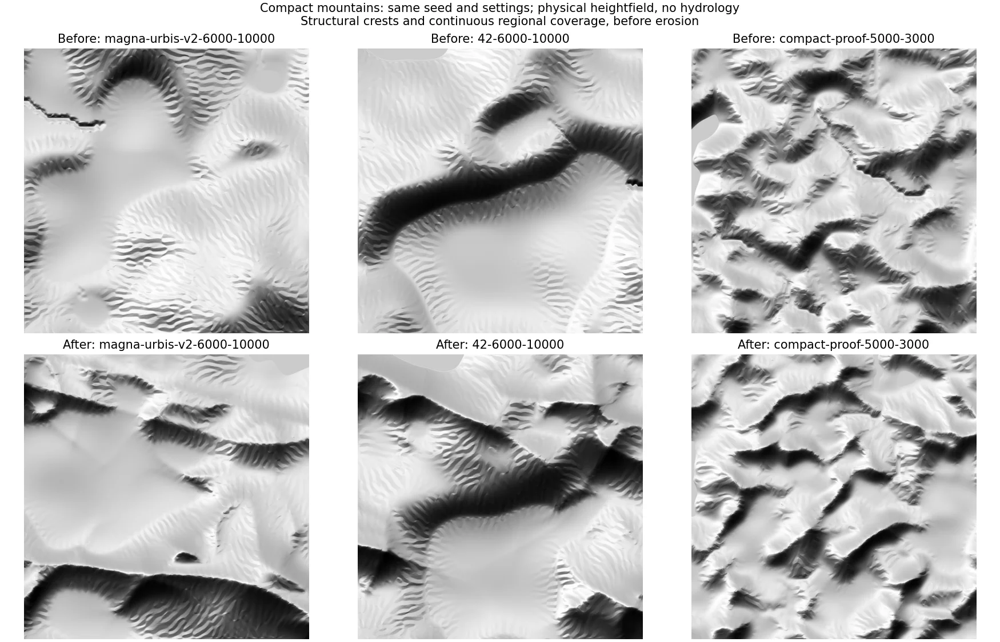

# Correction des sommets du relief compact

Le défaut signalé sur « Montagnes » a été reproduit avec la graine V2 par
défaut, une carte de 6 km et une échelle de relief de 10 km, ainsi que deux
autres graines et plusieurs échelles. La sauvegarde du code antérieur est
`.local-archive/compact-before-summit-fix-20261029/sources.zip`.

## Diagnostic et correction

Sur les cas testés, les altitudes ne sont pas écrêtées à un maximum commun :
les sommets restent sous la borne du moteur et ne forment pas de grands
ensembles à altitude exactement identique. Le défaut de forme vient de la
saturation du masque régional et de l'absence de squelette de crêtes dans le
soulèvement des montagnes ordinaires. Le Phasor s'atténue sur les faibles
pentes et ne peut pas compenser ces sommets larges et lisses.

Le nouvel initialiseur GPU utilise un poids régional continu, sans bande
supérieure écrêtée, et une composante de crêtes dans le soulèvement **avant
l'érosion**. La force des crêtes est 0,55 pour les montagnes ordinaires et
0,55 × √mélange pour le relief mixte. Le Phasor de sortie conserve ses limites
d'amplitude. Le procédé original et ses noyaux partagés ne sont pas modifiés.
La référence CPU de la source compacte reste indépendante de ce nouvel
initialiseur GPU.

La version `compact-erosion-phasor-v2-summits` est incluse dans la clé du cache
de V2 pour cette source seulement. Recharger l'application puis générer
recalcule le terrain ; les projets conservés ne sont pas modifiés en place.



Il s'agit d'un ombrage du champ physique 1024², sans eau, avec la même lumière
et sans exagération verticale. Les colonnes correspondent aux graines
`magna-urbis-v2`, `42` et `compact-proof`. Les deux premières cartes mesurent
6 km avec une échelle de relief de 10 km ; la troisième mesure 5 km avec une
échelle de 3 km. La morphologie change : la graine reste déterministe à version
fixée, sans promesse de conserver les anciens massifs.

Sur le premier cas, dans les 20 % de cellules les plus hautes, la proportion
de pentes inférieures à 5° passe de 5,08 % à 1,14 % et la pente médiane passe
de 14,49° à 25,60°. Ce diagnostic décrit ce cas ; il ne prouve pas le réalisme
géomorphologique de tous les terrains. Les limites de l'érosion réduite et les
motifs répétitifs du Phasor restent visibles.

## Vérification

- 37 tests ciblés réussis, dont deux régressions sur la saturation et les
  crêtes, plus la version dans le cache V2.
- TypeScript et builds V2, Terrainbench et Rustbench.
- Comparaison du champ source, de l'aperçu GPU et de la projection V2 sur six
  configurations ; sept cas après correction, dont les réglages V2 complets
  avec eau vectorielle et côte.
- Terrain déterministe sur l'adaptateur testé ; écart maximal de 0,000347 m
  entre les points de contrôle Phasor CPU et GPU.
- Contrôles d'interface et générations réelles via V2 et les deux benches ;
  le contrôle visuel des benches utilise le rendu SVG, le calcul reste WebGPU.

Le nouveau benchmark GPU sur NVIDIA Lovelace donne 0,814 s pour le premier
appel 5 km, puis 0,095–0,097 s à 5 km et 0,100–0,103 s à 10 km, moteur chargé.
Le rendu et l'import initial des modules sont exclus ; le cache du pilote est
conservé. Avec l'hydrologie Rust à 512², les requêtes complètes prennent
0,572 s et 0,916 s respectivement. Les corrections maximales du modèle d'eau
restent de 6,98 m et 13,69 m : le traitement des dépressions reste nécessaire.
Ces valeurs sont locales, sans garantie sur d'autres GPU.

Rapports : [avant](before.json), [après](after.json),
[performances et hydrologie](performance.json), [sources](source-hashes.json).
Les gros rasters restent dans `web/out/compact-summits-before/`,
`web/out/compact-summits-after/` et `web/out/compact-summits-performance/`.

Depuis `web/`, sous PowerShell :

```powershell
$env:MAGNA_BROWSER_CHANNEL='chrome'
node scripts/check_compact_summits.mjs --out out/compact-summits-after
node scripts/benchmark_compact_terrain.mjs --water --out out/compact-summits-performance
node scripts/check_compact_terrain_ui.mjs
```
