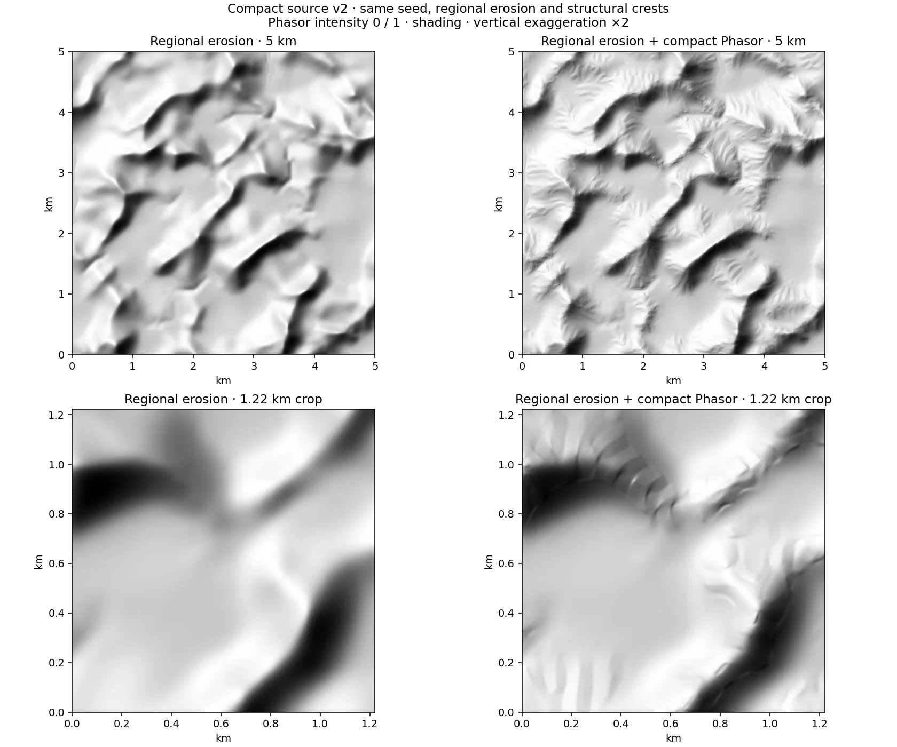

# Compact regional erosion and Phasor terrain

The compact preset of the unified procedural pipeline combines the existing noise and erosion
kernels with a smaller regional simulation and a fused Phasor detail pass. It
requires no neural checkpoint or Python server. Select **Procedural → Compact** and enable **Phasor detail** in Magna Urbis V2, Terrainbench or Rustbench → Terrain. Classic remains a preset of the same scheduler; neural sources remain available.
The old `procedural-phasor` source name is kept as a saved-recipe alias.

## Inputs and physical scale

The square map width and landform scale are in metres; heights are metres above
sea level. The seed, relief family, erosion dose, climate preset, quality and
Phasor intensity determine the result. Supported automatic families are plains,
hills, valleys, canyons, mountains, mixed terrain and high mountains. Painted
zones and finite geological shapes use the original sources.

The retained physical field is always 1024². A 5 km map therefore has 4.88 m
samples, a 10 km map 9.77 m samples, and a 50 km map 48.83 m samples. Increasing
the map width does not increase output resolution. This is not metre-scale
terrain over a 50 km region.

## Regional simulation

The new scheduler reuses `terrainErosion.wgsl` without changing that shared
file. The original scheduler is also unchanged. It retains uplift, basin
routing, incision, thermal relaxation, diffusion, graph convergence checks and
retries. It does **not** replace these with a fixed number of unchecked graph
relaxations.

Quality selects a target regional cell width and an evolution budget:

| Quality | Target cell width over padded domain | Evolution cycles |
| --- | --- | --- |
| Fast | 100 m | 8 |
| Balanced | 65 m | 12 |
| Detailed | 40 m | 20 |

The simulated domain spans 1.44 times the map width. Its grid side is rounded
up to a multiple of 16 and clamped to 64–384 cells. Balanced quality therefore
uses 112² cells at 5 km and 224² at 10 km. At larger extents the cap makes the
regional cell width exceed the target in the table.

The plan adjusts the per-cycle uplift to preserve the original cumulative
uplift dose and scales incision for the changed physical cell width. These
adjustments preserve useful units; they do not make coarse and original
erosion numerically equivalent. A positive cubic B-spline reconstructs the
regional heights without interpolation overshoot. Canyon trunk carving uses
the reduced surface grid. The legacy fine ridged noise, post-routing domain
warp and ordinary full-resolution surface erosion are disabled by default in this preset; the bench inspector can enable them.
Coasts use the existing marine mask and a compact surface erosion pass.

### Mountain summits (version 2)

The original compact version retained a clamped regional mountain mask and
omitted the structural ridge skeleton for ordinary mountains. Together with
coarse reconstruction and slope-gated detail, this produced broad smooth tops
that looked like tables. The tested default cases did not share a clipped
maximum altitude; the defect was in the shape of the underlying uplift.

The compact GPU initializer now uses a continuous regional weight for mountain
regimes, with `x = (distribution + 1.4 × (mountainMix − 0.5)) / 0.28`:

```text
mountainWeight = 0.5 + 0.5 x / sqrt(1 + x²)
uplift *= 1 + crestStrength × mountainWeight × (0.24 + 1.8 ridge² − 1)
```

The weight has no clamped upper band. Ordinary mountains use crest strength
0.55, mixed terrain uses `0.55 × sqrt(mountainMix)`, and high mountains retain
their existing strength. The ridge skeleton changes the uplift **before
erosion**, so it participates in drainage instead of masking smooth summits
with an unrelated final texture. Hills and plains keep their former profile.
The independent CPU reference still uses the original Rust regional generator.


Same seeds, widths and landform scales; shading of the physical 1024² field,
without hydrology. The first two columns use a 6 km map and 10 km landform
scale, including V2's default seed. The third uses a 5 km map and 3 km scale.
The change preserves the remaining limits of coarse erosion and Phasor detail;
it is not a validation against real elevation data. V2 cache keys include the
compact algorithm version so regeneration cannot reuse a version 1 heightfield.

## Phasor detail

This is a new GPU-oriented adaptation of Grenier, *Terrain Amplification using
Multi-scale Phasor Noise* (2024), not an exact port of the Neural Earth Python
implementation. It uses complex Gabor convolution and a bounded triangle-like
profile. It omits a full hierarchical feature construction and a physically
evolved small-scale drainage network.

Each octave sums jittered, globally anchored impulses within two wavelengths.
Their carrier directions follow the contour tangent of the regional surface,
with seeded angular variation. The direction is evaluated at each immutable
impulse, avoiding a discontinuous query-dependent rotation.

```text
z(x) = sum_j w_j(x) exp(i phase_j(x))
pattern(x) = (2 / pi) asin(Re(z) / sqrt(|z|² + 0.015 (sum_j w_j)² + epsilon))
height'(x) = max(0.3, height(x) + sum_octaves amplitude(x) pattern(x))
```

There are at most three octaves, with a wavelength ratio of three. The base
wavelength is `clamp(landformScale / 24, 48, 160)` metres, multiplied by the
climate factor. Amplitude is limited by both wavelength and regional slope:
`min(0.025 × wavelength, 0.12 × slope × wavelength)`, multiplied by intensity,
smooth terrain masks and a parent-octave gate. Detail fades on flat ground,
concave valley bottoms and near sea level. Wavelengths below four output cells
are suppressed, with a smooth transition to seven cells. At 50 km most small
octaves are consequently absent.

The Phasor evaluation is fused into the final output packing dispatch. It
needs no full-size intermediate detail texture. Working simulation buffers are
destroyed after every generation; compiled pipelines remain cached. Reported
allocation counts refer to buffers owned by this scheduler, excluding the
driver, rendering, WASM heap, sampling and hydrology.



Same seed, 5 km extent, balanced quality; lower row is a 1.22 km crop. Identical
lighting and vertical exaggeration ×2. Detail changes the physical heightfield.
The regional channels still reveal the limitations of the coarse erosion grid.

## Climate presets

These are artistic morphology presets, not biome or geological simulations.
They are global for one map. The existing climate selector also continues to
control water and vegetation.

| Preset | Incision factor | Thermal factor | Phasor amplitude | Wavelength |
| --- | --- | --- | --- | --- |
| Temperate | 1 | 1 | 1 | 1 |
| Oceanic | 1.2 | 1.3 | 0.7 | 1.15 |
| Mediterranean | 0.95 | 0.85 | 1.15 | 0.9 |
| Arid | 0.65 | 0.65 | 1.3 | 0.85 |
| Cold | 0.7 | 1.5 | 0.5 | 1.2 |
| Tropical | 1.4 | 1.25 | 0.85 | 0.9 |

Cold terrain does not simulate glaciers; arid terrain does not model sediment
stratigraphy. Custom temperature and precipitation values affect hydrology,
not these morphology coefficients.

## Determinism, CPU and hydrology

GPU generation is deterministic for the tested adapter and implementation.
Floating-point differences across adapters can alter routing; bitwise
cross-device identity is not promised. The scalar TypeScript Phasor reference
uses the same equations. The CPU generation option runs the existing Rust
regional generator plus that scalar reference. Its erosion topology and grid
are independent of the compact GPU path, and it is considerably slower.
The five-second target concerns WebGPU generation.

The retained field feeds the existing hydrology models, including conditioning,
depression handling and lake/river extraction. Phasor adds geometry, **not a
guarantee of drainage consistency**. It can introduce local depressions. The
benchmark records hydrological adjustment magnitude as well as finite output
and river/lake counts; those smoke checks are not a validation of geomorphic
realism or watershed quality. Use intensity zero to compare the same regional
erosion without Phasor, or Detailed quality to inspect regional artifacts.

## Reproduction and evidence

From `web/`, with Chrome installed:

```text
MAGNA_BROWSER_CHANNEL=chrome node scripts/benchmark_compact_terrain.mjs --water --extra
node scripts/check_compact_terrain_ui.mjs
npx vitest run tests/terrainPhasor.test.ts
```

In PowerShell set `$env:MAGNA_BROWSER_CHANNEL='chrome'` before the commands.
The GPU benchmark generates new seeds rather than replaying retained terrain.
It records 5/10 km timings, actual backend, allocation and GPU timestamps,
before/after detail, repeated-generation agreement, scalar/GPU samples, CPU,
valley/canyon/flat/coastal cases, and optional hydrology. Large float rasters go
to `web/out/compact-terrain/`; compact evidence is kept under
`docs/evidence/compact-terrain-2026-10-29/`.

## Primary references

- Grenier, 2024, [Terrain Amplification using Multi-scale Phasor Noise](https://doi.org/10.1111/cgf.14992).
- Lagae et al., 2009, [Procedural Noise using Sparse Gabor Convolution](https://doi.org/10.1145/1531326.1531360).
- The existing Magna Urbis erosion implementation remains the source of the
  hydraulic and thermal kernels. This method changes their scheduling and
  spatial budget, not their physical claims.
