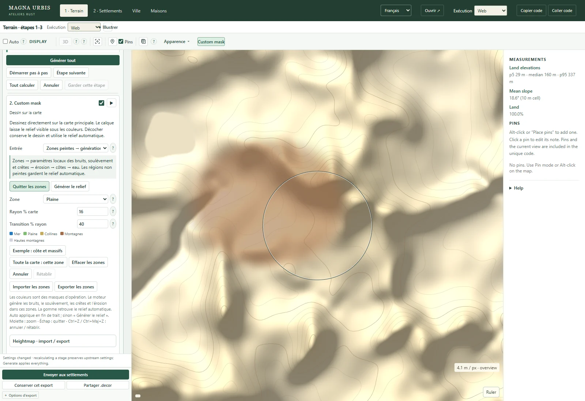

# Inspectable procedural terrain generation

Terrainbench and Rustbench → Terrain expose an integrated procedural stage panel for the
unified procedural pipeline. Classic and compact are presets; Phasor is an
independent optional stage on either preset. The ordinary Generate All button and the step controls use the same terrain
worker, settings, engine cache and final application path. Explicit stepping
introduces intermediate previews; Generate All records stage progress without
these preview copies. Intermediate reliefs appear on the main map.

The source menu now has one Procedural entry in V2 and both benches. The
compact preset retains its grid/cycle budget, smooth mountain coverage and
positive reconstruction defaults. Classic retains its original defaults.
`procedural-phasor` remains a compatible saved-source alias; new UI recipes use
`source: procedural` plus `procedural.preset: compact`. The old compact module
is a compatibility wrapper, not a second scheduler.


Figure: the stage panel and the main map share one generation. CPU and GPU
use their selected solvers; stage previews are diagnostic views, not pure GPU
kernel timings.

## Ordered operations

The comparison's sixteen explanatory rows included infrastructure as well as
terrain operations. The inspector has nineteen rows: eighteen computation stages
and the interactive Custom mask input before the grids and initial noise.

| Order | Stage | Controls / dependency |
| --- | --- | --- |
| 1 | Backend preparation | Source, seed, map width, landform scale, relief, climate, master erosion dose, compute backend |
| 2 | Custom mask | Interactive input: transparent overlay on the main map; zone brushes, eraser, falloff, history and zone/heightmap import/export |
| 3 | Grids and buffers | Regional and surface dimensions; compact quality; output fixed at 1024² |
| 4 | Initial noise and uplift | Regional noise scale, structural crest strength, relief family and mountain mixture |
| 5 | Regional evolution | Cycle count, uplift multiplier, incision, onset slope, basin fill, sill carving, talus, thermal rate and diffusion |
| 6 | Final regional relaxation | Final sill carving, thermal relaxation and drainage |
| 7 | Reconstruction | Engine default, bounded bicubic or positive B-spline; domain warp multiplier |
| 8 | Amplitude calibration | Optional p99 rescaling; off retains the evolved physical amplitude |
| 9 | Classical ridged detail | Optional amplitude; before surface erosion |
| 10 | Surface erosion | Optional cycles, incision, routed/strict flow, sill carving, thermal rate and diffusion |
| 11 | Datum normalization | Optional p1 shift to 1 m; the positive land-input floor of 0.3 m remains required |
| 12 | Phasor and output | Optional detail on either preset; GPU output is read and validated, CPU retains its physical field |
| 13 | Posterior fluvial conditioning | Optional existing CPU conditioner: erosion, breaching or both; strength, maximum breach depth and length |
| 14 | Aeolian transport | Optional GPU (CPU reference for CPU generation): iterations, direction, maximum transported metres per pass |
| 15 | Retained source | Rust surface/pyramid construction after posterior operators; required |
| 16 | Coasts | Optional marine mask; separate coastal cycles, incision, thermal and diffusion multipliers |
| 17 | Overview sampling | Required; the inspector reports the engine's height bound and output resolution |
| 18 | Hydrology | Optional existing water pipeline, conditioning and riverbed cuts; its existing controls are moved into this row |
| 19 | Display | Normal map renderer; the completed pipeline becomes the applied terrain automatically |

The regional cycle remains a dependent sequence: uplift → basin drainage and
sill handling → accumulation → implicit incision → thermal relaxation →
diffusion. Thermal relaxation and diffusion can be suppressed separately.
Removing drainage while retaining incision would read invalid flow data, so
those operations are not presented as independent interchangeable filters.

## Interaction and state

Terrain is the first stage inside the inline pipeline, not a separate panel.
It stays open and exposes the square map size in metres, a kilometre readout
and 5, 10, 25 and 50 km presets, all using the existing width setting.
The main Generate All action sits in the pipeline toolbar.
Each stage header exposes its enable checkbox and a play button even when
collapsed, with its elapsed time on the same line. Long titles are truncated
with the full name on hover. Required stages have a checked, locked checkbox.
The Terrain settings play button generates the complete current map, including
a changed width; computation-stage play buttons execute their dependencies and
pause before the next stage. A real pause hides the loading overlay and shows
Next / Run all instructions. Input edits invalidate the old run while typing,
so committing a field cannot shift or cancel the next play-button click.
New bench maps default to a 10,000 m landform scale; explicit saved scales stay
unchanged. A shortcut at the top
opens the coast parameters in stage 16; empty legacy coast and hydrology cards
are hidden while their controls are in the pipeline. The marine directions
and conditional island selector remain together when controls are restored.
Next executes the next enabled stage. Until here starts a new generation and
executes its dependencies. Run all completes the current session. GPU buffers or the Rust CPU state remain alive while waiting. Cancel releases
the session after the current operation; hiding the panel resumes the run. A parameter edit invalidates it and disables Keep until a new
preview exists. No full history of GPU buffers is retained.

Custom mask is an interactive input, not an additional GPU kernel. Its play
button starts drawing directly on the main map without opening the controls.
Its checkbox switches the existing editor between automatic and manual input,
retaining painted zones and imported heightmaps in the editor history. The
editor stays accessible as its own card with neural terrain or when the detailed
procedural stack is hidden. Painted zones use the existing grouped Rust zone
generator with either procedural preset; automatic terrain retains its CPU/GPU
stage scheduler. Transparent areas reveal the underlying map, and wheel zoom
keeps the painting overlay aligned with the physical extent.



Keep imports the latest preview as a surface heightmap and disables hydrology
recalculation to retain its altitudes. Water can be enabled again afterwards.

The panel moves existing controls into their execution stage and restores them
when hidden. There is no separate inspector worker or private canvas.
The controls retain a single parameter model. The staged CPU solver reuses the
Rust flood, basin, thermal, reconstruction and surface helpers. The normal recipe, share URL and decor
metadata retain the settings. The optional `procedural` recipe stores stage
switches, grid overrides, biome influence and posterior operators.

GPU intermediate readouts use a separate output buffer and do not modify evolving
height, flow or percentile state. Grouped and stepped generation are checked
for exact equality on the tested adapter. Measured stage durations include
readback and are not isolated GPU-kernel timings. Ordinary grouped execution
does not issue these intermediate submissions/readbacks.

The GPU amplitude preview evaluates the calibrated height into the readout buffer;
the simulation still applies that scale in the subsequent detail kernel, so
its unscaled slope inputs remain unchanged.

The step panel covers automatic regional reliefs: hills, valley, mountains,
mixed, high mountains and canyon, with Rust/WASM CPU, GPU erosion, hybrid GPU
noise + CPU erosion, and Rust native generation. The native service exposes
`/terrain/stage` and retains the same Rust stage state between requests.
A service built before this API must be rebuilt. Neural, finite geological
shapes and painted-zone generation retain their ordinary path.

Regional CPU recipes use `TerrainPipeline` for both grouped and stepped runs.
Their parameter block matches the shared policy; their drainage solver is CPU
priority flood, so CPU/GPU topologies need not be identical. The historical
monolithic CPU path remains available to old low-level calls without a recipe.
The recipe cache version changes when the staged CPU path is introduced.

## Biome erosion presets

These are explicit artistic erosion regimes, not calibrated climatic landscape
evolution or sedimentology. Mean rainfall edits modulate hydraulic strength and
wind mobility around the selected climate's reference rainfall.

| Climate | Water incision × | Thermal × | Default posterior fluvial strength | Wind passes | Wind transport cap m/pass |
| --- | --- | --- | --- | --- | --- |
| Temperate | 1 | 1 | 0 | 0 | 0.2 |
| Oceanic | 1.35 | 1.25 | 1 | 0 | 0.2 |
| Mediterranean | 1.05 | 0.85 | 0.7 | 2 | 0.12 |
| Arid | 0.35 | 0.65 | 0 | 12 | 0.8 |
| Cold | 0.65 | 1.6 | 0 | 3 | 0.15 |
| Tropical | 1.8 | 1.15 | 1.5 | 0 | 0.1 |

Water and thermal multipliers affect the actual regional/surface coefficients.
The compact engine's older climate coefficients are replaced, not multiplied
twice. Tropical terrain also receives fluvial conditioning after detail;
arid terrain receives actual directional erosion/deposition. The cold preset
does not simulate ice flow or glaciers. Presets can be disabled, operations
switched off and posterior parameters overridden independently.

In Terrainbench, new procedural recipes enable biome influence. An absent
`procedural` block preserves the historical low-level generator behavior;
V2's default recipe is not changed by this bench interface. Old frozen decors
retain their raster. Regenerating under the new bench defaults may change it.

## Aeolian stencil and units

The custom wind operator is a conservative surface-shaping approximation for
mobile material. It is not a full saltation, atmospheric or bedrock abrasion
model. Each pass first computes an outgoing thickness limited by available
positive land height, directional exposure and a deterministic mobility wave.
It then deposits that thickness into the two downwind axial neighbours,
weighted by the absolute wind-vector components. Boundaries do not emit flux.

```text
outgoing[i] = min(available[i], transportCap × exposure[i] × mobility[i])
height'[i] = height[i] − outgoing[i] + weighted incoming fluxes
```

The two dispatches separate flux construction from height updates; there are no
cross-invocation height-write races. Thickness sums are conserved to floating
point tolerance on the closed grid. The direction is the direction of travel
in map coordinates (east 0°, south 90°). The CPU reference uses the same
stencil, with possible floating-point differences. Disabling wind or setting
zero iterations is an identity operation.

Posterior fluvial conditioning reuses `reliefConditioning.ts`: erosion runs on
at most 512² and its delta is interpolated; breaching runs on the source grid.
It therefore costs CPU time even for GPU-generated terrain. Hydrology still
handles remaining depressions; these operators do not guarantee drainage.

## Reproduction

From `web/`, under PowerShell:

```powershell
$env:MAGNA_BROWSER_CHANNEL='chrome'
node scripts/check_procedural_stages.mjs
node scripts/check_procedural_inspector_ui.mjs
node node_modules/vitest/vitest.mjs run tests/proceduralStages.test.ts
```

The GPU check compares stepped/grouped fields, checks finite intermediate
previews and the full bridge, and measures wind conservation and directional
response. It also exercises the original engine with Phasor, the compact engine
with ridged detail and surface erosion, alternative reconstruction kernels,
disabled operations, climate-dependent erosion, and the CPU wind/Phasor paths, CPU grouped/stepped equality and operation without a
WebGPU API. Both existing water chains are also exercised after
posterior terrain treatment.
The browser check exercises pauses, edits, replay, the main map, automatic
application, Generate All and backend preservation in the Rustbench frame. Raw captures stay in `web/out/procedural-stages/`.
