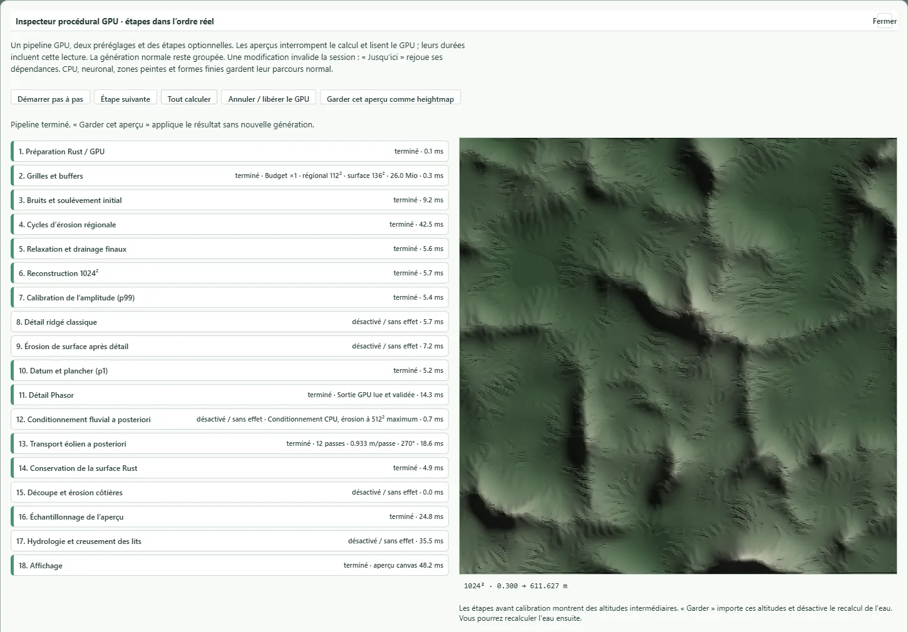

# Inspectable procedural terrain generation

Terrainbench and Rustbench → Terrain expose an advanced GPU inspector for the
unified procedural pipeline. Classic and compact are presets of the same GPU
scheduler; Phasor is an independent optional stage on either preset. The ordinary Generate
button keeps grouped GPU execution. The inspector deliberately introduces
submission boundaries and readbacks to show intermediate heights.

The source menu now has one Procedural entry in V2 and both benches. The
compact preset retains its grid/cycle budget, smooth mountain coverage and
positive reconstruction defaults. Classic retains its original defaults.
`procedural-phasor` remains a compatible saved-source alias; new UI recipes use
`source: procedural` plus `procedural.preset: compact`. The old compact module
is a compatibility wrapper, not a second scheduler.



Figure: compact mountains, edited arid rainfall, Phasor and wind enabled. Stage
durations include preview readbacks; this is an inspector capture, not a pure
GPU benchmark.

## Ordered operations

The comparison's sixteen explanatory rows included infrastructure as well as
terrain operations. The executable inspector uses eighteen rows, including the
additional fluvial and wind treatments:

| Order | Stage | Controls / dependency |
| --- | --- | --- |
| 1 | Rust/GPU preparation | Source, seed, map width, landform scale, relief, climate, master erosion dose, compute backend |
| 2 | Grids and buffers | Regional and surface dimensions; compact quality; output fixed at 1024² |
| 3 | Initial noise and uplift | Regional noise scale, structural crest strength, relief family and mountain mixture |
| 4 | Regional evolution | Cycle count, uplift multiplier, incision, onset slope, basin fill, sill carving, talus, thermal rate and diffusion |
| 5 | Final regional relaxation | Final sill carving, thermal relaxation and drainage |
| 6 | Reconstruction | Engine default, bounded bicubic or positive B-spline; domain warp multiplier |
| 7 | Amplitude calibration | Optional p99 rescaling; off retains the evolved physical amplitude |
| 8 | Classical ridged detail | Optional amplitude; before surface erosion |
| 9 | Surface erosion | Optional cycles, incision, routed/strict flow, sill carving, thermal rate and diffusion |
| 10 | Datum normalization | Optional p1 shift to 1 m; the positive land-input floor of 0.3 m remains required |
| 11 | Phasor and GPU output | Optional detail on either preset; intensity; output readback and convergence validation remain required |
| 12 | Posterior fluvial conditioning | Optional existing CPU conditioner: erosion, breaching or both; strength, maximum breach depth and length |
| 13 | Aeolian transport | Optional GPU (CPU reference for CPU generation): iterations, direction, maximum transported metres per pass |
| 14 | Retained source | Rust surface/pyramid construction after posterior operators; required |
| 15 | Coasts | Optional marine mask; separate coastal cycles, incision, thermal and diffusion multipliers |
| 16 | Overview sampling | Required; the inspector reports the engine's height bound and output resolution |
| 17 | Hydrology | Optional existing water pipeline, conditioning and riverbed cuts; its existing controls are moved into this row |
| 18 | Preview | Inspector canvas; Keep imports the selected preview as a heightmap |

The regional cycle remains a dependent sequence: uplift → basin drainage and
sill handling → accumulation → implicit incision → thermal relaxation →
diffusion. Thermal relaxation and diffusion can be suppressed separately.
Removing drainage while retaining incision would read invalid flow data, so
those operations are not presented as independent interchangeable filters.

## Interaction and state

Next executes the next enabled stage. Until here starts a new generation and
executes its dependencies. Run all completes the current session. The GPU
buffers remain alive while waiting; Cancel and closing the inspector release
the session. A parameter edit invalidates it and disables Keep until a new
preview exists. No full history of GPU buffers is retained.

Keep imports the latest preview as a surface heightmap and disables hydrology
recalculation to retain its altitudes. Water can be enabled again afterwards.

The form moves existing controls into the inspector and restores them on close.
There is no second implementation of the hydraulic kernels or duplicate
parameter model for those controls. The normal recipe, share URL and decor
metadata retain the settings. The optional `procedural` recipe stores stage
switches, grid overrides, biome influence and posterior operators.

Intermediate readouts use a separate output buffer and do not modify evolving
height, flow or percentile state. Grouped and stepped generation are checked
for exact equality on the tested adapter. Measured stage durations include
readback and are not isolated GPU-kernel timings. Ordinary grouped execution
does not issue these intermediate submissions/readbacks.

The amplitude preview evaluates the calibrated height into the readout buffer;
the simulation still applies that scale in the subsequent detail kernel, so
its unscaled slope inputs remain unchanged.

The step inspector covers automatic regional GPU reliefs: hills, valley,
mountains, mixed, high mountains and canyon. CPU, native, neural, finite
geological shapes and painted-zone generation retain their normal path.
Posterior treatments and biome coefficients also have a CPU generation path;
the monolithic Rust regional solver cannot be paused through this interface.

## Biome erosion presets

These are explicit artistic erosion regimes, not calibrated climatic landscape
evolution or sedimentology. Mean rainfall edits modulate hydraulic strength and
wind mobility around the selected climate's reference rainfall.

| Climate | Water incision × | Thermal × | Default posterior fluvial strength | Wind passes | Wind transport cap m/pass |
| --- | --- | --- | --- | --- | --- |
| Temperate | 1 | 1 | 0 | 0 | 0.2 |
| Oceanic | 1.35 | 1.25 | 1 | 0 | 0.2 |
| Mediterranean | 1.05 | 0.85 | 0.7 | 2 | 0.12 |
| Arid | 0.35 | 0.65 | 0 | 12 | 0.8 |
| Cold | 0.65 | 1.6 | 0 | 3 | 0.15 |
| Tropical | 1.8 | 1.15 | 1.5 | 0 | 0.1 |

Water and thermal multipliers affect the actual regional/surface coefficients.
The compact engine's older climate coefficients are replaced, not multiplied
twice. Tropical terrain also receives fluvial conditioning after detail;
arid terrain receives actual directional erosion/deposition. The cold preset
does not simulate ice flow or glaciers. Presets can be disabled, operations
switched off and posterior parameters overridden independently.

In Terrainbench, new procedural recipes enable biome influence. An absent
`procedural` block preserves the historical low-level generator behavior;
V2's default recipe is not changed by this bench interface. Old frozen decors
retain their raster. Regenerating under the new bench defaults may change it.

## Aeolian stencil and units

The custom wind operator is a conservative surface-shaping approximation for
mobile material. It is not a full saltation, atmospheric or bedrock abrasion
model. Each pass first computes an outgoing thickness limited by available
positive land height, directional exposure and a deterministic mobility wave.
It then deposits that thickness into the two downwind axial neighbours,
weighted by the absolute wind-vector components. Boundaries do not emit flux.

```text
outgoing[i] = min(available[i], transportCap × exposure[i] × mobility[i])
height'[i] = height[i] − outgoing[i] + weighted incoming fluxes
```

The two dispatches separate flux construction from height updates; there are no
cross-invocation height-write races. Thickness sums are conserved to floating
point tolerance on the closed grid. The direction is the direction of travel
in map coordinates (east 0°, south 90°). The CPU reference uses the same
stencil, with possible floating-point differences. Disabling wind or setting
zero iterations is an identity operation.

Posterior fluvial conditioning reuses `reliefConditioning.ts`: erosion runs on
at most 512² and its delta is interpolated; breaching runs on the source grid.
It therefore costs CPU time even for GPU-generated terrain. Hydrology still
handles remaining depressions; these operators do not guarantee drainage.

## Reproduction

From `web/`, under PowerShell:

```powershell
$env:MAGNA_BROWSER_CHANNEL='chrome'
node scripts/check_procedural_stages.mjs
node scripts/check_procedural_inspector_ui.mjs
node node_modules/vitest/vitest.mjs run tests/proceduralStages.test.ts
```

The GPU check compares stepped/grouped fields, checks finite intermediate
previews and the full bridge, and measures wind conservation and directional
response. It also exercises the original engine with Phasor, the compact engine
with ridged detail and surface erosion, alternative reconstruction kernels,
disabled operations, climate-dependent erosion, and the CPU wind/Phasor paths. Both existing water chains are also exercised after
posterior terrain treatment.
The browser check exercises pauses, edits, replay, Keep and the
Rustbench frame. Raw captures stay in `web/out/procedural-stages/`.
