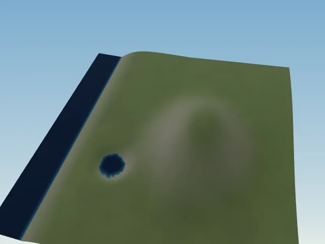
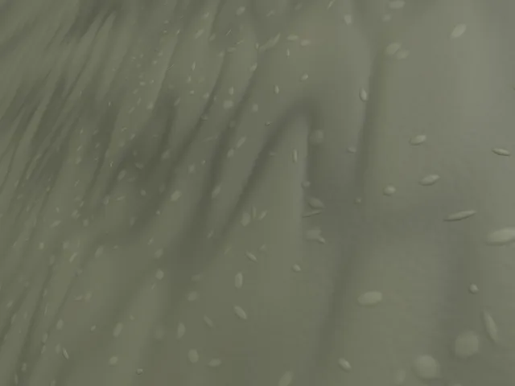

# Render3D: multiscale ground, material and mesh

Render3D evaluates a procedural ground material in the perspective fragment
shader. A shared CPU/GLSL height field supplies small physical displacements;
its filtered gradients and unresolved slope variance supply the surface response.
The original Render style retains its cartographic material and surface.

## Coordinates and pipeline

Coordinates are physical metres: **X east, Up, Z south**. Noise uses the fixed
reference plane `(X, 0, Z)`, so displaced height never feeds its own phase.
Vertical exaggeration changes presentation geometry, not material coordinates.
The seed, climate and physical scales remain fixed when the camera moves.

1. Retain the generated terrain and hydrology.
2. Read the global source grid with cubic B-splines to classify rock, soil,
   vegetation and snow independently of the current mesh resolution.
3. Evaluate the shared centimetre-scale ground residual for mesh vertices.
4. Evaluate a filtered material and physical normal per fragment; shade it in 3D.
5. Composite projected water and ink using explicit alpha, then apply fog.

Render3D supports up to **128 CSS pixels per metre** in 2D and 3D; other styles
retain their 8-pixel limit. These are view limits, not guarantees that every
physical grain is represented by triangles.



The overview retains the source terrain and its water boundaries. The procedural
ground becomes visible only as the physical footprint becomes small enough.

## Shared displacement

For retained terrain height `H`, the local ground is

```text
H_ground(x,z) = H(x,z) + g(H, ||∇H||, T, P) · q(x,z)
```

The gain `g` depends smoothly on slope, height, temperature `T` in Celsius and
annual precipitation `P` in millimetres. Flat plains and ground below sea level
get zero displacement. Lake water retains its separate hydraulic surface.
Rock permits the strongest residual, bounded by approximately
**−10.1 to +5.6 cm**; soil, vegetation and snow use smaller fractions.

The field `q` combines four oriented bands with analytic gradients. Their
characteristic wavelengths are **8 m, 2.2 m, 0.32 m and 0.055 m**. Anisotropic
gradient noise supplies broad undulations, grooves and fine granulation.
The 0.32 m band instead places compact elliptical clasts on a seeded lattice.
Each centre jitters across its full cell; only **5/8 of cells** are occupied.
Elliptical radii span approximately **2.7–12.8 cm**, with seeded cap weights
between 0.6 and 2.4. Each clast has a C1 cap; a saturating sum joins overlaps
without a hard maximum:

```text
q_clasts = 1 − exp(−Σ_i w_i · max(1 − r_i², 0)²)
```

Here `r_i` is the normalized elliptical radius and `w_i` the seeded cap weight.
These are characteristic scales, not strict Fourier cutoffs: nonlinear shaping
also produces higher frequencies.

CPU and GLSL constants come from the same band table. The underlying field is
canonical. A mesh may filter the residual at its own sampling footprint and
morph between approximations; it does not regenerate the source terrain.
Gradients of the noise and shaping functions are analytic. Derivatives of the
slow slope/climate envelope are approximated at macro scale.

## Filtering and reflectance

The perspective pixel footprint `f`, in metres, is estimated from derivatives of
the physical position. Each band uses a conservative effective filter scale
`λ_eff = λ_b a_b c_b`: the shortest anisotropic axis, with a further factor of
0.5 for the sharpened groove and clast bands. A smooth visibility weight `v_b` falls from
one to zero between `0.18 λ_eff` and `0.42 λ_eff`. Remaining bands are not
renormalized, so zoom does not amplify their contrast.

Filtered-out slope energy is retained as an approximate variance:

```text
σ²(f) = Σ_b C_b · (A_b / λ_b)² · (1 + 1 / a_b²) · (1 − v_b(f)²)
```

where `A_b` is the height amplitude, `a_b` the anisotropic aspect and `C_b` an
empirical variance factor. For perceptual roughness `r`, GGX uses `α = r²`;
the material broadens `α²` by `g² σ²` before recovering roughness.

The BRDF uses a GGX distribution, Smith visibility, Schlick Fresnel and a diffuse
term, evaluated with linear albedo. Directional lights and a simple ambient
approximation illuminate it. Local cavity darkening is an approximation, not
traced grain shadows or global illumination.

The shading normal follows the global physical field and filtered detail,
`normalize(−∂H/∂X, 1, −∂H/∂Z)`. It does not use the changing triangulation as
the material classifier. This avoids coarse/fine boundaries changing material
coverage or normal appearance. Filtering is approximate; sharp nonlinear
features and grazing views remain demanding cases.
Here the macro normal comes from the retained global source grid: additional
terrain-noise or Neural Earth residual slopes are not yet included in that
normal. Their refined elevations still contribute to the mesh. This deliberate
approximation keeps material normals stable across asynchronous tile LODs.
The scalar footprint filter is isotropic and conservative: it removes a band's
finer compressed structures before they shimmer. It does not integrate a full
orientation-dependent anisotropic pixel filter.



This is the same seeded field at about 118 CSS pixels per metre, with the tile
boundary overlay disabled. The image illustrates the material, not a scan of
real soil or a trained geological model.

## Tile boundaries, water and layers

Geometry keeps a parent visible while child data and meshes become ready.
Parent/child morphs and shared boundary constraints join the displayed triangle
surfaces. Material evaluation stays in the same world reference throughout.
The optional **Tuiles** overlay displays patch boundaries without moving vertices.

Water and diagnostic overlays enter the ground's RGBA texture. Alpha is their
explicit coverage; RGB never identifies water. Real neighbour samples form a
two-texel gutter around each fine colour tile. Resolved forest crowns occlude
the projected water; procedural contour ink is applied after those crowns.
Texture upload and composition use premultiplied alpha, avoiding dark fringes
at partially covered shores.

To classify crown centres outside a near material patch, tiles up to 2048 m
wide also retain an R8 water mask on a globally aligned 1 m grid, with a 64 m
halo. Neighbour masks sample the same world positions, so the bank decision
does not stop at a colour-tile edge. These masks share the texture cache and
its memory accounting. Coarser patches use their projected water coverage;
individual crowns are normally unresolved at those distances. The bank colour
keeps the fine tile resolution independently of this centre-classification mask.
Sea and lake geometry retains its hydraulic surface elevations.

## Neural Earth boundary

Ground material synthesis is local presentation code, not neural inference.
The optional Neural Earth refinement service separately adds residuals to the
retained terrain. With a retained Python world, its first sub-native band reuses
the decoder; finer bands use the upstream sparse-convolution refiner. Sources
without those neural latents explicitly use native-roughness procedural detail.
The local ground field does not replace that decoder or change hydrology.

## References and implementation scope

- [Guehl et al., *Multi-Dimensional Procedural Wave Noise*, SIGGRAPH 2025](https://pascalguehl.github.io/siggraph2025-wave-noise/):
  spectral design and oriented procedural structures. This implementation uses
  its own analytic noise and clast bands; it does **not** implement the paper's
  precomputed complex wave profiles or complete synthesis algorithm.
- [Wronski, *GPU-Friendly Laplacian Texture Blending*, JCGT 2025](https://jcgt.org/published/0014/01/02/):
  motivates treating detail scales separately when blending. The local band and
  cover composition is not the paper's complete mipmap/Laplacian texture method.
- [Dupuy et al., *LEADR Mapping*, SIGGRAPH Asia 2013](https://perso.liris.cnrs.fr/victor.ostromoukhov/publications/pdf/SAsia2013-LEADR.pdf):
  motivates carrying unresolved geometry into reflectance. The scalar variance
  heuristic here is not the complete LEADR moment representation or BRDF.
- [Filament shading reference](https://google.github.io/filament/main/filament.html):
  microfacet shading terms and linear-colour conventions.

The surface remains a heightfield: no overhangs, per-grain silhouettes, hydraulic
erosion simulation or traced micro-occlusion are introduced by this material.

## Focused validation

An isolated synthetic fixture covers coast, lake, plains, slopes and a ridge.
The GPU float probe compares 32 CPU/GLSL samples, including coordinates near
±40 km and several footprints. On an RTX 3090 through Chromium ANGLE/D3D11,
its maximum raw height difference was **0.385 mm**,
gradient difference **0.00709**, and CPU analytic-gradient finite-difference error
**1.3 × 10⁻⁸**. Flat-ground displacement was exactly zero. The sloped displacement
wrapper differed by at most **2.52 μm** in height in this fixture. Large world
coordinates expose expected FP32 phase error at the finest bands.

Original Render pixels matched the pre-3D reference exactly in overview and
close view on the same graphics backend. Three settled frames in each of three
perspective views were byte-identical, with no JavaScript or WebGL errors.
After a zoom/morph cycle, 118 shared edges differed by at most **1.5 × 10⁻⁹ m**;
canonical sampled heights were unchanged. Returning to the same camera can
retain a different LOD approximation through hysteresis, so identical pixels
across a zoom round trip are not guaranteed.

The focused 640 × 480 probe measured about **19–36 ms** per explicit draw plus
GPU completion wait on this machine. This is a small validation fixture, not an
isolated GPU benchmark or a general performance guarantee.
