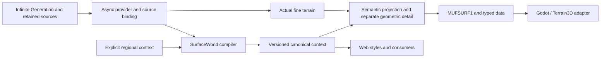

# SurfaceWorld — implementation status

> The [original French version](IMPLEMENTATION_FR.md) is preserved for reference.

The **V13 campaign passes technically** on freeze `6ef8d3c`, compiler `surface-1.6.0`, physical analysis `1.5.2`. All 624 tracked files are identical before and after; navigation, seven zooms and two layer probes are complete. See the [V13 report](evidence/NATIVE_V13.md), [compact evidence](evidence/native-e2e-v13.json) and [separate urban views](NATIVE_CITY419_V13.md).

Two distinct worlds appear during the 20 s movement: native 30 m parent after 12.808 s, then native 0.9375 m neural refinement after 19.602 s. Actual duration is 20.015 s; drain then supplies native 0.46875 m. Environmental context remains at 78.125 m. The 4.8828 mm screen pixel at 10 m is not a measurement of source terrain. The 699.89 ms maximum wall-frame time covers warmup, movement and drain; no 60 FPS claim is qualified.

[Continuous ground response](GROUND_RESPONSE.md) and [CC0 grasses](evidence/vegetation-grass-v13/README.md) are integrated. [Experimental trees](evidence/vegetation-tree-v13/GPU.md) use near geometry and impostors with a shared optical mask, explicitly enabled by manifest. Ground, grass/litter and trees remain independent. The Blueprint plan keeps its presentation; 419 native volumes are tested separately on a legacy urban source. High geometry/impostor, oblique views, vegetation diversity, final styles and navigation cost retain declared limitations. The [independent Opus V13 review](reviews/phase06-followup-v13.md) confirms technical success but still refuses artistic/production acceptance: high/impostor discontinuities, sparse close patterns, primitive canopies, shadows and final map composition. It validates layer separation and correction of non-categorical ground steps. The [post-review check of 624 files](evidence/v13-post-review-campaign-files.json) extends verification to the HEAD reviewed without changing the verdict.

[V13 corrections](V13_CORRECTIONS.md) retain their negative evidence. Two later targeted fixes are prepared outside the freeze: shared scheduling for resident/oblique atlas and high-LOD selection by support intersecting the view. This campaign does not qualify them.

The last complete campaign before V13 changes: **V12 passes technically** on frozen runtime `bc6579f`, compiler `surface-1.5.3` and physical analysis `1.5.2`. The [V12 report](evidence/NATIVE_V12.md) and its [compact evidence](evidence/native-e2e-v12.json) retain results and hashes. Corrections are detailed in [V9_CORRECTIONS.md](V9_CORRECTIONS.md).

- A fresh Infinite Generation covers 40 × 40 km. All 584 runtime files and assets remain identical during the 803.958 s campaign.
- Nominal navigation of 20 s, actual duration 20.118 s: **one distinct preview world** appears twice, first after 17.018 s. Its 128² grid is resampled from the native 30 m parent, without decoder: this proves live request progress, not arrival of finer neural detail during movement.
- After stopping, the 17.207 s drain supplies a 133² grid at delivered 0.468353 m spacing, native 0.46875 m terrain with decoder. Seven captures range from 40 km to 10 m. The latter's 4.8828125 mm per pixel is a screen measurement.
- Two independent probes at 10 km and 160 m check ground, low cover and trees. At close range, framed alpha-positive CPU counts are 64 trees and 64 trunks, 288 grasses, 17 shrubs, 61 debris items and 31 rocks. Hiding trees also removes their canopy and optical shadow; hiding low cover retains ground. These counts do not measure GPU occlusion.
- Magna hydrology retains contours and levels; the 1.25-screen-pixel cartographic bank symbol is declared. Both source archives pass strict reimport without slot repair.
- Three views of the 419 native buildings are [qualified separately](evidence/native-city419-v12.json), with a retained 15.625 m parent. This campaign's fresh generation contains no city.

Navigation frames yield p50 31.236 ms, p95 39.101 ms, p99 64.117 ms, maximum 1,625.123 ms; warmup takes 62.062 s. This is not 60 FPS or low-latency qualification. Checks pass: **224 tests in 42 files**, full TypeScript, terrainbench build of 445 modules, native parsing and 13 Node log/clock/retention tests. Hydrology-cache and preemption validations remain supplementary bounded evidence.

Close vegetation retains spherical crowns and small blocks; environmental context remains at 78.125 m. Google Earth quality, parity across all styles and final Godot adoption remain to be demonstrated. The [independent Opus V12 review](reviews/phase06-followup-v12.md) confirms technical success and refuses artistic/production acceptance: simplified crowns and shadows, 78 m ground steps, latency and residual hydrology halos. Post-review verification recalculates the [584 runtime hashes](evidence/v12-post-review-runtime-equivalence.json): no difference and no runtime path changed since the freeze. Later artistic corrections are prepared separately; V12 does not qualify them.

## Preserved history

Documentary status as of 24 October 2026. The technical assessment below describes frozen V8 renderer `984f488`, compiler `surface-1.5.2`. **The complete V8 technical campaign passes.** Its Opus 5.5 review qualifies the prototype and refuses artistic acceptance; it does not decide final engine adoption. Failures V1–V4, V6 and V7 and initial review verdicts remain preserved. V5 qualified code 1.4; V8 qualifies the new ground, low-cover and tree layers, their native integration and live journey. The complete roadmap is not claimed as delivered.

**V9 remains failed**, on snapshot `ab3c499` / compiler 1.5.3: no new source appeared during the 20.004 s movement. The accepted preview appears only after stopping. The seven captures and two layer probes therefore did not run. The three separate urban views pass; they do not replace this live qualification. See [negative evidence](evidence/native-e2e-v9-negative.json) and [V9 urban captures](evidence/native-current-419-v9-render.json).

**V10 also remains failed** on `f4d25e1`. Population optimisation preserves outputs exactly and reduces the first live compilation from 13.928 s to 1.223 s. A 10.55 s native freeze and observed ACK delays of 9.8–11.1 s still prevent a new world from being displayed during movement. Nominal 20 s movement actually lasts 27.015 s because of blocking; this overrun is not a deliberate test extension. Tour and probes do not run. See [negative V10](evidence/native-e2e-v10-negative.json) and [population comparison](evidence/population-optimization-independent-v10.json).

The [independent Opus V10 review](reviews/phase06-performance-v10.md) corrects interpretation of those delays: Godot receives both previews in 1.685 s and 1.115 s, contradicting an actual 11 s upload. CDP observations were processed late by the driver. Freeze windows occur around synchronous log writes, with an inactive Node reader at the same times; pipe backpressure is the mechanism to confirm by instrumented A/B. Direct Worker benchmarks prove the population gain; driver-observed delays alone do not measure CPU or network. The review also notes parent camera refresh occupying preparation for 7.9 s and a terminal gap omitted from navigation metrics. Ongoing fixes do not retroactively qualify V9 or V10.

**V11 remains failed** on clean snapshot `176e774`: no new source appears during the nominal 20 s window. Log, preemption and measurement fixes work: actual movement 20.014 s, maximum print 15.821 ms, cancellation actually reached. The first preview is accepted only after 16.426 s; the page clock measures 8.526 s from sending to the worker until receiving its result, then 0.387 s upload. This delay has not yet been attributed to worker CPU or reception on a busy page. Tour and probes do not run. Three recaptured urban views pass and remain pixel-identical to V9, without replacing the live check. See [negative V11](evidence/native-e2e-v11-negative.json), [V11 urban captures](evidence/native-current-419-v11-render.json) and the [separate pipe diagnostic](NATIVE_STDOUT_DIAGNOSTIC.md).

## Archived V8 qualification

[V8 evidence](evidence/native-e2e-v8.json) covers a real fresh 40 × 40 km teacher generation, with the same browser and session during all three phases. Its 542 runtime files have identical hashes at start and end; HEAD and clean status are also unchanged.

- Navigation lasting 20.016 s: three new preview128 worlds are accepted and actually displayed during input, at native spacings 15 / 0.9375 / 0.46875 m. Final drain requested at 512 completes after 7.239 s.
- Seven 2048 × 1280 captures from 40 km to 10 m width, with all three explicit layers and no omitted water contours. The 51 corrected edge lookups are reported at 40 km; source levels remain unchanged.
- Four visibility states and a bare-ground diagnostic: distinct pixels, identical hashes for actual heights, ground fields, inventory, context and geometric detail. Final screen spacing is 4.8828125 mm/px; native terrain spacing remains 0.46875 m. The delivered interpolated grid is yet another measurement.
- Navigation frame times: median 31.155 ms, p95 38.156 ms, p99 60.133 ms, maximum 528.975 ms. Warmup 50.541 s; preparation and application remain costly. This is not proof of continuous 60 FPS streaming.

The [separate urban qualification](evidence/native-current-419-render.json) shows all 419 native exteriors in overview, close plan and perspective with their actual roofs. No building proxies, reached mesh budget or runtime errors are reported. Submitted, CPU-framed and post-occlusion visible counts are not conflated. Urban terrain is a retained parent at 15.625 m spacing, not freshly generated V8 terrain. The 256 road-projector cap is explicit in the overview.

Supplementary checks pass: 185 SurfaceWorld tests and eight historical road tests, full TypeScript, terrainbench build (445 modules), GDScript/shader parsing, and native tests for parent binding, empty water, edge rounding and material slots. Expected parent-test rejections are negative cases, not errors in the captures. Isolated GPU probes supplement this evidence without being presented as complete production scenes.

## Product and engine choice

Magna Urbis produces cities and RPG maps/plans in 2D and 3D. Styles, road hierarchy, silhouettes, urban materials, labels, orthographic projection and export are part of the final result. A physical aerial view is one presentation to qualify.

**Godot/Terrain3D is a candidate for the primary rendering engine.** Its local implementation allows evaluation; final standing depends on map quality, styles, plans, exports and integration as well as performance. The contract does not mandate an engine. Web renderers and their styles remain available during qualification. Palette sharing does not yet reproduce every brush stroke, label, ink effect or final composition of existing renderers. No complete artistic parity is claimed.

Infinite Generation remains the provider of actual heights and on-demand detail. Godot does not become a terrain generator. A decoder error retains the valid parent and its diagnostic; no substitute noise is presented as new source generation. 40 km is a validation footprint, not a provider limit. A camera at 5 mm/px does not establish physical 5 mm resolution: `sourceLOD`, `nativeSpacingM`, grid spacing and screen footprint are reported separately.

## Delivered architecture



| Responsibility | Code and contract |
| --- | --- |
| Engine-independent physical world | `web/src/surface/model.ts`, metres, right-handed frame +X east / +Y up / +Z south, cell-centred grids. |
| Canonical compilation | `compiler.ts`: multi-radius morphology, explicit geology or declared granite scenario, source drainage or declared D8, soils/deposits/covers, material recipes and identities. |
| Physical layers | `surfaceLayers.ts`, compiler `surface-1.5.3`, physical analysis `1.5.2`: bare-ground and low-cover pairs and means, premultiplied cover interpolation, continuous brown humus, natural substrate beneath coarse urban occupation, independent trees/crowns; nine arrays and 28 additional bytes per sample, explicit legacy availability. |
| Refinement | `retargetSurfaceWorld` retains canonical context and categories; projects continuous fields semantically, renormalises fractions and retains actual fine-terrain metadata. |
| Source | `provider.ts`, `adapters/infiniteRefinement.ts`, `registrationBinding.ts`: footprint/spacing request, cancellation, retained-control snapshot, non-cryptographic content fingerprint, strict versions and footprint. |
| Regional context | `adapters/neuralEarth.ts`, `regionalCompiler.ts`, `geologyScenario.ts`: explicit georeferencing, units and provenance; no substrate inferred from climate alone. |
| Local geometry | `geometryDetail.ts` and `surface_geometry_detail.gd`: slope/normals/support from actual heights at declared physical support; bound context, scenario and source; exposure layer conditioned by soils, water and occupation. |
| Populations | `population.ts`, `treeCanopy.ts`, `candidateColumns.ts`: world cells, stable IDs/ranks/variants, season-independent acceptance, compute budgets and typed transport. |
| City and occupation | `adapters/magnaUrban.ts`, `urbanColumns.ts`, `occupation.ts`: same export/live schema, source IDs, volumes and materials, footprints/holes/floors, road footprints and exclusions. |
| Presentation | `presentation.ts`, `web/src/render/terrainStyle.ts` and exported palettes: style choice separate from physical fields, explicit CSS/sRGB/linear spaces. |
| Transport | `binary.ts`, `packet.ts`, `sourceArchive.ts`: MUFSURF1 manifest + typed little-endian arrays, validation, source archives; JSON reserved for small fixtures. |
| Browser compute | `workerClient.ts`, `workerProcessor.ts`, `surfaceCompiler.worker.ts`, `surfaceExport.worker.ts`: durable context, source/scene epochs, cancellable export, ArrayBuffer transfer. |
| Native scene | `viewer-local/adapters/*`, `scene/main.gd`, shaders: relative frame, respected source kernel, bounded regions/objects/water/city, caches and threaded preparation. GPU transfers remain measured separately. |

`sourceLOD` is an opaque provider-specific label; finer levels may be negative. Only `nativeSpacingM` compares physical scale. An old `.decor` without LOD remains `sourceLODKnown=false`. Bilinear capture samples are never silently reclassified as B-spline coefficients. `registrationParent` supplies a copy of actual recorded controls, with the `cubic-bspline-controls` kernel and current source identity.

A native request crosses the local broker, its SSE session, browser provider, compilation worker and binary response. The browser remains open; no JSON export is manually exchanged along this path. The `knownContextId` and `knownSceneContextId` handshakes avoid repeating large contexts and the city. Road, placement, climate or building edits advance epochs; an old result cannot become the result for the new world. Coalescing retains the first context under construction and the last useful job; a bounded cancellation delay then allows worker termination.

The browser sends binary packets in 4 MiB blocks, with offset/total, session and strict acknowledgements. The broker emits the packet to Godot only after all contiguous bytes arrive, with `Content-Length`. This avoids HTTP blocks over 16 MiB rejected by Godot and giant CDP strings when inspecting a browser. Cancellation destroys the transaction; a late block does not recreate it. MUFSURF1 contents remain unchanged.

## Fixed-map hydrology

**The Magna Urbis network is authoritative.** Retained classes, levels, IDs, widths and contours remain archived; D8 serves ground diagnostics when a capture has no graph, without creating replacement rivers. Godot uses lake/river polygons and their islands. Sea still uses the union of source sea cells. Displayed levels are interpolated only from measured wet cells; triangles without a level are omitted and counted, without inventing an elevation. Physical `source-levels` mode cuts water against the actual bed and exposes conflicts between regional levels and refined terrain.

Default fixed-map mode **projects source contours onto terrain**: a Decal limited to the ground layer, without covering roofs and urban objects. It retains archived levels without claiming that the projected surface physically simulates them. It does not carve terrain or raise water to hide a conflict. A 10 km GPU proof retains the reference contours' 6,495 pixels and none of the 52 roof pixels affected by an overlay without depth. Each view's metrics state authority, missing levels, budgets, areas and support conflicts. Before rasterisation, vector boundaries receive a declared 1.25-screen-pixel symbol, improving regional legibility without inventing a centreline, physical width or flow. Raw mode uses zero symbol width; `source-levels` forbids these symbols. See [projection](evidence/hydrology-f2/README.md) and [bank symbols](WATER_SYMBOLS.md).

The V7 defect of 43 missing triangles was reproduced: converting a relative vertex to Float32 reconstructed the 0 m boundary at −0.000122 m. Strict lookup then rejected an available source level. The fix bounds recovery to half an ULP of relative coordinates already clipped in double precision. It moves neither vertices nor levels and does not extend wet-cell lookup. The four production CPU checks (40 km, 10 km, rebase, translation ±10⁹ m) no longer lose triangles; genuinely missing levels remain errors. See [evidence and limitations](evidence/hydrology-f2/FLOAT_BOUNDARY.md).

Simple contours use bounded native triangulation; multi-contour groups use an even/odd active-edge sweep in local coordinates. Exact duplicates are removed from display without modifying source data. The actual 40 km case yields 719,184 vertices, no missing levels and about 2.8 s to prepare this geometry alone. Diagnostics state budget, any fallback and missing areas.

The capture contains 26 invalid rings: sweep fill conventions differ from independent GEOS repair by about 106 m² over 48 million m². Additional difference due to GPU vertices is 4.77 m². No perfect topological equivalence with GEOS is claimed. Sea, lake and river colours use categorical classes separate from the coverage mask. Projected roads and cartographic objects use existing palettes; road contours remain within source width. Periodic albedo waves that formed a checkerboard were removed.

## What answers “where / what”, and its limits

Canonical context fixes climate, rock, mineral fractions, drainage, provenance and cover independently of the camera. The compiler normalises sand+silt+clay; organic matter is separate. Alluvial deposits take their mixture from transported provenance of the first downstream channel; this provenance remains separate from the local deposit. Gravity transport retains its rock source. These are synthesis potentials, not a conservative sediment budget or calibrated soil classification.

Without a lithology map, the default remains uniform granite **explicitly declared**. `tilted-strata-v1` is an author option: tilted planes, thickness normal to beds, granite basement, complete catalogue and provenance. The same world descriptor is retained while zooming. This demonstration is neither observed geology nor a terrain modification. See [scenario and geometric detail](../SURFACE_GEOLOGY_AND_GEOMETRY_DETAIL.md).

A 78 m context cannot locate a bank at 2 m or a small alluvial lens. Actual geometric detail can constrain slope, normal, rock exposure and tree support without recomputing soils or D8 per camera patch. The support veto removes a visual tree only on extreme source slope over 65° with complete physical support; it does not change canonical inventory or seed. Unknown edges are not guessed cliffs. Next physical steps require more accurate canonical contacts/banks/footprints and an explicit basin network, then stable sub-grid recipes or a declared context revision. A new texture does not provide that information.

The requested separation of **ground, grasses and trees** is a separation of data and representation. Ground includes rock, deposits and humus; dead litter and low plants have their own layer; crowns are an overlaid layer. Fractions of these three layers are not a global partition. The historical `material*` composite is retained for compatibility, but is no longer called “bare ground”. An old packet cannot recover that ground by subtracting its top2. See [contract, invariants and limits](../SURFACE_RENDER_LAYERS.md).

The native reader checks all nine types, roles, projected and canonical versions, then prepares five images: support pairs, support mean, low-cover pairs, premultiplied low-cover mean and low-cover state. Visibility controls affect responses and objects of each layer. Real probes and alpha 0/1 fixtures qualify absence of support contamination; they do not replace artistic scene acceptance. See [GPU evidence](evidence/native-layers/README.md).

[Canopy r4](evidence/canopy-r4/README.md) corrects normals of actual non-uniform MultiMesh instances: the GPU control renders them identical to the reference MeshInstance sphere. Exact/meso optical filtering shares the same physical spectrum; geometric LOD uses a distinct pixel threshold. Combined cover on the actual page stays within 0.096 percentage points of its target. Shadow response is optical across the entire canopy: trees/trunks alone no longer cast Godot geometric shadows. Terrain and building shadows remain active. Reference transmission and crown height are declared parameters; physical shadow energy, penumbra and photographic silhouettes are not qualified. Representation differences remain perceptible at intermediate scales and oblique angles.

Orogen exposes a real graph and climate layers, but no lithology catalogue in the audited outputs. The importer therefore requires independent categorical geology. Temperatures are converted from the upstream convention and do not receive a second altitude correction; the two half-year precipitation values are added. The procedural equirectangular metric coordinate system retains its geographic limitations. See [regional audit and commands](../SURFACE_REGIONAL_IMPORT.md).

All 15 families have executable recipes and source conditions. Patterns do not construct dunes, cliffs, glacial valleys, volcanic chimneys or karst geometry absent from the provider. Cover and seasonal changes are separate layers. Mean material response and crown cover have probes; this establishes neither photorealism, nor photometric shadow invariance, nor 60 FPS during every replacement.

## City, plans and native realizations

The [four views of 500 retained plans](evidence/native-city500-v152.json) check IDs, materials, roads, terrain parent and three layers, including a close plan and perspective. This source set contains **no face labelled as a roof**: preserving it does not qualify complete houses. The cartographic renderer uses a declared roof-footprint representation. A missing native material value no longer becomes the string `"<null>"`: surface role resolves source slots without rewriting original data.

A [separate fixture of 419 native exteriors](evidence/native-current-exterior-fixture.json) is produced by `plans::plan_batch` then `plans::realize_plan`, with actual footprints, archived site requests and seeds. The current engine rejects 81 sites during planning; no substitute is generated. The 500 historical occupations explicitly remain the reference: 419 new exteriors and 81 unrealized parcels. The old incompatible plan retains its version rejection and bytes. New plans are new revisions, including floor differences up to 0.139 m; they are not described as unchanged old plans. The packet retains native inputs/responses in typed UTF-8.

[Reproducible tools](../../web/scripts/fixtures/native-city-realization/README.md) are versioned and the [CPU rerun](evidence/native-exterior-tool-reproduction.json) reproduces exactly the same packet. Cached WASM did not provide current realization exports: this evidence uses an isolated native executable whose 196 source files were verified identical to integration. No main repository is rebuilt or modified. Captures of the new exteriors pass on the same `984f488` freeze. These scenes use a retained parent; they do not prove a new city on freshly refined neural terrain.

## Reviews 1–5: initial verdicts and fixes

The five Opus 5.5 reviews are static readings: the reviewer ran no tests or benchmarks. All initial verdicts are **CHANGES REQUIRED**. The fixes below describe what was delivered after those reports; they do not rewrite a verdict as final acceptance.

| Initial review | Main defects | Delivered fixes and validation limits |
| --- | --- | --- |
| [Phase1](reviews/phase01.md) | Mirrored georeference, city/terrain offsets, dry levels, divergent climate, non-cancellable source queue. | Explicit frame and centres, tested east/north rotation, shared/tagged translations, dry NaN, shared Magna climate rules, dedicated cancellable provider, opaque LOD and strict metadata. Review 5 confirmed both blockers fixed, then identified live/export differences below. |
| [Phase2](reviews/phase02.md) | Incorrect local alluvial provenance and overwritten transported mix; incomplete drainage/catalogue identities; oversized JSON. | First downstream channel, separate `transportedProvenance`, versions depending on actual heights and ordered recipe IDs, binary container and JSON guard. Unknown HAND NaN, neutral planar TPI and edge confidence, physical thresholds, snow overlay, strict hydration and pre-allocation budgets. Processes remain heuristic and truncated basins are reported. |
| [Phase3](reviews/phase03.md) | Floating display grid on pan, shifted UVs, winding/depth, unbounded costs, stale results. | Source alignment, cell-centred UVs, single winding conversion, relative frame and canonical phases, adjusted near/far, binary packets and validation, moved CPU work and bounded caches. Review 4 confirmed several fixes while retaining upload and movement costs for qualification. |
| [Phase4](reviews/phase04.md) | Incorrect mean albedo, double-counted canopy/instances, incorrect height kernel; shader normals and derivatives. | Linear textures/mips, bounded centred normalisation, catalogue-linked recipe, GPU mean/normal probes; actual crown atlas and transmittance residual shared with instances; exact B-spline controls, source parents and seams, bounded native geometry. Isolated probes do not yet certify the complete tour or moving shadows. |
| [Phase5](reviews/phase05.md) | City/candidates in oversized JSON manifest; divergent schemas; cache destroyed on superseding; source binding forced true; synchronous edits and UI export. | Candidate/urban columns, common builder, scene/context handshake, durable coalescing, exact registered-control fingerprint and strict regions, scene/source epochs, cancellable export worker. Harmonised memory bounds, validated metadata/packets, same origin for water/city. Burst tests, actual 500-building city and HTTP requests ran separately. Full native tour remains to run. |

Historical region-replacement figures of 65–172 ms explain why warm display near 16.7 ms cannot be presented as 60 FPS during updates. Code reduces work on the frame thread; its current cost must be measured after integration during continuous navigation.

The later static review 6 retained **CHANGES REQUIRED**. The first real 40 km E2E failed before its first native response: HTTP response without explicit length beyond the 16 MiB chunk accepted by Godot, and browser upload observed by CDP too large for a V8 string. Parent and error were retained, without claiming fallback success. Transport fixes use a response length and a transaction of acknowledged 4 MiB chunks. Four client tests and a real Playwright/HTTP1 transfer of 96 MiB in 24 chunks passed: exact SHA256, maximum CDP body 4 MiB, 4.10 s on this probe. These are transport proofs, not new renderer or generator qualification.

Other fixes requested by this review concern proof of live display during movement, binding to exact loaded-world content and the frame of crop exports. The benchmark now requires an actual `terrain-replaced` application during input, linked by worldId/serial/epochs to fresh acceptance with known sourceLOD; an accepted packet alone is no longer sufficient. A new complete campaign must follow integration and the new freeze.

Attempt V2 confirmed acknowledged chunks without CDP crashes, but the first native capture still showed the parent (unknown LOD, serial −1) after HTTP0. It was stopped and marked FAILED without running fallback stages. The native client read the 121.21 MB response with per-frame configuration and a 120 s total timeout. The fix moves HTTP reading to a thread, with 1 MiB blocks and an explicit 300 s bound. Headless replay of the actual saved 62,241,233-byte packet passed in 214 ms with exact SHA256; it measures neither generation nor the GPU scene. Display proof also requires focus inside the patch, dominant fine contribution above 0.5 and agreement between tile metadata and effective source at focus.

Attempt V3 covered all seven scales without transport errors, but remains **failed**: no new live detail was displayed during the 20 s movement. An optimisation regression also invalidated placement of small images in Terrain3D: a start at −128 samples on 256 regions is rounded by the addon. Identical CPU heights were insufficient to detect it. The 512 minimum image is restored; the native probe imports a plane then queries actually stored heights. Five checks of the aligned 512 case have zero error; the shifted 256 case correctly reproduces the error. No V3 “one region” preparation result qualifies geometry.

The pinned addon also imposes vertex spacing from 0.25 to 100 m. Preparation retains this bound, including preview. The retained optimisation unrolls the same B-spline kernel in double arithmetic and avoids parent lookups outside the domain; 4,048 checks and 4,030 typed/generic path comparisons yield identical heights. CPU gains do not demonstrate smooth navigation. A new campaign on the integrated fix remains necessary.

Binding fixes now calculate a fingerprint of actual heights loaded natively before receiving another world; a browser assertion alone no longer suffices. Crop/translation exports declare their frames and preserve geological anchoring. A crop is not accepted as the root of a live session covering the whole world.

## Executed evidence register

Large binaries, captures and reports remain in `web/out/` or ignored local captures of each worktree. They are not fixtures implicitly available in a fresh clone. Required scripts and small fixtures are versioned; the provenance below states each proof's exact scope.

| Producer / local report | What was observed | What is not proved |
| --- | --- | --- |
| Integration: `web/out/surface/benchmark-1024-reviewed.json` | Explicit synthetic 1024² benchmark: compile 5.253 s, encode 34.7 ms, decode 47.5 ms, 170,933,312 bytes, byte-exact round trip, peak RSS ≈615 MB on this historical snapshot. | Neither a real generation nor a current measurement of all latest layers/identities. |
| Integration: `web/out/surface/ui-burst-reviewed/report.json` | Real browser, cancellable export, HTTP refinement of a retained capture and burst; context built once, stale requests distinguished. | `decoderUsed=false` for that old capture; no proof of fresh neural inference or native FPS. |
| Integration: `web/out/surface/native-e2e-40km/report.json` (first attempt) | Fresh actual teacher source and export succeeded; native journey failed on an HTTP block >16 MiB and a CDP limit. Failure and provenance retained. | First attempt does not validate the native tour. Framing and bounded uploads were subsequently fixed; a new campaign is needed. |
| Model: `web/out/surface/driver-upload-probe/bounded-upload-report.json` | Real browser and HTTP/1: 96 MiB in 24 POSTs, 4 MiB maximum per body and CDP record, exact SHA256. | Transport fixture, not generation or native rendering. |
| Model: `web/out/surface/real40km/teacher/report.json` | Fresh 40 × 40 km source, `coarse4/original/original` models, retained token, actual Python CUDA; 40 m / 64² refinement, requested spacing 0.625 m, sourceLOD −6, source spacing 0.46875 m, `decoderUsed=true`. | This report does not yet cover the complete 40 km → 10 m native journey. |
| Model: same directory, `fresh-neural-heightfield.f32` and `raw-neural-1024.surfacebin` | 1024² raw heights at 39.0625 m spacing before Magna reconstruction/hydrology, SHA256 `97e330f001aca1ccc6a1adb8dd884dc2ff40d412bf6235133dbf4d3403b68694`, exact copy verified. An 8² extract is committed with provenance. | Stress context compiled over this raw data is not presented as retained city hydrology. |
| Model: `web/out/surface/real40km/report.json` | Default student64 explicitly failed with “Non-finite decoder student output”; source and error retained. | Explicitly selected teacher success neither repairs nor conceals this student64 defect. |
| Adapters: `web/out/surface/real-native-500-cap-benchmark.json` | 500 unchanged native buildings selected from 6,683 plans; 18,390 triangles, 39 materials, reversible schema; 100,000-candidate transport stress, manifest ≈4 MB. | The 100,000 stress candidates are transport input, not 100,000 generated objects or an FPS test. Holes are exercised by a separate codec test. |
| Adapters: `web/out/surface/real-native-500-live-benchmark.json` | Two real HTTP8893 + worker calls, 500 buildings retained, context built once, second packet without repeated city/context. Parent correlation ≈0.99866 versus ≈0.26064 transposed; smoothing and residual separated. | Retained source `decoderUsed=false`, not a fresh neural source; CPU/transport timings, not GPU rendering. |
| Viewer: `viewer-local/captures/material-mean-forward.json`, `carto-decal/result.json` | Production Forward+ probes: declared maximum linear mean error 0.154%, rebase ≤1 8-bit level; normals rotated 0/90/180/270°; CSS road colours and deformed ground tested. | Isolated controls, hardware/backends specific to reports; no extrapolation to all scenes, shadows or configurations. |
| Model: `web/out/surface/canopy-probe/report.json` | Actual Godot 4.7.2/OpenGL RTX5090 GPU: overlapping crown cover plus tree excluded from budget, seven footprints; maximum absolute error 1.72 percentage points. 20 Mm translation and cache/mask tests included. | Small non-photometric cover fixture; not the entire regional forest or temporal shadow qualification. |
| Model: `web/out/surface/orogen-proof/report.json` | Actual original Orogen pipeline read unmodified, 20,001 regions; graph SHA256 `dbd86d036a22633992a8532ab0069beb2f609238c4c40e32c32ec984d5478829`, regional crop and binary import succeeded. | Geology used for this proof was an explicitly separate granite test scenario; Orogen supplied no lithology. |
| Model: `web/out/surface/http-io-proof/report.json`, `source.json` | Replay of actual V2 packet of 62,241,233 bytes over HTTP1 `Content-Length`, threaded headless Godot / 1 MiB blocks / 300 s timeout: 214 ms, result 0/HTTP200, exact SHA256 `d01c01e79d7f8d99c68f1885ebb6ae61b0a92de66f172398c77afc0488588e95`. | Transport-only control, without fresh inference, GPU rendering or scene smoothness proof. |

## Reproducible commands

From `web/`, with project dependencies and a pinned Godot 4.7.2 executable:

```powershell
npx vitest run tests/surfaceWorld.test.ts tests/surfaceRetarget.test.ts tests/surfaceWorker.test.ts tests/surfaceRegistration.test.ts
npx vitest run tests/surface.geometry-detail.test.ts tests/surface.geometry-detail-boundary.test.ts tests/surface.geology-scenario.test.ts tests/surface.regional.test.ts
npx tsx scripts/benchmark_surface.ts --size 1024 --out out/surface/benchmark-current.json
npx tsx scripts/export_surface_world.ts INPUT.decor OUTPUT.surfacebin --format binary
node scripts/surface_assets.mjs
node scripts/surface_viewer.mjs --godot $env:GODOT --world OUTPUT.surfacebin --assets C:/data/resolved.json --presentation aerial
node scripts/surface_viewer.mjs --godot $env:GODOT --world OUTPUT.surfacebin --presentation cartographic --style blueprint --top
```

Asset options are defined by `surface_assets.mjs` and the local catalogue; downloading is preparation outside the render loop. GPU probes in the [native README](../../viewer-local/README.md) run with the backend specified in their report; `canopy_probe.gd` requires a real renderer, without `--headless`.

The V12 campaign below is **technically qualified** on the declared freeze. The Vite server and Python service must already be running. Keeping the same snapshot during generation and the journey avoids code reloads:

```powershell
node --import tsx scripts/generate_surface_source.mjs --url http://127.0.0.1:5197 --neural http://127.0.0.1:8893 --width 40000 --seed surface-native-e2e-40km --decoder-model original --geology-scenario tilted-strata-v1 --out out/surface/native-e2e-40km-v12 --viewer-godot $env:GODOT --viewer-assets C:/data/resolved.json --viewer-resolution 2048x1280 --viewer-navigation-seconds 20 --viewer-navigation-first --viewer-layer-probe --viewer-layer-probe-widths 10000,160 --viewer-water-mode source-map --viewer-water-symbol-width-px 1.25 --viewer-retain-visuals-after-navigation-failure
```

`--viewer-launcher` explicitly selects the integration worktree launcher. The driver retains the browser and session throughout the native tour, collects seven PNGs, logs and metrics, and checks broker→worker→Python exchanges, versions and the fixed geological descriptor. It rejects complete status if a step is missing, source regenerated, context changes during zoom, the renderer reports an error or 10 m does not achieve at most 5 mm/px. Raw fine/parent deltas are recorded before viewer feathering: they do not directly measure a visible seam.

Continuous navigation has the external benchmark `viewer-local/diagnostics/navigation_probe.gd`. Attempt V3 failed: no new live world was displayed during 20 seconds of movement. Seven staged captures passed CPU provenance checks, but a later-discovered Terrain3D import-alignment defect prevents their qualification as physical rendering evidence. V1, V2 and V3 artifacts remain failed campaigns; their existence does not constitute visual acceptance. Adding `--viewer-navigation-seconds 20` to the driver launches this second process after the tour, keeping the same browser/session open. It injects real wheel and drag events at 20 Hz, measures geometry and source applications during movement, then awaits final drain. A result applying no live detail during input is a failure, even if the parent remains visible. The report separates expected cancellations from errors. A staged tour is not a substitute. The campaign criterion requires at least one world distinct from warmup to be displayed during those same 20 seconds, from an explicit interactive request `preview:true,resolution:128`, accepted and actually applied during movement. After stopping, drain and seven captures require requested final quality `preview:false,resolution:512`. These numbers describe the request: the actual supplied grid and `nativeSpacingM` remain source measurements, including when its physical limit bounds resolution. Interactive mode changes preparation cost without recreating terrain, canonical classes, geological scenario or candidate inventory.

An existing final source can satisfy a smaller view if its footprint and density cover it. This cache must be evidenced by view-satisfaction fields; it never counts as a new acceptance or newly displayed world. Actual packet serial can therefore remain identical between two captures. Successive camera satisfaction must progress and captures remain linked to the final packet actually rendered. V5, V8 and V12 check this policy without counting a cache as a new acceptance. V12 measures applications during input, cancellations and p95/p99; its option to retain captures after failure was not used. A navigation failure would remain a global failure despite static captures. Outstanding work includes return after eviction, RAM/VRAM peaks, long trajectories, the full live city and selected cartographic styles.

## Backlog B01–B28

“Implemented” means code and tests are available, not global visual acceptance. “Prototype” or “Partial” indicates capability demonstrated under explicit limits.

| ID | Status at snapshot | Still required by the design criterion |
| --- | --- | --- |
| B01 | Implemented: sources/snapshots, exact V12/V13 captures and manifests archived. | Maintain provenance during future changes. |
| B02 | Implemented: neutral provider, footprints/centres, cancellation, water/occupation/city and control binding. | Fresh V13 native journey qualified; new complete live urban scene remains separate. |
| B03 | Godot/Terrain3D prototype and real 40 km imports; V13 navigation and tour qualified within measured limits. | Latency/preparation, video, engine decision also based on styles/plans/export. |
| B04 | Real PBR prototype, water, bounded objects, lighting and GPU metrics. | Complete-scene quality and budgets during replacements. |
| B05 | Implemented: engine-neutral contract, versions/provenance, sampling, hydration and binary. | Final review of integrated schema and boundaries. |
| B06 | Implemented: multi-radius slope/curvature/TPI and edge confidence. | Documented terrain comparisons; not a complete geomorphon classifier. |
| B07 | Explicit prototype: rock map or author strata, several substrates on actual neural extract. | Large-scale integrated demonstration; observed geology optional but clearly distinct from scenarios. |
| B08 | Partial: supplied graph or D8, area, HAND, inflows and levels. | Fine banks and complete source basin; diagnose outer limits on a real case. |
| B09 | Partial: gravity/alluvial with separate sources and headwater/floodplain tests. | Complete real slope/valley and fragments→sources diagnostic; no certified material balance. |
| B10 | Partial: physical climate, renormalised mineral fractions, separate organic matter and heuristic soils. | Ridge-slope-hollow calibration/validation and relevant sub-grid geometries. |
| B11 | Implemented: extensible catalogue and 15 normalised PBR sets, explicit scales/provenance/fallbacks. | Artistic coverage of all scenes and asset checks in real use. |
| B12 | Partial: conditioned recipes, top2+blend and continuous physical parameter response before recipe (GR1.6), oriented patterns. | Mesoscale organisation finer than context cells; integrated rock/soil/deposit diagnostic. |
| B13 | Implemented: stable inventory, columns, complete bounded pages and close-instance isolation V12. | Bounded CC0 grasses and real trees integrated; diversity, support-based LOD and additional trajectories still needed. |
| B14 | Partial: shared asset mask, audited optical LUT, GPU TOP C/V, global filter certificate and V13 isolation. | High/impostor lighting parity, general oblique views, optical shadows and heterogeneous canopies; photographic forest not delivered. |
| B15 | Partial: linear filtering, GPU mean PBR, shared classes/weights and rebase. | Measure aliasing/popping/light continuity along trajectories, not just probes. |
| B16 | Partial: linear scene and distinct cartographic styles, explicit source water. | Multiple lighting setups, compatible moving banks and whole-scene shadows. |
| B17 | Complete V13 technical campaign: fresh source, movement, seven scales, isolation at 10 km and 160 m; separate city419. | Opus V13 review, then oblique/LOD fixes and additional trajectories/scenes; V12 artistic acceptance remains refused. |
| B18 | Prototype: real metric Orogen/NeuralEarth import, units/lapse/provenance; external geology required. | Integrate an actual regional geology packet and compare with scenes. |
| B19 | Partial: declared materials/coast masks/water and deposit provenance. | Two qualified coasts, geometric shoals/marshes, bed/turbidity/flow. |
| B20 | Partial: occupation, exclusions, roads and native city/source style retained. | Complete rural scene: validated fields/courtyards/hedges and support contacts. |
| B21 | Partial: seasonal/snow/moisture state separate from substrate and IDs. | Visually validated phenology/retention/shadows and seasonal supports. |
| B22 | Prototype: real parents and kernels, local slope/support detail and bounded scene. | Additional close geometry, picking, seams and support qualified in oblique view. |
| B23 | Partial: durable canonical cache, epochs/cancellation/coalescing and budgets. | Return after eviction/edit and absence of starvation under continuous movement. |
| B24 | Declared recipes and masks available; no complete morphological generators. | Actual examples and necessary geometry for each specialised family. |
| B25 | Not delivered: deposits remain synthesis potentials. | Explicit transport and material balance. |
| B26 | Partial: extensible catalogue/ID bindings/asset ingestion. | Many variants, calibration and author tools without case-specific shader changes. |
| B27 | Partial: regional exchange and shared contracts/styles. | Rendering/save adapter integrated into NeuralEarth and projection qualification. |
| B28 | Not started: no neural asset created to hide an unestablished need. | Generate identified gaps offline only, with maps/provenance and validation. |

The decision to adopt Godot as the primary engine remains open at this date. It must rely on maps/plans and their styles/export as much as the aerial surface, and on the final campaign rather than an isolated capture.
