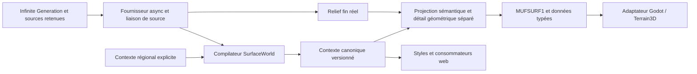

# SurfaceWorld — état de l'implémentation

État documentaire du 23 octobre 2026, code intégré jusqu'à `b4a52b0`. Le détail
géométrique, le scénario géologique, les styles et l'hydrologie fixe sont raccordés.
**La campagne technique V5 passe ; la phase 6 n'est pas acceptée visuellement.**
Le contrat TS 1.5 sépare maintenant sol, couvert bas et arbres ; son raccordement
natif est encore en cours à ce snapshot documentaire. V5 qualifie le code 1.4
figé `f6a45af`, pas ces nouvelles couches. Les rapports de revue initiaux sont conservés sans modifier
leur verdict. Ce document distingue le code disponible, les preuves exécutées et
les qualifications qui restent à faire.

## Produit et choix du moteur

Magna Urbis produit des villes et des cartes/plans de JDR en 2D et 3D. Les styles,
la hiérarchie des routes, les silhouettes, les matières urbaines, les étiquettes,
la projection orthographique et l'export font partie du résultat final. La vue
aérienne physique est une présentation parmi celles à qualifier.

**Godot/Terrain3D est candidat au moteur principal de rendu.** Son implémentation
locale permet d'évaluer ce choix ; son rang final dépendra de la qualité des cartes,
des styles, des plans, des exports et de l'intégration, en plus des performances.
Le contrat n'impose aucun moteur. Les renderers web et leurs styles restent
disponibles pendant cette qualification. Le partage des palettes ne reproduit pas
encore tous les coups de brosse, labels, effets d'encre ou compositions finales des
renderers existants. Aucune parité artistique complète n'est revendiquée.

Infinite Generation reste le fournisseur des vraies hauteurs et du détail à la
demande. Godot ne devient pas un générateur de relief. Une erreur du décodeur
conserve le parent valide et son diagnostic ; aucun bruit de remplacement n'est
présenté comme une nouvelle génération source. 40 km est une emprise de validation,
pas une limite du fournisseur. Une caméra à 5 mm/px ne prouve pas une résolution
physique de 5 mm : `sourceLOD`, `nativeSpacingM`, pas de grille et empreinte écran
sont rapportés séparément.

## Architecture livrée



| Responsabilité | Code et contrat |
| --- | --- |
| Monde physique indépendant du moteur | `web/src/surface/model.ts`, mètres, repère main droite +X est / +Y haut / +Z sud, grilles à centres de cellules. |
| Compilation canonique | `compiler.ts` : morphologie multi-rayons, géologie explicite ou scénario granite déclaré, drainage source ou D8 déclaré, sols/dépôts/couverts, recettes matérielles et identités. |
| Étages physiques | `surfaceLayers.ts`, compilateur `surface-1.5.0` : paires et moyennes du sol nu et du couvert bas, opacité basse, arbres/couronnes indépendants ; neuf arrays et 28 octets supplémentaires par échantillon, disponibilité legacy explicite. |
| Raffinement | `retargetSurfaceWorld` conserve le contexte canonique et ses catégories ; il projette les continus sémantiquement, renormalise les fractions et conserve les métadonnées du vrai relief fin. |
| Source | `provider.ts`, `adapters/infiniteRefinement.ts`, `registrationBinding.ts` : requête emprise/pas, annulation, snapshot des contrôles retenus, empreinte de contenu non cryptographique, versions et emprise strictes. |
| Contexte régional | `adapters/neuralEarth.ts`, `regionalCompiler.ts`, `geologyScenario.ts` : géoréférence, unités et provenance explicites ; aucun substrat déduit du seul climat. |
| Géométrie locale | `geometryDetail.ts` et `surface_geometry_detail.gd` : pente/normales/appui issus des vraies hauteurs au support physique déclaré ; contexte, scénario et source liés ; couche d'exposition conditionnée par les sols, l'eau et l'occupation. |
| Populations | `population.ts`, `treeCanopy.ts`, `candidateColumns.ts` : cellules monde, IDs/rangs/variantes stables, acceptation indépendante de la saison, budgets de calcul et transport typé. |
| Ville et occupation | `adapters/magnaUrban.ts`, `urbanColumns.ts`, `occupation.ts` : même schéma export/live, IDs, volumes et matériaux source, empreintes/trous/niveaux, emprises de voirie et exclusions. |
| Présentation | `presentation.ts`, `web/src/render/terrainStyle.ts` et palettes exportées : choix de style séparé des champs physiques, espaces CSS/sRGB/linéaire explicités. |
| Transport | `binary.ts`, `packet.ts`, `sourceArchive.ts` : manifeste MUFSURF1 + tableaux little-endian typés, validation, archives source ; JSON réservé aux petites fixtures. |
| Calcul navigateur | `workerClient.ts`, `workerProcessor.ts`, `surfaceCompiler.worker.ts`, `surfaceExport.worker.ts` : contexte durable, epochs source/scène, export annulable, transfert d'ArrayBuffer. |
| Scène native | `viewer-local/adapters/*`, `scene/main.gd`, shaders : repère relatif, noyau source respecté, régions/objets/eau/ville bornés, caches et préparation sur thread. Les transferts GPU restent mesurés séparément. |

`sourceLOD` est une étiquette opaque propre au fournisseur ; les niveaux plus fins
peuvent être négatifs. Seul `nativeSpacingM` compare l'échelle physique. Un ancien
`.decor` ne contenant pas de LOD reste `sourceLODKnown=false`. Les échantillons de
capture bilinéaires ne sont jamais requalifiés silencieusement en coefficients
B-spline. `registrationParent` fournit une copie des vrais contrôles enregistrés,
avec le noyau `cubic-bspline-controls` et l'identité de source courante.

La demande native traverse le broker local, sa session SSE, le fournisseur du
navigateur, le worker de compilation puis la réponse binaire. Le navigateur reste
ouvert ; aucun exportJSON n'est échangé manuellement pendant ce trajet. Les
handshakes `knownContextId` et `knownSceneContextId` évitent de répéter les gros
contextes et la ville. Les éditions de routes, placements, climat ou bâtiments
font évoluer les epochs ; un ancien résultat ne peut devenir celui du nouveau
monde. La coalescence conserve le premier contexte en construction et le dernier
job utile ; un délai d'annulation borné permet ensuite de terminer le worker.

Les paquets binaires sont envoyés par le navigateur en blocs de 4 Mio, avec
offset/total, session et accusés de réception stricts. Le broker n'émet le paquet
vers Godot qu'une fois tous les octets contigus reçus, avec `Content-Length`.
Cela évite les blocs HTTP supérieurs à 16 Mio refusés par Godot et les chaînes CDP
géantes quand un navigateur est inspecté. Une annulation détruit la transaction ;
un bloc tardif ne la recrée pas. Le contenu MUFSURF1 reste inchangé.

## Hydrologie de la carte fixe

**Le réseau de Magna Urbis fait autorité.** Classes, niveaux, identifiants,
largeurs et contours conservés restent archivés ; D8 sert aux diagnostics de sol
quand la capture ne possède pas de graphe, sans créer de rivières à leur place.
Godot reprend les polygones de lacs/rivières et leurs îlots. La mer utilise encore
l'union des cellules marines source. Les niveaux affichés sont interpolés depuis
les seules cellules humides mesurées ; les triangles sans niveau sont omis et
comptabilisés, sans inventer de cote. Le mode aérien coupe l'eau contre le vrai lit.

Les contours simples passent par la triangulation native bornée ; les groupes
multi-contours utilisent un balayage pair/impair à arêtes actives en coordonnées
locales. Les doublons stricts sont retirés de l'affichage, sans modifier les données
source. Le vrai cas de 40 km produit 719 184 sommets, aucun niveau manquant et
environ 2,8 s de préparation de cette géométrie seule. Les diagnostics déclarent
le budget, le fallback éventuel et les surfaces manquantes.

La capture comporte 26 anneaux invalides : les conventions de remplissage du
balayage diffèrent d'une réparation GEOS indépendante d'environ 106 m² sur
48 millions de m². L'écart supplémentaire dû aux sommets GPU est de 4,77 m².
Aucune équivalence topologique parfaite avec GEOS n'est revendiquée. Les couleurs
de mer, lac et rivière utilisent des classes catégorielles séparées du masque de
couverture. Les routes projetées et les objets cartographiques utilisent les
palettes existantes ; les contours de route restent contenus dans la largeur
source. Les vagues périodiques d'albédo qui formaient un damier ont été retirées.

## Ce qui répond à « où / quoi », et ses limites

Le contexte canonique fixe le climat, la roche, les fractions minérales, le
drainage, la provenance et les couverts indépendamment de la caméra. Le compiler
normalise sable+limon+argile ; l'organique est distinct. Les dépôts alluviaux
prennent leur mélange dans la provenance transportée du premier chenal aval ;
cette provenance reste séparée du dépôt local. Le transport gravitaire garde sa
source rocheuse. Ce sont des potentiels de synthèse, pas un bilan sédimentaire
conservatif ni une classification pédologique calibrée.

Sans carte lithologique, le défaut reste un granite uniforme **explicitement
déclaré**. `tilted-strata-v1` est une option d'auteur : plans inclinés, épaisseurs
normales aux lits, socle granite, catalogue et provenance complets. Le même
descripteur monde est conservé au zoom. Cette démonstration n'est pas une géologie
observée, ni une modification du relief. Voir
[le scénario et le détail géométrique](../SURFACE_GEOLOGY_AND_GEOMETRY_DETAIL.md).

Un contexte à 78 m ne peut pas localiser une berge à 2 m ou une petite lentille
alluviale. Le détail géométrique réel peut contraindre pente, normale, exposition
rocheuse et appui d'un arbre sans refaire les sols ou D8 par patch caméra. Le veto
d'appui ne retire un arbre visuel que sur une pente source extrême supérieure à 65°
avec support physique complet ; il ne change pas l'inventaire canonique ni son
seed. Les bords inconnus ne sont pas des falaises devinées. Les prochaines étapes
physiques exigent des contacts/rives/emprises canoniques plus précis et un réseau
de bassin explicite, puis des recettes submaille stables ou une révision déclarée
du contexte. Une nouvelle texture ne fournit pas cette information.

La séparation demandée entre **sol, herbes et arbres** est une séparation de
données et de représentation. Le sol inclut roche, dépôts et humus ; la litière
morte et les plantes basses ont une couche propre ; les couronnes sont un étage
superposé. Les fractions de ces trois étages ne forment pas une partition
globale. Le composite `material*` historique est conservé pour compatibilité,
mais n'est plus appelé « sol nu ». Un ancien paquet ne permet pas de récupérer
ce sol par soustraction de son top2. Voir le
[contrat, les invariants et les limites](../SURFACE_RENDER_LAYERS.md).

Orogen expose un vrai graphe et des couches climatiques, mais aucun catalogue de
lithologie dans les sorties auditées. L'importateur exige donc une géologie
catégorielle indépendante. Les températures sont converties depuis la convention
amont et ne reçoivent pas une seconde correction d'altitude ; les deux pluies
demi-annuelles sont additionnées. Le système de coordonnées métrique procédural
équirectangulaire conserve ses limites géographiques. Voir
[l'audit et les commandes régionales](../SURFACE_REGIONAL_IMPORT.md).

Les15 familles ont des recettes exécutables et des conditions de source. Les motifs
ne construisent aucune dune, falaise, vallée glaciaire, cheminée volcanique ou
géométrie karstique absente du fournisseur. Les couverts et les variations
saisonnières sont des couches distinctes. La réponse moyenne des matériaux et la
couverture des couronnes ont des probes ; cela ne démontre ni photoréalisme,
ni invariance photométrique des ombres, ni60 FPS durant chaque remplacement.

## Revues 1–5 : verdicts initiaux et corrections

Les cinq revues Opus 5.5 sont des lectures statiques : le reviewer n'a exécuté
ni tests ni benchmarks. Tous les verdicts initiaux sont **CHANGES REQUIRED**.
Les corrections ci-dessous décrivent ce qui a été livré après ces rapports ;
elles ne réécrivent pas un verdict en acceptation finale.

| Revue initiale | Défauts principaux | Corrections livrées et limites de validation |
| --- | --- | --- |
| [Phase1](reviews/phase01.md) | Géoréférence miroir, offsets ville/terrain, niveaux secs, climat divergent, file source non annulable. | Repère et centres explicités, rotation east/north testée, translations communes/taguées, NaN sec, règles climatiques Magna partagées, fournisseur dédié annulable, LOD opaque et métadonnées strictes. La revue 5 a confirmé les deux bloqueurs corrigés, puis relevé les écarts live/export suivants. |
| [Phase2](reviews/phase02.md) | Provenance alluviale locale incorrecte et mélange transporté écrasé ; identités drainage/catalogue incomplètes ; JSON trop grand. | Premier chenal aval, `transportedProvenance` séparée, versions dépendantes des vraies hauteurs et IDs ordonnés des recettes, conteneur binaire et gardeJSON. HANDinconnu NaN, TPI plan neutre et confiance de bord, seuils physiques, neigeoverlay, hydration stricte et budgets avant allocation. Les processus restent heuristiques et les bassins tronqués sont signalés. |
| [Phase3](reviews/phase03.md) | Grille d'affichage flottante au pan, UV décalées, winding/depth, coûts non bornés, résultats périmés. | Alignement source, UV à centres, conversion unique du winding, repère relatif et phases canoniques, near/far ajustés, packets binaires et validation, travail CPU déplacé et caches bornés. La revue 4 a confirmé plusieurs corrections, tout en gardant coûts d'upload et mouvement à qualifier. |
| [Phase4](reviews/phase04.md) | Moyenne d'albédo fausse, doublecompte canopy/instances, noyau de hauteur incorrect ; normales et dérivées shader. | Textures/mips linéaires, normalisation centrée bornée, recette liée au catalogue, probes GPU de moyenne/normales ; atlas des vraies couronnes et résidu de transmittance commun aux instances ; contrôles B-spline exacts, parents et raccords de source, géométrie native bornée. Les probes isolés ne certifient pas encore la tournée complète ni les ombres en mouvement. |
| [Phase5](reviews/phase05.md) | Ville/candidats dans un manifesteJSON trop gros ; schémas divergents ; cache détruit au superseding ; liaison source forcée vraie ; éditions et exportUI synchrones. | Colonnes candidates/urbaines, builder commun, handshake scène/contexte, coalescence durable, fingerprint exact des contrôles enregistrés et régions strictes, epochs scène/source, worker d'export annulable. Bornes mémoire harmonisées, métadonnées/packets validés, même origine pour eau/ville. Tests burst, vraie ville500 bâtiments et requêtesHTTP ont été exécutés séparément. La tournée native complète reste à exécuter. |

Les chiffres historiques de remplacement de région de 65–172 ms expliquent pourquoi
un affichage chaud proche de16,7 ms ne peut pas être présenté comme60 FPS durant les
mises à jour. Le code réduit les travaux sur le thread de frame ; son coût actuel
doit être mesuré après intégration, pendant une navigation continue.

La revue 6 statique ultérieure a conservé **CHANGES REQUIRED**. Le premier vrai
E2E 40 km a échoué avant sa première réponse native : réponse HTTP sans longueur
explicite au-delà du chunk 16 MiB accepté par Godot, et upload navigateur observé
par CDP trop volumineux pour une chaîne V8. Le parent et l'erreur ont été conservés,
sans succès de repli revendiqué. Les corrections de transport emploient une
longueur de réponse et une transaction de chunks 4 MiB acquittés. Les 4 tests client
et un vrai transfert Playwright/HTTP1 de 96 MiB en 24 chunks sont passés : SHA256 exact,
corps CDP maximal 4 MiB, 4,10 s sur ce probe. Ce sont des preuves de transport, pas
une nouvelle qualification du renderer ou du générateur.

Les autres corrections demandées par cette revue concernent la preuve d'affichage
live pendant le mouvement, la liaison au contenu exact du monde chargé et le
repère des exports crop. Le benchmark demande maintenant une application réelle
`terrain-replaced` pendant les entrées, liée par worldId/serial/epochs à une
acceptation fraîche, avec sourceLOD connu ; un paquet seulement accepté ne suffit
plus. Une nouvelle campagne complète doit suivre l'intégration et le nouveau gel.

La tentativeV2 a confirmé les chunks acquittés sans crashCDP, mais la première
capture native montrait encore le parent (LOD inconnu, serial−1) après un HTTP0.
Elle a été arrêtée et marquéeFAILED, sans dérouler des paliers de repli. Le client
natif lisait la réponse de121,21Mo avec la configuration par frame et un timeout
total120s. Le correctif met la lecture HTTPsur thread, des blocs1MiB et une borne
explicite300s. Le replay headless du vrai paquet sauvegardé62 241 233octets a passé
en214ms avec SHA256exact ; il ne mesure ni la génération ni la scèneGPU. La preuve
d'affichage exige aussi le focus dans le patch, une contribution fine dominante
supérieure à0,5 et l'accord des métadonnées du tile avec la source effective au focus.

La tentative V3 a parcouru les sept échelles sans erreur de transport, mais elle
reste **échouée** : aucun nouveau détail live n'a été affiché pendant les 20 s de
mouvement. Une régression d'optimisation a aussi invalidé le placement des petites
images dans Terrain3D : un début à −128 échantillons sur des régions de 256 est
arrondi par l'addon. Les hauteurs CPU identiques ne suffisaient pas à le détecter.
Le minimum d'image de 512 est rétabli ; le probe natif importe un plan puis interroge
les hauteurs réellement stockées. Les cinq contrôles du cas 512 aligné donnent
une erreur nulle ; le cas 256 décalé reproduit bien l'erreur. Aucun résultat de
préparation « une région » de V3 ne qualifie la géométrie.

L'addon épinglé impose également un espacement de sommets de 0,25 à 100 m. La
préparation conserve cette borne, y compris en prévisualisation. L'optimisation
conservée déroule le même noyau B-spline en arithmétique double et évite une
recherche de parents hors domaine ; 4 048 contrôles et 4 030 comparaisons du chemin
typé/générique donnent des hauteurs identiques. Les gains CPU ne démontrent pas
la fluidité de la navigation. Une nouvelle campagne sur le correctif intégré
reste nécessaire.

Les corrections de liaison calculent maintenant l'empreinte des véritables
hauteurs chargées côté natif avant de recevoir un autre monde ; une simple
affirmation du navigateur ne suffit plus. Les exports crop/translation déclarent
leurs repères et conservent l'ancrage géologique. Un crop n'est pas accepté comme
racine d'une session live couvrant le monde entier.

## Registre des preuves exécutées

Les gros binaires, captures et rapports restent dans `web/out/` ou les captures
locales ignorées de chaque worktree. Ils ne sont pas des fixtures implicitement
disponibles dans un clone frais. Les scripts et petites fixtures nécessaires sont
versionnés ; la provenance ci-dessous indique la portée exacte de chaque preuve.

| Producteur / rapport local | Ce qui a été observé | Ce qui n'est pas prouvé |
| --- | --- | --- |
| Intégration : `web/out/surface/benchmark-1024-reviewed.json` | Benchmark synthétique explicite1024² : compile 5,253 s, encode 34,7 ms, decode 47,5 ms,170 933 312 octets, roundtrip byte-exact, pic RSS ≈615 Mo sur ce snapshot historique. | Ce n'est ni une vraie génération ni une mesure actuelle de toutes les dernières couches/identités. |
| Intégration : `web/out/surface/ui-burst-reviewed/report.json` | Vrai navigateur, export annulable, raffinement HTTP d'une capture retenue et burst ; contexte construit une fois, requêtes périmées distinguées. | `decoderUsed=false` pour cette ancienne capture ; aucune preuve d'inférence neurale fraîche ou de FPSnatifs. |
| Intégration : `web/out/surface/native-e2e-40km/report.json` (premier essai) | Nouvelle source teacher réelle et export réussis ; parcours natif échoué sur un bloc HTTP >16 Mio et une limite CDP. L'échec et sa provenance sont conservés. | Ce premier essai ne valide pas la tournée native. Le framing et les uploads bornés ont ensuite été corrigés ; une nouvelle campagne est nécessaire. |
| Modèle : `web/out/surface/driver-upload-probe/bounded-upload-report.json` | Vrai navigateur et HTTP/1 : 96 Mio en 24 POST, 4 Mio maximum par corps et enregistrement CDP, SHA256 exact. | Fixture de transport, pas une génération ni un rendu natif. |
| Modèle : `web/out/surface/real40km/teacher/report.json` | Source neuve40×40km, modèles `coarse4/original/original`, token conservé, vrai Python CUDA ; raffinement40 m / 64², pas demandé 0,625 m, sourceLOD −6, pas source 0,46875 m, `decoderUsed=true`. | Ce rapport ne couvre pas encore le parcours natif complet40 km →10 m. |
| Modèle : même dossier, `fresh-neural-heightfield.f32` et `raw-neural-1024.surfacebin` |1024² hauteurs brutes au pas 39,0625 m avant la reconstruction/hydrologie Magna, SHA256 `97e330f001aca1ccc6a1adb8dd884dc2ff40d412bf6235133dbf4d3403b68694`, copie exacte vérifiée. Un extrait8² est committé avec sa provenance. | Le contexte de stress compilé sur ce brut n'est pas présenté comme l'hydrologie retenue de la ville. |
| Modèle : `web/out/surface/real40km/report.json` | Le défaut student64 a échoué explicitement avec «Non-finite decoder student output» ; la source et l'erreur ont été conservées. | Le succès du teacher choisi explicitement ne répare ni ne masque ce défaut student64. |
| Adaptateurs : `web/out/surface/real-native-500-cap-benchmark.json` |500 bâtiments natifs inchangés sélectionnés dans 6 683 plans ;18 390 triangles,39 matériaux, schéma réversible ; stress de transport 100 000candidats, manifeste≈4 Mo. | Le stress 100 000est un input de transport, pas 100 000 objets générés ni un test FPS. Les trous sont exercés par un test de codec séparé. |
| Adaptateurs : `web/out/surface/real-native-500-live-benchmark.json` | Deux vrais appels HTTP8893 +worker,500 bâtiments conservés, contexte construit une fois, second paquet sans ville/contexte répétés. Corrélation parent≈0,99866 contre≈0,26064 transposée ; lissage et résidu séparés. | Source retenue `decoderUsed=false`, pas une nouvelle source neurale ; timings CPU/transport, pas rendu GPU. |
| Viewer : `viewer-local/captures/material-mean-forward.json`, `carto-decal/result.json` | Probes de production sous Forward+ : erreur maximale de moyenne linéaire annoncée 0,154 %, rebase ≤1 niveau 8 bits ; normales tournées0/90/180/270° ; couleurs CSSroutes et sol déformé testés. | Contrôles isolés, matériels/backends propres aux rapports ; aucune extrapolation à toutes les scènes, ombres ou configurations. |
| Modèle : `web/out/surface/canopy-probe/report.json` | Vrai GPU Godot4.7.2/OpenGL RTX5090 : couverture de couronnes chevauchantes +arbre exclu du budget, sept empreintes ; erreur absolue maximale 1,72 point. Tests translation 20 Mm et cache/mask inclus. | Petite fixture de couverture non photométrique ; pas toute la forêt régionale ni une qualification temporelle des ombres. |
| Modèle : `web/out/surface/orogen-proof/report.json` | Vrai pipeline Orogen original lu sans modification,20 001 régions ; graphe SHA256 `dbd86d036a22633992a8532ab0069beb2f609238c4c40e32c32ec984d5478829`, crop régional et import binaire réussis. | La géologie utilisée pour cette preuve était un scénario granite de test explicitement séparé ; Orogen n'a fourni aucune lithologie. |
| Modèle : `web/out/surface/http-io-proof/report.json`, `source.json` | Replay du vrai paquetV2 de62 241 233octets via HTTP1 `Content-Length`, Godot headless threadé/blocs1MiB/timeout300s :214ms, résultat0/HTTP200, SHA256 `d01c01e79d7f8d99c68f1885ebb6ae61b0a92de66f172398c77afc0488588e95` exact. | Contrôle du transport seul, sans nouvelle inférence, renduGPU ni preuve de fluidité en scène. |

## Commandes reproductibles

Depuis `web/`, avec les dépendances du projet et un exécutable Godot4.7.2 épinglé :

```powershell
npx vitest run tests/surfaceWorld.test.ts tests/surfaceRetarget.test.ts tests/surfaceWorker.test.ts tests/surfaceRegistration.test.ts
npx vitest run tests/surface.geometry-detail.test.ts tests/surface.geometry-detail-boundary.test.ts tests/surface.geology-scenario.test.ts tests/surface.regional.test.ts
npx tsx scripts/benchmark_surface.ts --size 1024 --out out/surface/benchmark-current.json
npx tsx scripts/export_surface_world.ts INPUT.decor OUTPUT.surfacebin --format binary
node scripts/surface_assets.mjs
node scripts/surface_viewer.mjs --godot $env:GODOT --world OUTPUT.surfacebin --assets C:/data/resolved.json --presentation aerial
node scripts/surface_viewer.mjs --godot $env:GODOT --world OUTPUT.surfacebin --presentation cartographic --style blueprint --top
```

Les options d'assets sont définies par `surface_assets.mjs` et le catalogue local ;
le téléchargement est une préparation hors boucle de rendu. Les probes GPU du
[README natif](../../viewer-local/README.md) se lancent avec le backend indiqué
dans leur rapport ; `canopy_probe.gd` requiert un vrai renderer, sans `--headless`.

La réexécution corrigée ci-dessous est **préparée, pas encore qualifiée**.
Le serveurVite et le servicePython doivent déjà être actifs. Garder le même
snapshot pendant la génération et le parcours évite les rechargements de code :

```powershell
node --import tsx scripts/generate_surface_source.mjs --url http://127.0.0.1:5197 --neural http://127.0.0.1:8893 --width 40000 --seed surface-native-e2e-40km --decoder-model original --geology-scenario tilted-strata-v1 --out out/surface/native-e2e-40km --viewer-godot $env:GODOT --viewer-assets C:/data/resolved.json --viewer-resolution 2048x1280
```

`--viewer-launcher` permet de choisir explicitement le launcher du worktree
d'intégration. Le driver conserve le navigateur et sa session pendant toute la
tournée native, collecte les septPNG, les logs et métriques, et contrôle les
échanges broker→worker→Python, les versions et le descriptor géologique fixe.
Il refuse le statut complet si une étape manque, si la source est régénérée, si le
contexte change au zoom, si le renderer signale une erreur ou si10 m ne donne pas
au plus5 mm/px. Les deltas bruts fin/parent sont enregistrés avant le feather du
viewer : ce ne sont pas une mesure directe d'une couture affichée.

La navigation continue dispose du benchmark externe
`viewer-local/diagnostics/navigation_probe.gd`. La tentative V3 a échoué : aucun
nouveau monde live n'a été affiché pendant les 20 secondes de mouvement. Les
sept captures par paliers ont passé leurs contrôles de provenance CPU, mais un
défaut d'alignement de l'import Terrain3D découvert ensuite interdit de les
qualifier comme preuve physique du rendu. Les artefacts V1, V2 et V3 restent des
campagnes échouées ; leur présence ne constitue pas une acceptation visuelle.
Ajouter `--viewer-navigation-seconds 20` au driver lance ce second
processus après la tournée, en gardant le même navigateur/session ouverts. Il
injecte de vrais événements molette et glisser à20Hz, mesure les applications de
géométrie et de source pendant le mouvement, puis attend le drain final. Un
résultat qui n'applique aucun détail live pendant les entrées est un échec, même
si le parent reste affiché. Le rapport sépare les annulations attendues des erreurs.
Une tournée par paliers n'en tient pas lieu. La prochaine campagne doit afficher
pendant ces mêmes 20 secondes au moins un monde distinct du warmup, issu d'une
requête interactive explicite `preview:true,resolution:128`, accepté puis réellement
appliqué pendant le mouvement. Après arrêt, le drain et les sept captures exigent
la qualité finale demandée `preview:false,resolution:512`. Ces nombres décrivent
la requête : la grille effectivement fournie et `nativeSpacingM` restent les
mesures de la source, y compris lorsque sa limite physique borne la résolution.
Le mode interactif change le coût de préparation, sans recréer le relief, les
classes canoniques, le scénario géologique ni l'inventaire des candidats.

Une source finale déjà présente peut satisfaire une vue plus petite si son
emprise et sa densité la couvrent. Ce cache doit être prouvé par les champs de
satisfaction de la vue ; il ne compte jamais comme nouvelle acceptation ni
comme nouveau monde affiché. Le serial réel du paquet peut donc rester identique
entre deux captures. La satisfaction des caméras successives doit progresser et
les captures restent reliées au paquet final réellement rendu. Cette politique
est en cours d'intégration et n'est pas encore validée par une nouvelle campagne.
Restent à mesurer : applications pendant
les entrées continues, âge des résultats, files d'attente/annulations, retour sur
site après éviction, p95/p99 et pics d'upload/RAM/VRAM, avec routes/eau/ville/couvert
et les styles cartographiques choisis.

## BacklogB01–B28

«Implémenté» signifie code et tests disponibles, pas acceptation visuelle globale.
«Prototype» ou «Partiel» indique une capacité démontrée sous limites explicites.

| ID | État au snapshot | Reste nécessaire pour le critère du design |
| --- | --- | --- |
| B01 | Implémenté : sources/snapshots, vraies captures et provenance archivées. | Compléter le manifeste final avec le snapshot exact de la campagne finale. |
| B02 | Implémenté : fournisseur neutre, emprises/centres, annulation, eau/occupation/ville et liaison de contrôles. | Qualifier le parcours natif complet avec la source fraîche. |
| B03 | Prototype Godot/Terrain3D et vrais imports40km ; parent/noyaux/précision instrumentés. | Navigation continue et tournée finale, vidéo, décision moteur fondée aussi sur styles/plans/export. |
| B04 | Prototype PBR réel, eau, objets bornés, éclairage et métriquesGPU. | Qualité de la scène complète et budgets pendant les remplacements. |
| B05 | Implémenté : contrat moteur-neutre, versions/provenance, sampling, hydration et binaire. | Revue finale du schéma intégré et de ses frontières. |
| B06 | Implémenté : pente/courbure/TPI multi-rayons et confiance de bord. | Comparaisons terrain documentées ; ce n'est pas un classifieur geomorphon complet. |
| B07 | Prototype explicite : carte de roche ou strates d'auteur, plusieurs substrats sur vrai extrait neural. | Démonstration intégrée à grande échelle ; géologie observée facultative mais clairement distincte des scénarios. |
| B08 | Partiel : graphe fourni ou D8, aire, HAND, inflows et niveaux. | Rives fines et bassin source complet ; diagnostiquer les limites extérieures sur un vrai cas. |
| B09 | Partiel : gravitaire/alluvial avec sources distinctes et tests headwater/floodplain. | Versant/vallée réels complets et diagnostic fragments→sources ; aucun bilan matière certifié. |
| B10 | Partiel : climat physique, fractions minérales renormalisées, organique distinct et sols heuristiques. | Calibration/validation crête-versant-creux et géométries submaille pertinentes. |
| B11 | Implémenté : catalogue extensible et15 jeux PBR normalisés, échelles/provenance/fallback explicites. | Couverture artistique de toutes les scènes et contrôle des assets sur leurs usages réels. |
| B12 | Partiel : recettes conditionnées, top2+blend, moyenne canonique et motifs orientés. | Organisation mésoscopique plus précise que les cellules de contexte ; diagnostic intégré roche/sol/dépôts. |
| B13 | Implémenté : inventaire stable, colonnes, budgets/rangs et sélection bornée. | Objets proches de qualité et validation temporelle dans la scène. |
| B14 | Partiel : couronnes calibrées, transmittance/residual commun, masque d'appui séparé. | Canopy/ombres/couleurs sur navigation réelle et couverts hétérogènes ; forêt photographique non livrée. |
| B15 | Partiel : filtrage linéaire, moyenne PBRGPU, classes/poids communs et rebase. | Mesurer aliasing/popping/continuité lumineuse sur trajectoires, pas seulement probes. |
| B16 | Partiel : scène linéaire et styles cartographiques distincts, eau source explicite. | Plusieurs éclairages, rives mobiles compatibles et ombres de toute la scène. |
| B17 | En cours : captures/profils réels séparés ; première tentative E2E échouée, revue 6 exigeant des corrections. | Réussir la campagne finale 40 km →10 m et le mouvement continu ; faire recontrôler les corrections. |
| B18 | Prototype : vrai importOrogen/NeuralEarth métrique, unités/lapse/provenance ; géologie externe exigée. | Intégration d'un paquet géologique régional réel et confrontation aux scènes. |
| B19 | Partiel : matériaux/coastmasks/eau et provenance de dépôt déclarés. | Deux côtes qualifiées, bancs/marais géométriques, fond/turbidité/flux. |
| B20 | Partiel : occupation, exclusions, routes et ville native/style source conservés. | Scène rurale complète : champs/cours/haies et contacts d'appui validés. |
| B21 | Partiel : état saisonnier/neige/humidité séparé du substrat et des IDs. | Phénologie/rétention/ombres et supports saisonniers validés visuellement. |
| B22 | Prototype : parents et noyaux réels, détail local de pente/appui et scène bornée. | Géométrie proche complémentaire, picking, coutures et appuis qualifiés en oblique. |
| B23 | Partiel : cache canonique durable, epochs/annulation/coalescence et budgets. | Retour après éviction/édition et absence de famine sous mouvement continu. |
| B24 | Recettes et masques déclarés disponibles ; pas de générateurs morphologiques complets. | Exemples réels et géométries nécessaires pour chaque famille spécialisée. |
| B25 | Non livré : les dépôts restent des potentiels de synthèse. | Transport et bilan matière explicites. |
| B26 | Partiel : catalogue/liaisonsID/ingestion d'assets extensibles. | Variantes nombreuses, calibration et outils d'auteur sans modifier le shader par cas. |
| B27 | Partiel : échange régional et contrats/styles partagés. | Adaptateur de rendu/sauvegarde intégré dans NeuralEarth et qualification des projections. |
| B28 | Non engagé : aucun asset neuronal créé pour masquer un besoin non établi. | Générer hors ligne seulement les manques identifiés, avec cartes/provenance et validation. |

La décision d'adopter Godot comme moteur principal reste ouverte à cette date.
Elle doit s'appuyer sur les cartes/plans et leurs styles/export autant que sur la
surface aérienne, et sur la campagne finale plutôt que sur une capture isolée.
