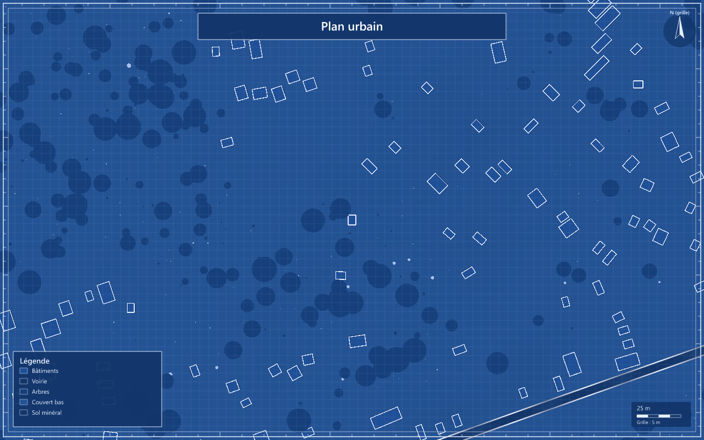

# CITY419 V14 — vues natives et compositions de carte

Les trois captures retenues et les deux compositions sont terminées sur le runtime gelé `763081706cb199c1e7a157d5e2de3c49d38f1aa1`. Les snapshots propres avant/après sont identiques : **945 empreintes de code/runtime**. Le profil `surface-v2` reste identique, avec **82 assets/exécutables** totalisant 274 146 927 octets ; leurs SHA256 ont été revérifiés en lecture seule. L’exécutable natif d’interpolation est épinglé à `1d2c1652ff6711c1a6c78677d3c6158bd497c93e1fad5a5609c952aef7a4f6ec`. La preuve épingle aussi le binaire Godot effectivement demandé.

La [preuve JSON](evidence/native-city419-v14.json) conserve les commandes, matrices, métriques, identités et empreintes des sorties originales de `ROOT/web/out/surface/native-current-419-v14-final/`. Les trois processus sortent avec le code 0, sans erreur de script ou shader. L’avertissement de dépréciation Terrain3D est conservé. Les loggers threaded v2 sont drainés, sans rejet. Aucun nouveau rendu, test lourd ou GPU n’a été lancé pour cet archivage.

## Source retenue, distincte de la campagne fraîche

Le paquet de **251 582 841 octets**, SHA256 `54616775da71a5fb94e32d1cce13b59cad38f79f410f04525be72bc14edf589e`, reste inchangé. Il contient **419 réalisations natives authentiques et 81 refus de planification conservés comme parcelles**, pour une occupation originale de 500 emprises. Ce n’est pas une nouvelle ville fraîche. Les anciens 500 plans non réalisés restent une preuve distincte.

Aux trois foyers, le terrain réellement utilisé est le parent retenu à **15,625 m**, avec LOD source inconnu et contribution du petit enfant raffiné nulle. Le sol est en génération legacy 1.5.3 : `groundResponse.available=false`. Ces images ne valident ni un nouveau GR ni une mise à jour fine. L’interpolation native f64 est effectivement utilisée, mais les pas d’images de 0,9765625 / 1,953125 / 31,25 m sont des résolutions de reconstruction pour l’affichage, pas de nouvelles observations du terrain.

| Vue | Cadre | Bâtiments natifs soumis | Proxy | Canopée |
| --- | --- | ---: | ---: | --- |
| Blueprint rapproché TOP | 400 m | 254 | 0 | Phase 2 ; assets arbres désactivés en carto |
| Aérien rapproché oblique | 600 m | 335 | 0 | Phase 2 ; 5 371 imposteurs, aucun arbre haute géométrie |
| Ensemble aérien TOP | 8 400 m | 419 | 0 | Phase 0 ; page exacte de 4 km insuffisante pour le cadre |

Les 15 groupes de matériaux sont soumis sans budget urbain atteint. Ces nombres sont des lots préparés, pas un comptage de visibilité ou d’occlusion GPU. En oblique, 1 411 centres d’arbres sont alpha-positifs dans le frustum ; les 5 371 imposteurs soumis ne sont donc pas 5 371 arbres visibles. Les transitions et atlas ne sont plus en attente au moment des captures. La voirie conserve 90 / 210 / 256 projecteurs selon les vues, avec plafond déclaré pour l’ensemble ; toutes les rues ne sont pas garanties visibles.

**Les trois `viewSatisfaction.covered` restent faux.** Les deux vues proches demandent une densité source plus fine ; l’ensemble demande une requête finale 512. Les captures sont prêtes côté image/scène, mais ne satisfont pas pour autant la qualité source finale hors ligne. Les niveaux et contours d’eau conservés restent inchangés ; les fenêtres affichées ont zéro triangle sans niveau et zéro aire vectorielle omise, avec projection source sur terrain et symbole explicite de 1,25 pixel.

## Cartes finales sur les vraies projections

La capture et les métriques portent la même `mapProjection`, liée au monde affiché et au SHA du PNG. La matrice caméra réelle est rebassée en float32 ; le compositeur soustrait l’origine de rendu conservée en float64 avant multiplication. La preuve contient les matrices TOP et perspective, sans caméra approximative reconstruite.

Le blueprint composé ajoute le titre explicitement fourni **« Plan urbain »**, un cadre et une police partagés, un nord de grille local, une barre de **25 m = 80 pixels**, une grille JDR de **5 m** et cinq entrées de légende : Bâtiments, Voirie, Arbres, Couvert bas, Sol minéral. La copie versionnée ci-dessus est exacte : SHA256 `c6ef6d7bc4656456c62c9e07a2ee2e5d85fe9aab1857fcd19f23fef6885fbc13`. Le raster natif embarqué reste `c69ecb23fc11944e7553908834b1fa934634869b9ef121ce8068e909fb0d2452`, sans recoloration ni régénération.

La composition oblique, **« Vue urbaine »**, utilise la vraie matrice perspective et comporte huit entrées de légende. Elle n’ajoute **aucune barre métrique uniforme, grille JDR ou flèche nord**. Les recettes et potentiels de cette légende proviennent du contexte canonique source entier ; ils ne certifient pas que chaque recette est visible dans les pixels de l’oblique. Dans les deux compositions, **zéro nom source est disponible et zéro toponyme ou POI est inventé**. Les qualifications, comptes et chemins restent dans les métadonnées ; les titres sont des textes de présentation explicitement fournis.

## Cache et limites

L’ordre est fixe : première vue avec cache PBR froid (0 hit, 15 misses, 15 écritures ; chargement 7 898,036 ms), puis oblique et ensemble avec cache chaud (15 hits, zéro miss ; 2 236,592 et 2 336,979 ms). `sourceChanged=0` partout. Ce constat n’est ni une comparaison causale isolée ni une mesure de FPS.

Cette preuve montre la compatibilité des volumes natifs et une composition de carte 2D/3D concrète, sans valoir acceptation artistique finale. Neuf palettes de surcouche ne qualifient pas quinze terrains entièrement restylés. Les pinceaux SVG, labels absents, occlusion d’annotations et drapé de textes en perspective ne sont pas reconstruits. Les polices système ne sont pas embarquées ; aucune identité pixel entre machines n’est promise. La campagne E2E fraîche V14 est séparée de ces captures retenues et n’est pas qualifiée par ce document.
