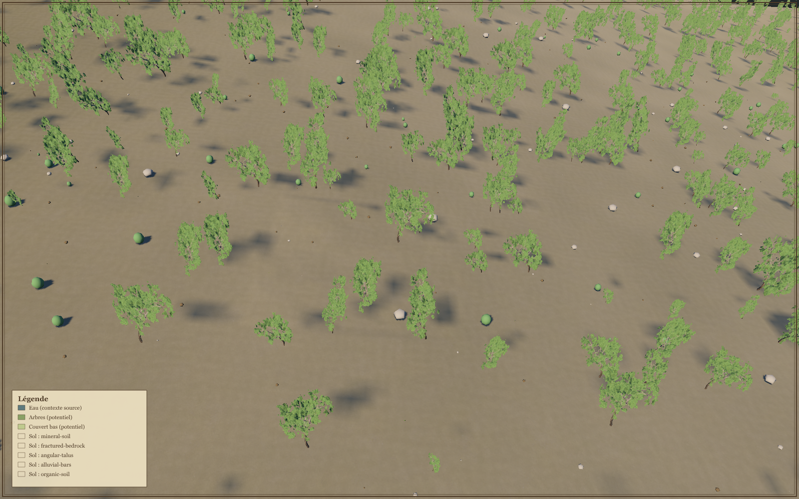

# V14 — contrôle intégré oblique retenu

Le contre-cas oblique V12 passe ce **contrôle d’intégration borné** sur ROOT `1eee770b21bcd4432ef53a96845e5a1729af7d1a`. Les snapshots avant/après sont identiques pour **935 fichiers**, avec état Git propre au moment de la capture. Aucun GPU n’a été relancé pour cette archive.

La source est le replay **legacy `surface-1.5.3`**, conservé depuis V12 : **75 105 689 octets**, SHA256 `e9646f0aadfc2d69cac78e64977389201ff8ef87360ff2f52f72bc37cb079d2c`. Son inventaire d’arbres de 4 km est explicite. Le petit enfant garde son détail natif 0,46875 m/grille 0,625 m ; le parent reste une reconstruction B-spline de contrôles espacés de 78,125 m. Il n’y a ni nouvelle génération ni nouveau raffinement demandé ici. Les potentiels GR sont absents : cette vue ne qualifie pas GR ni la correction artistique M2.

À la largeur de référence 160 m et en 1600 × 1000, le plan commun atlas/résident atteint la **phase 2**, raison `planned-source-support-plus-halo`. Le filtre actif a un rapport 3,8485, sous sa limite 8. Les **4 773 imposteurs** sont soumis ; **369 centres** satisfont frustum et ALPHA positif. Ce comptage ne mesure ni l’occlusion GPU ni l’aire des couronnes.

Le batch Rust ROOT, SHA256 `1d2c1652ff6711c1a6c78677d3c6158bd497c93e1fad5a5609c952aef7a4f6ec`, est effectivement utilisé pour le résident 4096² : **1406,936 ms** pour le batch complet, dont 369,2445 ms pour son calcul/digest. Le contrôle complet dure **37,276 s**, sort avec code 0 et sans erreur runtime. Un avertissement de dépréciation de l’interpolation physique est conservé dans la preuve.

Les quatre états de couches et le sol moyen non éclairé conservent les empreintes du contexte, du terrain/parent, du sol, de l’inventaire et des buffers. Masquer les arbres ramène leur visibilité et les centres ALPHA à zéro et coupe canopée résiduelle et ombre optique, sans modifier les instances soumises.

L’export composé est lié par empreintes à la source, aux métriques et au PNG natif, embarqué sans modification. Il conserve la **matrice de perspective réelle** et son origine rebasée ; `uniformMetricScale`, grille métrique et barre d’échelle sont absentes. La légende décrit le contexte/potentiel source, pas les quantités visibles dans la vue.

Ce résultat ne constitue pas une qualification photoréaliste, des optiques C/V exactes en oblique, d’une ville, d’un parcours frais complet ou de la QoS interactive. Il ne couvre ni les clasts ni le cache PBR ajoutés ultérieurement. La [preuve structurée](evidence/oblique-v14-gpu.json) conserve les paramètres, empreintes des rapports et cinq captures, avertissement, assertions de provenance et limites.
